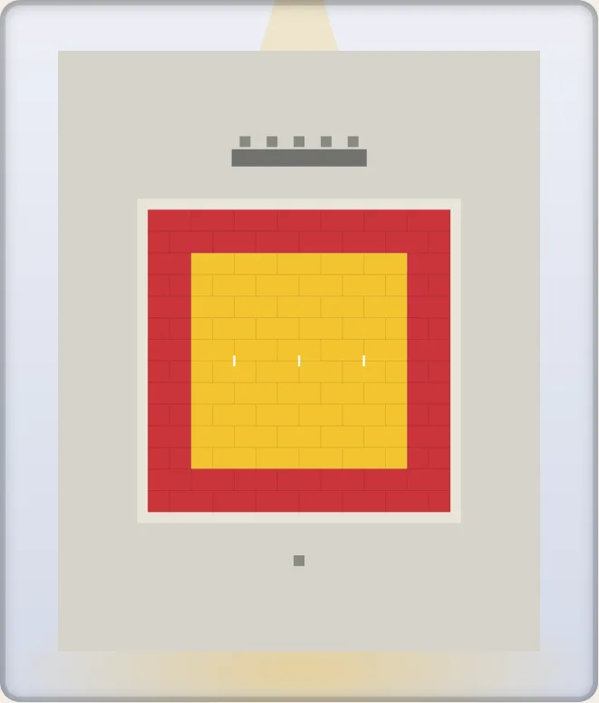
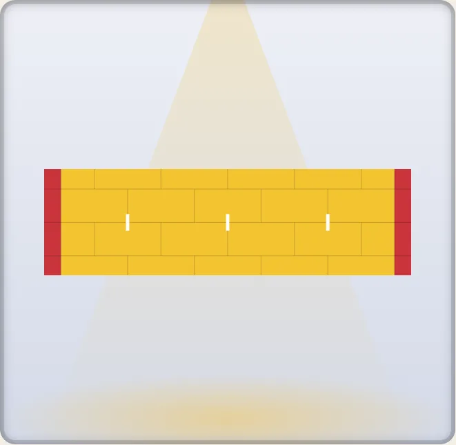

# The budō: judo, karate, kendo, sumo, kyūdō and the dojo

Six surfaces of the Japanese martial arts, drawn to scale from the federations' own rules: `sport: "judo"` (the IJF's and the All Japan Judo Federation's competition areas), `"karate"` (the WKF's kumite and kata areas), `"kendo"` (the shiai-jo), `"sumo"` (the dohyō), `"kyudo"` (the kyūdōjō, kinteki and enteki) and `"dojo"`, the builder: a floor of tatami laid as real units, with its walls, doors, windows, shrine and seat of honour. Five famous halls are on [the atlas](./atlas.md): the Kodokan, the Nippon Budokan, the Ryōgoku Kokugikan, the old Butokuden of Kyoto and the Budokwai of London.

```ts
import { drawKyogijo, RANGES } from "@johnmorrisdotca/kyogijo-stadiums";

const judo = drawKyogijo({ sport: "judo" });
const dohyo = drawKyogijo({ sport: "sumo", budo: { tassels: true } });
console.log(judo.includes('data-sport="judo"'), dohyo.includes("ky-bud-tassel-e"));
// true true
console.log(RANGES.judo.map((range) => range.id).join(", "), "|", RANGES.kyudo.map((range) => range.id).join(", "));
// contest-area, start, half | shajo, yamichi, azuchi
```

Every figure is a published fact, with its rule or its page in [Sources](./sources.md#judo-karate-kendo-sumo-kyudo-and-the-dojo); a figure no rule gives is marked **ours** there and in the code. The Japanese names are the federations' own where their rules have one, and are listed in [strings-ja.md](./strings-ja.md). Photographs were looked at as references and nothing from one is copied.

The options are `budo` (`BudoStyle`) for judo, karate, kendo, sumo and kyūdō, and `dojo` (`DojoSpec`) for the dojo; `league` picks the rulebook. A compass side (`north`, `south`, `east`, `west`) names a side of the plan as it lies wide; a tall drawing turns it a quarter, as every surface turns.

## Judo

`sport: "judo"`. The default is the IJF's competition area as it is laid for the Games, the Worlds and the Masters: a contest area of 10 m by 10 m in a safety area of 4 m, laid with tatami of 2 m by 1 m. `budo.size` (8 m to 10 m), `budo.safety` (3 m up), `budo.areas` (1 to 6, or `{ across, down }`), `budo.tatami` (`2x1`, `1x1`, `182x91`), `budo.platform`, `budo.officials` (the technical table), `budo.start` (the tape) and `budo.look` choose what is drawn.

| What | Figure | Rule |
| --- | --- | --- |
| The contest area | a square, 8 m to 10 m a side; 10 m at the Olympic Games, the World Championships and the Masters | IJF Sport and Organisation Rules (version of 21 January 2026) 8.7 |
| The safety area | at least 3 m; 4 m (common and exterior) at the Games, the Worlds and the Masters | 8.7 |
| Two areas side by side | a common safe zone may serve for the 4 m between them | 8.7 |
| The free zone | at least 50 cm round the whole competition area | 8.7 |
| The tatami | 1 m by 2 m by 5 cm of pressed foam; the contest area and the safety area in colours with enough contrast to show the edge | 8.7 |
| The official colours | yellow (Pantone 123 C) and red (1795 C) at World Judo Tour events; any other the organiser proposes the IJF must approve | 8.7 |
| The platform | at the Games, of wood, 1 m wider and longer than the tatami, the exterior safety area 4 m | 8.7 |
| The start tape | a blue and a white tape of 10 cm by 50 cm at the centre of the contest area, 4 m apart, the blue to the referee's right (the 2026 version no longer marks them) | SOR 2020, 18.1 |
| The referee | at the centre, 2 m back from the line the contestants start on, facing the technical table | Article 9 |
| The kata area | 10 m for the World Championships, 8 m for the other events; a safety area of at least 2 m between and round the areas; two white tapes of 5 cm by 50 cm, 3 m from the centre either side, and a tape of the same colour at the centre; five judges on the shomen side, 1.25 m apart | B1.8 and the judges' article (`budo.style: "kata"`, or `league: "ijf-kata"`; [below](#the-kata-area)) |

The tatami's colours are the IJF's yellow for the contest area and red for the safety area, which the rule does not say which is which; the other looks (`yellow-blue`, `blue-grey`, `green-beige`, `green-red`, `black-red`) are **ours**, not the rulebook's: the rule names only the two official colours and lets an organiser propose others. The AJJF's own guidebook shows a yellow contest area in a safety area of another colour and recommends the IJF's.

`league: "ajjf"` is the All Japan Judo Federation's layout, from its Tournament Management Guidebook 2023 (2-1, 2-3, 2-4): the tatami of 182 cm by 91 cm (the 200 by 100 cm of the IJF and the halves of both are also allowed), 5 or 6 cm thick; the red tatami of the danger zone, a tatami wide, inside the contest area, which the guidebook allows at events other than the Games, the Worlds and the Masters; and the red and the white tape 4 m (2 ken) apart. Mats of 91 cm do not divide 8 m or 3 m, so the sizes are made a whole number of mats: a contest area of 8.19 m in a safety area of 3.64 m.

```ts
import { budoPlan } from "@johnmorrisdotca/kyogijo-stadiums/budo";

const plan = budoPlan({ sport: "judo", budo: { areas: 2 } });
console.log(plan.judo?.contests.length, plan.judo?.gap, plan.box.x1, plan.box.y1);
// 2 4 32 18
const ajjf = budoPlan({ sport: "judo", league: "ajjf" });
console.log(ajjf.judo!.contests[0].x1 - ajjf.judo!.contests[0].x0, ajjf.judo!.danger);
// 8.19 0.91
```

### The kata area

`budo: { style: "kata" }` (or `league: "ijf-kata"`, which says the same) draws the IJF's kata area, from the Sport and Organisation Rules of 21 January 2026 (B1.8, the judges' article and B1.10), the Kata Commission's Tournament Handbook of 2024 and its Criteria for the Evaluation of January 2025. `style: "shiai"` is the contest area, and the default.



Close up, the line across the centre: the centre tape and the two starting tapes 3 m from it, each 5 cm by 50 cm.



| What | Figure | Source |
| --- | --- | --- |
| The area | 10 m by 10 m for the World Championships (drawn), 8 m by 8 m for other events; the Kata Commission Chair may change it | B1.8 |
| The safety area | at least 2 m between the areas and round them (drawn: 2 m) | B1.8; Handbook: "a common safety area of minimum 2 meters" |
| The starting places | two white tapes of about 5 cm by 50 cm, 3 m from the centre either side, on the line across the area (the "6 m line" of the Criteria) | B1.8 |
| The centre | a tape of the same colour and size | B1.8 |
| The judges | five, on the shomen side (the top of the drawing), about 1.25 m apart, the central judge at the centre of the area | the judges' article |
| The coach's chair | at the centre on the side opposite the shomen; the pair enters and leaves there | B1.10; the judges' article |
| No referee | the pair is judged by the five judges, so no referee's place is marked | |

`budo.officials` draws the judges' table with its five seats and the coach's chair; with several areas each area of the top row has a panel and each of the bottom row a chair. The rules do not say which of the two tapes is tori's and which is uke's, nor which way a tape lies, so the drawing assigns neither (the tapes lie across the line between them, as the contest tapes do: ours). The table (0.8 m deep and as long as the seats), the chairs (0.5 m) and their distance from the free zone are ours as well. Where the Handbook reads "6 m apart from the centre tape on both sides" it is taken as the same 6 m line as the SOR's "3 m apart from the centre", because the Criteria's closing ceremony is "behind the 6 m line" and an 8 m area is no wider than that. In the 3D view the area, its tapes and the seats are drawn like any other judo area's. Who sits in the seats, with a name and an ID, is [judging assignments](./judging.md). Light and dark, English and Japanese, and as an area of a [tournament layout](./multi.md) are as for the contest area (a layout's judo areas are contest areas: no source gives an event that mixes the two).

```ts
import { budoPlan } from "@johnmorrisdotca/kyogijo-stadiums/budo";

const plan = budoPlan({ sport: "judo", budo: { style: "kata", officials: true } });
console.log(plan.league, plan.judo?.gap, plan.judo?.judges.seats.length);
// ijf-kata 2 5
```

## Karate

`sport: "karate"`: the WKF's kumite area (`wkf-kumite`, the default) and its kata area (`wkf-kata`), from the Competition Rules of 2026 (Article 1).

| What | Figure | Rule |
| --- | --- | --- |
| The area | a matted square of 8 m measured from the outside; for kumite the outer 1 m in another colour, marking the boundary | Kumite 1.1, Kata 1.1 |
| The safety area | 2 m round it; at least 2 m between two areas | 1.1, 1.2 |
| The start | two mats turned over, red (or otherwise coloured) side up, 1 m from the centre, where the athletes stand facing each other | Kumite 1.5 |
| The referee, the judges | the referee at the middle, 2 m from the boundary; each judge about 1.5 m off a corner, in the safety area | Kumite 1.6 |
| The points | yuko 1, waza-ari 2, ippon 3 | Kumite 8.6 |

The rules give no mat's size: 1 m by 1 m is drawn (**ours**, the size of a WKF-approved mat). The blue, the red and the dark blue of the looks are **ours**.

## Kendo

`sport: "kendo"`: the shiai-jo of the International Kendo Federation's Regulations of Kendo Shiai and Shinpan (Article 2, the Subsidiary Rules' Article 1 and Figure 1): a wooden floor, square or rectangular, of 9 m to 11 m a side including the width of the line; the lines 5 cm to 10 cm wide and white; the cross at the centre 30 cm to 40 cm; the two kaishi-sen each 50 cm long and 1.4 m from the centre; 1.5 m kept clear outside. `budo.size` is the side (10 m by default, the middle: **ours**).

## Sumo

`sport: "sumo"`: the dohyō. The clay square is 6.7 m a side and 34 cm to 60 cm high (the Sumo Rules, Dohyō Regulations, Article 1); the ring is 4.55 m across, made of 20 tawara: 4 tokudawara and 4 between each of them (the Association's Quiz No. 355); the two shikiri-sen are 90 cm long, 6 cm wide and 70 cm apart (Quiz No. 1091). The tassels of the roof are in the colours of the four quarters: green east, red south, white west, black north (`budo.tassels`). The width of a tawara, how far a tokudawara stands out, the width of the jano-me and the height drawn (55 cm) are **ours**: no rule gives them. `budo.height` sets the height, which the 3D view raises.

## Kyūdō

`sport: "kyudo"`: the kyūdōjō, kinteki (28 m, `league: "kinteki"`) or enteki (60 m, `league: "enteki"`): the shajō, the hall the archers shoot from, with the shooting positions and the honza, the yamichi, the open ground to the azuchi, the mound the targets stand against, and the path for fetching the arrows.

| What | Figure | Source |
| --- | --- | --- |
| The distances | 28 m (kinteki) and 60 m (enteki), from the shooting position to the target | National Sports Festival's rules (Wakayama 2015), ANKF manual |
| The targets | 36 cm across, the centre 27 cm over the azuchi's base, tilted 5 degrees; 100 cm, 97 cm over the ground and 15 degrees for enteki | the same |
| The shooters | 1.8 m apart (1.6 m to 2.0 m) for kinteki, 1.6 m (1.4 m to 1.8 m) for enteki; five in a line | ANKF competition manual 6 |
| The honza | 2.0 m behind the shooting position (kinteki), 1.1 m (enteki) | ANKF manual 6 |
| The shajō | 9.0 m from its front edge to the row of the officials' seats; the shooting positions 2.1 m behind the front edge; 2.7 m (kinteki) or 2.2 m (enteki) from the end shooters to the walls: a frontage of 12.6 m or 10.8 m for five | ANKF manual, Figures II-1 and II-3 |

`budo.shooters` (1 to 12), `budo.targets` and `budo.roof` choose what is drawn. The width of the yamichi, the path and the azuchi are **ours**.

## The dojo builder

`dojo(spec)` lays a floor of tatami as real units and returns it as data; `drawDojo(spec)` draws it; `drawKyogijo({ sport: "dojo", dojo: spec })` is the same drawing.

```ts
import { dojo, fourCorners } from "@johnmorrisdotca/kyogijo-stadiums/budo";

const hall = dojo({ jo: 20 });
console.log(hall.jo, hall.width.toFixed(2), hall.length.toFixed(2), hall.counts.full, hall.counts.half, fourCorners(hall.mats));
// 20 7.28 4.55 18 4 0
const small = dojo({ mats: [3, 2], pattern: "checker", kamiza: "east" });
console.log(small.jo, small.width.toFixed(2), small.length.toFixed(2), small.kamiza);
// 6 3.64 2.73 east
```

`mats` is the floor: a number is its area in jō, and 8, 12, 20, 50, 100 and 200 give the usual shapes (a mat's width is the unit: 8 jō is 4 by 4 of them, 3.64 m square); `[across, along]` is the whole mats across and along; `{ width, length, unit }` a size in `m`, `ft`, `mat` or `jo`. `standard` (or `league`) is the mat: `chukyoma` (1820 by 910 mm, the default), `kyoma` (1910 by 955), `edoma` (1760 by 880), `danchima` (1700 by 850) or `judo-2x1`; the sizes are those of the regions (English and Japanese Wikipedia).

| `pattern` | How the mats are laid |
| --- | --- |
| `traditional` | the columns of mats set off by half a mat, so that no four corners meet (shūgi-jiki), with the heri along each mat's long sides; hanjō, half mats, fill the ends of the set-off columns |
| `competition` | the same lay in the colours of a contest area and its safety area |
| `checker` | the mats' tones alternate, as a chessboard's squares do (four corners meet, which a traditional room avoids) |
| `border` | a band of another colour round the floor, with the heri |

`kamiza` (`north` by default) is the wall of the seat of honour; `shinzen` puts the shrine there; `entrances` and `windows` (a list, or a number spread along the long walls) cut the walls; `walls: false` leaves the floor alone; `areas` lays judo contest areas of 8 m on the floor (it must fit); `colours` and `look` (`green-beige`, `yellow-red`, `yellow-blue`, `blue-grey`, `black-red`, `green-red`) paint it.

### Blocks of contest areas, a room with a history and the weave of the mats

- `areas: { across: 2, down: 2 }` lays a block of contest areas (four here) on the floor; `areaSize` (8 m to 10 m) sets their side; `outline: true` puts a band one mat wide in the third colour round each area, as the border mats of a floor of one colour do.
- `surround` is the wood between the mats and the walls, in metres; `dais: true` raises the seat of honour's platform at the middle of the kamiza wall; `banner: true` hangs a plain dark vertical banner there (a band, never an emblem); `balcony` is the spectators' gallery that `dojoRoom()` reports (`crowd` draws the stands).
- `eras` is the floor's history, oldest first: each era has a `name`, the `from` and `to` years (`null` where no source gives them) and any of `look`, `colours`, `pattern`, `areas`, `areaSize` and `outline` it changes. `era: "earlier"` picks one by name, `year: 1990` the first whose years hold it, and with neither the last is drawn. `colours` (`mat`, `alt`, `border`, `heri`, `floor`, `wall`) are CSS colours. The looks `yellow-green` (pale yellow contest areas on green mats) and `green-orange` (green mats with red-orange border mats) are the dojo's own.
- `texture: "weave"` (judo and the dojo; the traditional lay has it by default, `"none"` turns it off) draws the rice-straw weave as fine ridges along each mat's long side, turned a quarter where a mat lies across, in a dark a few per cent deep (it is close to invisible at a normal size), with a fainter line on each mat's edge. The seams between the mats are the ink a tenth as dark, thin and low in contrast, so that the floor reads as one surface with faint lines, and the heri is as faint (a heri whose colour `colours.heri` names is drawn as a cloth edge, at 0.82). A contest area is just another colour of mat. It is one repeating gradient, shared by every mat, works in every look, and drops away at the simple detail.

## A dojo's crowd is its gallery

`crowd: true` on a dojo draws its gallery, not a stadium: one band of 3 rows of seats behind a rail, just beyond the walls, which seen from above (it is the upper level) is drawn as neat rows of seats along the band (a dashed line of cushions and a darker one of backs to a row) in blocks with an aisle across the band between them, and empty: a crowd is drawn only when a `density` or an `attendance` asks for one, and there is no home or visitors, card display, tunnel or benches. `balcony: { rows, sections }` sets the rows and the seats in each block of a row (`[5, 8, 8, 8, 5]` is the Kodokan's, 34 to a row, per the owner); a side without `sections` is cut into blocks of about 9 m of seats 0.6 m wide or a little more. `dojoGallery(options)` gives them with the shares of a side the aisles are at. It comes from the same balcony data as `dojoRoom()` (`balcony: { depth, rows, height }`; `balcony: false` asks for the sport's own stands instead), so the 2D drawing and a 3D view agree; `dojoGallery(options)` returns those figures. The Nippon Budokan and the Ryōgoku Kokugikan are arenas and keep their full bowls (`crowdStands()` reports `gallery: true` only for a gallery).

## The room as data

`dojoRoom(options)` (in `/budo`) gives the room round a surface as plain data (a dojo with a gallery is a storey high: its `walls` are 4.5 m, the gallery's floor level with their tops, the seats on the upper level and the room's `upperWindows` and `ceiling` high over them, all **ours**; the Kodokan's main dojo has a polished wood floor 4 m wide all round the mats, so its walls stand 4 m beyond them), in metres from the top left of the surface's box, for a 3D view to raise: the `walls` (centre line, thickness, height), the wood `surround`, the `platforms` (the dais with its height and footprint, the dohyō at its height), the `banners` (footprint, `bottom` and `top` heights), the `balconies` (the strip they cover, the height of their front edge, rows, the depth and rise of a row, the rail), the `doors` and `windows` (footprint, sill and head), the `shrine`, the Budokan's octagon (`hall`) and the `mats` (their thickness: 5 cm for the IJF's tatami, 6 cm for the AJJF's, whose rounded edge shows at the outer edge of the safety area). Every height that no source gives is ours, and `notes` says which; `basis` on a figure is `source`, `plan` or `ours`.

```ts
import { dojoRoom } from "@johnmorrisdotca/kyogijo-stadiums/budo";

const room = dojoRoom({ sport: "dojo", dojo: { jo: 20, dais: true, banner: true } });
console.log(room?.walls.length, room?.platforms[0]?.height, room?.banners.length);
// 4 0.3 1
```

## Famous halls on the atlas

[The atlas](./atlas.md) has five halls (`kind: "hall"`), each with only what a source gives, and for each surface it offers a note of what is documented and what is only plausible (`basis`: `documented`, `count` or `generic`). A floor whose size no source gives is drawn at a plausible size and says so.

| Hall | Facts | Surfaces |
| --- | --- | --- |
| Kodokan (Tokyo) | founded 1882 by Kanō Jigorō; the International Judo Center completed in 1984, on 8 floors; main dojo 420 jō on the 7th floor, a gallery on the 8th for about 900 | the main dojo (420 jō, now and in its earlier colours), the Judo School dojo (240), the international dojo (192), the women's (240) and the boys' (114); a dojo for special techniques on the 5th floor is not drawn (no count is given) |
| Nippon Budokan (Tokyo) | opened 3 October 1964; at most 14,501; the arena an octagon 55 m across the flats, 2,513 m²; the Olympic judo in 1964 and 2020, karate in 2020 | judo (two areas, one area), karate, kendo, on the octagon floor |
| Ryōgoku Kokugikan (Tokyo) | opened 9 January 1985; 11,098 | the dohyō |
| Kyū Butokuden (Kyoto) | built in 1899 by the Dai Nippon Butokukai; an Important Cultural Property since 1996; 1,200 seats | a floor of 100 jō drawn as plausible |
| The Budokwai (London) | opened 26 January 1918 by Gunji Koizumi; at 4 Gilston Road since 1954 | a floor of 50 jō drawn as plausible |

```ts
import { hallSurfaces, placeById, surfaceOf, surfacesOf } from "@johnmorrisdotca/kyogijo-stadiums/atlas";
import { drawKyogijo } from "@johnmorrisdotca/kyogijo-stadiums";

const kodokan = placeById("kodokan")!;
console.log(hallSurfaces(kodokan).map((surface) => `${surface.id} ${surface.mats}`).join(", "));
// main-dojo 420, main-dojo-earlier 420, school-dojo 240, international-dojo 192, womens-dojo 240, boys-dojo 114
console.log(JSON.stringify(hallSurfaces(kodokan)[0].options.dojo?.eras?.map((era) => era.name)), drawKyogijo({ ...surfacesOf(placeById("nippon-budokan")!)[0], style: "none" }).startsWith("<svg"));
// ["earlier","current"] true
```

The Budokan's floor is `budo.hall: "budokan"`: the octagon (55 m across the flats, from the Budokan's leaflet) under the competition area, which must fit inside it; with `crowd: true` the stands close in round it.

## The score

A score draws a board on the surface with the teams (the sides) named on it. `Team.budo` (`BudoScore`) says what each side scored, as the sport counts it, and the board shows it:

| Sport | `budo` | The board |
| --- | --- | --- |
| Judo | `ippon`, `wazaari`, `yuko`, `shido` | the score (ippon, or two waza-ari, 100; a waza-ari 10; a yuko 1, as the IJF's scoreboard writes them), and the waza-ari, yuko and shido of each side |
| Karate | `ippon`, `wazaari`, `yuko`, `shido` (the chui), `senshu` | the points (ippon 3, waza-ari 2, yuko 1), the warnings and the first unopposed score |
| Kendo | `techniques`: `men`, `kote`, `do`, `tsuki`, `hansoku` | the number of points, and the target of each as a letter |
| Sumo | `kimarite` | the winner's kimarite, from the 82 the Association recognises (`KIMARITE`, `kimariteOf`) |

A `score` of your own wins over the total worked out. Kyūdō and the dojo take the usual strip.

```ts
import { drawKyogijo } from "@johnmorrisdotca/kyogijo-stadiums";
import { KIMARITE_COUNT, kimariteName } from "@johnmorrisdotca/kyogijo-stadiums/budo";

const svg = drawKyogijo({
  sport: "judo",
  away: { name: "Blue", budo: { wazaari: 1, yuko: 2, shido: 1 } },
  home: { name: "White", budo: { wazaari: 1 } },
  status: "final",
});
console.log(svg.includes("ky-scoreboard"), KIMARITE_COUNT, kimariteName("yorikiri", "ja"));
// true 82 寄り切り
```

## In 3D, in the stands and in the pageant

- **3D.** The dohyō stands up as its mound (`budo.height`, 55 cm by default; the rule gives 34 cm to 60 cm); the azuchi rises behind the targets of a kyūdōjō, each tilted back 5 degrees; a dojo has its walls (3 m, **ours**; 4.5 m, a storey, when it has a gallery, whose floor is level with their tops) and, in the 3D view's [venue](./turn.md#the-venue), its whole room. A judo, karate or kendo surface lies flat: a platform's height is not in the rules.
- **The stands.** Judo, karate and kendo have an arena's bowl, closer round the Budokan's octagon (`budo.hall`); sumo the hall of the Kokugikan: box seats and a gallery; a kyūdōjō and a dojo a gallery along the sides. The profiles are **ours**: no rule gives the stands.
- **The pageant.** A carpet or a stage lies over each half of a surface, and the emblem in the middle; for a dohyō it lies in the ring, for a competition area in its middle.
- **Ranges and zones.** `range` crops to the contest area, the start, the ring, the shajō, the yamichi, the azuchi, the kamiza end or a half; the zone set `budo-areas` is the surface in its areas.
