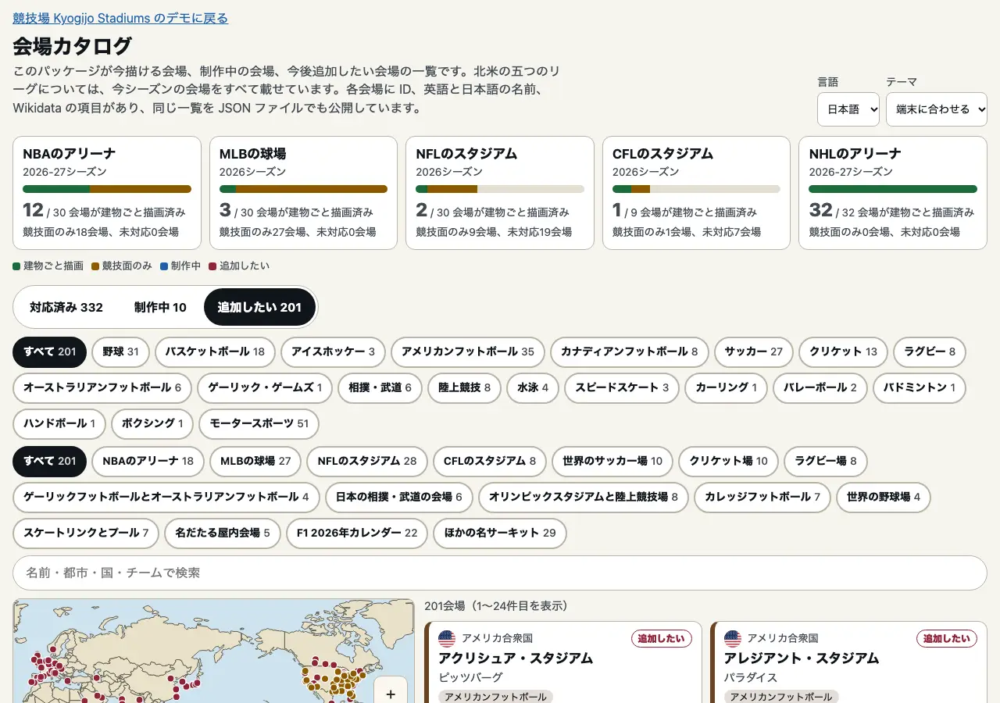

# 会場カタログ

日本語 · [English](catalogue.md)

このパッケージが今描ける会場、制作中の会場、今後追加したい会場を、一つの一覧にまとめました。会場ごとに ID、英語と日本語の名前、場所、競技、Wikidata の項目を載せています。同じデータを二つの形で公開しています。一つは静的なファイル `catalogue.json` で、決まったアドレスと npm パッケージの中に置いています。もう一つは型定義付きのエントリポイント `@johnmorrisdotca/kyogijo-stadiums/catalogue` です。サーバーはありません。デモの[カタログのページ](https://johnmorrisdotca.github.io/kyogijo-stadiums/catalogue.html)では、カードと地図で見られます。建物の中に会場を描く方法は、[実在のスタジアム](./stadiums.md)と[実在の会場](./venues.md)のページにあります。

- **対応済み**：このパッケージが描ける実在の会場すべてです。パッケージ自身のデータから作っていて、書き写してはいません。実在のスタジアム（`STADIUMS`）と NHL の実在の会場（`VENUES`）は、OpenStreetMap の建物の輪郭の中に、観客席とあわせて**建物ごと**描きます。`PARKS`、`GROUNDS`、`ARENAS`、`HALLS` のそれ以外のキーは、**競技面のみ**（フィールド、コート、リンク、球場、床）を、データにあればその会場の大きさで描きます。
- **制作中**：チケット KYOGIJO-STADIUMS-22 のテニスの主要コート10面です。外部の協力者が作ることもできます。
- **今後追加したい会場**：今シーズンの NFL と CFL の会場のうち、まだ描けないものすべてと、このパッケージが描ける競技の世界の名だたる会場です（サッカー、クリケット、ラグビー、ゲーリックフットボールとオーストラリアンフットボール、相撲と武道、陸上競技、カレッジフットボール、野球、スケートと水泳、屋内競技）。それぞれ有名な順に並べています。F1 の2026年カレンダーのサーキットと、ほかの名サーキットも載せていますが、サーキットを描く機能がまだないため、その対応待ちです。リーグやグループに入っている会場で、今は競技面だけを描けるものは、建物の輪郭を追加したい会場として載せ、重複しては載せていません。



<!-- catalogue-counts -->
| 区分 | 会場数 |
| --- | --- |
| 対応済み | 331 |
| 対応済み：建物ごと描ける | 43 |
| 対応済み：競技面のみ描ける | 288 |
| 対応済み：うち、建物の輪郭を追加したいもの | 69 |
| 制作中 | 10 |
| 今後追加したい会場 | 133 |
<!-- /catalogue-counts -->

## 使い方

JSON は <https://johnmorrisdotca.github.io/kyogijo-stadiums/catalogue.json>（デモと一緒に公開）と、パッケージの `@johnmorrisdotca/kyogijo-stadiums/catalogue.json` にあります。中身は、`schemaVersion`（現在は 1。読み込む側に影響する変更をしたときに上げます）、`generatedAt`（ファイルを書いた日ではなく、出典を読んだ日）、パッケージのバージョン、データのライセンス、件数、英語と日本語の名前が付いた競技とグループ、国名、そして会場ごとのオブジェクトが入った `venues` です。

```js no-run
const catalogue = await (await fetch("https://johnmorrisdotca.github.io/kyogijo-stadiums/catalogue.json")).json();
const wanted = catalogue.venues.filter((venue) => venue.status === "wanted");
console.log(catalogue.schemaVersion, wanted.length);
```

エントリポイントには、同じデータが型定義と一緒に入っていて、検索用の関数もあります。

```ts
import { catalogueById, catalogueCoverage } from "@johnmorrisdotca/kyogijo-stadiums/catalogue";

const nfl = catalogueCoverage("nfl");
console.log(nfl.venues, nfl.outline, nfl.surface, nfl.notYet);
// 30 2 9 19
const lambeau = catalogueById("lambeau-field")!;
console.log(lambeau.status, lambeau.nameJa);
// wanted ランボー・フィールド
```

各フィールドの意味は[英語版のページ](catalogue.md#using-it)の表にあります。`status` は `supported`（対応済み）、`working-on`（制作中）、`wanted`（追加したい）のどれかです。`drawn` は対応済みの会場の描き方で、`outline`（建物ごと）か `surface`（競技面のみ）です。`want` は追加したいもので、`outline`（建物の輪郭）か `venue`（会場そのもの）です。`missing` には、載せなかった事実とその理由が入っています。推測で埋めるより、空欄のほうがよいと考えています。

## リーグ

北米の五つのリーグについては、今シーズンの会場をすべて、描けるかどうかにかかわらず載せています。二つのクラブが使うスタジアムは、両方のクラブを付けて一度だけ載せています（メットライフ・スタジアム、SoFi スタジアム）。NBA、MLB、NHL の会場はパッケージ自身のデータ（`ARENAS`、`PARKS`、`VENUES` とそのクラブ）です。NFL と CFL の会場のうち描けないものは、英語版ウィキペディアのリーグのスタジアム一覧（版は `source.articles` に記載）と照らし合わせています。

<!-- catalogue-leagues -->
| リーグ | シーズン | 会場数 | 建物ごと | 競技面のみ | 未対応 |
| --- | --- | --- | --- | --- | --- |
| NBAのアリーナ | 2026-27 | 30 | 12 | 18 | 0 |
| MLBの球場 | 2026 | 30 | 3 | 27 | 0 |
| NFLのスタジアム | 2026 | 30 | 2 | 9 | 19 |
| CFLのスタジアム | 2026 | 9 | 1 | 1 | 7 |
| NHLのアリーナ | 2026-27 | 32 | 32 | 0 | 0 |
<!-- /catalogue-leagues -->

<!-- catalogue-league-venues -->
### NBAのアリーナ：30会場中12会場を建物ごと描画

| キー | 会場 | 都市 | チーム | 描き方 | Wikidata |
| --- | --- | --- | --- | --- | --- |
| `american-airlines-center` | アメリカン・エアラインズ・センター | ダラス、アメリカ合衆国 | ダラス・マーベリックス | 建物ごと | [Q463345](https://www.wikidata.org/wiki/Q463345) |
| `ball-arena` | ボール・アリーナ | デンバー、アメリカ合衆国 | デンバー・ナゲッツ | 建物ごと | [Q795470](https://www.wikidata.org/wiki/Q795470) |
| `barclays-center` | バークレイズ・センター | ブルックリン、アメリカ合衆国 | ブルックリン・ネッツ | 建物ごと | [Q807966](https://www.wikidata.org/wiki/Q807966) |
| `capital-one-arena` | キャピタル・ワン・アリーナ | ワシントン、アメリカ合衆国 | ワシントン・ウィザーズ | 建物ごと | [Q223240](https://www.wikidata.org/wiki/Q223240) |
| `crypto-com-arena` | クリプト・ドットコム・アリーナ | ロサンゼルス、アメリカ合衆国 | ロサンゼルス・レイカーズ | 建物ごと | [Q186080](https://www.wikidata.org/wiki/Q186080) |
| `delta-center` | デルタ・センター | ソルトレイクシティ、アメリカ合衆国 | ユタ・ジャズ | 建物ごと | [Q82294](https://www.wikidata.org/wiki/Q82294) |
| `little-caesars-arena` | リトル・シーザーズ・アリーナ | デトロイト、アメリカ合衆国 | デトロイト・ピストンズ | 建物ごと | [Q18154984](https://www.wikidata.org/wiki/Q18154984) |
| `madison-square-garden` | マディソン・スクエア・ガーデン | ニューヨーク、アメリカ合衆国 | ニューヨーク・ニックス | 建物ごと | [Q186125](https://www.wikidata.org/wiki/Q186125) |
| `scotiabank-arena` | スコシアバンク・アリーナ | トロント、カナダ | トロント・ラプターズ | 建物ごと | [Q406972](https://www.wikidata.org/wiki/Q406972) |
| `td-garden` | TDガーデン | ボストン、アメリカ合衆国 | ボストン・セルティックス | 建物ごと | [Q432105](https://www.wikidata.org/wiki/Q432105) |
| `united-center` | ユナイテッド・センター | シカゴ、アメリカ合衆国 | シカゴ・ブルズ | 建物ごと | [Q639975](https://www.wikidata.org/wiki/Q639975) |
| `xfinity-mobile-arena` | エクスフィニティ・モバイル・アリーナ | フィラデルフィア、アメリカ合衆国 | フィラデルフィア・セブンティシクサーズ | 建物ごと | [Q818735](https://www.wikidata.org/wiki/Q818735) |
| `chase-center` | チェイス・センター | サンフランシスコ、アメリカ合衆国 | ゴールデンステート・ウォリアーズ | 競技面のみ | [Q15262098](https://www.wikidata.org/wiki/Q15262098) |
| `fedexforum` | フェデックス・フォーラム | メンフィス、アメリカ合衆国 | メンフィス・グリズリーズ | 競技面のみ | [Q641212](https://www.wikidata.org/wiki/Q641212) |
| `fiserv-forum` | ファイサーブ・フォーラム | ミルウォーキー、アメリカ合衆国 | ミルウォーキー・バックス | 競技面のみ | [Q20372160](https://www.wikidata.org/wiki/Q20372160) |
| `frost-bank-center` | フロスト・バンク・センター | サンアントニオ、アメリカ合衆国 | サンアントニオ・スパーズ | 競技面のみ | [Q298573](https://www.wikidata.org/wiki/Q298573) |
| `gainbridge-fieldhouse` | ゲインブリッジ・フィールドハウス | インディアナポリス、アメリカ合衆国 | インディアナ・ペイサーズ | 競技面のみ | [Q545007](https://www.wikidata.org/wiki/Q545007) |
| `golden-1-center` | ゴールデン1センター | サクラメント、アメリカ合衆国 | サクラメント・キングス | 競技面のみ | [Q7011384](https://www.wikidata.org/wiki/Q7011384) |
| `intuit-dome` | インテュイット・ドーム | イングルウッド、アメリカ合衆国 | ロサンゼルス・クリッパーズ | 競技面のみ | [Q54958436](https://www.wikidata.org/wiki/Q54958436) |
| `kaseya-center` | カセヤ・センター | マイアミ、アメリカ合衆国 | マイアミ・ヒート | 競技面のみ | [Q420129](https://www.wikidata.org/wiki/Q420129) |
| `kia-center` | キア・センター | オーランド、アメリカ合衆国 | オーランド・マジック | 競技面のみ | [Q481795](https://www.wikidata.org/wiki/Q481795) |
| `moda-center` | モダ・センター | ポートランド、アメリカ合衆国 | ポートランド・トレイルブレイザーズ | 競技面のみ | [Q1347442](https://www.wikidata.org/wiki/Q1347442) |
| `mortgage-matchup-center` | モーゲージ・マッチアップ・センター | フェニックス、アメリカ合衆国 | フェニックス・サンズ | 競技面のみ | [Q1538690](https://www.wikidata.org/wiki/Q1538690) |
| `paycom-center` | ペイコム・センター | オクラホマシティ、アメリカ合衆国 | オクラホマシティ・サンダー | 競技面のみ | [Q665434](https://www.wikidata.org/wiki/Q665434) |
| `rocket-arena` | ロケット・アリーナ | クリーブランド、アメリカ合衆国 | クリーブランド・キャバリアーズ | 競技面のみ | [Q387157](https://www.wikidata.org/wiki/Q387157) |
| `smoothie-king-center` | スムージー・キング・センター | ニューオーリンズ、アメリカ合衆国 | ニューオーリンズ・ペリカンズ | 競技面のみ | [Q1515840](https://www.wikidata.org/wiki/Q1515840) |
| `spectrum-center` | スペクトラム・センター | シャーロット、アメリカ合衆国 | シャーロット・ホーネッツ | 競技面のみ | [Q983870](https://www.wikidata.org/wiki/Q983870) |
| `state-farm-arena` | ステートファーム・アリーナ | アトランタ、アメリカ合衆国 | アトランタ・ホークス | 競技面のみ | [Q1123297](https://www.wikidata.org/wiki/Q1123297) |
| `target-center` | ターゲット・センター | ミネアポリス、アメリカ合衆国 | ミネソタ・ティンバーウルブズ | 競技面のみ | [Q282675](https://www.wikidata.org/wiki/Q282675) |
| `toyota-center` | トヨタセンター | ヒューストン、アメリカ合衆国 | ヒューストン・ロケッツ | 競技面のみ | [Q1166157](https://www.wikidata.org/wiki/Q1166157) |

### MLBの球場：30会場中3会場を建物ごと描画

| キー | 会場 | 都市 | チーム | 描き方 | Wikidata |
| --- | --- | --- | --- | --- | --- |
| `citi-field` | シティ・フィールド | ニューヨーク、アメリカ合衆国 | ニューヨーク・メッツ | 建物ごと | [Q1072882](https://www.wikidata.org/wiki/Q1072882) |
| `t-mobile-park` | T-モバイル・パーク | シアトル、アメリカ合衆国 | シアトル・マリナーズ | 建物ごと | [Q1193117](https://www.wikidata.org/wiki/Q1193117) |
| `yankee-stadium` | ヤンキー・スタジアム | ニューヨーク、アメリカ合衆国 | ニューヨーク・ヤンキース | 建物ごと | [Q753529](https://www.wikidata.org/wiki/Q753529) |
| `american-family-field` | アメリカンファミリー・フィールド | ミルウォーキー、アメリカ合衆国 | ミルウォーキー・ブルワーズ | 競技面のみ | [Q1339293](https://www.wikidata.org/wiki/Q1339293) |
| `angel-stadium` | エンゼル・スタジアム・オブ・アナハイム | アナハイム、アメリカ合衆国 | ロサンゼルス・エンゼルス | 競技面のみ | [Q531897](https://www.wikidata.org/wiki/Q531897) |
| `busch-stadium` | ブッシュ・スタジアム | セントルイス、アメリカ合衆国 | セントルイス・カージナルス | 競技面のみ | [Q253546](https://www.wikidata.org/wiki/Q253546) |
| `chase-field` | チェイス・フィールド | フェニックス、アメリカ合衆国 | アリゾナ・ダイヤモンドバックス | 競技面のみ | [Q1068011](https://www.wikidata.org/wiki/Q1068011) |
| `citizens-bank-park` | シチズンズ・バンク・パーク | フィラデルフィア、アメリカ合衆国 | フィラデルフィア・フィリーズ | 競技面のみ | [Q912770](https://www.wikidata.org/wiki/Q912770) |
| `comerica-park` | コメリカ・パーク | デトロイト、アメリカ合衆国 | デトロイト・タイガース | 競技面のみ | [Q868482](https://www.wikidata.org/wiki/Q868482) |
| `coors-field` | クアーズ・フィールド | デンバー、アメリカ合衆国 | コロラド・ロッキーズ | 競技面のみ | [Q1129916](https://www.wikidata.org/wiki/Q1129916) |
| `daikin-park` | ダイキン・パーク | ヒューストン、アメリカ合衆国 | ヒューストン・アストロズ | 競技面のみ | [Q1193671](https://www.wikidata.org/wiki/Q1193671) |
| `dodger-stadium` | ドジャー・スタジアム | ロサンゼルス、アメリカ合衆国 | ロサンゼルス・ドジャース | 競技面のみ | [Q247420](https://www.wikidata.org/wiki/Q247420) |
| `fenway-park` | フェンウェイ・パーク | ボストン、アメリカ合衆国 | ボストン・レッドソックス | 競技面のみ | [Q49136](https://www.wikidata.org/wiki/Q49136) |
| `globe-life-field` | グローブライフ・フィールド | アーリントン、アメリカ合衆国 | テキサス・レンジャーズ | 競技面のみ | [Q24284037](https://www.wikidata.org/wiki/Q24284037) |
| `great-american-ball-park` | グレート・アメリカン・ボール・パーク | シンシナティ、アメリカ合衆国 | シンシナティ・レッズ | 競技面のみ | [Q979975](https://www.wikidata.org/wiki/Q979975) |
| `kauffman-stadium` | カウフマン・スタジアム | カンザスシティ、アメリカ合衆国 | カンザスシティ・ロイヤルズ | 競技面のみ | [Q1737017](https://www.wikidata.org/wiki/Q1737017) |
| `loandepot-park` | ローンデポ・パーク | マイアミ、アメリカ合衆国 | マイアミ・マーリンズ | 競技面のみ | [Q1368138](https://www.wikidata.org/wiki/Q1368138) |
| `nationals-park` | ナショナルズ・パーク | ワシントン、アメリカ合衆国 | ワシントン・ナショナルズ | 競技面のみ | [Q517545](https://www.wikidata.org/wiki/Q517545) |
| `oracle-park` | オラクル・パーク | サンフランシスコ、アメリカ合衆国 | サンフランシスコ・ジャイアンツ | 競技面のみ | [Q298585](https://www.wikidata.org/wiki/Q298585) |
| `oriole-park-at-camden-yards` | オリオール・パーク・アット・カムデン・ヤーズ | ボルチモア、アメリカ合衆国 | ボルチモア・オリオールズ | 競技面のみ | [Q1141174](https://www.wikidata.org/wiki/Q1141174) |
| `petco-park` | ペトコ・パーク | サンディエゴ、アメリカ合衆国 | サンディエゴ・パドレス | 競技面のみ | [Q1194586](https://www.wikidata.org/wiki/Q1194586) |
| `pnc-park` | PNCパーク | ピッツバーグ、アメリカ合衆国 | ピッツバーグ・パイレーツ | 競技面のみ | [Q1151177](https://www.wikidata.org/wiki/Q1151177) |
| `progressive-field` | プログレッシブ・フィールド | クリーブランド、アメリカ合衆国 | クリーブランド・ガーディアンズ | 競技面のみ | [Q1154053](https://www.wikidata.org/wiki/Q1154053) |
| `rate-field` | レート・フィールド | シカゴ、アメリカ合衆国 | シカゴ・ホワイトソックス | 競技面のみ | [Q633613](https://www.wikidata.org/wiki/Q633613) |
| `rogers-centre` | ロジャーズ・センター | トロント、カナダ | トロント・ブルージェイズ | 競技面のみ | [Q76318](https://www.wikidata.org/wiki/Q76318) |
| `sutter-health-park` | サター・ヘルス・パーク | ウェストサクラメント、アメリカ合衆国 | アスレチックス | 競技面のみ | [Q3418115](https://www.wikidata.org/wiki/Q3418115) |
| `target-field` | ターゲット・フィールド | ミネアポリス、アメリカ合衆国 | ミネソタ・ツインズ | 競技面のみ | [Q1156635](https://www.wikidata.org/wiki/Q1156635) |
| `tropicana-field` | トロピカーナ・フィールド | セントピーターズバーグ、アメリカ合衆国 | タンパベイ・レイズ | 競技面のみ | [Q1810119](https://www.wikidata.org/wiki/Q1810119) |
| `truist-park` | トゥルーイスト・パーク | カンバーランド、アメリカ合衆国 | アトランタ・ブレーブス | 競技面のみ | [Q17003430](https://www.wikidata.org/wiki/Q17003430) |
| `wrigley-field` | リグレー・フィールド | シカゴ、アメリカ合衆国 | シカゴ・カブス | 競技面のみ | [Q1052807](https://www.wikidata.org/wiki/Q1052807) |

### NFLのスタジアム：30会場中2会場を建物ごと描画

| キー | 会場 | 都市 | チーム | 描き方 | Wikidata |
| --- | --- | --- | --- | --- | --- |
| `lumen-field` | ルーメン・フィールド | シアトル、アメリカ合衆国 | シアトル・シーホークス | 建物ごと | [Q612736](https://www.wikidata.org/wiki/Q612736) |
| `metlife-stadium` | メットライフ・スタジアム | イーストラザフォード、アメリカ合衆国 | ニューヨーク・ジャイアンツ、ニューヨーク・ジェッツ | 建物ごと | [Q10862290](https://www.wikidata.org/wiki/Q10862290) |
| `arrowhead-stadium` | アローヘッド・スタジアム | カンザスシティ、アメリカ合衆国 | カンザスシティ・チーフス | 競技面のみ | [Q544553](https://www.wikidata.org/wiki/Q544553) |
| `att-stadium` | AT&Tスタジアム | アーリントン、アメリカ合衆国 | ダラス・カウボーイズ | 競技面のみ | [Q838284](https://www.wikidata.org/wiki/Q838284) |
| `gillette-stadium` | ジレット・スタジアム | フォックスボロ、アメリカ合衆国 | ニューイングランド・ペイトリオッツ | 競技面のみ | [Q373355](https://www.wikidata.org/wiki/Q373355) |
| `hard-rock-stadium` | ハードロック・スタジアム | マイアミ・ガーデンズ、アメリカ合衆国 | マイアミ・ドルフィンズ | 競技面のみ | [Q864339](https://www.wikidata.org/wiki/Q864339) |
| `levis-stadium` | リーバイス・スタジアム | サンタクララ、アメリカ合衆国 | サンフランシスコ・フォーティナイナーズ | 競技面のみ | [Q7419343](https://www.wikidata.org/wiki/Q7419343) |
| `lincoln-financial-field` | リンカーン・フィナンシャル・フィールド | フィラデルフィア、アメリカ合衆国 | フィラデルフィア・イーグルス | 競技面のみ | [Q1052370](https://www.wikidata.org/wiki/Q1052370) |
| `mercedes-benz-stadium` | メルセデス・ベンツ・スタジアム | アトランタ、アメリカ合衆国 | アトランタ・ファルコンズ | 競技面のみ | [Q7007552](https://www.wikidata.org/wiki/Q7007552) |
| `nrg-stadium` | リライアント・スタジアム | ヒューストン、アメリカ合衆国 | ヒューストン・テキサンズ | 競技面のみ | [Q1058864](https://www.wikidata.org/wiki/Q1058864) |
| `sofi-stadium` | SoFiスタジアム | イングルウッド、アメリカ合衆国 | ロサンゼルス・チャージャーズ、ロサンゼルス・ラムズ | 競技面のみ | [Q19520501](https://www.wikidata.org/wiki/Q19520501) |
| `acrisure-stadium` | アクリシュア・スタジアム | ピッツバーグ、アメリカ合衆国 | ピッツバーグ・スティーラーズ | 未対応 | [Q1067148](https://www.wikidata.org/wiki/Q1067148) |
| `allegiant-stadium` | アレジアント・スタジアム | パラダイス、アメリカ合衆国 | ラスベガス・レイダース | 未対応 | [Q27768421](https://www.wikidata.org/wiki/Q27768421) |
| `bank-of-america-stadium` | バンク・オブ・アメリカ・スタジアム | シャーロット、アメリカ合衆国 | カロライナ・パンサーズ | 未対応 | [Q806673](https://www.wikidata.org/wiki/Q806673) |
| `caesars-superdome` | シーザーズ・スーパードーム | ニューオーリンズ、アメリカ合衆国 | ニューオーリンズ・セインツ | 未対応 | [Q756452](https://www.wikidata.org/wiki/Q756452) |
| `empower-field-at-mile-high` | エンパワー・フィールド・アット・マイル・ハイ | デンバー、アメリカ合衆国 | デンバー・ブロンコス | 未対応 | [Q1046135](https://www.wikidata.org/wiki/Q1046135) |
| `everbank-stadium` | エバーバンク・スタジアム | ジャクソンビル、アメリカ合衆国 | ジャクソンビル・ジャガーズ | 未対応 | [Q635117](https://www.wikidata.org/wiki/Q635117) |
| `ford-field` | フォード・フィールド | デトロイト、アメリカ合衆国 | デトロイト・ライオンズ | 未対応 | [Q1142586](https://www.wikidata.org/wiki/Q1142586) |
| `highmark-stadium` | ハイマーク・スタジアム | オーチャードパーク、アメリカ合衆国 | バッファロー・ビルズ | 未対応 | [Q16251517](https://www.wikidata.org/wiki/Q16251517) |
| `huntington-bank-field` | ハンティントン・バンク・フィールド | クリーブランド、アメリカ合衆国 | クリーブランド・ブラウンズ | 未対応 | [Q1100756](https://www.wikidata.org/wiki/Q1100756) |
| `lambeau-field` | ランボー・フィールド | グリーンベイ、アメリカ合衆国 | グリーンベイ・パッカーズ | 未対応 | [Q860790](https://www.wikidata.org/wiki/Q860790) |
| `lucas-oil-stadium` | ルーカス・オイル・スタジアム | インディアナポリス、アメリカ合衆国 | インディアナポリス・コルツ | 未対応 | [Q867160](https://www.wikidata.org/wiki/Q867160) |
| `mt-bank-stadium` | M&Tバンク・スタジアム | ボルチモア、アメリカ合衆国 | ボルチモア・レイブンズ | 未対応 | [Q1141336](https://www.wikidata.org/wiki/Q1141336) |
| `nissan-stadium-nashville` | ニッサン・スタジアム | ナッシュビル、アメリカ合衆国 | テネシー・タイタンズ | 未対応 | [Q1142992](https://www.wikidata.org/wiki/Q1142992) |
| `northwest-stadium` | ノースウェスト・スタジアム | ランドーバー、アメリカ合衆国 | ワシントン・コマンダーズ | 未対応 | [Q583085](https://www.wikidata.org/wiki/Q583085) |
| `paycor-stadium` | ペイコー・スタジアム | シンシナティ、アメリカ合衆国 | シンシナティ・ベンガルズ | 未対応 | [Q1632294](https://www.wikidata.org/wiki/Q1632294) |
| `raymond-james-stadium` | レイモンド・ジェームス・スタジアム | タンパ、アメリカ合衆国 | タンパベイ・バッカニアーズ | 未対応 | [Q1141343](https://www.wikidata.org/wiki/Q1141343) |
| `soldier-field` | ソルジャー・フィールド | シカゴ、アメリカ合衆国 | シカゴ・ベアーズ | 未対応 | [Q1132413](https://www.wikidata.org/wiki/Q1132413) |
| `state-farm-stadium` | ステートファーム・スタジアム | グレンデール、アメリカ合衆国 | アリゾナ・カージナルス | 未対応 | [Q756433](https://www.wikidata.org/wiki/Q756433) |
| `us-bank-stadium` | USバンク・スタジアム | ミネアポリス、アメリカ合衆国 | ミネソタ・バイキングス | 未対応 | [Q7929512](https://www.wikidata.org/wiki/Q7929512) |

### CFLのスタジアム：9会場中1会場を建物ごと描画

| キー | 会場 | 都市 | チーム | 描き方 | Wikidata |
| --- | --- | --- | --- | --- | --- |
| `bc-place` | BCプレイス | バンクーバー、カナダ | BCライオンズ | 建物ごと | [Q612227](https://www.wikidata.org/wiki/Q612227) |
| `bmo-field` | BMOフィールド | トロント、カナダ | トロント・アルゴノーツ | 競技面のみ | [Q796351](https://www.wikidata.org/wiki/Q796351) |
| `commonwealth-stadium` | コモンウェルス・スタジアム | エドモントン、カナダ | エドモントン・エルクス | 未対応 | [Q130381](https://www.wikidata.org/wiki/Q130381) |
| `hamilton-stadium` | ハミルトン・スタジアム | ハミルトン、カナダ | ハミルトン・タイガーキャッツ | 未対応 | [Q7008048](https://www.wikidata.org/wiki/Q7008048) |
| `mcmahon-stadium` | マクマーン・スタジアム | カルガリー、カナダ | カルガリー・スタンピーダーズ | 未対応 | [Q1810204](https://www.wikidata.org/wiki/Q1810204) |
| `mosaic-stadium` | モザイク・スタジアム | レジャイナ、カナダ | サスカチュワン・ラフライダーズ | 未対応 | [Q7011148](https://www.wikidata.org/wiki/Q7011148) |
| `percival-molson-memorial-stadium` | パーシバル・モルソン・メモリアル・スタジアム | モントリオール、カナダ | モントリオール・アルエッツ | 未対応 | [Q732147](https://www.wikidata.org/wiki/Q732147) |
| `princess-auto-stadium` | プリンセス・オート・スタジアム | ウィニペグ、カナダ | ウィニペグ・ブルーボマーズ | 未対応 | [Q1671788](https://www.wikidata.org/wiki/Q1671788) |
| `td-place-stadium` | TDプレイス・スタジアム | オタワ、カナダ | オタワ・レッドブラックス | 未対応 | [Q1442809](https://www.wikidata.org/wiki/Q1442809) |

### NHLのアリーナ：32会場中32会場を建物ごと描画

| キー | 会場 | 都市 | チーム | 描き方 | Wikidata |
| --- | --- | --- | --- | --- | --- |
| `amerant-bank-arena` | アメラント・バンク・アリーナ | サンライズ、アメリカ合衆国 | フロリダ・パンサーズ | 建物ごと | [Q795526](https://www.wikidata.org/wiki/Q795526) |
| `american-airlines-center` | アメリカン・エアラインズ・センター | ダラス、アメリカ合衆国 | ダラス・スターズ | 建物ごと | [Q463345](https://www.wikidata.org/wiki/Q463345) |
| `ball-arena` | ボール・アリーナ | デンバー、アメリカ合衆国 | コロラド・アバランチ | 建物ごと | [Q795470](https://www.wikidata.org/wiki/Q795470) |
| `bell-centre` | ベル・センター | モントリオール、カナダ | モントリオール・カナディアンズ | 建物ごと | [Q522282](https://www.wikidata.org/wiki/Q522282) |
| `benchmark-international-arena` | ベンチマーク・インターナショナル・アリーナ | タンパ、アメリカ合衆国 | タンパベイ・ライトニング | 建物ごと | [Q940199](https://www.wikidata.org/wiki/Q940199) |
| `bridgestone-arena` | ブリヂストン・アリーナ | ナッシュビル、アメリカ合衆国 | ナッシュビル・プレデターズ | 建物ごと | [Q302869](https://www.wikidata.org/wiki/Q302869) |
| `canada-life-centre` | カナダライフ・センター | ウィニペグ、カナダ | ウィニペグ・ジェッツ | 建物ごと | [Q656928](https://www.wikidata.org/wiki/Q656928) |
| `canadian-tire-centre` | カナディアン・タイヤ・センター | オタワ、カナダ | オタワ・セネターズ | 建物ごと | [Q1327290](https://www.wikidata.org/wiki/Q1327290) |
| `capital-one-arena` | キャピタル・ワン・アリーナ | ワシントン、アメリカ合衆国 | ワシントン・キャピタルズ | 建物ごと | [Q223240](https://www.wikidata.org/wiki/Q223240) |
| `climate-pledge-arena` | クライメット・プレッジ・アリーナ | シアトル、アメリカ合衆国 | シアトル・クラーケン | 建物ごと | [Q977529](https://www.wikidata.org/wiki/Q977529) |
| `crypto-com-arena` | クリプト・ドットコム・アリーナ | ロサンゼルス、アメリカ合衆国 | ロサンゼルス・キングス | 建物ごと | [Q186080](https://www.wikidata.org/wiki/Q186080) |
| `delta-center` | デルタ・センター | ソルトレイクシティ、アメリカ合衆国 | ユタ・マンモス | 建物ごと | [Q82294](https://www.wikidata.org/wiki/Q82294) |
| `enterprise-center` | エンタープライズ・センター | セントルイス、アメリカ合衆国 | セントルイス・ブルース | 建物ごと | [Q1067700](https://www.wikidata.org/wiki/Q1067700) |
| `grand-casino-arena` | グランド・カジノ・アリーナ | セントポール、アメリカ合衆国 | ミネソタ・ワイルド | 建物ごと | [Q1421388](https://www.wikidata.org/wiki/Q1421388) |
| `honda-center` | ホンダセンター | アナハイム、アメリカ合衆国 | アナハイム・ダックス | 建物ごと | [Q774138](https://www.wikidata.org/wiki/Q774138) |
| `keybank-center` | キーバンク・センター | バッファロー、アメリカ合衆国 | バッファロー・セイバーズ | 建物ごと | [Q1110789](https://www.wikidata.org/wiki/Q1110789) |
| `lenovo-center` | レノボ・センター | ローリー、アメリカ合衆国 | カロライナ・ハリケーンズ | 建物ごと | [Q39177](https://www.wikidata.org/wiki/Q39177) |
| `little-caesars-arena` | リトル・シーザーズ・アリーナ | デトロイト、アメリカ合衆国 | デトロイト・レッドウィングス | 建物ごと | [Q18154984](https://www.wikidata.org/wiki/Q18154984) |
| `madison-square-garden` | マディソン・スクエア・ガーデン | ニューヨーク、アメリカ合衆国 | ニューヨーク・レンジャース | 建物ごと | [Q186125](https://www.wikidata.org/wiki/Q186125) |
| `nationwide-arena` | ネイションワイド・アリーナ | コロンバス、アメリカ合衆国 | コロンバス・ブルージャケッツ | 建物ごと | [Q166503](https://www.wikidata.org/wiki/Q166503) |
| `ppg-paints-arena` | PPGペインツ・アリーナ | ピッツバーグ、アメリカ合衆国 | ピッツバーグ・ペンギンズ | 建物ごと | [Q595460](https://www.wikidata.org/wiki/Q595460) |
| `prudential-center` | プルデンシャル・センター | ニューアーク、アメリカ合衆国 | ニュージャージー・デビルス | 建物ごと | [Q849027](https://www.wikidata.org/wiki/Q849027) |
| `rogers-arena` | ロジャーズ・アリーナ | バンクーバー、カナダ | バンクーバー・カナックス | 建物ごと | [Q517318](https://www.wikidata.org/wiki/Q517318) |
| `rogers-place` | ロジャーズ・プレイス | エドモントン、カナダ | エドモントン・オイラーズ | 建物ごと | [Q5339036](https://www.wikidata.org/wiki/Q5339036) |
| `sap-center` | SAPセンター | サンノゼ、アメリカ合衆国 | サンノゼ・シャークス | 建物ごと | [Q261863](https://www.wikidata.org/wiki/Q261863) |
| `scotiabank-arena` | スコシアバンク・アリーナ | トロント、カナダ | トロント・メープルリーフス | 建物ごと | [Q406972](https://www.wikidata.org/wiki/Q406972) |
| `scotiabank-saddledome` | スコシアバンク・サドルドーム | カルガリー、カナダ | カルガリー・フレームス | 建物ごと | [Q1140083](https://www.wikidata.org/wiki/Q1140083) |
| `t-mobile-arena` | T-モバイル・アリーナ | ラスベガス、アメリカ合衆国 | ベガス・ゴールデンナイツ | 建物ごと | [Q3338973](https://www.wikidata.org/wiki/Q3338973) |
| `td-garden` | TDガーデン | ボストン、アメリカ合衆国 | ボストン・ブルーインズ | 建物ごと | [Q432105](https://www.wikidata.org/wiki/Q432105) |
| `ubs-arena` | UBSアリーナ | エルモント、アメリカ合衆国 | ニューヨーク・アイランダース | 建物ごと | [Q48742753](https://www.wikidata.org/wiki/Q48742753) |
| `united-center` | ユナイテッド・センター | シカゴ、アメリカ合衆国 | シカゴ・ブラックホークス | 建物ごと | [Q639975](https://www.wikidata.org/wiki/Q639975) |
| `xfinity-mobile-arena` | エクスフィニティ・モバイル・アリーナ | フィラデルフィア、アメリカ合衆国 | フィラデルフィア・フライヤーズ | 建物ごと | [Q818735](https://www.wikidata.org/wiki/Q818735) |
<!-- /catalogue-league-venues -->

## 対応済み

各会場を、最初に描ける競技ごとに分けています。過去の会場は、当時の姿（フェンスやリンク）で描きます。

<!-- catalogue-supported -->
### 野球（94）

| キー | 会場 | 都市 | 描き方 | Wikidata |
| --- | --- | --- | --- | --- |
| `oriole-park-at-camden-yards` | オリオール・パーク・アット・カムデン・ヤーズ | ボルチモア、アメリカ合衆国 | 競技面のみ | [Q1141174](https://www.wikidata.org/wiki/Q1141174) |
| `fenway-park` | フェンウェイ・パーク | ボストン、アメリカ合衆国 | 競技面のみ | [Q49136](https://www.wikidata.org/wiki/Q49136) |
| `yankee-stadium` | ヤンキー・スタジアム | ニューヨーク、アメリカ合衆国 | 建物ごと | [Q753529](https://www.wikidata.org/wiki/Q753529) |
| `tropicana-field` | トロピカーナ・フィールド | セントピーターズバーグ、アメリカ合衆国 | 競技面のみ | [Q1810119](https://www.wikidata.org/wiki/Q1810119) |
| `rogers-centre` | ロジャーズ・センター | トロント、カナダ | 競技面のみ | [Q76318](https://www.wikidata.org/wiki/Q76318) |
| `rate-field` | レート・フィールド | シカゴ、アメリカ合衆国 | 競技面のみ | [Q633613](https://www.wikidata.org/wiki/Q633613) |
| `progressive-field` | プログレッシブ・フィールド | クリーブランド、アメリカ合衆国 | 競技面のみ | [Q1154053](https://www.wikidata.org/wiki/Q1154053) |
| `comerica-park` | コメリカ・パーク | デトロイト、アメリカ合衆国 | 競技面のみ | [Q868482](https://www.wikidata.org/wiki/Q868482) |
| `kauffman-stadium` | カウフマン・スタジアム | カンザスシティ、アメリカ合衆国 | 競技面のみ | [Q1737017](https://www.wikidata.org/wiki/Q1737017) |
| `target-field` | ターゲット・フィールド | ミネアポリス、アメリカ合衆国 | 競技面のみ | [Q1156635](https://www.wikidata.org/wiki/Q1156635) |
| `daikin-park` | ダイキン・パーク | ヒューストン、アメリカ合衆国 | 競技面のみ | [Q1193671](https://www.wikidata.org/wiki/Q1193671) |
| `angel-stadium` | エンゼル・スタジアム・オブ・アナハイム | アナハイム、アメリカ合衆国 | 競技面のみ | [Q531897](https://www.wikidata.org/wiki/Q531897) |
| `sutter-health-park` | サター・ヘルス・パーク | ウェストサクラメント、アメリカ合衆国 | 競技面のみ | [Q3418115](https://www.wikidata.org/wiki/Q3418115) |
| `t-mobile-park` | T-モバイル・パーク | シアトル、アメリカ合衆国 | 建物ごと | [Q1193117](https://www.wikidata.org/wiki/Q1193117) |
| `globe-life-field` | グローブライフ・フィールド | アーリントン、アメリカ合衆国 | 競技面のみ | [Q24284037](https://www.wikidata.org/wiki/Q24284037) |
| `truist-park` | トゥルーイスト・パーク | カンバーランド、アメリカ合衆国 | 競技面のみ | [Q17003430](https://www.wikidata.org/wiki/Q17003430) |
| `loandepot-park` | ローンデポ・パーク | マイアミ、アメリカ合衆国 | 競技面のみ | [Q1368138](https://www.wikidata.org/wiki/Q1368138) |
| `citi-field` | シティ・フィールド | ニューヨーク、アメリカ合衆国 | 建物ごと | [Q1072882](https://www.wikidata.org/wiki/Q1072882) |
| `citizens-bank-park` | シチズンズ・バンク・パーク | フィラデルフィア、アメリカ合衆国 | 競技面のみ | [Q912770](https://www.wikidata.org/wiki/Q912770) |
| `nationals-park` | ナショナルズ・パーク | ワシントン、アメリカ合衆国 | 競技面のみ | [Q517545](https://www.wikidata.org/wiki/Q517545) |
| `wrigley-field` | リグレー・フィールド | シカゴ、アメリカ合衆国 | 競技面のみ | [Q1052807](https://www.wikidata.org/wiki/Q1052807) |
| `great-american-ball-park` | グレート・アメリカン・ボール・パーク | シンシナティ、アメリカ合衆国 | 競技面のみ | [Q979975](https://www.wikidata.org/wiki/Q979975) |
| `american-family-field` | アメリカンファミリー・フィールド | ミルウォーキー、アメリカ合衆国 | 競技面のみ | [Q1339293](https://www.wikidata.org/wiki/Q1339293) |
| `pnc-park` | PNCパーク | ピッツバーグ、アメリカ合衆国 | 競技面のみ | [Q1151177](https://www.wikidata.org/wiki/Q1151177) |
| `busch-stadium` | ブッシュ・スタジアム | セントルイス、アメリカ合衆国 | 競技面のみ | [Q253546](https://www.wikidata.org/wiki/Q253546) |
| `chase-field` | チェイス・フィールド | フェニックス、アメリカ合衆国 | 競技面のみ | [Q1068011](https://www.wikidata.org/wiki/Q1068011) |
| `coors-field` | クアーズ・フィールド | デンバー、アメリカ合衆国 | 競技面のみ | [Q1129916](https://www.wikidata.org/wiki/Q1129916) |
| `dodger-stadium` | ドジャー・スタジアム | ロサンゼルス、アメリカ合衆国 | 競技面のみ | [Q247420](https://www.wikidata.org/wiki/Q247420) |
| `petco-park` | ペトコ・パーク | サンディエゴ、アメリカ合衆国 | 競技面のみ | [Q1194586](https://www.wikidata.org/wiki/Q1194586) |
| `oracle-park` | オラクル・パーク | サンフランシスコ、アメリカ合衆国 | 競技面のみ | [Q298585](https://www.wikidata.org/wiki/Q298585) |
| `baker-bowl` | ベイカー・ボウル | フィラデルフィア、アメリカ合衆国 | 競技面のみ（過去の会場） | [Q4849117](https://www.wikidata.org/wiki/Q4849117) |
| `exposition-park-pittsburgh` | エクスポジション・パーク (ピッツバーグ) | ピッツバーグ、アメリカ合衆国 | 競技面のみ（過去の会場） | [Q5421611](https://www.wikidata.org/wiki/Q5421611) |
| `polo-grounds` | ポロ・グラウンズ | ニューヨーク、アメリカ合衆国 | 競技面のみ（過去の会場） | [Q1276360](https://www.wikidata.org/wiki/Q1276360) |
| `south-end-grounds` | サウス・エンド・グラウンズ | ボストン、アメリカ合衆国 | 競技面のみ（過去の会場） | [Q6646308](https://www.wikidata.org/wiki/Q6646308) |
| `huntington-avenue-grounds` | ハンティントン・アベニュー・グラウンズ | ボストン、アメリカ合衆国 | 競技面のみ（過去の会場） | [Q1056422](https://www.wikidata.org/wiki/Q1056422) |
| `league-park-cleveland` | リーグ・パーク (クリーブランド) | クリーブランド、アメリカ合衆国 | 競技面のみ（過去の会場） | [Q870897](https://www.wikidata.org/wiki/Q870897) |
| `sportsmans-park` | スポーツマンズ・パーク | セントルイス、アメリカ合衆国 | 競技面のみ（過去の会場） | [Q7579980](https://www.wikidata.org/wiki/Q7579980) |
| `hilltop-park` | ヒルトップ・パーク | ニューヨーク、アメリカ合衆国 | 競技面のみ（過去の会場） | [Q5764114](https://www.wikidata.org/wiki/Q5764114) |
| `forbes-field` | フォーブス・フィールド | ピッツバーグ、アメリカ合衆国 | 競技面のみ（過去の会場） | [Q1963954](https://www.wikidata.org/wiki/Q1963954) |
| `shibe-park` | シャイブ・パーク | フィラデルフィア、アメリカ合衆国 | 競技面のみ（過去の会場） | [Q7496044](https://www.wikidata.org/wiki/Q7496044) |
| `comiskey-park` | コミスキー・パーク | シカゴ、アメリカ合衆国 | 競技面のみ（過去の会場） | [Q1114772](https://www.wikidata.org/wiki/Q1114772) |
| `griffith-stadium` | グリフィス・スタジアム | ワシントン、アメリカ合衆国 | 競技面のみ（過去の会場） | [Q5608924](https://www.wikidata.org/wiki/Q5608924) |
| `crosley-field` | クロスリー・フィールド | シンシナティ、アメリカ合衆国 | 競技面のみ（過去の会場） | [Q3003747](https://www.wikidata.org/wiki/Q3003747) |
| `tiger-stadium` | タイガー・スタジアム | デトロイト、アメリカ合衆国 | 競技面のみ（過去の会場） | [Q1750255](https://www.wikidata.org/wiki/Q1750255) |
| `ebbets-field` | エベッツ・フィールド | ブルックリン、アメリカ合衆国 | 競技面のみ（過去の会場） | [Q1278537](https://www.wikidata.org/wiki/Q1278537) |
| `braves-field` | ブレーブス・フィールド | ボストン、アメリカ合衆国 | 競技面のみ（過去の会場） | [Q11335096](https://www.wikidata.org/wiki/Q11335096) |
| `yankee-stadium-1923` | ヤンキー・スタジアム (1923年) | ニューヨーク、アメリカ合衆国 | 競技面のみ（過去の会場） | [Q675214](https://www.wikidata.org/wiki/Q675214) |
| `cleveland-stadium` | クリーブランド・スタジアム | クリーブランド、アメリカ合衆国 | 競技面のみ（過去の会場） | [Q2113078](https://www.wikidata.org/wiki/Q2113078) |
| `milwaukee-county-stadium` | ミルウォーキー・カウンティ・スタジアム | ミルウォーキー、アメリカ合衆国 | 競技面のみ（過去の会場） | [Q3314569](https://www.wikidata.org/wiki/Q3314569) |
| `baltimore-memorial-stadium` | メモリアル・スタジアム (ボルチモア) | ボルチモア、アメリカ合衆国 | 競技面のみ（過去の会場） | [Q2748739](https://www.wikidata.org/wiki/Q2748739) |
| `municipal-stadium-kansas-city` | カンザスシティ・ミュニシパル・スタジアム | カンザスシティ、アメリカ合衆国 | 競技面のみ（過去の会場） | [Q6936283](https://www.wikidata.org/wiki/Q6936283) |
| `seals-stadium` | シールズ・スタジアム | サンフランシスコ、アメリカ合衆国 | 競技面のみ（過去の会場） | [Q7440659](https://www.wikidata.org/wiki/Q7440659) |
| `candlestick-park` | キャンドルスティック・パーク | サンフランシスコ、アメリカ合衆国 | 競技面のみ（過去の会場） | [Q1033076](https://www.wikidata.org/wiki/Q1033076) |
| `wrigley-field-los-angeles` | ロサンゼルス・リグレー・フィールド | ロサンゼルス、アメリカ合衆国 | 競技面のみ（過去の会場） | [Q3297716](https://www.wikidata.org/wiki/Q3297716) |
| `metropolitan-stadium` | メトロポリタン・スタジアム | ブルーミントン、アメリカ合衆国 | 競技面のみ（過去の会場） | [Q1415967](https://www.wikidata.org/wiki/Q1415967) |
| `colt-stadium` | コルト・スタジアム | ヒューストン、アメリカ合衆国 | 競技面のみ（過去の会場） | [Q5149429](https://www.wikidata.org/wiki/Q5149429) |
| `robert-f-kennedy-memorial-stadium` | ロバート・F・ケネディ・メモリアル・スタジアム | ワシントン、アメリカ合衆国 | 競技面のみ（過去の会場） | [Q153312](https://www.wikidata.org/wiki/Q153312) |
| `shea-stadium` | シェイ・スタジアム | ニューヨーク、アメリカ合衆国 | 競技面のみ（過去の会場） | [Q1056326](https://www.wikidata.org/wiki/Q1056326) |
| `astrodome` | アストロドーム | ヒューストン、アメリカ合衆国 | 競技面のみ（過去の会場） | [Q1025406](https://www.wikidata.org/wiki/Q1025406) |
| `atlanta-fulton-county-stadium` | アトランタ・フルトン・カウンティ・スタジアム | アトランタ、アメリカ合衆国 | 競技面のみ（過去の会場） | [Q641243](https://www.wikidata.org/wiki/Q641243) |
| `busch-memorial-stadium` | ブッシュ・メモリアル・スタジアム | セントルイス、アメリカ合衆国 | 競技面のみ（過去の会場） | [Q1017286](https://www.wikidata.org/wiki/Q1017286) |
| `oakland-coliseum` | オークランド・アラメダ・カウンティ・コロシアム | オークランド、アメリカ合衆国 | 競技面のみ（過去の会場） | [Q1147732](https://www.wikidata.org/wiki/Q1147732) |
| `sicks-stadium` | シックズ・スタジアム | シアトル、アメリカ合衆国 | 競技面のみ（過去の会場） | [Q6127401](https://www.wikidata.org/wiki/Q6127401) |
| `jarry-park-stadium` | ジェリー・パーク | モントリオール、カナダ | 競技面のみ（過去の会場） | [Q3495641](https://www.wikidata.org/wiki/Q3495641) |
| `three-rivers-stadium` | スリー・リバース・スタジアム | ピッツバーグ、アメリカ合衆国 | 競技面のみ（過去の会場） | [Q1189339](https://www.wikidata.org/wiki/Q1189339) |
| `riverfront-stadium` | リバーフロント・スタジアム | シンシナティ、アメリカ合衆国 | 競技面のみ（過去の会場） | [Q153824](https://www.wikidata.org/wiki/Q153824) |
| `veterans-stadium` | ベテランズ・スタジアム | フィラデルフィア、アメリカ合衆国 | 競技面のみ（過去の会場） | [Q1545870](https://www.wikidata.org/wiki/Q1545870) |
| `arlington-stadium` | アーリントン・スタジアム | アーリントン、アメリカ合衆国 | 競技面のみ（過去の会場） | [Q2861657](https://www.wikidata.org/wiki/Q2861657) |
| `exhibition-stadium` | エキシビション・スタジアム | トロント、カナダ | 競技面のみ（過去の会場） | [Q1383747](https://www.wikidata.org/wiki/Q1383747) |
| `olympic-stadium-montreal` | オリンピック・スタジアム (モントリオール) | モントリオール、カナダ | 建物ごと | [Q285467](https://www.wikidata.org/wiki/Q285467) |
| `metrodome` | ヒューバート・H・ハンフリー・メトロドーム | ミネアポリス、アメリカ合衆国 | 競技面のみ（過去の会場） | [Q1072186](https://www.wikidata.org/wiki/Q1072186) |
| `mile-high-stadium` | マイル・ハイ・スタジアム | デンバー、アメリカ合衆国 | 競技面のみ（過去の会場） | [Q1934586](https://www.wikidata.org/wiki/Q1934586) |
| `globe-life-park-in-arlington` | チョクトー・スタジアム | アーリントン、アメリカ合衆国 | 競技面のみ（過去の会場） | [Q1634492](https://www.wikidata.org/wiki/Q1634492) |
| `turner-field` | ターナー・フィールド | アトランタ、アメリカ合衆国 | 競技面のみ（過去の会場） | [Q1150936](https://www.wikidata.org/wiki/Q1150936) |
| `tokyo-dome` | 東京ドーム | 東京、日本 | 建物ごと | [Q733748](https://www.wikidata.org/wiki/Q733748) |
| `hanshin-koshien-stadium` | 甲子園球場 | 西宮、日本 | 建物ごと | [Q959811](https://www.wikidata.org/wiki/Q959811) |
| `meiji-jingu-stadium` | 神宮球場 | 東京、日本 | 競技面のみ | [Q944559](https://www.wikidata.org/wiki/Q944559) |
| `yokohama-stadium` | 横浜スタジアム | 横浜、日本 | 競技面のみ | [Q1148681](https://www.wikidata.org/wiki/Q1148681) |
| `vantelin-dome-nagoya` | バンテリンドーム ナゴヤ | 名古屋、日本 | 競技面のみ | [Q929524](https://www.wikidata.org/wiki/Q929524) |
| `mazda-stadium-hiroshima` | マツダスタジアム | 広島、日本 | 競技面のみ | [Q1038647](https://www.wikidata.org/wiki/Q1038647) |
| `es-con-field-hokkaido` | エスコンフィールド北海道 | 北広島、日本 | 競技面のみ | [Q96395338](https://www.wikidata.org/wiki/Q96395338) |
| `rakuten-mobile-park-miyagi` | 楽天モバイル 最強パーク宮城 | 仙台、日本 | 競技面のみ | [Q489699](https://www.wikidata.org/wiki/Q489699) |
| `belluna-dome` | ベルーナドーム | 所沢、日本 | 競技面のみ | [Q1194822](https://www.wikidata.org/wiki/Q1194822) |
| `zozo-marine-stadium` | ZOZOマリンスタジアム | 千葉、日本 | 競技面のみ | [Q486192](https://www.wikidata.org/wiki/Q486192) |
| `kyocera-dome-osaka` | 京セラドーム大阪 | 大阪、日本 | 競技面のみ | [Q128836](https://www.wikidata.org/wiki/Q128836) |
| `mizuho-paypay-dome-fukuoka` | みずほPayPayドーム福岡 | 福岡、日本 | 競技面のみ | [Q1365961](https://www.wikidata.org/wiki/Q1365961) |
| `sapporo-dome` | 札幌ドーム | 札幌、日本 | 競技面のみ | [Q494860](https://www.wikidata.org/wiki/Q494860) |
| `hotto-motto-field-kobe` | ほっともっとフィールド神戸 | 神戸、日本 | 競技面のみ | [Q849183](https://www.wikidata.org/wiki/Q849183) |
| `hiroshima-municipal-stadium` | 旧広島市民球場 | 広島、日本 | 競技面のみ（過去の会場） | [Q8012748](https://www.wikidata.org/wiki/Q8012748) |
| `korakuen-stadium` | 後楽園球場 | 東京、日本 | 競技面のみ（過去の会場） | [Q473519](https://www.wikidata.org/wiki/Q473519) |
| `osaka-stadium` | 大阪球場 | 大阪、日本 | 競技面のみ（過去の会場） | [Q861117](https://www.wikidata.org/wiki/Q861117) |
| `heiwadai-stadium` | 平和台野球場 | 福岡、日本 | 競技面のみ（過去の会場） | [Q5365631](https://www.wikidata.org/wiki/Q5365631) |
| `kawasaki-stadium` | 川崎球場 | 川崎、日本 | 競技面のみ（過去の会場） | [Q6379828](https://www.wikidata.org/wiki/Q6379828) |
| `nagoya-stadium` | ナゴヤ球場 | 名古屋、日本 | 競技面のみ（過去の会場） | [Q5369853](https://www.wikidata.org/wiki/Q5369853) |

### サッカー（64）

| キー | 会場 | 都市 | 描き方 | Wikidata |
| --- | --- | --- | --- | --- |
| `estadio-centenario` | エスタディオ・センテナリオ | モンテビデオ、ウルグアイ | 競技面のみ | [Q498245](https://www.wikidata.org/wiki/Q498245) |
| `stadio-nazionale-pnf` | スタディオ・ナツィオナーレPNF | ローマ、イタリア | 競技面のみ（過去の会場） | [Q642958](https://www.wikidata.org/wiki/Q642958) |
| `stade-yves-du-manoir` | スタッド・デパルトモンタル・イヴ＝デュ＝マノワール | コロンブ、フランス | 競技面のみ | [Q754502](https://www.wikidata.org/wiki/Q754502) |
| `maracana` | マラカナン | リオデジャネイロ、ブラジル | 競技面のみ | [Q155174](https://www.wikidata.org/wiki/Q155174) |
| `wankdorf` | シュタディオン・ヴァンクドルフ | ベルン、スイス | 競技面のみ（過去の会場） | [Q676004](https://www.wikidata.org/wiki/Q676004) |
| `rasunda` | ロースンダ・スタディオン | ソルナ、スウェーデン | 競技面のみ（過去の会場） | [Q725623](https://www.wikidata.org/wiki/Q725623) |
| `estadio-nacional-santiago` | エスタディオ・ナシオナル・デ・チリ | サンティアゴ、チリ | 競技面のみ | [Q594994](https://www.wikidata.org/wiki/Q594994) |
| `wembley-1923` | 旧ウェンブリー・スタジアム | ロンドン、イギリス | 競技面のみ（過去の会場） | [Q43279](https://www.wikidata.org/wiki/Q43279) |
| `wembley` | ウェンブリー・スタジアム | ロンドン、イギリス | 競技面のみ | [Q128468](https://www.wikidata.org/wiki/Q128468) |
| `estadio-azteca` | エスタディオ・アステカ | メキシコシティ、メキシコ | 競技面のみ | [Q320454](https://www.wikidata.org/wiki/Q320454) |
| `olympiastadion-munich` | ミュンヘン・オリンピアシュタディオン | ミュンヘン、ドイツ | 競技面のみ | [Q131610](https://www.wikidata.org/wiki/Q131610) |
| `monumental` | エスタディオ・モヌメンタル | ブエノスアイレス、アルゼンチン | 競技面のみ | [Q276354](https://www.wikidata.org/wiki/Q276354) |
| `santiago-bernabeu` | エスタディオ・サンティアゴ・ベルナベウ | マドリード、スペイン王国 | 競技面のみ | [Q164027](https://www.wikidata.org/wiki/Q164027) |
| `stadio-olimpico-rome` | スタディオ・オリンピコ・ディ・ローマ | ローマ、イタリア | 競技面のみ | [Q159884](https://www.wikidata.org/wiki/Q159884) |
| `rose-bowl` | ローズボウル | パサデナ、アメリカ合衆国 | 競技面のみ | [Q582280](https://www.wikidata.org/wiki/Q582280) |
| `stade-de-france` | スタッド・ド・フランス | サン＝ドニ、フランス | 競技面のみ | [Q13205](https://www.wikidata.org/wiki/Q13205) |
| `nissan-stadium-yokohama` | 日産スタジアム | 横浜、日本 | 競技面のみ | [Q116601](https://www.wikidata.org/wiki/Q116601) |
| `olympiastadion-berlin` | ベルリン・オリンピアシュタディオン | ベルリン、ドイツ | 競技面のみ | [Q151374](https://www.wikidata.org/wiki/Q151374) |
| `soccer-city` | FNBスタジアム | ヨハネスブルク、南アフリカ共和国 | 競技面のみ | [Q163521](https://www.wikidata.org/wiki/Q163521) |
| `luzhniki` | ルジニキ・スタジアム | モスクワ、ロシア | 競技面のみ | [Q202163](https://www.wikidata.org/wiki/Q202163) |
| `lusail` | ルサイル・アイコニック・スタジアム | ルサイル、カタール | 競技面のみ | [Q1186333](https://www.wikidata.org/wiki/Q1186333) |
| `metlife-stadium` | メットライフ・スタジアム | イーストラザフォード、アメリカ合衆国 | 建物ごと | [Q10862290](https://www.wikidata.org/wiki/Q10862290) |
| `att-stadium` | AT&Tスタジアム | アーリントン、アメリカ合衆国 | 競技面のみ | [Q838284](https://www.wikidata.org/wiki/Q838284) |
| `arrowhead-stadium` | アローヘッド・スタジアム | カンザスシティ、アメリカ合衆国 | 競技面のみ | [Q544553](https://www.wikidata.org/wiki/Q544553) |
| `nrg-stadium` | リライアント・スタジアム | ヒューストン、アメリカ合衆国 | 競技面のみ | [Q1058864](https://www.wikidata.org/wiki/Q1058864) |
| `mercedes-benz-stadium` | メルセデス・ベンツ・スタジアム | アトランタ、アメリカ合衆国 | 競技面のみ | [Q7007552](https://www.wikidata.org/wiki/Q7007552) |
| `hard-rock-stadium` | ハードロック・スタジアム | マイアミ・ガーデンズ、アメリカ合衆国 | 競技面のみ | [Q864339](https://www.wikidata.org/wiki/Q864339) |
| `sofi-stadium` | SoFiスタジアム | イングルウッド、アメリカ合衆国 | 競技面のみ | [Q19520501](https://www.wikidata.org/wiki/Q19520501) |
| `levis-stadium` | リーバイス・スタジアム | サンタクララ、アメリカ合衆国 | 競技面のみ | [Q7419343](https://www.wikidata.org/wiki/Q7419343) |
| `lumen-field` | ルーメン・フィールド | シアトル、アメリカ合衆国 | 建物ごと | [Q612736](https://www.wikidata.org/wiki/Q612736) |
| `gillette-stadium` | ジレット・スタジアム | フォックスボロ、アメリカ合衆国 | 競技面のみ | [Q373355](https://www.wikidata.org/wiki/Q373355) |
| `lincoln-financial-field` | リンカーン・フィナンシャル・フィールド | フィラデルフィア、アメリカ合衆国 | 競技面のみ | [Q1052370](https://www.wikidata.org/wiki/Q1052370) |
| `bmo-field` | BMOフィールド | トロント、カナダ | 競技面のみ | [Q796351](https://www.wikidata.org/wiki/Q796351) |
| `bc-place` | BCプレイス | バンクーバー、カナダ | 建物ごと | [Q612227](https://www.wikidata.org/wiki/Q612227) |
| `estadio-bbva` | エスタディオBBVA | グアダルーペ、メキシコ | 競技面のみ | [Q3058827](https://www.wikidata.org/wiki/Q3058827) |
| `estadio-akron` | エスタディオ・アクロン | サポパン、メキシコ | 競技面のみ | [Q666183](https://www.wikidata.org/wiki/Q666183) |
| `tianhe-stadium` | 天河体育中心体育場 | 広州、中華人民共和国 | 競技面のみ | [Q929126](https://www.wikidata.org/wiki/Q929126) |
| `dignity-health-sports-park` | ディグニティ・ヘルス・スポーツ・パーク | カーソン、アメリカ合衆国 | 競技面のみ | [Q200684](https://www.wikidata.org/wiki/Q200684) |
| `hongkou-football-stadium` | 上海虹口足球場 | 上海、中華人民共和国 | 競技面のみ | [Q201773](https://www.wikidata.org/wiki/Q201773) |
| `waldstadion-frankfurt` | ドイチェ・バンク・パルク | フランクフルト、ドイツ | 競技面のみ | [Q157273](https://www.wikidata.org/wiki/Q157273) |
| `groupama-stadium` | グルパマ・スタジアム | デシーヌ＝シャルピュー、フランス | 競技面のみ | [Q8507](https://www.wikidata.org/wiki/Q8507) |
| `stadium-australia` | スタジアム・オーストラリア | シドニー、オーストラリア | 競技面のみ | [Q295886](https://www.wikidata.org/wiki/Q295886) |
| `camp-nou` | カンプ・ノウ | バルセロナ、スペイン王国 | 競技面のみ | [Q159848](https://www.wikidata.org/wiki/Q159848) |
| `san-siro` | サン・シーロ | ミラノ、イタリア | 競技面のみ | [Q133566](https://www.wikidata.org/wiki/Q133566) |
| `old-trafford` | オールド・トラッフォード | マンチェスター、イギリス | 競技面のみ | [Q83457](https://www.wikidata.org/wiki/Q83457) |
| `anfield` | アンフィールド | リバプール、イギリス | 競技面のみ | [Q45671](https://www.wikidata.org/wiki/Q45671) |
| `signal-iduna-park` | ジグナル・イドゥナ・パルク | ドルトムント、ドイツ | 競技面のみ | [Q150928](https://www.wikidata.org/wiki/Q150928) |
| `allianz-arena` | アリアンツ・アレーナ | ミュンヘン、ドイツ | 競技面のみ | [Q127429](https://www.wikidata.org/wiki/Q127429) |
| `la-bombonera` | ラ・ボンボネーラ | ブエノスアイレス、アルゼンチン | 競技面のみ | [Q499855](https://www.wikidata.org/wiki/Q499855) |
| `hampden-park` | ハムデン・パーク | グラスゴー、イギリス | 競技面のみ | [Q193651](https://www.wikidata.org/wiki/Q193651) |
| `celtic-park` | セルティック・パーク | グラスゴー、イギリス | 競技面のみ | [Q216037](https://www.wikidata.org/wiki/Q216037) |
| `estadio-da-luz` | エスタディオ・ダ・ルス | リスボン、ポルトガル | 競技面のみ | [Q7875112](https://www.wikidata.org/wiki/Q7875112) |
| `parc-des-princes` | パルク・デ・プランス | パリ、フランス | 競技面のみ | [Q193431](https://www.wikidata.org/wiki/Q193431) |
| `saitama-stadium-2002` | 埼玉スタジアム2002 | さいたま、日本 | 競技面のみ | [Q482446](https://www.wikidata.org/wiki/Q482446) |
| `seoul-world-cup-stadium` | ソウルワールドカップ競技場 | ソウル、大韓民国 | 競技面のみ | [Q175477](https://www.wikidata.org/wiki/Q175477) |
| `emirates-stadium` | エミレーツ・スタジアム | ロンドン、イギリス | 競技面のみ | [Q163995](https://www.wikidata.org/wiki/Q163995) |
| `etihad-stadium` | エティハド・スタジアム | マンチェスター、イギリス | 競技面のみ | [Q48159](https://www.wikidata.org/wiki/Q48159) |
| `stamford-bridge` | スタンフォード・ブリッジ | カウンティ・オブ・ロンドン、イギリス | 競技面のみ | [Q171458](https://www.wikidata.org/wiki/Q171458) |
| `tottenham-hotspur-stadium` | トッテナム・ホットスパー・スタジアム | ロンドン、イギリス | 競技面のみ | [Q55074091](https://www.wikidata.org/wiki/Q55074091) |
| `ibrox` | アイブロックス・スタジアム | グラスゴー、イギリス | 競技面のみ | [Q208709](https://www.wikidata.org/wiki/Q208709) |
| `johan-cruyff-arena` | ヨハン・クライフ・アレナ | アムステルダム、オランダ王国 | 競技面のみ | [Q207109](https://www.wikidata.org/wiki/Q207109) |
| `allianz-stadium-turin` | ユヴェントス・スタジアム | トリノ、イタリア | 競技面のみ | [Q62149](https://www.wikidata.org/wiki/Q62149) |
| `japan-national-stadium` | 国立競技場 | 東京、日本 | 競技面のみ | [Q14862239](https://www.wikidata.org/wiki/Q14862239) |
| `kashima-soccer-stadium` | カシマサッカースタジアム | 鹿嶋、日本 | 競技面のみ | [Q494769](https://www.wikidata.org/wiki/Q494769) |

### 相撲・武道（5）

| キー | 会場 | 都市 | 描き方 | Wikidata |
| --- | --- | --- | --- | --- |
| `kodokan` | 講道館 | 東京、日本 | 競技面のみ | [Q1165384](https://www.wikidata.org/wiki/Q1165384) |
| `nippon-budokan` | 日本武道館 | 東京、日本 | 競技面のみ | [Q386246](https://www.wikidata.org/wiki/Q386246) |
| `ryogoku-kokugikan` | 両国国技館 | 東京、日本 | 競技面のみ | [Q176821](https://www.wikidata.org/wiki/Q176821) |
| `kyu-butokuden` | 旧武徳殿 | 京都、日本 | 競技面のみ | [Q1017987](https://www.wikidata.org/wiki/Q1017987) |
| `budokwai` | ブドクワイ | ロンドン、イギリス | 競技面のみ | [Q3646473](https://www.wikidata.org/wiki/Q3646473) |

### アイスホッケー（90）

| キー | 会場 | 都市 | 描き方 | Wikidata |
| --- | --- | --- | --- | --- |
| `amerant-bank-arena` | アメラント・バンク・アリーナ | サンライズ、アメリカ合衆国 | 建物ごと | [Q795526](https://www.wikidata.org/wiki/Q795526) |
| `american-airlines-center` | アメリカン・エアラインズ・センター | ダラス、アメリカ合衆国 | 建物ごと | [Q463345](https://www.wikidata.org/wiki/Q463345) |
| `ball-arena` | ボール・アリーナ | デンバー、アメリカ合衆国 | 建物ごと | [Q795470](https://www.wikidata.org/wiki/Q795470) |
| `bell-centre` | ベル・センター | モントリオール、カナダ | 建物ごと | [Q522282](https://www.wikidata.org/wiki/Q522282) |
| `benchmark-international-arena` | ベンチマーク・インターナショナル・アリーナ | タンパ、アメリカ合衆国 | 建物ごと | [Q940199](https://www.wikidata.org/wiki/Q940199) |
| `bridgestone-arena` | ブリヂストン・アリーナ | ナッシュビル、アメリカ合衆国 | 建物ごと | [Q302869](https://www.wikidata.org/wiki/Q302869) |
| `canada-life-centre` | カナダライフ・センター | ウィニペグ、カナダ | 建物ごと | [Q656928](https://www.wikidata.org/wiki/Q656928) |
| `canadian-tire-centre` | カナディアン・タイヤ・センター | オタワ、カナダ | 建物ごと | [Q1327290](https://www.wikidata.org/wiki/Q1327290) |
| `capital-one-arena` | キャピタル・ワン・アリーナ | ワシントン、アメリカ合衆国 | 建物ごと | [Q223240](https://www.wikidata.org/wiki/Q223240) |
| `climate-pledge-arena` | クライメット・プレッジ・アリーナ | シアトル、アメリカ合衆国 | 建物ごと | [Q977529](https://www.wikidata.org/wiki/Q977529) |
| `crypto-com-arena` | クリプト・ドットコム・アリーナ | ロサンゼルス、アメリカ合衆国 | 建物ごと | [Q186080](https://www.wikidata.org/wiki/Q186080) |
| `delta-center` | デルタ・センター | ソルトレイクシティ、アメリカ合衆国 | 建物ごと | [Q82294](https://www.wikidata.org/wiki/Q82294) |
| `enterprise-center` | エンタープライズ・センター | セントルイス、アメリカ合衆国 | 建物ごと | [Q1067700](https://www.wikidata.org/wiki/Q1067700) |
| `grand-casino-arena` | グランド・カジノ・アリーナ | セントポール、アメリカ合衆国 | 建物ごと | [Q1421388](https://www.wikidata.org/wiki/Q1421388) |
| `honda-center` | ホンダセンター | アナハイム、アメリカ合衆国 | 建物ごと | [Q774138](https://www.wikidata.org/wiki/Q774138) |
| `keybank-center` | キーバンク・センター | バッファロー、アメリカ合衆国 | 建物ごと | [Q1110789](https://www.wikidata.org/wiki/Q1110789) |
| `lenovo-center` | レノボ・センター | ローリー、アメリカ合衆国 | 建物ごと | [Q39177](https://www.wikidata.org/wiki/Q39177) |
| `little-caesars-arena` | リトル・シーザーズ・アリーナ | デトロイト、アメリカ合衆国 | 建物ごと | [Q18154984](https://www.wikidata.org/wiki/Q18154984) |
| `madison-square-garden` | マディソン・スクエア・ガーデン | ニューヨーク、アメリカ合衆国 | 建物ごと | [Q186125](https://www.wikidata.org/wiki/Q186125) |
| `nationwide-arena` | ネイションワイド・アリーナ | コロンバス、アメリカ合衆国 | 建物ごと | [Q166503](https://www.wikidata.org/wiki/Q166503) |
| `ppg-paints-arena` | PPGペインツ・アリーナ | ピッツバーグ、アメリカ合衆国 | 建物ごと | [Q595460](https://www.wikidata.org/wiki/Q595460) |
| `prudential-center` | プルデンシャル・センター | ニューアーク、アメリカ合衆国 | 建物ごと | [Q849027](https://www.wikidata.org/wiki/Q849027) |
| `rogers-arena` | ロジャーズ・アリーナ | バンクーバー、カナダ | 建物ごと | [Q517318](https://www.wikidata.org/wiki/Q517318) |
| `rogers-place` | ロジャーズ・プレイス | エドモントン、カナダ | 建物ごと | [Q5339036](https://www.wikidata.org/wiki/Q5339036) |
| `sap-center` | SAPセンター | サンノゼ、アメリカ合衆国 | 建物ごと | [Q261863](https://www.wikidata.org/wiki/Q261863) |
| `scotiabank-arena` | スコシアバンク・アリーナ | トロント、カナダ | 建物ごと | [Q406972](https://www.wikidata.org/wiki/Q406972) |
| `scotiabank-saddledome` | スコシアバンク・サドルドーム | カルガリー、カナダ | 建物ごと | [Q1140083](https://www.wikidata.org/wiki/Q1140083) |
| `t-mobile-arena` | T-モバイル・アリーナ | ラスベガス、アメリカ合衆国 | 建物ごと | [Q3338973](https://www.wikidata.org/wiki/Q3338973) |
| `td-garden` | TDガーデン | ボストン、アメリカ合衆国 | 建物ごと | [Q432105](https://www.wikidata.org/wiki/Q432105) |
| `ubs-arena` | UBSアリーナ | エルモント、アメリカ合衆国 | 建物ごと | [Q48742753](https://www.wikidata.org/wiki/Q48742753) |
| `united-center` | ユナイテッド・センター | シカゴ、アメリカ合衆国 | 建物ごと | [Q639975](https://www.wikidata.org/wiki/Q639975) |
| `xfinity-mobile-arena` | エクスフィニティ・モバイル・アリーナ | フィラデルフィア、アメリカ合衆国 | 建物ごと | [Q818735](https://www.wikidata.org/wiki/Q818735) |
| `barclays-center` | バークレイズ・センター | ブルックリン、アメリカ合衆国 | 建物ごと | [Q807966](https://www.wikidata.org/wiki/Q807966) |
| `mortgage-matchup-center` | モーゲージ・マッチアップ・センター | フェニックス、アメリカ合衆国 | 競技面のみ | [Q1538690](https://www.wikidata.org/wiki/Q1538690) |
| `pacific-coliseum` | パシフィック・コロシアム | バンクーバー、カナダ | 競技面のみ | [Q832644](https://www.wikidata.org/wiki/Q832644) |
| `state-farm-arena` | ステートファーム・アリーナ | アトランタ、アメリカ合衆国 | 競技面のみ | [Q1123297](https://www.wikidata.org/wiki/Q1123297) |
| `coca-cola-coliseum` | コカ・コーラ・コロシアム | トロント、カナダ | 競技面のみ | [Q541481](https://www.wikidata.org/wiki/Q541481) |
| `place-bell` | プラス・ベル | ラヴァル、カナダ | 競技面のみ | [Q3389723](https://www.wikidata.org/wiki/Q3389723) |
| `the-arena-ottawa` | ジ・アリーナ（オタワ） | オタワ、カナダ | 競技面のみ（過去の会場） | [Q7714219](https://www.wikidata.org/wiki/Q7714219) |
| `barton-street-arena` | バートン・ストリート・アリーナ | ハミルトン、カナダ | 競技面のみ（過去の会場） | [Q4865692](https://www.wikidata.org/wiki/Q4865692) |
| `big-e-coliseum` | ビッグE・コロシアム | ウェストスプリングフィールド、アメリカ合衆国 | 競技面のみ（過去の会場） | [Q7717607](https://www.wikidata.org/wiki/Q7717607) |
| `boston-garden` | ボストン・ガーデン | ボストン、アメリカ合衆国 | 競技面のみ（過去の会場） | [Q894567](https://www.wikidata.org/wiki/Q894567) |
| `buffalo-memorial-auditorium` | バッファロー・メモリアル・オーディトリアム | バッファロー、アメリカ合衆国 | 競技面のみ（過去の会場） | [Q2927640](https://www.wikidata.org/wiki/Q2927640) |
| `capital-centre` | キャピタル・センター | ランドーバー、アメリカ合衆国 | 競技面のみ（過去の会場） | [Q3656844](https://www.wikidata.org/wiki/Q3656844) |
| `chicago-coliseum` | シカゴ・コロシアム | シカゴ、アメリカ合衆国 | 競技面のみ（過去の会場） | [Q2370898](https://www.wikidata.org/wiki/Q2370898) |
| `chicago-stadium` | シカゴ・スタジアム | シカゴ、アメリカ合衆国 | 競技面のみ（過去の会場） | [Q2703852](https://www.wikidata.org/wiki/Q2703852) |
| `civic-arena` | シビック・アリーナ | ピッツバーグ、アメリカ合衆国 | 競技面のみ（過去の会場） | [Q1237181](https://www.wikidata.org/wiki/Q1237181) |
| `colisee-de-quebec` | コリゼ・ド・ケベック | ケベック、カナダ | 競技面のみ（過去の会場） | [Q600226](https://www.wikidata.org/wiki/Q600226) |
| `cow-palace` | カウ・パレス | デイリーシティ、アメリカ合衆国 | 競技面のみ（過去の会場） | [Q604015](https://www.wikidata.org/wiki/Q604015) |
| `desert-diamond-arena` | デザート・ダイヤモンド・アリーナ | グレンデール、アメリカ合衆国 | 競技面のみ（過去の会場） | [Q1421377](https://www.wikidata.org/wiki/Q1421377) |
| `detroit-olympia` | デトロイト・オリンピア | デトロイト、アメリカ合衆国 | 競技面のみ（過去の会場） | [Q1201545](https://www.wikidata.org/wiki/Q1201545) |
| `duquesne-gardens` | デュケイン・ガーデンズ | ピッツバーグ、アメリカ合衆国 | 競技面のみ（過去の会場） | [Q3041488](https://www.wikidata.org/wiki/Q3041488) |
| `expo-hall` | エキスポ・ホール | タンパ、アメリカ合衆国 | 競技面のみ（過去の会場） | [Q1384652](https://www.wikidata.org/wiki/Q1384652) |
| `first-horizon-coliseum` | ファースト・ホライズン・コロシアム | グリーンズボロ、アメリカ合衆国 | 競技面のみ（過去の会場） | [Q133089582](https://www.wikidata.org/wiki/Q133089582) |
| `joe-louis-arena` | ジョー・ルイス・アリーナ | デトロイト、アメリカ合衆国 | 競技面のみ（過去の会場） | [Q168579](https://www.wikidata.org/wiki/Q168579) |
| `jubilee-arena` | ジュビリー・アリーナ | モントリオール、カナダ | 競技面のみ（過去の会場） | [Q599978](https://www.wikidata.org/wiki/Q599978) |
| `kia-forum` | キア・フォーラム | イングルウッド、アメリカ合衆国 | 競技面のみ（過去の会場） | [Q639129](https://www.wikidata.org/wiki/Q639129) |
| `los-angeles-memorial-sports-arena` | ロサンゼルス・メモリアル・スポーツ・アリーナ | ロサンゼルス、アメリカ合衆国 | 競技面のみ（過去の会場） | [Q1571403](https://www.wikidata.org/wiki/Q1571403) |
| `madison-square-garden-1925` | マディソン・スクエア・ガーデン（三代目） | ニューヨーク、アメリカ合衆国 | 競技面のみ（過去の会場） | [Q6728098](https://www.wikidata.org/wiki/Q6728098) |
| `maple-leaf-gardens` | メープルリーフ・ガーデンズ | トロント、カナダ | 競技面のみ（過去の会場） | [Q1814534](https://www.wikidata.org/wiki/Q1814534) |
| `massmutual-center` | マスミューチュアル・センター | スプリングフィールド、アメリカ合衆国 | 競技面のみ（過去の会場） | [Q6783965](https://www.wikidata.org/wiki/Q6783965) |
| `matthews-arena` | マシューズ・アリーナ | ボストン、アメリカ合衆国 | 競技面のみ（過去の会場） | [Q919959](https://www.wikidata.org/wiki/Q919959) |
| `mcnichols-sports-arena` | マクニコルズ・スポーツ・アリーナ | デンバー、アメリカ合衆国 | 競技面のみ（過去の会場） | [Q2081796](https://www.wikidata.org/wiki/Q2081796) |
| `meadowlands-arena` | メドウランズ・アリーナ | イーストラザフォード、アメリカ合衆国 | 競技面のみ（過去の会場） | [Q538218](https://www.wikidata.org/wiki/Q538218) |
| `met-center` | メット・センター | ブルーミントン、アメリカ合衆国 | 競技面のみ（過去の会場） | [Q3307175](https://www.wikidata.org/wiki/Q3307175) |
| `miami-arena` | マイアミ・アリーナ | マイアミ、アメリカ合衆国 | 競技面のみ（過去の会場） | [Q1857422](https://www.wikidata.org/wiki/Q1857422) |
| `montreal-arena` | モントリオール・アリーナ | ウェストマウント、カナダ | 競技面のみ（過去の会場） | [Q849938](https://www.wikidata.org/wiki/Q849938) |
| `montreal-forum` | モントリオール・フォーラム | モントリオール、カナダ | 競技面のみ（過去の会場） | [Q367272](https://www.wikidata.org/wiki/Q367272) |
| `mount-royal-arena` | マウント・ロイヤル・アリーナ | モントリオール、カナダ | 競技面のみ（過去の会場） | [Q544559](https://www.wikidata.org/wiki/Q544559) |
| `mullett-arena` | マレット・アリーナ | テンピ、アメリカ合衆国 | 競技面のみ（過去の会場） | [Q111169373](https://www.wikidata.org/wiki/Q111169373) |
| `mutual-street-arena` | ミューチュアル・ストリート・アリーナ | トロント、カナダ | 競技面のみ（過去の会場） | [Q3331013](https://www.wikidata.org/wiki/Q3331013) |
| `nassau-coliseum` | ナッソー・コロシアム | ユニオンデール、アメリカ合衆国 | 競技面のみ（過去の会場） | [Q1048921](https://www.wikidata.org/wiki/Q1048921) |
| `northlands-coliseum` | ノースランズ・コロシアム | エドモントン、カナダ | 競技面のみ（過去の会場） | [Q1139489](https://www.wikidata.org/wiki/Q1139489) |
| `oakland-arena` | オークランド・アリーナ | オークランド、アメリカ合衆国 | 競技面のみ（過去の会場） | [Q1139021](https://www.wikidata.org/wiki/Q1139021) |
| `omni-coliseum` | オムニ・コロシアム | アトランタ、アメリカ合衆国 | 競技面のみ（過去の会場） | [Q1970067](https://www.wikidata.org/wiki/Q1970067) |
| `ottawa-auditorium` | オタワ・オーディトリアム | オタワ、カナダ | 競技面のみ（過去の会場） | [Q7109141](https://www.wikidata.org/wiki/Q7109141) |
| `peoplesbank-arena` | ピープルズバンク・アリーナ | ハートフォード、アメリカ合衆国 | 競技面のみ（過去の会場） | [Q1783634](https://www.wikidata.org/wiki/Q1783634) |
| `philadelphia-arena` | フィラデルフィア・アリーナ | フィラデルフィア、アメリカ合衆国 | 競技面のみ（過去の会場） | [Q3378842](https://www.wikidata.org/wiki/Q3378842) |
| `quebec-arena` | ケベック・アリーナ | ケベック、カナダ | 競技面のみ（過去の会場） | [Q7269749](https://www.wikidata.org/wiki/Q7269749) |
| `reunion-arena` | リユニオン・アリーナ | ダラス、アメリカ合衆国 | 競技面のみ（過去の会場） | [Q1859962](https://www.wikidata.org/wiki/Q1859962) |
| `richfield-coliseum` | リッチフィールド・コロシアム | リッチフィールド、アメリカ合衆国 | 競技面のみ（過去の会場） | [Q2982682](https://www.wikidata.org/wiki/Q2982682) |
| `st-louis-arena` | セントルイス・アリーナ | セントルイス、アメリカ合衆国 | 競技面のみ（過去の会場） | [Q3495282](https://www.wikidata.org/wiki/Q3495282) |
| `spectrum` | スペクトラム | フィラデルフィア、アメリカ合衆国 | 競技面のみ（過去の会場） | [Q2085822](https://www.wikidata.org/wiki/Q2085822) |
| `stampede-corral` | スタンピード・コラル | カルガリー、カナダ | 競技面のみ（過去の会場） | [Q1147148](https://www.wikidata.org/wiki/Q1147148) |
| `td-place-arena` | TDプレイス・アリーナ | オタワ、カナダ | 競技面のみ（過去の会場） | [Q1143666](https://www.wikidata.org/wiki/Q1143666) |
| `windsor-arena` | ウィンザー・アリーナ | ウィンザー、カナダ | 競技面のみ（過去の会場） | [Q8024565](https://www.wikidata.org/wiki/Q8024565) |
| `winnipeg-arena` | ウィニペグ・アリーナ | ウィニペグ、カナダ | 競技面のみ（過去の会場） | [Q1165024](https://www.wikidata.org/wiki/Q1165024) |
| `total-mortgage-arena` | トータル・モーゲージ・アリーナ | ブリッジポート、アメリカ合衆国 | 競技面のみ（過去の会場） | [Q7978892](https://www.wikidata.org/wiki/Q7978892) |
| `tsongas-center` | ツォンガス・センター | ローウェル、アメリカ合衆国 | 競技面のみ（過去の会場） | [Q2076478](https://www.wikidata.org/wiki/Q2076478) |
| `verdun-auditorium` | ヴェルダン・オーディトリアム | モントリオール、カナダ | 競技面のみ（過去の会場） | [Q2870805](https://www.wikidata.org/wiki/Q2870805) |

### バスケットボール（77）

| キー | 会場 | 都市 | 描き方 | Wikidata |
| --- | --- | --- | --- | --- |
| `chase-center` | チェイス・センター | サンフランシスコ、アメリカ合衆国 | 競技面のみ | [Q15262098](https://www.wikidata.org/wiki/Q15262098) |
| `fedexforum` | フェデックス・フォーラム | メンフィス、アメリカ合衆国 | 競技面のみ | [Q641212](https://www.wikidata.org/wiki/Q641212) |
| `fiserv-forum` | ファイサーブ・フォーラム | ミルウォーキー、アメリカ合衆国 | 競技面のみ | [Q20372160](https://www.wikidata.org/wiki/Q20372160) |
| `frost-bank-center` | フロスト・バンク・センター | サンアントニオ、アメリカ合衆国 | 競技面のみ | [Q298573](https://www.wikidata.org/wiki/Q298573) |
| `gainbridge-fieldhouse` | ゲインブリッジ・フィールドハウス | インディアナポリス、アメリカ合衆国 | 競技面のみ | [Q545007](https://www.wikidata.org/wiki/Q545007) |
| `golden-1-center` | ゴールデン1センター | サクラメント、アメリカ合衆国 | 競技面のみ | [Q7011384](https://www.wikidata.org/wiki/Q7011384) |
| `intuit-dome` | インテュイット・ドーム | イングルウッド、アメリカ合衆国 | 競技面のみ | [Q54958436](https://www.wikidata.org/wiki/Q54958436) |
| `kaseya-center` | カセヤ・センター | マイアミ、アメリカ合衆国 | 競技面のみ | [Q420129](https://www.wikidata.org/wiki/Q420129) |
| `kia-center` | キア・センター | オーランド、アメリカ合衆国 | 競技面のみ | [Q481795](https://www.wikidata.org/wiki/Q481795) |
| `moda-center` | モダ・センター | ポートランド、アメリカ合衆国 | 競技面のみ | [Q1347442](https://www.wikidata.org/wiki/Q1347442) |
| `paycom-center` | ペイコム・センター | オクラホマシティ、アメリカ合衆国 | 競技面のみ | [Q665434](https://www.wikidata.org/wiki/Q665434) |
| `rocket-arena` | ロケット・アリーナ | クリーブランド、アメリカ合衆国 | 競技面のみ | [Q387157](https://www.wikidata.org/wiki/Q387157) |
| `smoothie-king-center` | スムージー・キング・センター | ニューオーリンズ、アメリカ合衆国 | 競技面のみ | [Q1515840](https://www.wikidata.org/wiki/Q1515840) |
| `spectrum-center` | スペクトラム・センター | シャーロット、アメリカ合衆国 | 競技面のみ | [Q983870](https://www.wikidata.org/wiki/Q983870) |
| `target-center` | ターゲット・センター | ミネアポリス、アメリカ合衆国 | 競技面のみ | [Q282675](https://www.wikidata.org/wiki/Q282675) |
| `toyota-center` | トヨタセンター | ヒューストン、アメリカ合衆国 | 競技面のみ | [Q1166157](https://www.wikidata.org/wiki/Q1166157) |
| `carefirst-arena` | ケアファースト・アリーナ | ワシントン、アメリカ合衆国 | 競技面のみ | [Q30488454](https://www.wikidata.org/wiki/Q30488454) |
| `michelob-ultra-arena` | ミケロブ・ウルトラ・アリーナ | ラスベガス、アメリカ合衆国 | 競技面のみ | [Q1888848](https://www.wikidata.org/wiki/Q1888848) |
| `wintrust-arena` | ウィントラスト・アリーナ | シカゴ、アメリカ合衆国 | 競技面のみ | [Q16991688](https://www.wikidata.org/wiki/Q16991688) |
| `kemper-arena` | ケンパー・アリーナ | カンザスシティ、アメリカ合衆国 | 競技面のみ（過去の会場） | [Q1489399](https://www.wikidata.org/wiki/Q1489399) |
| `baltimore-civic-center` | ボルチモア・シビック・センター | ボルチモア、アメリカ合衆国 | 競技面のみ（過去の会場） | [Q2739940](https://www.wikidata.org/wiki/Q2739940) |
| `69th-regiment-armory` | 第69連隊アーモリー | ニューヨーク、アメリカ合衆国 | 競技面のみ（過去の会場） | [Q2781236](https://www.wikidata.org/wiki/Q2781236) |
| `allen-county-war-memorial-coliseum` | アレン・カウンティ・ウォー・メモリアル・コロシアム | フォートウェイン、アメリカ合衆国 | 競技面のみ（過去の会場） | [Q1144284](https://www.wikidata.org/wiki/Q1144284) |
| `orlando-arena` | オーランド・アリーナ | オーランド、アメリカ合衆国 | 競技面のみ（過去の会場） | [Q481794](https://www.wikidata.org/wiki/Q481794) |
| `arco-arena` | ARCOアリーナ | サクラメント、アメリカ合衆国 | 競技面のみ（過去の会場） | [Q93831](https://www.wikidata.org/wiki/Q93831) |
| `arco-arena-1985` | ARCOアリーナ（初代） | サクラメント、アメリカ合衆国 | 競技面のみ（過去の会場） | [Q4653610](https://www.wikidata.org/wiki/Q4653610) |
| `arizona-veterans-memorial-coliseum` | アリゾナ・ベテランズ・メモリアル・コロシアム | フェニックス、アメリカ合衆国 | 競技面のみ（過去の会場） | [Q670890](https://www.wikidata.org/wiki/Q670890) |
| `baltimore-coliseum` | ボルチモア・コロシアム | ボルチモア、アメリカ合衆国 | 競技面のみ（過去の会場） | [Q4852825](https://www.wikidata.org/wiki/Q4852825) |
| `bill-graham-civic-auditorium` | ビル・グラハム・シビック・オーディトリアム | サンフランシスコ、アメリカ合衆国 | 競技面のみ（過去の会場） | [Q4909197](https://www.wikidata.org/wiki/Q4909197) |
| `rochester-community-war-memorial` | ロチェスター・コミュニティ・ウォー・メモリアル | ロチェスター、アメリカ合衆国 | 競技面のみ（過去の会場） | [Q885674](https://www.wikidata.org/wiki/Q885674) |
| `bradley-center` | ブラッドリー・センター | ミルウォーキー、アメリカ合衆国 | 競技面のみ（過去の会場） | [Q737976](https://www.wikidata.org/wiki/Q737976) |
| `calihan-hall` | カリハン・ホール | デトロイト、アメリカ合衆国 | 競技面のみ（過去の会場） | [Q5021351](https://www.wikidata.org/wiki/Q5021351) |
| `charlotte-coliseum` | シャーロット・コロシアム | シャーロット、アメリカ合衆国 | 競技面のみ（過去の会場） | [Q632138](https://www.wikidata.org/wiki/Q632138) |
| `cincinnati-gardens` | シンシナティ・ガーデンズ | シンシナティ、アメリカ合衆国 | 競技面のみ（過去の会場） | [Q1092220](https://www.wikidata.org/wiki/Q1092220) |
| `cleveland-arena` | クリーブランド・アリーナ | クリーブランド、アメリカ合衆国 | 競技面のみ（過去の会場） | [Q5132059](https://www.wikidata.org/wiki/Q5132059) |
| `cobo-arena` | コボ・アリーナ | デトロイト、アメリカ合衆国 | 競技面のみ（過去の会場） | [Q1104711](https://www.wikidata.org/wiki/Q1104711) |
| `the-summit` | ザ・サミット | ヒューストン、アメリカ合衆国 | 競技面のみ（過去の会場） | [Q2435324](https://www.wikidata.org/wiki/Q2435324) |
| `denver-auditorium-arena` | デンバー・オーディトリアム・アリーナ | デンバー、アメリカ合衆国 | 競技面のみ（過去の会場） | [Q5259672](https://www.wikidata.org/wiki/Q5259672) |
| `edgerton-park-arena` | エッジャートン・パーク・アリーナ | ロチェスター、アメリカ合衆国 | 競技面のみ（過去の会場） | [Q5337822](https://www.wikidata.org/wiki/Q5337822) |
| `hofheinz-pavilion` | ホフハインツ・パビリオン | ヒューストン、アメリカ合衆国 | 競技面のみ（過去の会場） | [Q5876764](https://www.wikidata.org/wiki/Q5876764) |
| `hemisfair-arena` | ヘミスフェア・アリーナ | サンアントニオ、アメリカ合衆国 | 競技面のみ（過去の会場） | [Q1145169](https://www.wikidata.org/wiki/Q1145169) |
| `hinkle-fieldhouse` | ヒンクル・フィールドハウス | インディアナポリス、アメリカ合衆国 | 競技面のみ（過去の会場） | [Q3785713](https://www.wikidata.org/wiki/Q3785713) |
| `international-amphitheatre` | インターナショナル・アンフィシアター | シカゴ、アメリカ合衆国 | 競技面のみ（過去の会場） | [Q1666325](https://www.wikidata.org/wiki/Q1666325) |
| `rutgers-athletic-center` | ラトガース・アスレチック・センター | ピスカタウェイ、アメリカ合衆国 | 競技面のみ（過去の会場） | [Q6686804](https://www.wikidata.org/wiki/Q6686804) |
| `kiel-auditorium` | キール・オーディトリアム | セントルイス、アメリカ合衆国 | 競技面のみ（過去の会場） | [Q3024991](https://www.wikidata.org/wiki/Q3024991) |
| `loyola-field-house` | ロヨラ・フィールドハウス | ニューオーリンズ、アメリカ合衆国 | 競技面のみ（過去の会場） | [Q6694553](https://www.wikidata.org/wiki/Q6694553) |
| `market-square-arena` | マーケット・スクエア・アリーナ | インディアナポリス、アメリカ合衆国 | 競技面のみ（過去の会場） | [Q3294309](https://www.wikidata.org/wiki/Q3294309) |
| `alexander-memorial-coliseum` | アレクサンダー・メモリアル・コロシアム | アトランタ、アメリカ合衆国 | 競技面のみ（過去の会場） | [Q1492102](https://www.wikidata.org/wiki/Q1492102) |
| `memphis-pyramid` | ピラミッド・アリーナ | メンフィス、アメリカ合衆国 | 競技面のみ（過去の会場） | [Q2226897](https://www.wikidata.org/wiki/Q2226897) |
| `minneapolis-armory` | ミネアポリス・アーモリー | ミネアポリス、アメリカ合衆国 | 競技面のみ（過去の会場） | [Q745327](https://www.wikidata.org/wiki/Q745327) |
| `minneapolis-auditorium` | ミネアポリス・オーディトリアム | ミネアポリス、アメリカ合衆国 | 競技面のみ（過去の会場） | [Q125537911](https://www.wikidata.org/wiki/Q125537911) |
| `moody-coliseum` | ムーディー・コロシアム | ユニバーシティパーク、アメリカ合衆国 | 競技面のみ（過去の会場） | [Q9035055](https://www.wikidata.org/wiki/Q9035055) |
| `municipal-auditorium-kansas-city` | ミュニシパル・オーディトリアム（カンザスシティ） | カンザスシティ、アメリカ合衆国 | 競技面のみ（過去の会場） | [Q14704450](https://www.wikidata.org/wiki/Q14704450) |
| `municipal-auditorium-new-orleans` | ミュニシパル・オーディトリアム（ニューオーリンズ） | ニューオーリンズ、アメリカ合衆国 | 競技面のみ（過去の会場） | [Q6936134](https://www.wikidata.org/wiki/Q6936134) |
| `omaha-civic-auditorium` | オマハ・シビック・オーディトリアム | オマハ、アメリカ合衆国 | 競技面のみ（過去の会場） | [Q7089414](https://www.wikidata.org/wiki/Q7089414) |
| `palace-of-auburn-hills` | ザ・パレス・オブ・オーバーンヒルズ | オーバーンヒルズ、アメリカ合衆国 | 競技面のみ（過去の会場） | [Q1327633](https://www.wikidata.org/wiki/Q1327633) |
| `pechanga-arena` | ペチャンガ・アリーナ | サンディエゴ、アメリカ合衆国 | 競技面のみ（過去の会場） | [Q3106621](https://www.wikidata.org/wiki/Q3106621) |
| `philadelphia-convention-hall-and-civic-center` | フィラデルフィア・シビック・センター | フィラデルフィア、アメリカ合衆国 | 競技面のみ（過去の会場） | [Q3378843](https://www.wikidata.org/wiki/Q3378843) |
| `salt-palace` | ソルト・パレス | ソルトレイクシティ、アメリカ合衆国 | 競技面のみ（過去の会場） | [Q17030210](https://www.wikidata.org/wiki/Q17030210) |
| `sheboygan-armory` | シェボイガン・アーモリー | シボイガン、アメリカ合衆国 | 競技面のみ（過去の会場） | [Q7492276](https://www.wikidata.org/wiki/Q7492276) |
| `war-memorial-gymnasium` | ウォー・メモリアル・ジムナジウム | サンフランシスコ、アメリカ合衆国 | 競技面のみ（過去の会場） | [Q781955](https://www.wikidata.org/wiki/Q781955) |
| `tacoma-dome` | タコマドーム | タコマ、アメリカ合衆国 | 競技面のみ（過去の会場） | [Q1570942](https://www.wikidata.org/wiki/Q1570942) |
| `the-hippodrome` | ヒッポドローム（ウォータールー） | ウォータールー、アメリカ合衆国 | 競技面のみ（過去の会場） | [Q6801072](https://www.wikidata.org/wiki/Q6801072) |
| `toyota-coliseum` | トヨタ・コロシアム | シラキュース、アメリカ合衆国 | 競技面のみ（過去の会場） | [Q7603208](https://www.wikidata.org/wiki/Q7603208) |
| `uline-arena` | ユーライン・アリーナ | ワシントン、アメリカ合衆国 | 競技面のみ（過去の会場） | [Q7971729](https://www.wikidata.org/wiki/Q7971729) |
| `onondaga-county-war-memorial` | オノンダガ・カウンティ・ウォー・メモリアル | シラキュース、アメリカ合衆国 | 競技面のみ（過去の会場） | [Q3566224](https://www.wikidata.org/wiki/Q3566224) |
| `milwaukee-arena` | ミルウォーキー・アリーナ | ミルウォーキー、アメリカ合衆国 | 競技面のみ（過去の会場） | [Q1142808](https://www.wikidata.org/wiki/Q1142808) |
| `veterans-memorial-coliseum` | ベテランズ・メモリアル・コロシアム（ポートランド） | ポートランド、アメリカ合衆国 | 競技面のみ（過去の会場） | [Q549437](https://www.wikidata.org/wiki/Q549437) |
| `wharton-field-house` | ウォートン・フィールドハウス | モリーン、アメリカ合衆国 | 競技面のみ（過去の会場） | [Q14688239](https://www.wikidata.org/wiki/Q14688239) |
| `allstate-arena` | オールステート・アリーナ | ローズモント、アメリカ合衆国 | 競技面のみ（過去の会場） | [Q1336027](https://www.wikidata.org/wiki/Q1336027) |
| `bok-center` | BOKセンター | タルサ、アメリカ合衆国 | 競技面のみ（過去の会場） | [Q2877349](https://www.wikidata.org/wiki/Q2877349) |
| `college-park-center` | カレッジ・パーク・センター | アーリントン、アメリカ合衆国 | 競技面のみ（過去の会場） | [Q2982974](https://www.wikidata.org/wiki/Q2982974) |
| `credit-union-1-arena` | クレジット・ユニオン1アリーナ | シカゴ、アメリカ合衆国 | 競技面のみ（過去の会場） | [Q3547208](https://www.wikidata.org/wiki/Q3547208) |
| `mohegan-sun-arena` | モヒガン・サン・アリーナ | アンカスビル、アメリカ合衆国 | 競技面のみ（過去の会場） | [Q2056942](https://www.wikidata.org/wiki/Q2056942) |
| `reliant-arena` | リライアント・アリーナ | ヒューストン、アメリカ合衆国 | 競技面のみ（過去の会場） | [Q7311038](https://www.wikidata.org/wiki/Q7311038) |
| `westchester-county-center` | ウェストチェスター・カウンティ・センター | ホワイトプレーンズ、アメリカ合衆国 | 競技面のみ（過去の会場） | [Q7987239](https://www.wikidata.org/wiki/Q7987239) |
| `rhode-island-auditorium` | ロードアイランド・オーディトリアム | プロビデンス、アメリカ合衆国 | 競技面のみ（過去の会場） | [Q7320897](https://www.wikidata.org/wiki/Q7320897) |

### ボクシング（1）

| キー | 会場 | 都市 | 描き方 | Wikidata |
| --- | --- | --- | --- | --- |
| `korakuen-hall` | 後楽園ホール | 東京、日本 | 建物ごと | [Q4389857](https://www.wikidata.org/wiki/Q4389857) |
<!-- /catalogue-supported -->

## 制作中

四大大会と東京の主要コートです（チケット KYOGIJO-STADIUMS-22）。完成すると建物ごと描けるようになります。

<!-- catalogue-working-on -->
| キー | 会場 | 都市 | 競技 | チケット | Wikidata |
| --- | --- | --- | --- | --- | --- |
| `arthur-ashe-stadium` | アーサー・アッシュ・スタジアム | ニューヨーク、アメリカ合衆国 | テニス | KYOGIJO-STADIUMS-22 | [Q609551](https://www.wikidata.org/wiki/Q609551) |
| `louis-armstrong-stadium` | ルイ・アームストロング・スタジアム | ニューヨーク、アメリカ合衆国 | テニス | KYOGIJO-STADIUMS-22 | [Q47487977](https://www.wikidata.org/wiki/Q47487977) |
| `rod-laver-arena` | ロッド・レーバー・アリーナ | メルボルン、オーストラリア | テニス | KYOGIJO-STADIUMS-22 | [Q222878](https://www.wikidata.org/wiki/Q222878) |
| `margaret-court-arena` | マーガレット・コート・アリーナ | メルボルン、オーストラリア | テニス | KYOGIJO-STADIUMS-22 | [Q732679](https://www.wikidata.org/wiki/Q732679) |
| `john-cain-arena` | ジョン・ケイン・アリーナ | メルボルン、オーストラリア | テニス | KYOGIJO-STADIUMS-22 | [Q1245311](https://www.wikidata.org/wiki/Q1245311) |
| `court-philippe-chatrier` | フィリップ・シャトリエ・コート | パリ、フランス | テニス | KYOGIJO-STADIUMS-22 | [Q3026397](https://www.wikidata.org/wiki/Q3026397) |
| `court-suzanne-lenglen` | スザンヌ・ランラン・コート | パリ、フランス | テニス | KYOGIJO-STADIUMS-22 | [Q547549](https://www.wikidata.org/wiki/Q547549) |
| `centre-court` | センターコート | ロンドン、イギリス | テニス | KYOGIJO-STADIUMS-22 | [Q2603183](https://www.wikidata.org/wiki/Q2603183) |
| `no-1-court` | No.1コート | ロンドン、イギリス | テニス | KYOGIJO-STADIUMS-22 | [Q2306600](https://www.wikidata.org/wiki/Q2306600) |
| `ariake-coliseum` | 有明コロシアム | 東京、日本 | テニス | KYOGIJO-STADIUMS-22 | [Q3299452](https://www.wikidata.org/wiki/Q3299452) |
<!-- /catalogue-working-on -->

## 今後追加したい会場

グループごとに、有名な順に並べています。「建物の輪郭」は、すでに競技面だけを描ける会場です。「会場」は、まだ描けない会場です。

<!-- catalogue-wanted -->
### 世界のサッカー場（10）

| 番号 | キー | 会場 | 都市 | 競技 | 追加したいもの | 収容人数 | Wikidata |
| --- | --- | --- | --- | --- | --- | --- | --- |
| 1 | `camp-nou` | カンプ・ノウ | バルセロナ、スペイン王国 | サッカー | 建物の輪郭 |  | [Q159848](https://www.wikidata.org/wiki/Q159848) |
| 2 | `santiago-bernabeu` | エスタディオ・サンティアゴ・ベルナベウ | マドリード、スペイン王国 | サッカー | 建物の輪郭 |  | [Q164027](https://www.wikidata.org/wiki/Q164027) |
| 3 | `maracana` | マラカナン | リオデジャネイロ、ブラジル | サッカー | 建物の輪郭 |  | [Q155174](https://www.wikidata.org/wiki/Q155174) |
| 4 | `wembley` | ウェンブリー・スタジアム | ロンドン、イギリス | サッカー | 建物の輪郭 |  | [Q128468](https://www.wikidata.org/wiki/Q128468) |
| 5 | `old-trafford` | オールド・トラッフォード | マンチェスター、イギリス | サッカー | 建物の輪郭 |  | [Q83457](https://www.wikidata.org/wiki/Q83457) |
| 6 | `san-siro` | サン・シーロ | ミラノ、イタリア | サッカー | 建物の輪郭 |  | [Q133566](https://www.wikidata.org/wiki/Q133566) |
| 7 | `anfield` | アンフィールド | リバプール、イギリス | サッカー | 建物の輪郭 |  | [Q45671](https://www.wikidata.org/wiki/Q45671) |
| 8 | `estadio-azteca` | エスタディオ・アステカ | メキシコシティ、メキシコ | サッカー | 建物の輪郭 |  | [Q320454](https://www.wikidata.org/wiki/Q320454) |
| 9 | `signal-iduna-park` | ジグナル・イドゥナ・パルク | ドルトムント、ドイツ | サッカー | 建物の輪郭 |  | [Q150928](https://www.wikidata.org/wiki/Q150928) |
| 10 | `la-bombonera` | ラ・ボンボネーラ | ブエノスアイレス、アルゼンチン | サッカー | 建物の輪郭 |  | [Q499855](https://www.wikidata.org/wiki/Q499855) |

### クリケット場（10）

| 番号 | キー | 会場 | 都市 | 競技 | 追加したいもの | 収容人数 | Wikidata |
| --- | --- | --- | --- | --- | --- | --- | --- |
| 1 | `lords` | ローズ・クリケット・グラウンド | ロンドン、イギリス | クリケット | 会場 | 31,100 | [Q331613](https://www.wikidata.org/wiki/Q331613) |
| 2 | `melbourne-cricket-ground` | メルボルン・クリケット・グラウンド | メルボルン、オーストラリア | クリケット、オーストラリアンフットボール | 会場 | 100,024 | [Q330136](https://www.wikidata.org/wiki/Q330136) |
| 3 | `eden-gardens` | イーデン・ガーデンズ | コルカタ、インド | クリケット | 会場 | 68,000 | [Q2035004](https://www.wikidata.org/wiki/Q2035004) |
| 4 | `narendra-modi-stadium` | ナレンドラ・モディ・スタジアム | インド | クリケット | 会場 | 132,000 | [Q3531421](https://www.wikidata.org/wiki/Q3531421) |
| 5 | `the-oval` | ジ・オーバル | ロンドン、イギリス | クリケット | 会場 | 23,500 | [Q1155836](https://www.wikidata.org/wiki/Q1155836) |
| 6 | `wankhede-stadium` | ワンケデ・スタジアム | ムンバイ、インド | クリケット | 会場 | 33,108 | [Q177067](https://www.wikidata.org/wiki/Q177067) |
| 7 | `sydney-cricket-ground` | シドニー・クリケット・グラウンド | シドニー、オーストラリア | クリケット、オーストラリアンフットボール | 会場 | 43,649 | [Q856393](https://www.wikidata.org/wiki/Q856393) |
| 8 | `adelaide-oval` | アデレード・オーバル | オーストラリア | クリケット、オーストラリアンフットボール | 会場 | 53,500 | [Q2462430](https://www.wikidata.org/wiki/Q2462430) |
| 9 | `newlands-cricket-ground` | ニューランズ・クリケット・グラウンド | ケープタウン、南アフリカ共和国 | クリケット | 会場 | 25,000 | [Q3045283](https://www.wikidata.org/wiki/Q3045283) |
| 10 | `old-trafford-cricket-ground` | オールド・トラッフォード・クリケット・グラウンド | イギリス | クリケット | 会場 | 19,000 | [Q1572215](https://www.wikidata.org/wiki/Q1572215) |

### ラグビー場（8）

| 番号 | キー | 会場 | 都市 | 競技 | 追加したいもの | 収容人数 | Wikidata |
| --- | --- | --- | --- | --- | --- | --- | --- |
| 1 | `twickenham-stadium` | トゥイッケナム・スタジアム | ロンドン、イギリス | ラグビー | 会場 | 82,000 | [Q209725](https://www.wikidata.org/wiki/Q209725) |
| 2 | `eden-park` | イーデン・パーク | ニュージーランド | ラグビー、クリケット | 会場 | 50,000 | [Q312411](https://www.wikidata.org/wiki/Q312411) |
| 3 | `millennium-stadium` | ミレニアム・スタジアム | カーディフ、イギリス | ラグビー | 会場 | 73,931 | [Q204496](https://www.wikidata.org/wiki/Q204496) |
| 4 | `murrayfield-stadium` | マレーフィールド・スタジアム | エディンバラ、イギリス | ラグビー | 会場 | 67,144 | [Q1024926](https://www.wikidata.org/wiki/Q1024926) |
| 5 | `aviva-stadium` | アビバ・スタジアム | ダブリン、アイルランド | ラグビー、サッカー | 会場 | 51,700 | [Q244402](https://www.wikidata.org/wiki/Q244402) |
| 6 | `ellis-park-stadium` | エリス・パーク・スタジアム | 南アフリカ共和国 | ラグビー | 会場 | 62,567 | [Q182081](https://www.wikidata.org/wiki/Q182081) |
| 7 | `hanazono-rugby-stadium` | 東大阪市花園ラグビー場 | 日本 | ラグビー | 会場 | 30,000 | [Q1267545](https://www.wikidata.org/wiki/Q1267545) |
| 8 | `chichibunomiya-rugby-stadium` | 秩父宮ラグビー場 | 東京、日本 | ラグビー | 会場 | 24,871 | [Q631237](https://www.wikidata.org/wiki/Q631237) |

### ゲーリックフットボールとオーストラリアンフットボール（4）

| 番号 | キー | 会場 | 都市 | 競技 | 追加したいもの | 収容人数 | Wikidata |
| --- | --- | --- | --- | --- | --- | --- | --- |
| 1 | `croke-park` | クローク・パーク | ダブリン、アイルランド | ゲーリック・ゲームズ | 会場 | 82,300 | [Q478225](https://www.wikidata.org/wiki/Q478225) |
| 2 | `optus-stadium` | パース・スタジアム | オーストラリア | オーストラリアンフットボール、クリケット | 会場 | 60,000 | [Q7170896](https://www.wikidata.org/wiki/Q7170896) |
| 3 | `marvel-stadium` | ドックランズ・スタジアム | メルボルン、オーストラリア | オーストラリアンフットボール | 会場 | 56,771 | [Q917998](https://www.wikidata.org/wiki/Q917998) |
| 4 | `the-gabba` | ザ・ガバ | ブリスベン、オーストラリア | クリケット、オーストラリアンフットボール | 会場 | 42,000 | [Q2462392](https://www.wikidata.org/wiki/Q2462392) |

### 日本の相撲・武道の会場（6）

| 番号 | キー | 会場 | 都市 | 競技 | 追加したいもの | 収容人数 | Wikidata |
| --- | --- | --- | --- | --- | --- | --- | --- |
| 1 | `ryogoku-kokugikan` | 両国国技館 | 東京、日本 | 相撲・武道 | 建物の輪郭 |  | [Q176821](https://www.wikidata.org/wiki/Q176821) |
| 2 | `nippon-budokan` | 日本武道館 | 東京、日本 | 相撲・武道 | 建物の輪郭 |  | [Q386246](https://www.wikidata.org/wiki/Q386246) |
| 3 | `kodokan` | 講道館 | 東京、日本 | 相撲・武道 | 建物の輪郭 |  | [Q1165384](https://www.wikidata.org/wiki/Q1165384) |
| 4 | `osaka-prefectural-gymnasium` | 大阪府立体育会館 | 大阪、日本 | 相撲・武道 | 会場 | 8,000 | [Q7105594](https://www.wikidata.org/wiki/Q7105594) |
| 5 | `aichi-international-arena` | IGアリーナ | 名古屋、日本 | 相撲・武道 | 会場 | 17,000 | [Q124460245](https://www.wikidata.org/wiki/Q124460245) |
| 6 | `fukuoka-kokusai-center` | 福岡国際センター | 福岡、日本 | 相撲・武道 | 会場 |  | [Q11592190](https://www.wikidata.org/wiki/Q11592190) |

### オリンピックスタジアムと陸上競技場（8）

| 番号 | キー | 会場 | 都市 | 競技 | 追加したいもの | 収容人数 | Wikidata |
| --- | --- | --- | --- | --- | --- | --- | --- |
| 1 | `beijing-national-stadium` | 北京国家体育場 | 北京、中華人民共和国 | 陸上競技、サッカー | 会場 | 80,000 | [Q133525](https://www.wikidata.org/wiki/Q133525) |
| 2 | `london-stadium` | ロンドン・スタジアム | ロンドン、イギリス | 陸上競技、サッカー | 会場 | 62,500 | [Q172190](https://www.wikidata.org/wiki/Q172190) |
| 3 | `los-angeles-memorial-coliseum` | ロサンゼルス・メモリアル・コロシアム | ロサンゼルス、アメリカ合衆国 | 陸上競技、アメリカンフットボール | 会場 | 77,500 | [Q849784](https://www.wikidata.org/wiki/Q849784) |
| 4 | `athens-olympic-stadium` | アテネ・オリンピック・スタジアム | ギリシャ | 陸上競技、サッカー | 会場 | 69,618 | [Q189663](https://www.wikidata.org/wiki/Q189663) |
| 5 | `estadi-olimpic-lluis-companys` | エスタディ・オリンピック・リュイス・コンパニス | バルセロナ、スペイン王国 | 陸上競技、サッカー | 会場 | 55,926 | [Q275715](https://www.wikidata.org/wiki/Q275715) |
| 6 | `hayward-field` | ヘイワード・フィールド | ユージーン、アメリカ合衆国 | 陸上競技 | 会場 | 10,500 | [Q1568417](https://www.wikidata.org/wiki/Q1568417) |
| 7 | `letzigrund` | レッツィグルント | スイス | 陸上競技、サッカー | 会場 | 25,000 | [Q207623](https://www.wikidata.org/wiki/Q207623) |
| 8 | `bislett-stadium` | ビスレット・スタジアム | ノルウェー王国 | 陸上競技 | 会場 | 15,400 | [Q866409](https://www.wikidata.org/wiki/Q866409) |

### カレッジフットボール（7）

| 番号 | キー | 会場 | 都市 | 競技 | 追加したいもの | 収容人数 | Wikidata |
| --- | --- | --- | --- | --- | --- | --- | --- |
| 1 | `michigan-stadium` | ミシガン・スタジアム | アナーバー、アメリカ合衆国 | アメリカンフットボール | 会場 | 107,601 | [Q1640118](https://www.wikidata.org/wiki/Q1640118) |
| 2 | `beaver-stadium` | ビーバー・スタジアム | アメリカ合衆国 | アメリカンフットボール | 会場 | 106,572 | [Q692816](https://www.wikidata.org/wiki/Q692816) |
| 3 | `ohio-stadium` | オハイオ・スタジアム | コロンバス、アメリカ合衆国 | アメリカンフットボール | 会場 | 102,780 | [Q774694](https://www.wikidata.org/wiki/Q774694) |
| 4 | `kyle-field` | カイル・フィールド | アメリカ合衆国 | アメリカンフットボール | 会場 | 102,733 | [Q945223](https://www.wikidata.org/wiki/Q945223) |
| 5 | `neyland-stadium` | ニーランド・スタジアム | ノックスビル、アメリカ合衆国 | アメリカンフットボール | 会場 | 102,455 | [Q1984022](https://www.wikidata.org/wiki/Q1984022) |
| 6 | `tiger-stadium-lsu` | タイガー・スタジアム | バトンルージュ、アメリカ合衆国 | アメリカンフットボール | 会場 | 102,321 | [Q1594708](https://www.wikidata.org/wiki/Q1594708) |
| 7 | `rose-bowl` | ローズボウル | パサデナ、アメリカ合衆国 | サッカー | 建物の輪郭 |  | [Q582280](https://www.wikidata.org/wiki/Q582280) |

### 世界の野球場（4）

| 番号 | キー | 会場 | 都市 | 競技 | 追加したいもの | 収容人数 | Wikidata |
| --- | --- | --- | --- | --- | --- | --- | --- |
| 1 | `jamsil-baseball-stadium` | 蚕室野球場 | ソウル、大韓民国 | 野球 | 会場 | 30,265 | [Q490616](https://www.wikidata.org/wiki/Q490616) |
| 2 | `gocheok-sky-dome` | 高尺スカイドーム | ソウル、大韓民国 | 野球 | 会場 |  | [Q10855359](https://www.wikidata.org/wiki/Q10855359) |
| 3 | `taipei-dome` | 台北ドーム | 台北、中華民国 | 野球 | 会場 | 40,000 | [Q858333](https://www.wikidata.org/wiki/Q858333) |
| 4 | `estadio-latinoamericano` | エスタディオ・ラティーノアメリカーノ | ハバナ、キューバ | 野球 | 会場 | 55,000 | [Q1369326](https://www.wikidata.org/wiki/Q1369326) |

### スケートリンクとプール（7）

| 番号 | キー | 会場 | 都市 | 競技 | 追加したいもの | 収容人数 | Wikidata |
| --- | --- | --- | --- | --- | --- | --- | --- |
| 1 | `thialf` | ティアルフ | ヘーレンフェーン、オランダ王国 | スピードスケート | 会場 | 12,500 | [Q1371953](https://www.wikidata.org/wiki/Q1371953) |
| 2 | `olympic-oval-calgary` | オリンピック・オーバル | カナダ | スピードスケート | 会場 | 4,000 | [Q1341643](https://www.wikidata.org/wiki/Q1341643) |
| 3 | `utah-olympic-oval` | ユタ・オリンピック・オーバル | アメリカ合衆国 | スピードスケート | 会場 | 3,000 | [Q1369595](https://www.wikidata.org/wiki/Q1369595) |
| 4 | `london-aquatics-centre` | ロンドン・アクアティクス・センター | ロンドン、イギリス | 水泳 | 会場 | 17,500 | [Q308874](https://www.wikidata.org/wiki/Q308874) |
| 5 | `beijing-national-aquatics-center` | 北京国家水泳センター | 北京、中華人民共和国 | 水泳、カーリング | 会場 | 17,000 | [Q244877](https://www.wikidata.org/wiki/Q244877) |
| 6 | `tokyo-aquatics-centre` | 東京アクアティクスセンター | 東京、日本 | 水泳 | 会場 |  | [Q65038183](https://www.wikidata.org/wiki/Q65038183) |
| 7 | `duna-arena` | ドナウ・アレーナ | ブダペスト、ハンガリー | 水泳 | 会場 | 12,880 | [Q25454740](https://www.wikidata.org/wiki/Q25454740) |

### 名だたる屋内会場（5）

| 番号 | キー | 会場 | 都市 | 競技 | 追加したいもの | 収容人数 | Wikidata |
| --- | --- | --- | --- | --- | --- | --- | --- |
| 1 | `mgm-grand-garden-arena` | MGMグランド・ガーデン・アリーナ | アメリカ合衆国 | ボクシング | 会場 | 17,157 | [Q717472](https://www.wikidata.org/wiki/Q717472) |
| 2 | `maracanazinho` | マラカナンジーニョ | ブラジル | バレーボール | 会場 | 11,800 | [Q1300456](https://www.wikidata.org/wiki/Q1300456) |
| 3 | `istora-gelora-bung-karno` | イストラ・ゲロラ・ブン・カルノ | インドネシア | バドミントン | 会場 | 7,166 | [Q15108473](https://www.wikidata.org/wiki/Q15108473) |
| 4 | `lanxess-arena` | ランクセス・アレーナ | ケルン、ドイツ | ハンドボール、アイスホッケー | 会場 | 20,000 | [Q310525](https://www.wikidata.org/wiki/Q310525) |
| 5 | `ariake-arena` | 有明アリーナ | 東京、日本 | バレーボール | 会場 |  | [Q28068157](https://www.wikidata.org/wiki/Q28068157) |

### F1 2026年カレンダー（23）

| 番号 | キー | 会場 | 都市 | 競技 | 追加したいもの | 収容人数 | Wikidata |
| --- | --- | --- | --- | --- | --- | --- | --- |
| 1 | `albert-park-circuit` | アルバート・パーク・サーキット | メルボルン、オーストラリア | モータースポーツ | 会場（先にサーキットの描画が必要） |  | [Q171288](https://www.wikidata.org/wiki/Q171288) |
| 2 | `shanghai-international-circuit` | 上海インターナショナルサーキット | 上海、中華人民共和国 | モータースポーツ | 会場（先にサーキットの描画が必要） |  | [Q171358](https://www.wikidata.org/wiki/Q171358) |
| 3 | `suzuka-circuit` | 鈴鹿サーキット | 鈴鹿、日本 | モータースポーツ | 会場（先にサーキットの描画が必要） |  | [Q174170](https://www.wikidata.org/wiki/Q174170) |
| 4 | `miami-international-autodrome` | マイアミ・インターナショナル・オートドローム | マイアミ・ガーデンズ、アメリカ合衆国 | モータースポーツ | 会場（先にサーキットの描画が必要） |  | [Q106544792](https://www.wikidata.org/wiki/Q106544792) |
| 5 | `circuit-gilles-villeneuve` | ジル・ヴィルヌーヴ・サーキット | モントリオール、カナダ | モータースポーツ | 会場（先にサーキットの描画が必要） | 100,000 | [Q172860](https://www.wikidata.org/wiki/Q172860) |
| 6 | `circuit-de-monaco` | モンテカルロ市街地コース | モナコ、モナコ | モータースポーツ | 会場（先にサーキットの描画が必要） |  | [Q171400](https://www.wikidata.org/wiki/Q171400) |
| 7 | `circuit-de-barcelona-catalunya` | カタロニア・サーキット | モンメロ、スペイン王国 | モータースポーツ | 会場（先にサーキットの描画が必要） |  | [Q171404](https://www.wikidata.org/wiki/Q171404) |
| 8 | `red-bull-ring` | レッドブル・リンク | シュピールベルク、オーストリア | モータースポーツ | 会場（先にサーキットの描画が必要） |  | [Q171566](https://www.wikidata.org/wiki/Q171566) |
| 9 | `silverstone-circuit` | シルバーストン・サーキット | シルバーストーン、イギリス | モータースポーツ | 会場（先にサーキットの描画が必要） |  | [Q171402](https://www.wikidata.org/wiki/Q171402) |
| 10 | `circuit-de-spa-francorchamps` | スパ・フランコルシャン | スタブロ、ベルギー | モータースポーツ | 会場（先にサーキットの描画が必要） |  | [Q172851](https://www.wikidata.org/wiki/Q172851) |
| 11 | `hungaroring` | ハンガロリンク | モギョロード、ハンガリー | モータースポーツ | 会場（先にサーキットの描画が必要） |  | [Q171356](https://www.wikidata.org/wiki/Q171356) |
| 12 | `circuit-zandvoort` | ザントフォールト・サーキット | ザントフォールト、オランダ王国 | モータースポーツ | 会場（先にサーキットの描画が必要） |  | [Q173083](https://www.wikidata.org/wiki/Q173083) |
| 13 | `monza-circuit` | モンツァ・サーキット | モンツァ、イタリア | モータースポーツ | 会場（先にサーキットの描画が必要） |  | [Q171417](https://www.wikidata.org/wiki/Q171417) |
| 14 | `madring` | マドリンク | マドリード、スペイン王国 | モータースポーツ | 会場（先にサーキットの描画が必要） |  | [Q126193406](https://www.wikidata.org/wiki/Q126193406) |
| 15 | `baku-city-circuit` | バクー市街地コース | バクー、アゼルバイジャン | モータースポーツ | 会場（先にサーキットの描画が必要） |  | [Q17004958](https://www.wikidata.org/wiki/Q17004958) |
| 16 | `sepang-international-circuit` | セパン・インターナショナル・サーキット | セパン、マレーシア | モータースポーツ | 会場（先にサーキットの描画が必要） |  | [Q172738](https://www.wikidata.org/wiki/Q172738) |
| 17 | `marina-bay-street-circuit` | シンガポール市街地コース | シンガポール、シンガポール | モータースポーツ | 会場（先にサーキットの描画が必要） |  | [Q171390](https://www.wikidata.org/wiki/Q171390) |
| 18 | `circuit-of-the-americas` | サーキット・オブ・ジ・アメリカズ | オースティン、アメリカ合衆国 | モータースポーツ | 会場（先にサーキットの描画が必要） |  | [Q59626](https://www.wikidata.org/wiki/Q59626) |
| 19 | `autodromo-hermanos-rodriguez` | エルマノス・ロドリゲス・サーキット | メキシコシティ、メキシコ | モータースポーツ | 会場（先にサーキットの描画が必要） |  | [Q173099](https://www.wikidata.org/wiki/Q173099) |
| 20 | `interlagos-circuit` | インテルラゴス・サーキット | サンパウロ、ブラジル | モータースポーツ | 会場（先にサーキットの描画が必要） |  | [Q171387](https://www.wikidata.org/wiki/Q171387) |
| 21 | `las-vegas-strip-circuit` | ラスベガス・ストリップ・サーキット | パラダイス、アメリカ合衆国 | モータースポーツ | 会場（先にサーキットの描画が必要） |  | [Q113112116](https://www.wikidata.org/wiki/Q113112116) |
| 22 | `lusail-international-circuit` | ルサイル・インターナショナル・サーキット | ルサイル、カタール | モータースポーツ | 会場（先にサーキットの描画が必要） |  | [Q547535](https://www.wikidata.org/wiki/Q547535) |
| 23 | `yas-marina-circuit` | ヤス・マリーナ・サーキット | アブダビ、アラブ首長国連邦 | モータースポーツ | 会場（先にサーキットの描画が必要） |  | [Q172869](https://www.wikidata.org/wiki/Q172869) |

### ほかの名サーキット（29）

| 番号 | キー | 会場 | 都市 | 競技 | 追加したいもの | 収容人数 | Wikidata |
| --- | --- | --- | --- | --- | --- | --- | --- |
| 1 | `indianapolis-motor-speedway` | インディアナポリス・モーター・スピードウェイ | スピードウェイ、アメリカ合衆国 | モータースポーツ | 会場（先にサーキットの描画が必要） | 257,325 | [Q172732](https://www.wikidata.org/wiki/Q172732) |
| 2 | `circuit-de-la-sarthe` | サルト・サーキット | ル・マン、フランス | モータースポーツ | 会場（先にサーキットの描画が必要） |  | [Q174090](https://www.wikidata.org/wiki/Q174090) |
| 3 | `daytona-international-speedway` | デイトナ・インターナショナル・スピードウェイ | デイトナビーチ、アメリカ合衆国 | モータースポーツ | 会場（先にサーキットの描画が必要） |  | [Q1179250](https://www.wikidata.org/wiki/Q1179250) |
| 4 | `nurburgring` | ニュルブルクリンク | ドイツ | モータースポーツ | 会場（先にサーキットの描画が必要） |  | [Q152207](https://www.wikidata.org/wiki/Q152207) |
| 5 | `mount-panorama-circuit` | マウント・パノラマ・サーキット | オーストラリア | モータースポーツ | 会場（先にサーキットの描画が必要） |  | [Q1950645](https://www.wikidata.org/wiki/Q1950645) |
| 6 | `talladega-superspeedway` | タラデガ・スーパースピードウェイ | アメリカ合衆国 | モータースポーツ | 会場（先にサーキットの描画が必要） |  | [Q1547320](https://www.wikidata.org/wiki/Q1547320) |
| 7 | `bristol-motor-speedway` | ブリストル・モーター・スピードウェイ | ブリストル、アメリカ合衆国 | モータースポーツ | 会場（先にサーキットの描画が必要） |  | [Q383490](https://www.wikidata.org/wiki/Q383490) |
| 8 | `charlotte-motor-speedway` | シャーロット・モーター・スピードウェイ | アメリカ合衆国 | モータースポーツ | 会場（先にサーキットの描画が必要） |  | [Q1067286](https://www.wikidata.org/wiki/Q1067286) |
| 9 | `darlington-raceway` | ダーリントン・レースウェイ | アメリカ合衆国 | モータースポーツ | 会場（先にサーキットの描画が必要） |  | [Q1166378](https://www.wikidata.org/wiki/Q1166378) |
| 10 | `fuji-speedway` | 富士スピードウェイ | 小山町、日本 | モータースポーツ | 会場（先にサーキットの描画が必要） |  | [Q171399](https://www.wikidata.org/wiki/Q171399) |
| 11 | `sebring-international-raceway` | セブリング・インターナショナル・レースウェイ | アメリカ合衆国 | モータースポーツ | 会場（先にサーキットの描画が必要） |  | [Q172883](https://www.wikidata.org/wiki/Q172883) |
| 12 | `bahrain-international-circuit` | バーレーン・インターナショナル・サーキット | サヒール、バーレーン | モータースポーツ | 会場（先にサーキットの描画が必要） |  | [Q171332](https://www.wikidata.org/wiki/Q171332) |
| 13 | `jeddah-corniche-circuit` | ジェッダ・コーニッシュ・サーキット | サウジアラビア | モータースポーツ | 会場（先にサーキットの描画が必要） |  | [Q102141307](https://www.wikidata.org/wiki/Q102141307) |
| 14 | `imola-circuit` | イモラ・サーキット | イモラ、イタリア | モータースポーツ | 会場（先にサーキットの描画が必要） |  | [Q171313](https://www.wikidata.org/wiki/Q171313) |
| 15 | `mugello-circuit` | ムジェロ・サーキット | スカルペリーア・エ・サン・ピエロ、イタリア | モータースポーツ | 会場（先にサーキットの描画が必要） |  | [Q782455](https://www.wikidata.org/wiki/Q782455) |
| 16 | `misano-world-circuit` | ミサノ・ワールド・サーキット | ミサノ・アドリアーティコ、イタリア | モータースポーツ | 会場（先にサーキットの描画が必要） |  | [Q1347804](https://www.wikidata.org/wiki/Q1347804) |
| 17 | `phillip-island-grand-prix-circuit` | フィリップ・アイランド・サーキット | フィリップ島、オーストラリア | モータースポーツ | 会場（先にサーキットの描画が必要） |  | [Q571271](https://www.wikidata.org/wiki/Q571271) |
| 18 | `tt-circuit-assen` | TTサーキット・アッセン | アッセン、オランダ王国 | モータースポーツ | 会場（先にサーキットの描画が必要） |  | [Q843925](https://www.wikidata.org/wiki/Q843925) |
| 19 | `sachsenring` | ザクセンリンク | ホーエンシュタイン＝エルンストタール、ドイツ | モータースポーツ | 会場（先にサーキットの描画が必要） |  | [Q567770](https://www.wikidata.org/wiki/Q567770) |
| 20 | `motegi-circuit` | モビリティリゾートもてぎ | 茂木町、日本 | モータースポーツ | 会場（先にサーキットの描画が必要） |  | [Q1420895](https://www.wikidata.org/wiki/Q1420895) |
| 21 | `circuito-de-jerez` | ヘレス・サーキット | ヘレス・デ・ラ・フロンテーラ、スペイン王国 | モータースポーツ | 会場（先にサーキットの描画が必要） |  | [Q172884](https://www.wikidata.org/wiki/Q172884) |
| 22 | `buriram-international-circuit` | ブリーラム・インターナショナル・サーキット | ブリーラム、タイ王国 | モータースポーツ | 会場（先にサーキットの描画が必要） |  | [Q16307503](https://www.wikidata.org/wiki/Q16307503) |
| 23 | `circuit-ricardo-tormo` | リカルド・トルモ・サーキット | チェステ、スペイン王国 | モータースポーツ | 会場（先にサーキットの描画が必要） |  | [Q786577](https://www.wikidata.org/wiki/Q786577) |
| 24 | `motorland-aragon` | モーターランド・アラゴン | アルカニス、スペイン王国 | モータースポーツ | 会場（先にサーキットの描画が必要） |  | [Q1321650](https://www.wikidata.org/wiki/Q1321650) |
| 25 | `mandalika-international-street-circuit` | マンダリカ・インターナショナル・ストリート・サーキット | インドネシア | モータースポーツ | 会場（先にサーキットの描画が必要） |  | [Q105061873](https://www.wikidata.org/wiki/Q105061873) |
| 26 | `autodromo-internacional-do-algarve` | アルガルヴェ・インターナショナル・サーキット | ポルティマン、ポルトガル | モータースポーツ | 会場（先にサーキットの描画が必要） |  | [Q789427](https://www.wikidata.org/wiki/Q789427) |
| 27 | `balaton-park-circuit` | バラトン・パーク・サーキット | バラトンフェーカヤール、ハンガリー | モータースポーツ | 会場（先にサーキットの描画が必要） |  | [Q118511681](https://www.wikidata.org/wiki/Q118511681) |
| 28 | `brno-circuit` | ブルノ・サーキット | ブルノ、チェコ共和国 | モータースポーツ | 会場（先にサーキットの描画が必要） |  | [Q222686](https://www.wikidata.org/wiki/Q222686) |
| 29 | `autodromo-internacional-ayrton-senna-goiania` | アウトドローモ・インテルナシオナル・アイルトン・セナ | ゴイアニア、ブラジル | モータースポーツ | 会場（先にサーキットの描画が必要） |  | [Q789407](https://www.wikidata.org/wiki/Q789407) |
<!-- /catalogue-wanted -->

## サーキットに必要なもの

このパッケージはまだサーキットを描けないため、サーキットはすべて待ちの状態です（`needs: "circuit-surface"`）。サーキットを描くには、OpenStreetMap に記録されたコース（`highway=raceway`、サーキットのリレーションのウェイ）と、記録されていればピットレーン、スタートライン、セクターが必要です。これは ODbL の地理データなので、実在の会場の輪郭（`src/venues.osm.data.ts`）と同じように、クレジットを付けてほかのファイルとは分けて保存し、一度取得したら日付付きで `data-sources/` に残します。全長とコーナーは、サーキットの記事が公表している値と照らし合わせます。

## 出典とライセンス

- **Wikidata（CC0）**：すべての項目、英語と日本語の名前、座標、国、収容人数、会場の所在地（P131。都市名はこれと照らし合わせています）。
- **英語版ウィキペディア（CC BY-SA 4.0）**：新しい会場の記事名（ふだん使われる名前）と、根拠としてだけ、リーグの一覧とシーズンのカレンダーの表がどの会場にリンクしているか（NFL と CFL のスタジアム一覧、F1 と MotoGP の2026年カレンダー）。記事の文章は写していません。
- **パッケージ自身のデータ**：対応済みの会場すべて。[NOTICE.md](../NOTICE.md) を参照してください。
- `pnpm catalogue:fetch` が、取得した生のレスポンスを日付付きで `data-sources/catalogue/` に保存します（一度に一つずつ、3秒あけて、パッケージ名を名乗る User-Agent で取得）。`pnpm catalogue` がそこから `src/catalogue.data.ts`、`catalogue.json`、このページの表を作ります。表は手で書き換えないでください。テストで、すべての項目が生のレスポンスにあること、JSON とエントリが同じであること、表がデータどおりであることを確かめています。

## 制限

- 都市名は、Wikidata の所在地と一致する場合（リーグやカレンダーの会場は、記事の表の行と一致する場合）にだけ載せています。一致しないときは載せず、理由を `missing.city` に書いています。日本語の名前、国、座標も同じです。
- 収容人数は、Wikidata が一つの値だけを示している場合の値です。スタジアムの座席数は構成によって変わるので、目安として見てください。
- 追加したい会場のグループは、有名な会場を選んだもので、どこかで公表された順位ではありません。
