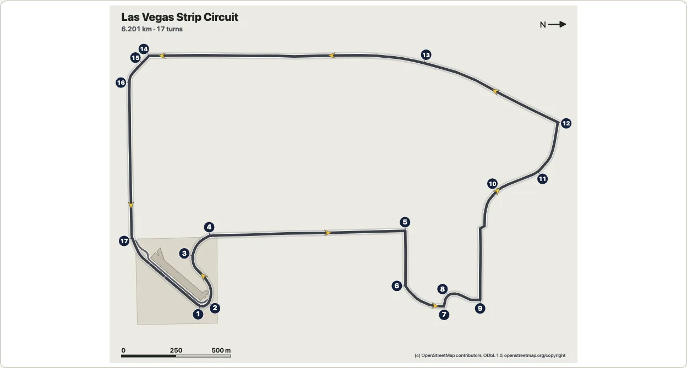

# サーキット

日本語 · [English](circuits.md)

OpenStreetMapに登録されたレーストラックを描きます。周回路はサーキットの道路に沿ってコース幅の帯で描き、ピットレーン、ピットビルのある敷地、コースを横切るスタートラインとチェッカー模様のフィニッシュライン、走行方向を示す矢印、各コーナーの脇の番号、方位記号、縮尺を添えます。最初のサーキットは**ラスベガス・ストリップ・サーキット**で、ラスベガス・ストリップ、コーバル・レーン、ハーモン・アベニュー、サンズ・アベニューを走る市街地コースです。[3D表示](./turn.md)では回転する床の上にコースを置き、ピットビルを立ち上げ、各コーナーの番号をポールの上に立てます。レース、シリーズ、チームのものは一切描きません。ロゴ、スポンサー、マークはありません。



```ts
import { circuitById, drawCircuit } from "@johnmorrisdotca/kyogijo-stadiums/circuits";

const svg = drawCircuit({ circuit: "las-vegas", language: "ja" });
console.log(svg.includes('data-turn="17"'), svg.includes("全長6.201 km・17コーナー"));
// true true
const lv = circuitById("las-vegas")!;
console.log(lv.names.ja, lv.length.value, lv.corners.value);
// ラスベガス・ストリップ・サーキット 6201 17
```

サーキットは `drawKyogijo` の `sport` ではなく、独立したエントリー `@johnmorrisdotca/kyogijo-stadiums/circuits` です。周回路は何キロメートルもの道路で、チームも得点も観客もなく、ルールブックではなく地図の座標で描くため、競技場向けの仕組み（スコアのパネル、スタンド、データ提供元の座標系）は使いません。共通して使うのは、3D表示とその操作、ライトとダークのテーマ、OpenStreetMapのデータのクレジット、そして[実在の会場](./venues.md)と同じ、実在の場所のデータの取得・保存・検証の方法です。デモの[サーキットのページ](https://johnmorrisdotca.github.io/kyogijo-stadiums/circuits.html?lang=ja)では、2Dと3D、英語と日本語で描き、データと、表示中の図を描くコードを示します。

## 描くものとその出典

| 部分 | 出典 |
| --- | --- |
| 周回路 | OpenStreetMap：サーキットのリレーションのうち、役割が `forward` または `backward` のウェイを、リレーションの順に、走る向きにそろえて端と端をつなぎ、1つの環にして0.5メートルの精度に簡略化したもの。 |
| コース幅 | 独自の値：12メートル（妥当な推定）。出典はありません（周回路のウェイに幅は登録されておらず、どちらの記事にも書かれていません）。 |
| 白い縁取り | 独自のもの：見やすさのために帯の両側に引いた線で、縁石ではありません。 |
| ピットレーン | OpenStreetMap：リレーションのうち役割が `pit_lane` のメンバー。幅8メートルで描きます（独自の値。出典はありません）。 |
| スタートラインとフィニッシュライン | OpenStreetMap：リレーションのうち役割が `start` と `finish` のノード（`raceway=start` と `raceway=finish` のタグ付き）。コースを横切る線で描き、スタートは白い線、フィニッシュは2列の市松模様で示します。 |
| コーナーの番号 | OpenStreetMap：リレーションのノードのうち、`junction=yes` で `ref` が1から17のもの。各コーナーに1つずつあります。番号の印はカーブの外側に置いて細い線で結び、隣の印と重なる場合は離します。 |
| 走行方向 | 英語版の記事：コースは反時計回りです（日本語版の記事も同じです）。リレーションの `forward` のウェイも同じ向きです。周回路に沿った8つの矢印で示します。 |
| 敷地とピットビル | OpenStreetMap：サーキットの敷地（サーキットの名前が付いた `leisure=sports_centre`）と、その中のピットレーンの脇にある建物。高さ19.5メートル、4階建てです（`height` と `building:levels`）。 |
| 縁石、ランオフエリア、グラベル | ありません。OpenStreetMapには、この場所でレース用に登録されたものはありません。周回路から60メートル以内にある縁石は、道路の横断歩道にある歩行者用のもの（段差を下げ、点字ブロックのあるもの）だけで、サーキットのものとしては扱いません。 |
| 方位記号と縮尺 | 地図から独自に描くもの：周回路の長い辺がページに沿うように置き（地図を回転させるだけで、裏返しにはしません）、矢印で北を示します。縮尺は、図の幅のおよそ5分の1になる切りのよいメートル数です。 |

## ラスベガス・ストリップ・サーキット

| 項目 | 値 | 根拠と出典 |
| --- | --- | --- |
| 名前 | ラスベガス・ストリップ・サーキット | Q113112116 の Wikidata のラベル |
| 1周の長さ | 6.201 km | 出典あり：英語版記事の基本情報欄（版 1376988769）。日本語版記事の基本情報欄（版 108197128）も同じ値です。日本語版記事の本文には6.120 kmとありますが、どちらの基本情報欄にも英語版記事にもない値のため使っていません。 |
| 描いた線の長さ | 6.210 km | 描いた周回路に沿って測った値。公表値より9メートル（0.15パーセント）長くなっています |
| コーナー数 | 17 | 出典あり：英語版記事の基本情報欄と本文（レースの発表時は14コーナーで、シケインが加わって17になりました） |
| 走行方向 | 反時計回り | 出典あり：英語版記事 |
| 開業 | 2023年11月16日 | 出典あり：Wikidata の P1619 |
| 描いたコース幅 | 12 m | 独自の値（妥当な推定） |
| 描いたピットレーン幅 | 8 m | 独自の値（妥当な推定） |

**長さの確かめ方。** ビルド（`pnpm circuits`）は、Overpassから取得した生データで周回路をつなぎ、環が閉じない場合、コーナーが周回路から2メートル以上離れているか順番が違う場合、線の長さが公表値と3パーセント以上違う場合には止まります。ウェイの長さは簡略化の前が6,210.2メートル、後が6,210.1メートルです。周回路は一方通行の車道の中心線で、レーシングラインではないため、公表値の6,201メートルを少し上回るのは想定どおりです。`src/circuits.raw.test.js` は生データから周回路をつなぎ直し、描いた図の長さが1メートル以内、描いた各点が生データの線から0.5メートルの許容範囲内にあることを確かめます。

**コーナーの位置は記事と合っています。** OpenStreetMapの番号は、英語版記事の周回の説明どおりの位置にあります。ターン1はピットの後のヘアピン、ターン5から9はスフィアの周り（日本語版記事）、ターン10と11はサンズ・アベニュー、ターン12はラスベガス・ブールバードに入る低速の左コーナー、ターン13はストリップ上、ターン14から16はハーモン・アベニューに入る区間、ターン17はピット手前の高速の左コーナーです。

**近くの会場。** パッケージが[実在の会場](./venues.md)として描くT-モバイル・アリーナは、周回路のいちばん近い地点から南西に約790メートル、ストリップを挟んだ反対側にあります。サーキットのすぐ脇ではありませんが、両方（とその間のホテルやスフィア）を1つの地面に置く[会場の地区](./district.md)にできる距離です。これはまだ作っていません。

## オプション

| オプション | 内容 |
| --- | --- |
| `circuit` | サーキットのキー（`CIRCUIT_IDS`）：`las-vegas`。それ以外を渡すと、キーの一覧を示すエラーになります。 |
| `language` | `en`（既定）または `ja`：名前、データの行、説明、表の言語。 |
| `theme` | `light` または `dark` を指定するとそのテーマに固定し、省略するとページと端末の設定に従います。色はカスタムプロパティです（`--ky-ci-*`、`KYOGIJO_CIRCUIT_STYLE`）。 |
| `label` | 左上の名前とデータの行：`true`（既定）または `false`。 |
| `turns` | コーナーの番号：`true`（既定）または `false`。 |
| `arrows` | 周回路に沿った矢印：`true`（既定）または `false`。 |
| `id`、`className`、`css` | 図の中のIDの接頭辞、ルート要素に加えるクラス、スタイルシートを省く `css: "none"`。 |

`circuitTable(options)` は各データとその根拠を表で返します。`circuitPlan(circuit)` は図の座標系（フィート単位、周回路の長い辺がx方向）での平面図を、描いた線の長さとともに返します。データそのものは `CIRCUITS`、`circuitById` とその型です。

## 3D表示


```ts
import { buildCircuitTurn, circuitTurnMarkup } from "@johnmorrisdotca/kyogijo-stadiums/circuits";

const model = buildCircuitTurn({ circuit: "las-vegas", language: "ja" });
console.log(model.planes.length, model.title);
// 68 ラスベガス・ストリップ・サーキット
const html = circuitTurnMarkup({ circuit: "las-vegas", language: "ja" }, { preset: "corner" });
console.log(html.includes('data-part="turn-17"'), html.includes("preserve-3d"));
// true false
```

床はサーキット自身の図で、名前はページに任せ、コーナーの番号は床から立ち上げます。床の上には、OpenStreetMapに登録された高さ19.5メートルのピットビルが箱（地区の建物と同じく壁と屋根）として立ち、各コーナーの上には番号の付いた丸い印が細いポールの上に立ちます。印は視点の方を向き、正面から読めるように後ろに傾きます（真上から見ると平らに寝ます）。印は読めるように大きくした目印で（`CIRCUIT_MARKER`：図の長い辺の1000分の30の大きさの印を、1000分の22の高さのポールに載せます）、コーナーに実際にこの大きさのものが立っているわけではありません。`uprights: false` にすると床だけになり、番号は床の上に描きます。視点は `CIRCUIT_PRESETS` で、真上、長い辺の上空から見る中継カメラ、エンド側から、低い角度からの4つです。周回路は何キロメートルも広がる平らなものなので、どれも単一の競技場より高い位置から見ます。

**軽く描きます。** ラスベガスの3D表示は68枚の面（17個の印、その34本のポールの帯、ピットビルの17の面）と合計292の要素で、サッカーのスタジアム（110枚の面と500の要素）より少なくなっています。床は14.8 KB（gzip圧縮で3.7 KB）のSVG 1つです。`CIRCUIT_PLANES_MAX`（120）で各サーキットの3D表示の面の数を制限し、床が40 KB未満であることをテストで確かめています。周回路はビルドの時点で一度だけ簡略化しており（0.5メートルの精度で228点から107点）、回転中には何も簡略化しません。

**ひとりでに動くことはありません。** 表示はほかの3D表示と同じもの（`mountTurn`）です。読み手が回すか自動回転を押すまで何も動かず、止まっている間は何も描かず、ページが隠れているときや表示が画面の外にあるときは自動回転が止まります。要素は一度作るだけで、あとは動かすだけなので、回しても何も増えません。デモのテストで実際に動かして数えています。

## 次のサーキットを加えるには

サーキットのほとんどはデータです。`scripts/circuits.data.json` の1件、1回の取得、1回のビルドで加わります。モナコ、スパ・フランコルシャン、インディアナポリスなら次のとおりです。

1. **リレーションを探します。** OpenStreetMapで、サーキットのリレーション（`type=circuit` または `route=circuit` で、サーキットのWikidataの項目のタグ付き）、`forward` または `backward` のメンバーのウェイ、`pit_lane`、`start` と `finish` のノード、そしてサーキットの敷地（サーキットの名前が付いた `leisure=sports_centre` や `landuse=` のウェイ）とその中のピットビルを探します。モナコのコースは公国の市街地なので、ラスベガスと同じく普通の道路にかかるリレーションである可能性が高く、スパとインディアナポリスは独自の `highway=raceway` のウェイである可能性が高そうです。データを書く前に確かめてください。3か所とも、まだ読み取っていません。リレーションにコーナーのノード（`ref` 付きの `junction=yes`）がない場合は、コーナーの番号を描かず、ドキュメントにそう書きます。推測で置くことはしません。
2. **データを書きます。** `id`、`wikidata`、`osm`（`relation`、`area`、`pitBuilding`）、英語版と日本語版の記事のほか、各データとして `names`（Wikidataのラベル）、`country`、`opened`、`length` と `corners`（読み取った基本情報欄の行付き）、`direction`（それを述べた文付き）、`width` と `pitLaneWidth` を書きます。それぞれ、出典付きの `documented` か、独自の値の `plausible` にします。インディアナポリスのロードコースとオーバルのように複数のレイアウトがあるサーキットは、レイアウトごとに1件とし、それぞれのリレーションを使います。
3. **一度だけ取得します。** `pnpm circuits:fetch <日付> <id>` が、Wikidata、両方のウィキペディア、Overpassに、間を置いて1件ずつ問い合わせ、結果を `data-sources/circuits/<日付>/` に保存します。
4. **ビルドします。** `pnpm circuits` が、`documented` の各データを生データと照らし合わせ、周回路の長さを公表値と比べ（3パーセント以内）、`src/circuits.data.ts` と `src/circuits.osm.data.ts` を書き出します。鈴鹿の8の字のように周回路が自分自身と交差するサーキットには、もう1つ必要なものがあります。交差のデータ（どちらが上を通るかを、ウェイの `bridge` や `layer` のタグから読み取ったもの）で、2Dでは下を通る帯に切れ目を入れ、3Dでは上を通る部分を橋として立てます。
5. **クレジットを書きます。** `NOTICE.md` に1行（日本語版の記事は `NOTICE.ja.md` にも）、そしてこのページの表にも書きます。デモのページとテストは、`CIRCUITS` のサーキットをすべて自動的に扱います。

## 出典とライセンス

- **OpenStreetMap、ODbL 1.0、(c) OpenStreetMap contributors。** 周回路、ピットレーン、敷地、ピットビル、コーナーの番号、スタートとフィニッシュ。2026年11月3日にOverpass APIで読み取りました（relation/16696508、敷地の way/233786564、建物の way/1198427833）。これらは `src/circuits.osm.data.ts` と `data-sources/circuits/` にだけ置き、パッケージのCC0やCC BY-SAのファイルにコピーすることも、そうしたファイルからコピーすることもありません。ODbLのもとで、クレジット `CIRCUIT_ATTRIBUTION`（会場と同じ文言：`(c) OpenStreetMap contributors, ODbL 1.0, openstreetmap.org/copyright`）を付けて提供します。これらから描いた図はODbLでいう「生成物」（Produced Work）にあたり、図の隅と説明にクレジットを入れています。
- **Wikidata、CC0。** Q113112116 の英語と日本語のラベル、国（P17）、開業日（P1619）。
- **英語版と日本語版のウィキペディア、CC BY-SA 4.0。** 長さ、コーナー数、走行方向。それぞれ記事と版を記録しています（`Las Vegas Strip Circuit`、1376988769。`ラスベガス・ストリップ・サーキット`、108197128）。使っているのは事実を表す数値と独自の言葉で、記事の文章ではありません。記事のクレジットは [NOTICE.md](../NOTICE.md#the-circuits-sources) にあります。
- **生データ**は、返ってきたままの形で `data-sources/circuits/2026-11-03/` に保存しています（問い合わせとOpenStreetMapのデータの時刻付きの `osm-las-vegas.json`、`wikidata.json`、読み取った基本情報欄の行と文を根拠として残した `wikipedia.json`）。

## 制限

- 周回路はOpenStreetMapに登録された車道の中心線で、レーシングラインではありません。コース幅は周回路全体で1つの推定値なので、実際のコースがそれより広い所や狭い所では、帯の幅は実際と違います。
- バリア、グランドスタンド、ストリップをまたぐ歩道橋、周回路の脇のホテルやスフィアは描いていません。描くのは、サーキットのリレーションとその敷地に登録されたものだけです。
- サーキットはまだ1か所です。次は交差のある鈴鹿を考えており、必要なものは上の手順に書いたとおりです。
