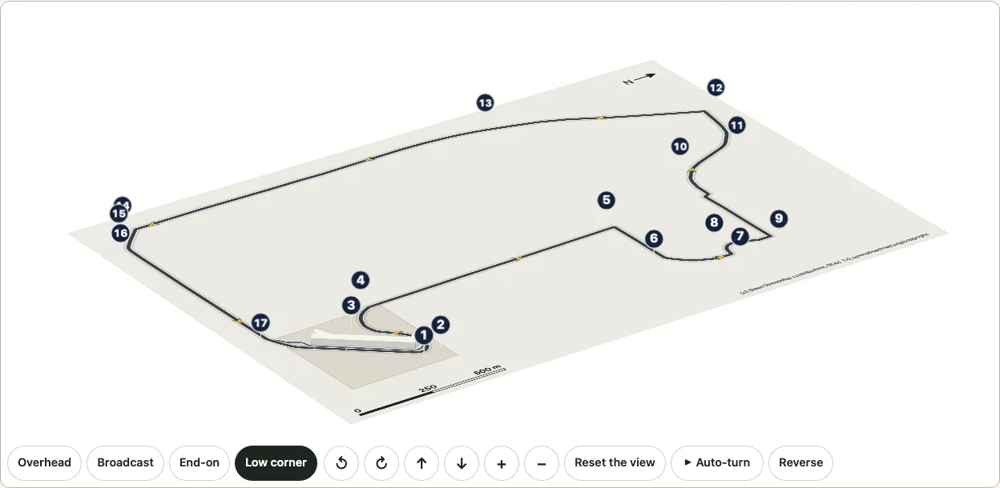
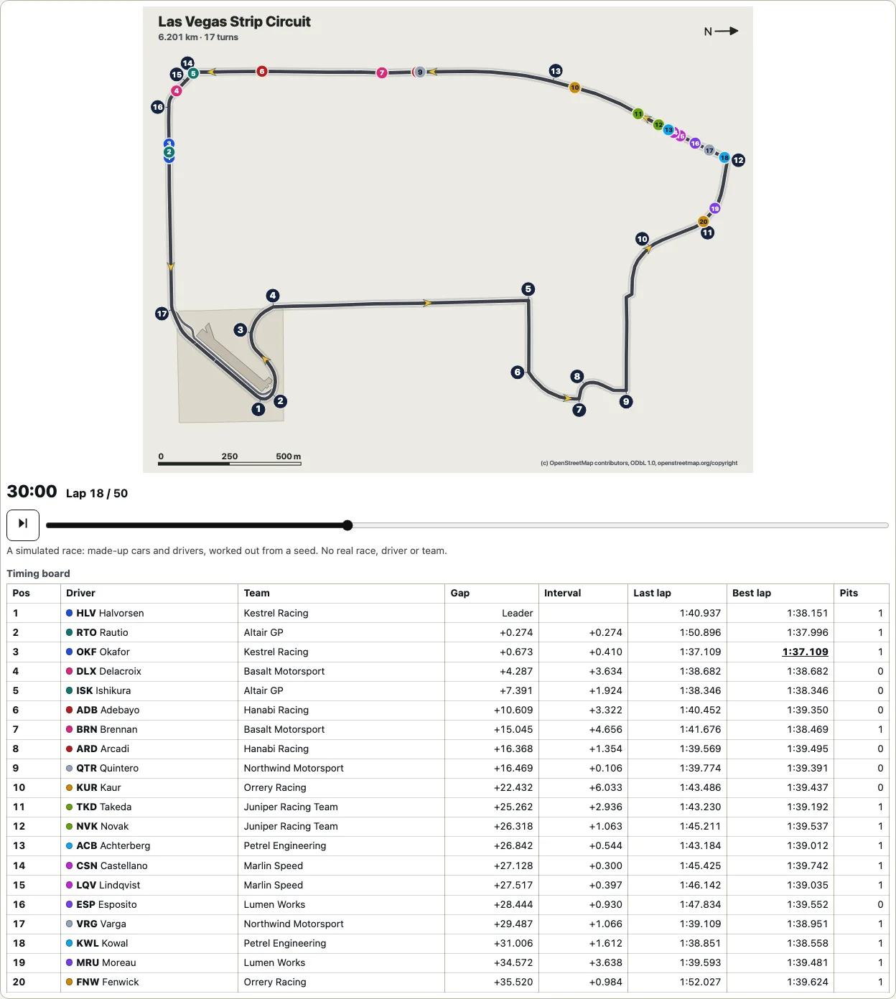
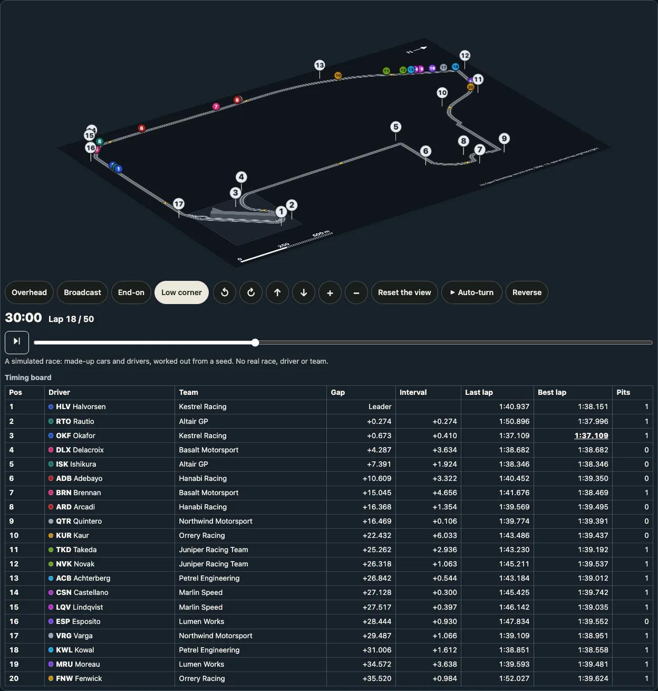

# サーキット

日本語 · [English](circuits.md)

OpenStreetMapに登録されたレーストラックを描き、その上でシミュレーションレースを走らせます（[レース](#レース)）。周回路はサーキットの道路に沿ってコース幅の帯で描き、ピットレーン、ピットビルのある敷地、コースを横切るスタートラインとチェッカー模様のフィニッシュライン、走行方向を示す矢印、各コーナーの脇の番号、方位記号、縮尺を添えます。最初のサーキットは**ラスベガス・ストリップ・サーキット**で、ラスベガス・ストリップ、コーバル・レーン、ハーモン・アベニュー、サンズ・アベニューを走る市街地コースです。[3D表示](./turn.md)では回転する床の上にコースを置き、ピットビルを立ち上げ、各コーナーの番号をポールの上に立てます。レース、シリーズ、チームのものは一切描きません。ロゴ、スポンサー、マークはありません。


```ts
import { circuitById, drawCircuit } from "@johnmorrisdotca/kyogijo-stadiums/circuits";

const svg = drawCircuit({ circuit: "las-vegas", language: "ja" });
console.log(svg.includes('data-turn="17"'), svg.includes("全長6.201 km・17コーナー"));
// true true
const lv = circuitById("las-vegas")!;
console.log(lv.names.ja, lv.length.value, lv.corners.value);
// ラスベガス・ストリップ・サーキット 6201 17
```

サーキットは `drawKyogijo` の `sport` ではなく、独立したエントリー `@johnmorrisdotca/kyogijo-stadiums/circuits` です。周回路は何キロメートルもの道路で、チームも得点も観客もなく、ルールブックではなく地図の座標で描くため、競技場向けの仕組み（スコアのパネル、スタンド、データ提供元の座標系）は使いません。共通して使うのは、3D表示とその操作、ライトとダークのテーマ、OpenStreetMapのデータのクレジット、そして[実在の会場](./venues.md)と同じ、実在の場所のデータの取得・保存・検証の方法です。デモの[サーキットのページ](https://johnmorrisdotca.github.io/kyogijo-stadiums/circuits.html?lang=ja)では、2Dと3D、英語と日本語で描き、データと、表示中の図を描くコードを示します。

## 描くものとその出典

| 部分 | 出典 |
| --- | --- |
| 周回路 | OpenStreetMap：サーキットのリレーションのうち、役割が `forward` または `backward` のウェイを、リレーションの順に、走る向きにそろえて端と端をつなぎ、1つの環にして0.5メートルの精度に簡略化したもの。 |
| コース幅 | 独自の値：12メートル（妥当な推定）。出典はありません（周回路のウェイに幅は登録されておらず、どちらの記事にも書かれていません）。 |
| 白い縁取り | 独自のもの：見やすさのために帯の両側に引いた線で、縁石ではありません。 |
| ピットレーン | OpenStreetMap：リレーションのうち役割が `pit_lane` のメンバー。幅8メートルで描きます（独自の値。出典はありません）。 |
| スタートラインとフィニッシュライン | OpenStreetMap：リレーションのうち役割が `start` と `finish` のノード（`raceway=start` と `raceway=finish` のタグ付き）。コースを横切る線で描き、スタートは白い線、フィニッシュは2列の市松模様で示します。 |
| コーナーの番号 | OpenStreetMap：リレーションのノードのうち、`junction=yes` で `ref` が1から17のもの。各コーナーに1つずつあります。番号の印はカーブの外側に置いて細い線で結び、隣の印と重なる場合は離します。 |
| 走行方向 | 英語版の記事：コースは反時計回りです（日本語版の記事も同じです）。リレーションの `forward` のウェイも同じ向きです。周回路に沿った8つの矢印で示します。 |
| 敷地とピットビル | OpenStreetMap：サーキットの敷地（サーキットの名前が付いた `leisure=sports_centre`）と、その中のピットレーンの脇にある建物。高さ19.5メートル、4階建てです（`height` と `building:levels`）。 |
| 縁石、ランオフエリア、グラベル | ありません。OpenStreetMapには、この場所でレース用に登録されたものはありません。周回路から60メートル以内にある縁石は、道路の横断歩道にある歩行者用のもの（段差を下げ、点字ブロックのあるもの）だけで、サーキットのものとしては扱いません。 |
| 方位記号と縮尺 | 地図から独自に描くもの：周回路の長い辺がページに沿うように置き（地図を回転させるだけで、裏返しにはしません）、矢印で北を示します。縮尺は、図の幅のおよそ5分の1になる切りのよいメートル数です。 |

## ラスベガス・ストリップ・サーキット

| 項目 | 値 | 根拠と出典 |
| --- | --- | --- |
| 名前 | ラスベガス・ストリップ・サーキット | Q113112116 の Wikidata のラベル |
| 1周の長さ | 6.201 km | 出典あり：英語版記事の基本情報欄（版 1376988769）。日本語版記事の基本情報欄（版 108197128）も同じ値です。日本語版記事の本文には6.120 kmとありますが、どちらの基本情報欄にも英語版記事にもない値のため使っていません。 |
| 描いた線の長さ | 6.210 km | 描いた周回路に沿って測った値。公表値より9メートル（0.15パーセント）長くなっています |
| コーナー数 | 17 | 出典あり：英語版記事の基本情報欄と本文（レースの発表時は14コーナーで、シケインが加わって17になりました） |
| 走行方向 | 反時計回り | 出典あり：英語版記事 |
| 開業 | 2023年11月16日 | 出典あり：Wikidata の P1619 |
| 描いたコース幅 | 12 m | 独自の値（妥当な推定） |
| 描いたピットレーン幅 | 8 m | 独自の値（妥当な推定） |

**長さの確かめ方。** ビルド（`pnpm circuits`）は、Overpassから取得した生データで周回路をつなぎ、環が閉じない場合、コーナーが周回路から2メートル以上離れているか順番が違う場合、線の長さが公表値と3パーセント以上違う場合には止まります。ウェイの長さは簡略化の前が6,210.2メートル、後が6,210.1メートルです。周回路は一方通行の車道の中心線で、レーシングラインではないため、公表値の6,201メートルを少し上回るのは想定どおりです。`src/circuits.raw.test.js` は生データから周回路をつなぎ直し、描いた図の長さが1メートル以内、描いた各点が生データの線から0.5メートルの許容範囲内にあることを確かめます。

**コーナーの位置は記事と合っています。** OpenStreetMapの番号は、英語版記事の周回の説明どおりの位置にあります。ターン1はピットの後のヘアピン、ターン5から9はスフィアの周り（日本語版記事）、ターン10と11はサンズ・アベニュー、ターン12はラスベガス・ブールバードに入る低速の左コーナー、ターン13はストリップ上、ターン14から16はハーモン・アベニューに入る区間、ターン17はピット手前の高速の左コーナーです。

**近くの会場。** パッケージが[実在の会場](./venues.md)として描くT-モバイル・アリーナは、周回路のいちばん近い地点から南西に約790メートル、ラスベガス・ストリップを挟んだ反対側にあります。サーキットのすぐ脇ではありませんが、1つの地面に並べて描ける距離で、[会場の地区](./district.md#las-vegas-a-circuit-on-the-ground-and-the-strips-landmarks)なら実際の位置関係のまま描けます。`planDistrict({ venues: ["t-mobile-arena"], circuit: "las-vegas" })` で両方を並べ、`context` を加えると、周囲にストリップ沿いのホテルのほか、スフィア、ハイ・ローラー、ベラージオの噴水も描きます。デモの[地区のページ](https://johnmorrisdotca.github.io/kyogijo-stadiums/district.html?venues=t-mobile-arena&circuit=las-vegas&labels=1&lang=ja)にプリセットがあります。

## オプション

| オプション | 内容 |
| --- | --- |
| `circuit` | サーキットのキー（`CIRCUIT_IDS`）：`las-vegas`。それ以外を渡すと、キーの一覧を示すエラーになります。 |
| `language` | `en`（既定）または `ja`：名前、データの行、説明、表の言語。 |
| `theme` | `light` または `dark` を指定するとそのテーマに固定し、省略するとページと端末の設定に従います。色はカスタムプロパティです（`--ky-ci-*`、`KYOGIJO_CIRCUIT_STYLE`）。 |
| `label` | 左上の名前とデータの行：`true`（既定）または `false`。 |
| `turns` | コーナーの番号：`true`（既定）または `false`。 |
| `arrows` | 周回路に沿った矢印：`true`（既定）または `false`。 |
| `id`、`className`、`css` | 図の中のIDの接頭辞、ルート要素に加えるクラス、スタイルシートを省く `css: "none"`。 |

`circuitTable(options)` は各データとその根拠を表で返します。`circuitPlan(circuit)` は図の座標系（フィート単位、周回路の長い辺がx方向）での平面図を、描いた線の長さとともに返します。データそのものは `CIRCUITS`、`circuitById` とその型です。

## 3D表示



```ts
import { buildCircuitTurn, circuitTurnMarkup } from "@johnmorrisdotca/kyogijo-stadiums/circuits";

const model = buildCircuitTurn({ circuit: "las-vegas", language: "ja" });
console.log(model.planes.length, model.title);
// 68 ラスベガス・ストリップ・サーキット
const html = circuitTurnMarkup({ circuit: "las-vegas", language: "ja" }, { preset: "corner" });
console.log(html.includes('data-part="turn-17"'), html.includes("preserve-3d"));
// true false
```

床はサーキット自身の図で、名前はページに任せ、コーナーの番号は床から立ち上げます。床の上には、OpenStreetMapに登録された高さ19.5メートルのピットビルが箱（地区の建物と同じく壁と屋根）として立ち、各コーナーの上には番号の付いた丸い印が細いポールの上に立ちます。印は視点の方を向き、正面から読めるように後ろに傾きます（真上から見ると平らに寝ます）。印は読めるように大きくした目印で（`CIRCUIT_MARKER`：図の長い辺の1000分の30の大きさの印を、1000分の22の高さのポールに載せます）、コーナーに実際にこの大きさのものが立っているわけではありません。`uprights: false` にすると床だけになり、番号は床の上に描きます。視点は `CIRCUIT_PRESETS` で、真上、長い辺の上空から見る中継カメラ、エンド側から、低い角度からの4つです。周回路は何キロメートルも広がる平らなものなので、どれも単一の競技場より高い位置から見ます。

**軽く描きます。** ラスベガスの3D表示は68枚の面（17個の印、その34本のポールの帯、ピットビルの17の面）と合計292の要素で、サッカーのスタジアム（110枚の面と500の要素）より少なくなっています。床は14.8 KB（gzip圧縮で3.7 KB）のSVG 1つです。`CIRCUIT_PLANES_MAX`（120）で各サーキットの3D表示の面の数を制限し、床が40 KB未満であることをテストで確かめています。周回路はビルドの時点で一度だけ簡略化しており（0.5メートルの精度で228点から107点）、回転中には何も簡略化しません。

**ひとりでに動くことはありません。** 表示はほかの3D表示と同じもの（`mountTurn`）です。利用者が回すか自動回転を押すまで何も動かず、止まっている間は何も描かず、ページが隠れているときや表示が画面の外にあるときは自動回転が止まります。要素は一度作るだけで、あとは動かすだけなので、回しても何も増えません。デモのテストで実際に動かして数えています。

## レース

**[レースを試す：circuits.html?race=1](https://johnmorrisdotca.github.io/kyogijo-stadiums/circuits.html?race=1)**（デモで実際に動きます）



[レースを試す：circuits.html?race=1](https://johnmorrisdotca.github.io/kyogijo-stadiums/circuits.html?race=1)

```ts
import { raceAt, simulateRace } from "@johnmorrisdotca/kyogijo-stadiums/circuits";

const race = simulateRace({ circuit: "las-vegas" });
console.log(race.laps, race.cars.length, Math.round(race.flag / 60));
// 50 20 82
const now = raceAt(race, 1800);
console.log(now.lap, now.standings[0].position, now.standings[1].gap! < 1);
// 18 1 true
```

```ts no-run
import { mountCircuitRace } from "@johnmorrisdotca/kyogijo-stadiums/circuits";

const race = mountCircuitRace(document.querySelector("#race")!, { circuit: "las-vegas", language: "ja" }, { view: "3d", speed: 10 });
race.play();
```

サーキットではレースを走らせられます。20台のマシンが点としてグリッドに並び、描いた線に沿って周回し、チェッカーフラッグを受けます。レース時計（スタートからの経過時間と、トップが何周目か）とタイミングボード（順位、ドライバーとチーム、トップ差、前車との差、前周タイム、ベストラップ、ピット回数）がそれに合わせて動きます。**これはシミュレーションで、そのことをページと図の説明に明記しています。** マシン、ドライバー、チームはすべて架空のものです（`RACE_TEAMS`、`RACE_DRIVERS`：名前、略号、色はすべて独自に作ったもので、実在のドライバー、チーム、シリーズのものではありません。マシンには固有のカーナンバーはなく、現在の順位だけを表示します）。レースはシード値から計算します。実際のレース、タイム、結果は一切含まれていません。

**フルレース距離を走ります。** 既定では、グランプリの距離の決め方と同じく、305 km以上になる最少の周回数（`raceLaps`）を走ります。ラスベガスでは50周で、チェッカーフラッグまでおよそ1時間22分です。1倍速では実時間で再生され、レース時計とタイミングボードが最後まで動き続けます。10倍速と60倍速（レースの1分が1秒）やスライダーで、レースのどこへでも移動できます。`seed`、`laps`（1〜200）、`cars`（2〜20）を変えると別のレースになり、同じ指定からはいつも同じレースが得られます。

**計算のしかた。** `paceProfile` は描いた線を5メートルごとに読み、各地点にそのカーブで出せる最高速度を割り当てます。カーブの半径 `r` と、ウイングが車体を押さえつけるため速度とともに増える横方向のグリップから `v² = r × (22 + 0.0036 v²)` を求め、直線では94 m/sを上限とします。前向きの計算でエンジンが加えられる加速度（停止時17 m/s²、最高速度で0）を、後ろ向きの計算でブレーキが減らせる減速度（34 m/s²）を守らせるので、マシンはコーナーの手前でブレーキをかけ、立ち上がりで加速します。レーシングカーは道路の中央を走らないので、カーブは前後32メートルの範囲で測ります。これでラスベガスの1周は1:35.6となり、速度はストリップの時速338 kmから最もきついコーナーの時速84 kmまで変わります。`simulateRace` は全車を0.2秒刻みで進めます。各マシンは、チームによる差（1チームごとに0.25%）、燃料（満タンで2.4%、チェッカーフラッグに向けてゼロまで減る）、タイヤ（使った周回数に応じて遅くなり、24周を過ぎると落ち込みが大きくなる）、その周ごとのばらつき（ときどきミスを含む）の分だけ、その速度より少し遅く走ります。前車との差が1秒以内なら、直線ではスリップストリームで速くなり、コーナーでは乱気流で少し遅くなります。差がおよそ0.4秒より詰まると、直線でしかも相手より速い場合を除いて抜けずに後ろにつきます。こうして車列ができては崩れ、周回遅れのマシンはどこででもトップ集団に道を譲ります。各マシンは戦略で決めた周に1回か2回ピットレーンに入り、時速80 kmで走り、2〜3秒停止します（ときどき作業に手間取ります）。各マシンには20分の1の確率でリタイアがあります（既定のレースではリタイアはありません）。各マシンの走行距離を1秒ごとに記録し、`raceAt` はそこから任意の時点を読み出します。

**公開のタイミングデータを参考にしていますが、同梱はしていません。** モデルの値（最高速度、各速度でのブレーキと加速、ピットレーンの通過時間と停止時間、1レースあたり1〜3回のピットストップ）は、OpenF1 API（openf1.org）からラスベガスの1レースを読んで決めました。ドライバー1人の周回データ、1周分の車両データ、ピットストップの一覧を、リクエストを1つずつ送って一度だけ取得し、リポジトリとパッケージの外にあるメンテナーのマシンに保存しています。*ペースはOpenF1のデータを参考にしています。* そのレースのもの（ドライバー、チーム、順位、差、タイム）は、パッケージにも、デモにも、このドキュメントにも一切含まれていません。

**ページで使うには。** `mountCircuitRace(host, options, settings)` はサーキットを平面で（`view: "3d"` なら3D表示で、マシンは視点の方を向く円盤として立ちます）表示し、その下に、すべてのリプレイと共通の操作バー（最初に戻る、前の周へ、次の周へ、再生、1倍・10倍・60倍のボタン、繰り返し、レース全体のスライダー、経過時間とその下の周回・フラッグ表示）とタイミングボードを置きます。スマートフォンでは、タイミングボードに順位、ドライバーの略号、トップ差、前車との差だけを表示します。戻り値には `play`、`pause`、`seek`、`nextLap`、`prevLap`、`step(±1)`、`setSpeed`、`setLoop`、`setMarkers`、`setLabels`、`setTower`、`setOverlay`、`setPodium`、`setFollow`、`holdFollow`、`slots`、`state`、`moment`、`update`（言語やテーマを変えても時計はそのまま）、`destroy` があります。スクリーンリーダーには、トップが入れ替わったときと、チェッカーフラッグを誰が受けたかを伝えます。動きを減らす設定では何もひとりでに再生されず、再生・速度・繰り返しのボタンは表示されず、「次の周へ」でトップの次の周へ移ります。キー操作は試合のリプレイと同じです。スペースキーで再生と一時停止、矢印キーで周ごとの移動、Shiftキーを押しながら矢印キーで1分ずつの移動、Homeキーで最初、Endキーで最後に移動します。3D表示では、矢印キーの代わりにカンマキーとピリオドキーを使い、矢印キーはビューを回します。`loop: true` を指定すると、レースが終わったらグリッドからもう一度走ります（デモのアドレスでは `loop=1`）。

**コーナー番号、順位の数字、トップの目印。** レースはマシンが主役なので、コースの上に立つコーナー番号は、レース中は既定で**表示しません**（`markers: true` か `setMarkers(true)` で、平面でも3Dでも表示できます。レースがないときは、これまでどおり番号が表示されます）。`labels: false`（`setLabels`）で、マシンの丸に書いた順位の数字を消せます。地図データのクレジット、縮尺、方位記号は常に残ります。**トップのマシン**には、この2つの設定に関係なく目印が付きます。目印は、丸の周りの琥珀色の輪と、その上の小さな**P1**のタグです。輪の縁は暗い色なので、明るい背景でも暗い背景でも、平面でも3Dでも読めます。タイミングボードの1行目にも色が付きます。目印は今のトップのマシンに付いたままで、別のマシンが1.5メートル以上前に出てはじめて移ります（`raceLeaderMark`）。そのため、ほぼ並んだ2台の間でちらつくことはありません。再生位置を飛ばしたときは、すぐに今のトップのマシンに移ります。デモには「コーナー番号」と「順位の数字」のボタンがあり、設定はアドレスに保存されます（`markers=1`、`markers=0`、`labels=0`）。`drawRace` はある時点の図を1つのSVG文字列として、`raceBoard` はタイミングボードを表として返すので、サーバーや独自のページで使えます。

**スコアボードと表彰台。** レースにも、アリーナと同じようにスコアボードがあります。**タイミングタワー**は、スタート／フィニッシュラインのあるホームストレートのそばの、周回路とピットレーンにかからない、余裕のある側に立ちます。平面図ではパネルとして、3Dでは視点の方を向く支柱の上のスクリーンとして表示されます。周回数（またはグリッド、フラッグ）、上位10台の順位・チームカラー・略号・差、それ以外のマシンを流す一行、ファステストラップを表示します。内容はタイミングボードと同じで（テストがレースの途中の複数の時点で突き合わせています）、書き換えるのは文字が変わったときだけで、ボードの更新と一緒に、1秒に4回までです。一時停止中は何も書き換えません。`tower: false`（`setTower`）で表示しないこともできます。同じタワーを放送画面風にビューの左に重ねる**オーバーレイ**は、初期状態ではオフです（`overlay: true`、`setOverlay`。デモの「タイミングタワー」ボタン、アドレスでは `overlay=1`）。**チェッカーフラッグ**が振られると、トップのマシンの「P1」タグがフラッグに変わり、タワーにフラッグとトップのレースタイムが表示され、ビューの上に**表彰台のカード**が現れます。カードには上位3台（名前、チーム、トップのタイム、他のマシンの差。まだフラッグを受けていないマシンは「走行中」）とファステストラップが表示されます。カードには閉じるボタンがあり、操作バー（`extra` スロット）の「表彰台」ボタンで再び表示できます。フラッグより前に戻すと、カードとボタンは消えます。全車がフラッグを受けたあとは、カードの内容がそのまま最終順位になります（`podiumData`）。スマートフォンでは、カードはビューの上ではなく下に表示します。シミュレーションのレースでも、フィードから取り込んだレースでも使えます。シミュレーションのレースでは、カードとタワーに表示するものもすべて架空のものです。フィードから取り込んだレースでは、名前とタイムはフィードのものです。

**カメラはトップを追う。** サーキットのレースは、**トップにゆっくり寄り、トップに合わせて動き、引いて、常にトップを画面に収める**カメラで見られます。見る人が選ぶまでは使われません（`follow: "leader"` または `"pack"`、`setFollow`。デモはアドレスに `follow=leader` または `follow=pack` として残します）。レースの操作バーのカメラの欄には、**トップ**（トップだけを、サーキット全体の最大4倍まで寄って中央に映します）、**先頭集団**（トップとそのすぐ後ろのマシンを、まわりに余白をとって映します。集団が固まると最大6倍まで寄り、広がると引きます）、**再び追う**があります。オンのボタンをもう一度押すとカメラは止まり、ゆっくりサーキット全体に戻ります。これは、[プレーを追うカメラ](replay.ja.md)の、トップをパックに見立てたものです。同じ臨界減衰のばね（ゆっくりなめらかに動き、フレームの間で飛びません）、小さな動きでは動かない不感帯、そしてレースがカメラの動きより先に進んだときにフレームをトップといっしょに動かす仕組みを備えているので、どちらのモードでも、1倍、60倍、600倍のどの速さでも、トップが画面の外に出ません（テストが、レース全体を再生して確かめています）。追い越しのあとも、新しいトップへ飛ばずに移ります。平面では図の `viewBox` で図の一部を映し、3Dでは床の上の注目する点と、ビュー自身のズームに重ねるズームとして働くので、どの視点でも角度はそのままです。3D表示を見る人が回す、傾ける、ズームするとカメラは止まり、**再び追う**を押すまで止まったままです。視点のボタンやリセットは、サーキット全体に戻します。動きを減らす設定では、1コマ進めるたびにカメラはすぐにあるべき位置へ移ります。カメラが寄っている間は図の中の地図の出典表示が枠の外に出るため、出典は文字でビューの上に残します（ODbLの条件です）。

**自動で追うボタンは自動回転の隣に。** 3D表示のボタンの列には、**自動回転**のすぐ後ろに**自動で追う**のボタンがあります。自動回転と同じ形のボタンで、レースでも試合のリプレイでも同じように使えます。2つは同時にオンにできます。ビューがゆっくり回るあいだ、カメラはトップを追います。このページの動く図は、その様子です。

カメラのための余計な負荷はありません。レース自身のアニメーションフレームの中で（3D表示では、ビューとレースが共有する1つのフレームの中で）動き、レースが一時停止している間、ページが隠れている間、ビューが画面の外にある間は何も動かず、オフで落ち着いていれば何もしません。`e2e/race.demo.mjs` で、カメラをオンにした状態（平面と3D、トップと先頭集団）について、フリーズとリークが上限内に収まっていること、そしてどの時点でもトップが画面にあることを確かめています。

**必要のないことはしません。** 再生するまで何も動かず、一時停止中、ページが隠れているとき、画面の外にスクロールしたときも何も動きません。各フレームでは動いた点だけを動かし、時計とタイミングボードは文字が変わったところだけを書き換えます（タイミングボードは1秒に4回まで）。3Dではレースが表示を通じてフレームを要求するので、自動回転とレースは1つのフレームを共有します。再生中に要素は増えず、`destroy` の後には何も残りません。`e2e/race.demo.mjs` で、平面と3Dの両方について、10回のレースを通してこれらを確かめています。



**どのサーキットでも走ります。** レースにラスベガス固有のものはありません。速度は線から、ピットレーンはそのサーキット自身のものから、グリッドはスタートラインから、周回数はコースの長さから決まります。テストでは、パッケージが描くすべてのサーキットでレースを走らせ、すべての点がコース上かピットレーン上にあることを確かめています。

**地区の地面の上でも走ります。** 同じレースを、サーキットの周りの会場や街並みの中でも走らせられます。[ラスベガスの地区](./district.md#a-race-on-the-strip)では、T-モバイル・アリーナ、スフィア、ストリップ沿いのホテル群と並べたストリップ・サーキットの上に点を置き、平面でも3Dでも表示します（`drawDistrictRace`、`mountDistrictRace`）。デモのサーキットのページから地区のページへのリンクをたどると、レースもそのまま引き継がれます。

## 次のサーキットを加えるには

サーキットのほとんどはデータです。`scripts/circuits.data.json` の1件、1回の取得、1回のビルドで加わります。モナコ、スパ・フランコルシャン、インディアナポリスなら次のとおりです。

1. **リレーションを探します。** OpenStreetMapで、サーキットのリレーション（`type=circuit` または `route=circuit` で、サーキットのWikidataの項目のタグ付き）、`forward` または `backward` のメンバーのウェイ、`pit_lane`、`start` と `finish` のノード、そしてサーキットの敷地（サーキットの名前が付いた `leisure=sports_centre` や `landuse=` のウェイ）とその中のピットビルを探します。モナコのコースは公国の市街地なので、ラスベガスと同じく普通の道路にかかるリレーションである可能性が高く、スパとインディアナポリスは独自の `highway=raceway` のウェイである可能性が高そうです。データを書く前に確かめてください。3か所とも、まだ読み取っていません。リレーションにコーナーのノード（`ref` 付きの `junction=yes`）がない場合は、コーナーの番号を描かず、ドキュメントにそう書きます。推測で置くことはしません。
2. **データを書きます。** `id`、`wikidata`、`osm`（`relation`、`area`、`pitBuilding`）、英語版と日本語版の記事のほか、各データとして `names`（Wikidataのラベル）、`country`、`opened`、`length` と `corners`（読み取った基本情報欄の行付き）、`direction`（それを述べた文付き）、`width` と `pitLaneWidth` を書きます。それぞれ、出典付きの `documented` か、独自の値の `plausible` にします。インディアナポリスのロードコースとオーバルのように複数のレイアウトがあるサーキットは、レイアウトごとに1件とし、それぞれのリレーションを使います。
3. **一度だけ取得します。** `pnpm circuits:fetch <日付> <id>` が、Wikidata、両方のウィキペディア、Overpassに、間を置いて1件ずつ問い合わせ、結果を `data-sources/circuits/<日付>/` に保存します。
4. **ビルドします。** `pnpm circuits` が、`documented` の各データを生データと照らし合わせ、周回路の長さを公表値と比べ（3パーセント以内）、`src/circuits.data.ts` と `src/circuits.osm.data.ts` を書き出します。鈴鹿の8の字のように周回路が自分自身と交差するサーキットには、もう1つ必要なものがあります。交差のデータ（どちらが上を通るかを、ウェイの `bridge` や `layer` のタグから読み取ったもの）で、2Dでは下を通る帯に切れ目を入れ、3Dでは上を通る部分を橋として立てます。
5. **クレジットを書きます。** `NOTICE.md` に1行（日本語版の記事は `NOTICE.ja.md` にも）、そしてこのページの表にも書きます。デモのページとテストは、`CIRCUITS` のサーキットをすべて自動的に扱います。

## 出典とライセンス

- **OpenStreetMap、ODbL 1.0、(c) OpenStreetMap contributors。** 周回路、ピットレーン、敷地、ピットビル、コーナーの番号、スタートとフィニッシュ。2026年11月3日にOverpass APIで読み取りました（relation/16696508、敷地の way/233786564、建物の way/1198427833）。これらは `src/circuits.osm.data.ts` と `data-sources/circuits/` にだけ置き、パッケージのCC0やCC BY-SAのファイルにコピーすることも、そうしたファイルからコピーすることもありません。ODbLのもとで、クレジット `CIRCUIT_ATTRIBUTION`（会場と同じ文言：`(c) OpenStreetMap contributors, ODbL 1.0, openstreetmap.org/copyright`）を付けて提供します。これらから描いた図はODbLでいう「生成物」（Produced Work）にあたり、図の隅と説明にクレジットを入れています。
- **Wikidata、CC0。** Q113112116 の英語と日本語のラベル、国（P17）、開業日（P1619）。
- **英語版と日本語版のウィキペディア、CC BY-SA 4.0。** 長さ、コーナー数、走行方向。それぞれ記事と版を記録しています（`Las Vegas Strip Circuit`、1376988769。`ラスベガス・ストリップ・サーキット`、108197128）。使っているのは事実を表す数値と独自の言葉で、記事の文章ではありません。記事のクレジットは [NOTICE.md](../NOTICE.md#the-circuits-sources) にあります。
- **生データ**は、返ってきたままの形で `data-sources/circuits/2026-11-03/` に保存しています（問い合わせとOpenStreetMapのデータの時刻付きの `osm-las-vegas.json`、`wikidata.json`、読み取った基本情報欄の行と文を根拠として残した `wikipedia.json`）。

## 制限

- 周回路はOpenStreetMapに登録された車道の中心線で、レーシングラインではありません。コース幅は周回路全体で1つの推定値なので、実際のコースがそれより広い所や狭い所では、帯の幅は実際と違います。
- バリア、グランドスタンド、ラスベガス・ストリップをまたぐ歩道橋は描いていません。描くのは、サーキットのリレーションとその敷地に登録されたものだけです。周回路の脇のホテルやスフィアは、`circuit` と周辺のデータを使う[地区](./district.md#las-vegas-a-circuit-on-the-ground-and-the-strips-landmarks)で描きます。
- レースはモデルです。点は車道の中央を走り、レーシングラインは走らないので、横に並んだ2台は1つの点に重なって見えます。セーフティカー、天候、タイヤの種類はなく、実際のレースのものは何も含みません。
- サーキットはまだ1か所です。次は交差のある鈴鹿を考えており、必要なものは上の手順に書いたとおりです。
