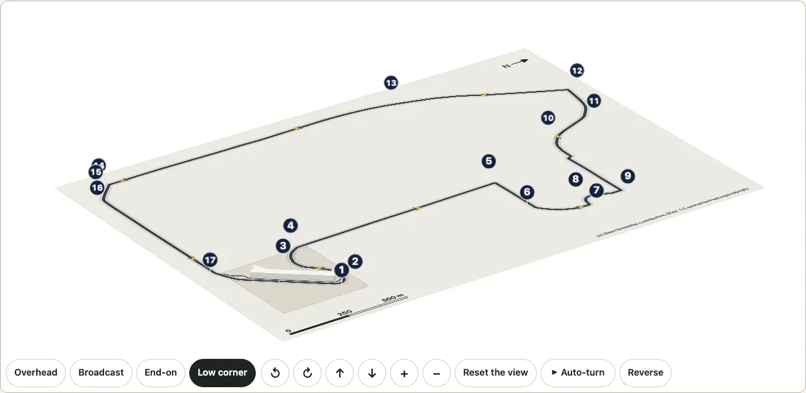
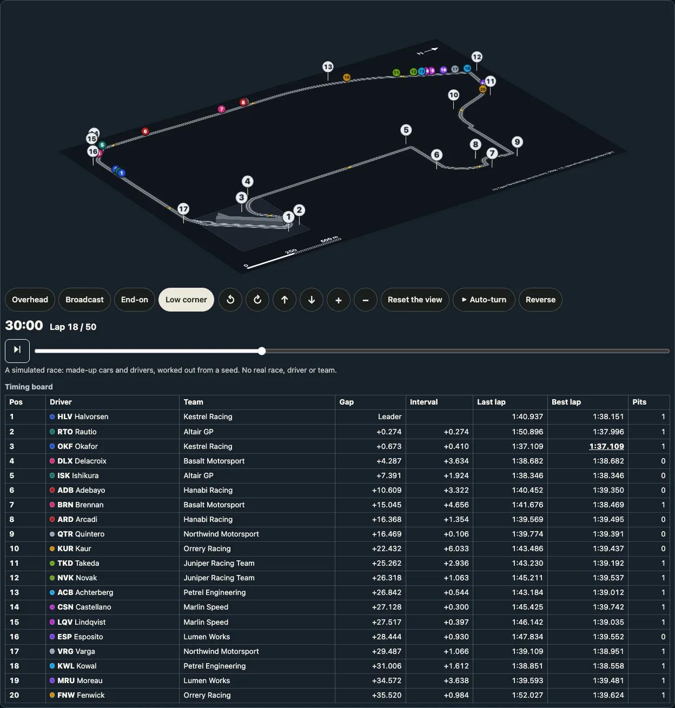

# Circuits

[日本語](circuits.ja.md) · English

A race track drawn as OpenStreetMap maps it, and a simulated race on it ([a race](#a-race)): the lap as a ribbon of the track's width along the ways of the circuit, the pit lane and the circuit's ground with its pit building, the start line and the chequered finish across the track, arrows the way the lap runs, each turn's number beside its bend, a north arrow and a scale bar. The first is the **Las Vegas Strip Circuit**, a street circuit on the Las Vegas Strip, Koval Lane, Harmon Avenue and Sands Avenue. The [3D view](./turn.md) lays it on a floor that turns, with the pit building standing up and each turn's number on a post. Nothing of a race's, a series' or a team's is drawn: no logo, no sponsor, no mark.


```ts
import { circuitById, drawCircuit } from "@johnmorrisdotca/kyogijo-stadiums/circuits";

const svg = drawCircuit({ circuit: "las-vegas" });
console.log(svg.includes('data-turn="17"'), svg.includes("OpenStreetMap"));
// true true
const lv = circuitById("las-vegas")!;
console.log(lv.length.value, lv.corners.value, lv.direction.value, lv.width.basis);
// 6201 17 counterclockwise plausible
```

A circuit is an entry of its own, `@johnmorrisdotca/kyogijo-stadiums/circuits`, and not a `sport` of `drawKyogijo`: a lap is kilometres of road with no teams, no score and no crowd, drawn on a map's frame rather than a rulebook's, so the surfaces' machinery (the score panel, the stands, the frames of a data provider) has nothing to do there. It shares what fits: the 3D view and its controls, the light and dark themes, the credit of OpenStreetMap's data and the way real places are fetched, kept and checked (as [the real venues](./venues.md) are). The demo's [circuits page](https://johnmorrisdotca.github.io/kyogijo-stadiums/circuits.html) draws it in 2D and 3D, in English and Japanese, with its facts and the code that draws what is shown.

## What is drawn, and where it comes from

| Part | From |
| --- | --- |
| The lap | OpenStreetMap: the ways of the circuit's relation with the role `forward` or `backward`, in the relation's order, each turned the way it is driven, joined end to end into one ring and simplified to half a metre. |
| The track's width | Ours: 12 metres, plausible. No source gives it (OpenStreetMap maps no width on the lap's ways, and neither article gives one). |
| The white edges | Ours: a line along each side of the ribbon, for the eye. They are not the kerbs. |
| The pit lane | OpenStreetMap: the relation's member with the role `pit_lane`, drawn 8 metres wide (ours: no source gives it). |
| The start line and the finish line | OpenStreetMap: the relation's nodes with the roles `start` and `finish` (tagged `raceway=start` and `raceway=finish`), drawn across the track: the start as a white line, the finish as two rows of squares. |
| The turns' numbers | OpenStreetMap: the relation's nodes tagged `junction=yes` with a `ref` of 1 to 17, one at each turn. The badge sits beside the outside of the bend, with a thin line to it, and is pushed apart from its neighbours where two would touch. |
| The direction | The English article: the lap runs counterclockwise (the Japanese article says the same); the relation's `forward` ways run that way too. Eight arrows along the lap show it. |
| The ground and the pit building | OpenStreetMap: the circuit's area (`leisure=sports_centre`, named for the circuit) and the building inside it beside the pit lane, 19.5 metres high in 4 levels (its `height` and `building:levels`). |
| Kerbs, run-off and gravel | None. OpenStreetMap maps none for racing here: the only kerbs within 60 metres of the lap are the streets' (lowered, with tactile paving, at the pedestrian crossings), and the drawing does not take them for a circuit's. |
| The north arrow and the scale | Ours, from the map: the drawing lies with the lap's long side along the page (a turn of the map, never a mirror), and the arrow points north. The scale bar is a round number of metres about a fifth of the drawing's width. |

## The Las Vegas Strip Circuit

| Fact | Value | Basis and source |
| --- | --- | --- |
| Name | Las Vegas Strip Circuit (`ラスベガス・ストリップ・サーキット` on the Japanese page) | Wikidata's labels of Q113112116 |
| Length of a lap | 6.201 km | documented: the English infobox (revision 1376988769), which the Japanese infobox (revision 108197128) also gives. The Japanese article's prose says 6.120 km, which neither infobox nor the English article does, and it is not used. |
| Length of the drawn line | 6.210 km | measured along the lap as drawn: 9 metres, 0.15 percent, longer than the published length |
| Turns | 17 | documented: the English infobox, and its prose (14 corners when the race was announced, 17 after a chicane was added) |
| Direction | counterclockwise | documented: the English article |
| Opened | 2023-11-16 | documented: Wikidata's P1619 |
| Track width drawn | 12 m | ours, plausible |
| Pit lane width drawn | 8 m | ours, plausible |

**How the length is held.** The build (`pnpm circuits`) joins the lap from the raw answer of Overpass and stops if it does not close, if a turn is more than 2 metres off it or out of order, or if the line measures more than 3 percent from the published length. The ways measure 6,210.2 metres before they are simplified and 6,210.1 after; the lap is the middle of each one-way carriageway, not a racing line, so a little over the published 6,201 is what to expect. `src/circuits.raw.test.js` joins the lap again from the raw answer and holds the drawing to it: within a metre of its length, and every drawn point within the half-metre tolerance of the raw line.

**The turns agree with the article.** OpenStreetMap's numbers lie where the English article's account of the lap puts them: Turn 1, a hairpin after the pits; Turns 5 to 9 round the Sphere (the Japanese article); Turns 10 and 11 on Sands Avenue; Turn 12, a slow left onto Las Vegas Boulevard; Turn 13 on the Strip; Turns 14 to 16 onto Harmon Avenue; Turn 17, a fast left before the pits.

**Beside it.** T-Mobile Arena, which the package draws among [the real venues](./venues.md), stands about 790 metres south-west of the nearest point of the lap, across the Strip from it: not beside the circuit, but near enough for [a district](./district.md) that puts the two (and the hotels and the Sphere between them) on one ground. That is not built yet.

## Options

| Option | What it does |
| --- | --- |
| `circuit` | The circuit's key (`CIRCUIT_IDS`): `las-vegas`. Any other throws, naming the keys. |
| `language` | `en` (the default) or `ja`: the name, the line of facts, the description and the table. |
| `theme` | `light` or `dark` forces one; left out, the drawing follows the page and the device. The colours are custom properties (`--ky-ci-*`, `KYOGIJO_CIRCUIT_STYLE`). |
| `label` | The name and the line of facts in the top left: `true` (the default) or `false`. |
| `turns` | The turns' numbers: `true` (the default) or `false`. |
| `arrows` | The arrows along the lap: `true` (the default) or `false`. |
| `id`, `className`, `css` | The prefix of the ids inside the drawing, more classes on the root, and `css: "none"` to leave the stylesheet out. |

`circuitTable(options)` gives the facts as a table, each with its basis; `circuitPlan(circuit)` the plan in the drawing's frame (feet, the lap's long side along x), with the length the drawn line measures; `CIRCUITS`, `circuitById` and the types are the data.

## In 3D



```ts
import { buildCircuitTurn, circuitTurnMarkup } from "@johnmorrisdotca/kyogijo-stadiums/circuits";

const model = buildCircuitTurn({ circuit: "las-vegas" });
console.log(model.planes.length, model.planes.filter((p) => p.kind === "sign").length);
// 68 17
const html = circuitTurnMarkup({ circuit: "las-vegas" }, { preset: "corner" });
console.log(html.includes('data-part="turn-17"'), html.includes("preserve-3d"));
// true false
```

```ts no-run
import { mountCircuitTurn } from "@johnmorrisdotca/kyogijo-stadiums/circuits";

const view = mountCircuitTurn(document.querySelector("#lap")!, { circuit: "las-vegas" }, { preset: "corner" });
view.preset("overhead");
```

The floor is the circuit's own drawing, with its name left to the page and its turns' numbers standing up instead. On it stand the pit building, a block at the 19.5 metres OpenStreetMap maps (its walls and its roof, as a district's buildings are), and over each turn a round badge with its number on a thin post, turned to face the eye and leaning back to be read square on (it lies flat seen from straight above). The badges are markers, sized to be read (`CIRCUIT_MARKER`: a badge 30 thousandths of the drawing's longer side across, on a post 22 thousandths high): nothing of their size stands at a corner. `uprights: false` is the floor alone, with the numbers on it. The viewpoints are `CIRCUIT_PRESETS`: overhead, the main camera high over the long side, the end-on view and the low corner, each higher than a single surface's, since a lap is kilometres across and flat.

**It is cheap.** The view of Las Vegas is 68 planes (17 badges, their 34 post strips and 17 faces of the pit building) and 292 elements in all, against a soccer bowl's 110 planes and 500 elements; the floor is one SVG of 14.8 KB (3.7 KB gzipped). `CIRCUIT_PLANES_MAX` (120) holds every circuit's view to a budget, and a test holds the floor under 40 KB. The lap was simplified once, when it was built (228 points to 107, at half a metre), so nothing is simplified while the view turns.

**It does nothing by itself.** The view is every 3D view's (`mountTurn`): nothing moves until the reader turns it or presses Auto-turn, nothing is drawn while it is still, the auto-turn holds while the page is hidden or the view is scrolled out of sight, and the elements are made once and only moved, so nothing grows as it turns. The demo's test plays it and counts.

## A race


```ts
import { raceAt, simulateRace } from "@johnmorrisdotca/kyogijo-stadiums/circuits";

const race = simulateRace({ circuit: "las-vegas" });
console.log(race.laps, race.cars.length, Math.round(race.flag / 60));
// 50 20 82
const now = raceAt(race, 1800);
console.log(now.lap, now.standings[0].position, now.standings[1].gap! < 1);
// 18 1 true
```

```ts no-run
import { mountCircuitRace } from "@johnmorrisdotca/kyogijo-stadiums/circuits";

const race = mountCircuitRace(document.querySelector("#race")!, { circuit: "las-vegas" }, { view: "3d", speed: 10 });
race.play();
```

A circuit can hold a race: twenty cars as dots that start on the grid, run the laps along the drawn line and take the chequered flag, with a race clock (the time since the start, and the lap the leader is on) and a timing board (the position, the driver and team, the gap to the leader and to the car in front, the last and best laps, the stops) that move with it. **It is a simulation, and it says so**, on the page and in the drawing's description: the cars, drivers and teams are made up (`RACE_TEAMS`, `RACE_DRIVERS`: invented names, codes and colours, none of a real driver's, team's or series'; a car carries no number of its own, only the position it holds), and the race is worked out from a seed. No real race, time or result is in it.

**A full race distance.** By default a race runs the fewest laps that make 305 km (`raceLaps`), as a Grand Prix's distance is set: 50 laps of Las Vegas, about an hour and twenty-two minutes to the flag. At 1× it plays in real time, so the clock and the board run the whole way; 10× and 60× (a minute of the race a second) and the slider go anywhere in it. `seed`, `laps` (1 to 200) and `cars` (2 to 20) make another race; the same options always give the same race.

**How it is worked out.** `paceProfile` reads the drawn line every 5 metres and gives each place the fastest speed its bend allows: a bend's radius `r` and the grip across the car, which grows with speed as wings press it down, give `v² = r × (22 + 0.0036 v²)`, held to 94 m/s on a straight. A pass forward holds each speed to what the engine can add (17 m/s² from rest, falling to nothing at the top speed) and a pass backward to what the brakes can shed (34 m/s²), so the cars brake into a turn and pull out of it; a bend is measured over 32 metres either side, because a racing car does not follow the middle of the road. That laps Las Vegas in 1:35.6, from 338 km/h on the Strip down to 84 km/h in its tightest turn. `simulateRace` then runs every car a fifth of a second at a time. Each car runs those speeds a little slower by its team (a quarter of a percent a team), its fuel (2.4 percent with a full tank, falling to nothing at the flag), its tyres (more each lap they are used, faster past 24 laps) and the lap's own spread, now and then with a mistake in it. Within a second of the car in front it gains a tow on a straight and loses a little in a bend; closer than about four tenths of a second it is held behind unless it is on a straight and quicker there, so trains form and break up, and a car a lap or more down lets the leaders by anywhere. Each car stops once or twice in the pit lane, on laps its strategy draws, at 80 km/h with two or three seconds standing (now and then a slow stop), and each car has one chance in twenty of retiring (the default race has none). Each car's distance is kept at every second, and `raceAt` reads any moment from it.

**Guided by public timing data, never shipped.** The model's figures (the top speed, the braking and the pull at each speed, the pit lane's time and the length of a stop, one to three stops in a race) were set by reading one race at Las Vegas from the OpenF1 API (openf1.org): a driver's laps, a lap of car data and the pit stops, fetched once, a request at a time, and kept on the maintainer's machine, outside the repository and the package. *Pace guided by OpenF1 data.* Nothing of that race (no driver, team, position, gap or time) is in the package, the demo or these pages.

**In a page.** `mountCircuitRace(host, options, settings)` mounts the circuit flat (or with `view: "3d"`, its 3D view, the cars standing on it as discs that face the eye) with the clock, the controls (play, the speeds 1×, 10× and 60× as buttons, and a slider over the whole race) and the timing board under it; on a phone the board keeps the position, the driver's code, the gap and the interval. It gives back `play`, `pause`, `seek`, `nextLap`, `setSpeed`, `state`, `moment`, `update` (a new language or theme, the clock where it is) and `destroy`. A screen reader is told when the lead changes and who takes the flag. With reduced motion nothing plays by itself: play moves to the leader's next lap. `drawRace` is the drawing at a moment as one SVG string, and `raceBoard` the board as a table, for a server or a page of your own.

**It does nothing it need not.** Nothing runs until the race is played, and nothing while it is paused, the page is hidden or it is scrolled out of sight. Each frame moves only the dots that moved and writes the board and the clock only where their words changed (the board at most four times a second); in 3D the race asks for its frames through the view, so the auto-turn and the race share one. No element is made while it plays, and `destroy` leaves nothing. `e2e/race.demo.mjs` holds each of these, flat and in 3D, over ten races.



**It runs on any circuit.** Nothing of the race is Las Vegas's own: the speeds come from the line, the pit lane from the circuit's own, the grid from its start line and the laps from its length, and a test runs a race on every circuit the package draws and holds every dot on the road or in the pit lane.

## Adding the next circuit

A circuit is mostly data: an entry in `scripts/circuits.data.json`, a fetch and a build. For Monaco, Spa-Francorchamps or Indianapolis:

1. **Find the relation.** Look in OpenStreetMap for the circuit's relation (`type=circuit` or `route=circuit`, tagged with the circuit's Wikidata item), its member ways with `forward` or `backward`, its `pit_lane`, and its `start` and `finish` nodes; and the area of the circuit (a `leisure=sports_centre` or a `landuse=` way named for it) and the pit building inside it. Monaco's lap is the streets of the principality, so like Las Vegas it is likely to be a relation over ordinary roads; Spa's and Indianapolis's are likely to be `highway=raceway` ways of their own. Look before you write the record: none of the three has been read yet. If the relation has no turn nodes (`junction=yes` with a `ref`), the turns' numbers are left off and the docs say so; they are never placed by guessing.
2. **Write its record.** `id`, `wikidata`, `osm` (`relation`, `area`, `pitBuilding`), the `en` and `ja` articles, and the facts: `names` (Wikidata's labels), `country`, `opened`, `length` and `corners` (with the infobox line they were read from), `direction` (with the sentence that says it), and `width` and `pitLaneWidth`, each `documented` with its source or `plausible` and ours. A circuit with several layouts (Indianapolis's road course and its oval) is a record per layout, each its own relation.
3. **Fetch it once.** `pnpm circuits:fetch <date> <id>` asks Wikidata, both Wikipedias and Overpass, one request at a time with a pause, and keeps the answers in `data-sources/circuits/<date>/`.
4. **Build it.** `pnpm circuits` checks every documented fact against the raw answers and the lap against the published length (3 percent), and writes `src/circuits.data.ts` and `src/circuits.osm.data.ts`. A circuit whose lap crosses itself (Suzuka's figure of eight) needs one thing more: the crossing as data (which part passes over, from the relation's `bridge` or `layer` tags on its ways), drawn as a gap in the lower ribbon in 2D and a bridge standing over it in 3D.
5. **Credit it.** A row in `NOTICE.md` (and `NOTICE.ja.md` for the Japanese article), and this page's table. The demo's page and the tests take every circuit of `CIRCUITS` by themselves.

## Sources and licences

- **OpenStreetMap, ODbL 1.0, (c) OpenStreetMap contributors.** The lap, the pit lane, the ground, the pit building, the turns' numbers, the start and the finish, read with the Overpass API on 2026-11-03 (relation/16696508, the area way/233786564, the building way/1198427833). They live only in `src/circuits.osm.data.ts` and in `data-sources/circuits/`, are never copied into a CC0 or CC BY-SA file of the package and no such file is copied into them, and are offered under the ODbL with the credit `CIRCUIT_ATTRIBUTION` (the venues' own words: `(c) OpenStreetMap contributors, ODbL 1.0, openstreetmap.org/copyright`). A drawing made from them is a produced work: it carries the credit, in its corner and in its description.
- **Wikidata, CC0.** The labels in English and Japanese, the country (P17) and the day it opened (P1619) of Q113112116.
- **English and Japanese Wikipedia, CC BY-SA 4.0.** The length, the number of turns and the direction, each with the article and the revision (`Las Vegas Strip Circuit`, 1376988769; `ラスベガス・ストリップ・サーキット`, 108197128); the facts are numbers and words of ours, not the text. The articles are credited in [NOTICE.md](../NOTICE.md#the-circuits-sources).
- **Raw answers** are kept as they were returned in `data-sources/circuits/2026-11-03/` (`osm-las-vegas.json` with its query and the time of OpenStreetMap's data, `wikidata.json`, `wikipedia.json` with the infobox lines and the sentences read, as evidence).

## Limits

- The lap is the middle of the carriageway OpenStreetMap maps, not a racing line; the track's width is one plausible figure along the whole lap, so where the real track is wider or narrower the ribbon is not.
- The barriers, the grandstands, the bridges for pedestrians over the Strip and the hotels and the Sphere beside the lap are not drawn: only what the circuit's relation and its area map.
- The race is a model: the dots run on the middle of the carriageway, not a racing line, so two cars side by side are one dot over another; there is no safety car, weather or named tyre, and nothing of a real race.
- One circuit so far. Suzuka, with its crossing, is the next in mind, and the steps above say what it needs.
