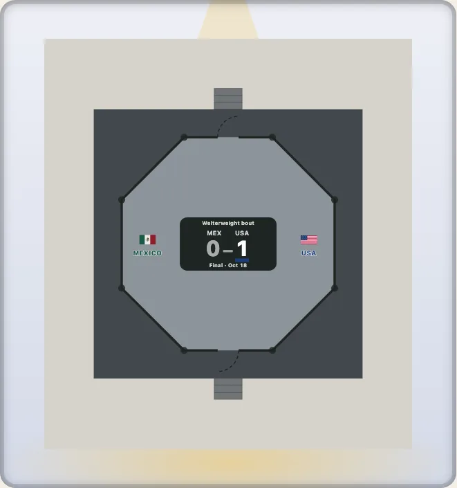
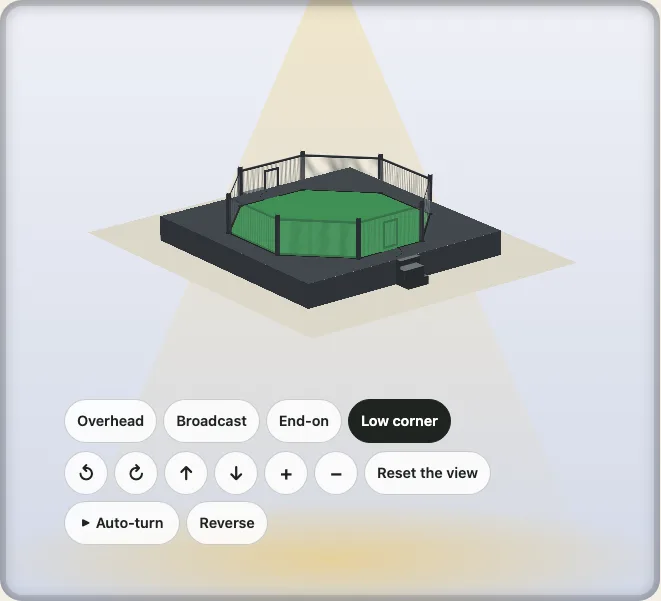
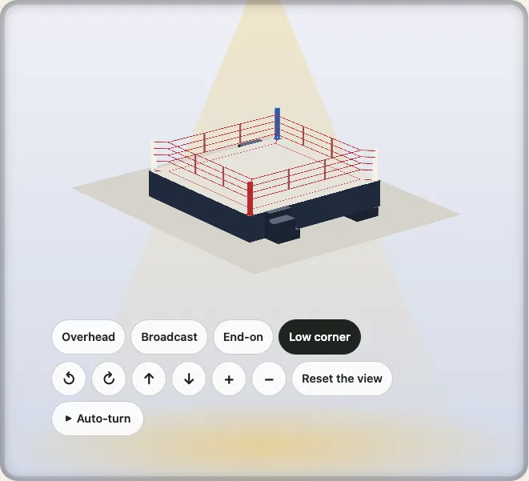

# The combat sports: the MMA cage and the boxing ring

The combat sports' surfaces, drawn to scale from the rules a commission or a federation writes: `sport: "mma"`, an eight-sided cage on its platform with its padded posts, its two gates, its steps and its fence of mesh, and `sport: "boxing"`, the square ring with its ropes and its four corners. The mats of wrestling follow them. The cage is named for what it is, a cage with eight sides: it is not any promotion's own cage, and no promotion's name or mark is used.

```ts
import { drawKyogijo, RANGES } from "@johnmorrisdotca/kyogijo-stadiums";
import { budoPlan } from "@johnmorrisdotca/kyogijo-stadiums/budo";

const cage = drawKyogijo({ sport: "mma" });
const small = budoPlan({ sport: "mma", budo: { size: 7.62 } });
console.log(cage.includes('data-sport="mma"'), small.mma?.width.toFixed(2), small.mma?.posts.length);
// true 7.62 8
console.log(RANGES.mma.map((range) => range.id).join(", "));
// cage, gate, half
```



The options are `budo` (`BudoStyle`), as for the budō, which the cage shares its engine with; `league` picks the rule. A figure is a published fact with its rule in [Sources](./sources.md#the-combat-sports); a figure no rule gives is marked **ours** there and in the code, and a figure that is common practice and not a rule is marked **typical**.

## The cage

| What | Figure | Rule |
| --- | --- | --- |
| The width | 20 to 32 feet (6.10 m to 9.75 m), measured across the flats of an eight-sided cage; 30 feet (9.14 m) is drawn, and 25 feet (7.62 m) is the smaller cage promotions use in smaller venues | Nevada Rules of Unarmed Combat (NRUC) 5.010 3(a); the IMMAF's rules for amateur competition; the two sizes are **typical** |
| The shape | round, or at least six equal sides; eight are drawn | NRUC 5.010 3(a); eight is **typical** |
| The platform | at most 4 feet (1.22 m) over the floor of the building, with suitable steps; 4 feet is drawn | NRUC 5.010 3(c); the drawn height is **typical** |
| The floor | at least 1 inch (25 mm) of closed-cell foam under canvas, duck or vinyl, laced to the platform; the IMMAF asks for 40 mm of high-density foam under vinyl | NRUC 5.010 3(b); the IMMAF's rules |
| The posts | metal, at most 6 inches (15 cm) across, from the floor of the building to between 5 and 7 feet over the floor of the cage, padded | NRUC 5.010 3(d) |
| The fence | made of a material that cannot be broken through, such as vinyl-coated chain link, with every metal part padded; 6 feet (1.83 m) high is drawn | NRUC 5.010 3(e) and (f); the height is **typical** |
| The gates | two, with secure locks, opposite each other and opening outward; 0.9 m wide | NRUC 5.010 3(g); the IMMAF's rules; the width is **typical** |

**Ours.** The apron, the width of the platform beyond the fence (1.2 m, four feet of walkway); the steps (three treads of 30 cm, 1.2 m wide); the pad on a post (0.3 m across) and the pad along the rails (12 cm); the gate's height (1.5 m); the colours of the looks (`grey`, the default, `black` and `blue`); the 5 cm cell of the mesh. The rules say "padded" and "steps" and give no size.

`budo.size` sets the width in metres, 6.096 to 9.754 (20 to 32 feet) and refuses a number outside it; `budo.height` sets the platform's height, 0 to 1.2192 m (0 puts the cage on the floor of the hall, and with it no steps); `budo.fence` sets the fence's height, 1.524 to 2.134 m (5 to 7 feet); `budo.gates` and `budo.steps` (true by default) take the gates and the steps away. `league: "immaf"` is the IMMAF's amateur rule, the same sizes with its own foam.

```ts
import { budoPlan } from "@johnmorrisdotca/kyogijo-stadiums/budo";

const plan = budoPlan({ sport: "mma", budo: { height: 1, fence: 1.7 } });
console.log(plan.mma?.height, plan.mma?.fence, plan.mma?.gates.length, plan.mma?.steps.length);
// 1 1.7 2 2
```

A drawing says what it is to a screen reader: "an MMA cage: an eight-sided fenced area 9.14 metres across (30 feet), with a fence 182.9 centimetres high and eight padded posts, on a platform 121.9 centimetres high", and that it has two gates and steps. `landmarks: true` labels the canvas, the fence, a padded post, a gate, the steps and the platform, in English and in Japanese. `RANGES.mma` has `cage` (the fence and the ground just round it), `gate` and `half`.

## In 3D

`buildTurn({ sport: "mma" })` raises the cage. The platform is a **solid block**: four sides from the floor of the hall up to the canvas and a top that is the drawing's own canvas, fence line and posts, lifted to the platform's height (the way the dohyō's mound is, so that the ground round it stays low). The eight padded posts are solid, two crossed strips each, from the platform to a hand's breadth over the fence. The fence is **mesh**: a panel on each of the eight flats, a faint tint with fine threads, a pad along the top and one along the foot, and the two gates as frames of padded rails over mesh, so that the canvas is in sight through it. A panel that lies between the eye and the cage gives way, as a pane of glass at a rink does, to at most 30 per cent of itself, and none gives way from straight above. The steps are three blocks each, the highest touching the platform.



The view is the same as for every surface: the steady camera (the cage keeps its size as the view turns, in no step) and the order the parts are drawn in from every side (the platform's far sides before its top and its near sides after it, the fence and the posts over the top), each held by a test in `src/mma.test.ts`. The views are `overhead`, `broadcast`, `end` and `corner`, as the others have.

```ts
import { buildTurn } from "@johnmorrisdotca/kyogijo-stadiums/turn";

const model = buildTurn({ sport: "mma" });
console.log(model.standing);
// Standing on it, in the 3D view: platform 4 feet, fence 6 feet, padded posts 6.5 feet.
console.log(model.planes.filter((plane) => plane.kind === "net").length, model.uprights.lift);
// 12 0
```

## The boxing ring

`sport: "boxing"`: a square raised platform with a post and a pad in each corner, four ropes, an apron and steps. `league` picks the rule: `nruc-ring` (the default) is the Nevada Rules of Unarmed Combat (2.050), `wisconsin` is Wisconsin's SPS 192.38, and `wbc-amateur` is the WBC Amateur rules (Rule 1), with Ontario's amateur rules beside them.

| What | Nevada (`nruc-ring`) | Wisconsin (`wisconsin`) | WBC Amateur (`wbc-amateur`) |
| --- | --- | --- | --- |
| The ring | 20 feet square within the ropes | 16 to 20 feet within the ropes (20 drawn) | 4.50 to 6.10 m inside the ropes (6.10 drawn) |
| The platform | at most 5 feet over the floor of the building, with steps (4 feet drawn, **typical**) | at most 4 feet, three sets of steps | 0.90 to 1.20 m high, three sets of steps |
| The apron | the floor reaches at least 18 inches beyond the ropes (2 feet drawn, **typical**) | at least 18 inches | at least 0.50 m |
| The ropes | at least four, at least 1 inch across and wrapped in soft material, the lowest 18 inches up (30, 42 and 54 are **typical**) | at least four of at least 1 inch, at 18, 30, 42 and 54 inches, two spacer ties a side | four of 3 to 5 cm at 41, 71, 102 and 132 cm, held by two tapes a side |
| The posts | metal, at most 3 inches across, 58 inches over the ring floor, at least 18 inches from the ropes | at least 3 inches across, 58 inches high, the ropes reaching them by an extension of at least 18 inches | four well-padded posts (the height is **ours**: 1.5 m) |
| The corners | red and blue for the two boxers, white for the neutral ones | the steps: one in each boxer's corner, one in a neutral corner | red and blue (or green and gold) for the boxers, white for the neutral ones; the red corner at the left, nearest the table (Ontario) |

**Ours.** The width of a post's pad (0.3 m), the thickness drawn for a rope, the spacer ties' places (a third and two thirds along each side), the steps (three treads of 30 cm, 1.2 m wide, beside the posts of the red corner, the blue corner and the neutral corner at the bottom right), the colours of the looks (`white`, the default, `blue` and `black`), and the red corner at the bottom left. The canvas is drawn over the whole platform, the ring and the apron alike.

`budo.size` sets the side inside the ropes in metres and refuses a number outside the league's range; `budo.height` sets the platform's height, 0 to the league's greatest; `budo.steps` and `budo.corners` (true by default) take the steps away and make the corners plain. `RANGES.boxing` has `ropes` (the ring and the ground just round it), `corner` (the red corner) and `half`.

```ts
import { budoPlan } from "@johnmorrisdotca/kyogijo-stadiums/budo";

const ring = budoPlan({ sport: "boxing" });
console.log(ring.boxing?.size.toFixed(3), ring.boxing?.corners.map((corner) => corner.colour).join(" "));
// 6.096 white blue white red
const small = budoPlan({ sport: "boxing", league: "wisconsin", budo: { size: 4.8768 } });
console.log(small.boxing?.size.toFixed(2), small.boxing?.steps.length);
// 4.88 3
```

In 3D the platform is a solid block as the cage's is. The four posts are solid and stand in their corner's colour, 58 inches over the ring floor; each of the four ropes is a thin round bar along each side and, at each corner, out to its post by its extension, so that the canvas is in sight through them, and two ties a side hold the ropes in line. The steps are three blocks each. The same tests hold the size of the view as it turns, the order the parts are drawn in from every side and the scene inside its box (`src/boxing.test.ts`).



## The demo

The [demo](https://johnmorrisdotca.github.io/kyogijo-stadiums/?sport=mma) has the cage and the ring in its sport picker, with the looks, the league of the ring, the cage's width (30 or 25 feet), the 3D view and the score. The address says all of it: `?sport=mma&view=3d&viewpoint=corner&cagesize=25`, `?sport=boxing&league=wbc-amateur`.
