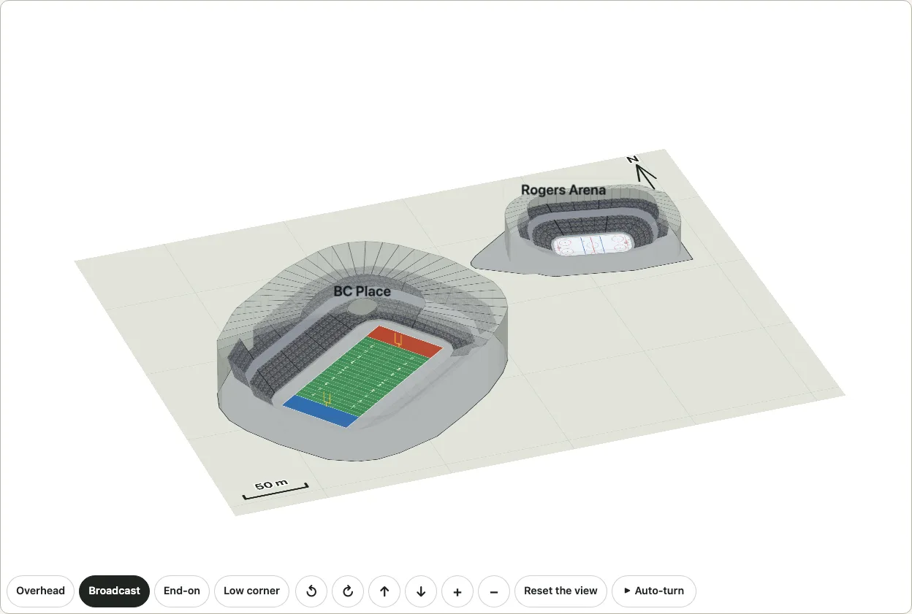
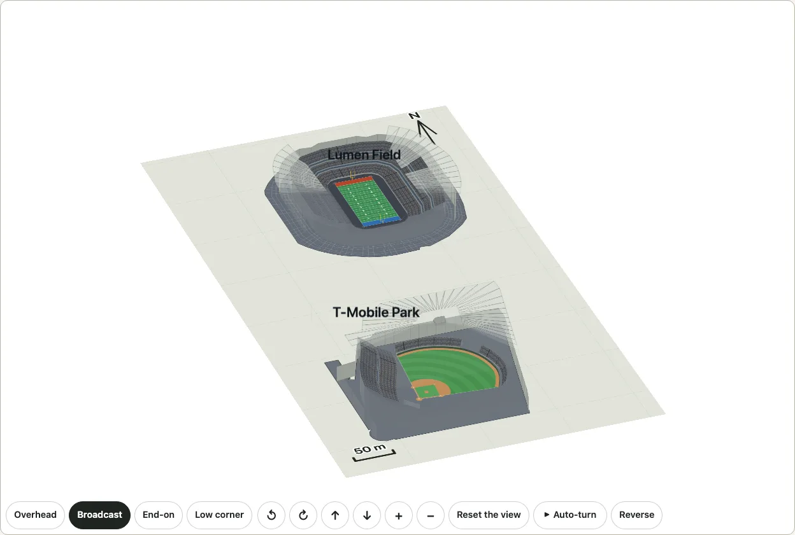

# A district of venues

Several real venues of one city on one plan, each at its real position and turned as it lies in the world. `drawDistrict({ venues: ["bc-place", "rogers-arena"] })` draws BC Place and Rogers Arena side by side as they stand in Vancouver, and `mountDistrictTurn` turns the pair around together in [3D](./turn.md). A district is a list of venue keys, whichever kinds they are (an arena of [the real venues](./venues.md), a stadium, a ballpark or a hall of [the real stadiums](./stadiums.md)), and the plan fits itself to them, so a city with stadiums near each other is a longer list and nothing else.

Each venue is drawn the way its own page draws it: nothing is drawn a second way. The district adds the ground, a grid, a scale, one north arrow and, where asked, a name beside each; it takes out each venue's own arrow and apron. There is no street, no park and no mark of a club, a league or a tournament.



```ts
import { drawDistrict, planDistrict } from "@johnmorrisdotca/kyogijo-stadiums/district";

const plan = planDistrict({ venues: ["bc-place", "rogers-arena"] });
console.log(plan.mode, plan.members.map((m) => m.member.key).join(" "), Math.round(plan.between[0].metres));
// neighbours bc-place:cfl rogers-arena 264
const svg = drawDistrict({ venues: ["bc-place:soccer", "rogers-arena"] });
console.log(svg.includes("ky-district"), svg.includes('data-venue="bc-place:soccer"'));
// true true
```

The demo's [district page](https://johnmorrisdotca.github.io/kyogijo-stadiums/district.html?venues=bc-place,rogers-arena) shows it in 2D and 3D, with the venues, the fit, the turn and the names to choose, in English and Japanese.

## The venues

A venue is a key of `VENUES` (the NHL arenas) or `STADIUMS` (the stadiums and the ballparks), as a string or an object: `"rogers-arena"`; `"bc-place"` (a stadium in its first configuration); `"bc-place:soccer"` or `{ id: "bc-place", config: "soccer" }` (the configuration named); `"t-mobile-park"` (a ballpark has one, `mlb`); `"korakuen-hall"` (a hall has one, `boxing`). `districtMember(key)` says what a key is: its name in both languages, its outline, the middle of its surface, the way the surface lies, its seats and the options it is drawn from. An unknown key throws and names the keys there are (`DISTRICT_IDS`); a venue twice in a district throws, except one stadium in two configurations, which is a comparison and not a twin.

## The plan

`planDistrict` puts each surface where it is on the ground and turns it as it lies:

- The distance and the direction from one venue to the next come from the coordinates of OpenStreetMap's outlines (the middle of each surface: the ice or the field), on a plane tangent to the earth at the district's middle. The distance between middles is the great-circle distance to a metre or so (`plan.between`); Rogers Arena stands 264 metres north-east of BC Place's field.
- Each venue's drawing, which has its surface along the page, is turned by the heading of the surface's long side less a quarter turn (`placed.angle`), about the middle of the surface, and put where the plan says. A ballpark's drawing is about home plate and its frame is turned a quarter from the way out to centre field, so its angle is the heading of that way: T-Mobile Park's drawing is turned 49.4 degrees, centre field to the north-east. A venue whose orientation is not known lies as it is drawn alone: an arena whose building has no direction east-west, and a ballpark nothing says how it lies (Tokyo Dome) the way that fits its building, with `basis` `none` and no arrow of its own.
- The map is turned by `turn` degrees clockwise: 0 (the default) has north at the top; `"auto"` turns it so that the district's long way lies across the page.
- The frame fits the buildings' outlines with a margin that depends on the mode.

### Neighbours and a city

`mode` says how far apart the venues are, and so how the plan is fitted:

| | `neighbours` (the default) | `city` |
| --- | --- | --- |
| For | Buildings within a few hundred metres of each other: BC Place and Rogers Arena | Venues kilometres apart |
| The frame | Tight round the buildings (9 percent margin) | The real distances, a wider margin (12 percent) |
| The grid | A line every 100 metres | A line every kilometre |
| Names | Off unless asked | Beside every venue |

The scale bar is the largest round length (50, 100, 200, 500, 1,000, 2,000 or 5,000 metres) that is no more than a fifth of the plan's width. A venue that is a long way off is a small building on a large ground: that is the distance, drawn to scale, and the 3D view zooms to it.

## Seattle: two neighbours and a city

The same keys give a second district, of three different venues: `["t-mobile-park", "lumen-field"]` for the two stadiums of SoDo, 459 metres apart, a ballpark and a football stadium side by side with Lumen Field to the north; and `["t-mobile-park", "lumen-field", "climate-pledge-arena"]` with `mode: "city"` for the three, the arena (already drawn in [the real venues](./venues.md)) 3.4 kilometres from Lumen Field and 3.8 from the ballpark, at their real distances, with a grid of kilometres and a name beside each (the scale bar is 500 metres). In 3D each is a building of its own and the far one is drawn first from every side, which for three at these distances is the same rule as for two.



```ts
import { planDistrict } from "@johnmorrisdotca/kyogijo-stadiums/district";

const sodo = planDistrict({ venues: ["t-mobile-park", "lumen-field"] });
console.log(sodo.mode, Math.round(sodo.between[0].metres), sodo.members[0].angle.toFixed(1));
// neighbours 459 49.4
const city = planDistrict({ venues: ["t-mobile-park", "lumen-field", "climate-pledge-arena"], mode: "city" });
console.log(city.mode, city.between.map((b) => Math.round(b.metres)).join(" "));
// city 459 3782 3425
```

The demo's [district page](https://johnmorrisdotca.github.io/kyogijo-stadiums/district.html?venues=t-mobile-park,lumen-field&labels=1) has both as presets.

## Tokyo Dome City: a ballpark and a hall

`["tokyo-dome", "korakuen-hall"]` puts Tokyo Dome, a ballpark under its air-supported roof, and Korakuen Hall, the hall with a boxing ring that stands in the same complex about 140 metres south of the Dome's middle, side by side as neighbours: the ballpark's key has the one configuration `mlb` and the hall's the one `boxing`, so the district names them `tokyo-dome:mlb` and `korakuen-hall:boxing`. The hall is a kind of venue of its own (`member.kind` is `"hall"`) and is drawn with the boxing ring in the middle of its seats. Tokyo Dome's orientation is not known (no diamond is mapped in the dome), so its drawing lies the way that fits its building, `basis` is `none`, and the district's north arrow is the only one; the hall's is inferred from its building's long axis. In 3D each is a building of its own, the Dome's roof a lens over the whole ballpark.


```ts
import { planDistrict } from "@johnmorrisdotca/kyogijo-stadiums/district";

const tokyo = planDistrict({ venues: ["tokyo-dome", "korakuen-hall"] });
console.log(tokyo.mode, tokyo.members.map((m) => `${m.member.key} ${m.member.kind} ${m.member.basis}`).join(", "));
// neighbours tokyo-dome:mlb park none, korakuen-hall:boxing hall building
```

The demo's [district page](https://johnmorrisdotca.github.io/kyogijo-stadiums/district.html?venues=tokyo-dome,korakuen-hall&labels=1) has it as a preset, in English and Japanese.

## In 3D

`buildDistrictTurn` makes a [`TurnModel`](./turn.md) like any other, so the camera, the four viewpoints, the controls, the pointer, the keys and the auto-turn are the 3D view's own, and its fit is steady: the scale and the place are one for the whole circle, so turning never zooms in and out or sways. Each venue is built as it is on its own (`buildTurn`: the stands, the walls and the roof with `venue: { roof: true }`, the goals and the posts), its planes turned about the middle of its surface and moved to its place; the floor is the district's plan with each building's outline only.

**The buildings are drawn one after another.** The 3D view stacks its planes by the depth of their middles, which puts the roof of a far building over the wall of a near one when the two stand close. A district gives each building its planes' `group` and the model its buildings' convex hulls (`TurnModel.groups`); from a view, one building is in front of another when a line can be put between them and the eye is on its side of it (and a nearer middle where no line can), and the far one is drawn first. For BC Place and Rogers Arena this puts the buildings in the right order in every one of 168 views tried (every five degrees of turn at three tips) where depth alone got 56 of them wrong; within a building the planes go by depth as before. `groupRanks` is the rule.

The viewpoints turn with the map (`districtPresets`): the main camera looks over the district from the south when north is up. `labels` stands a name over each building on a sign that faces the eye.

## Limits

- The plan is the venues' own outlines, not a map: no street, water or park is drawn, which would need more OpenStreetMap data and its credit. `city` is the real distances without a base map (a base map from OpenStreetMap, or Chizu's, is not here).
- A venue a few kilometres off is a small building on a large ground: the 3D view zooms to it, and flying from one to the next is [the fly-through](./flythrough.md)'s, which does not take a district.
- A building's outline is OpenStreetMap's: where it takes in a plaza or a wing, so does the plan, and two outlines can touch.
- Depth between buildings is exact for buildings a line can separate; two that no line separates (outlines that overlap) are ordered by their middles.
- The ground is flat: no hill or street level.

Every drawing and view carries the credit `VENUE_ATTRIBUTION` in its description: (c) OpenStreetMap contributors, ODbL 1.0, openstreetmap.org/copyright.
