# A district of venues

Several real venues of one city on one plan, each at its real position and turned as it lies in the world. `drawDistrict({ venues: ["bc-place", "rogers-arena"] })` draws BC Place and Rogers Arena side by side as they stand in Vancouver, and `mountDistrictTurn` turns the pair around together in [3D](./turn.md). A district is a list of venue keys, whichever kinds they are (an arena of [the real venues](./venues.md), a stadium, a ballpark or a hall of [the real stadiums](./stadiums.md)), and the plan fits itself to them, so a city with stadiums near each other is a longer list and nothing else.

Each venue is drawn the way its own page draws it: nothing is drawn a second way. The district adds the ground, a grid, a scale, one north arrow and, where asked, a name beside each; it takes out each venue's own arrow and apron. Without `context` there is no street and no park, and there is never a mark of a club, a league or a tournament.


```ts
import { drawDistrict, planDistrict } from "@johnmorrisdotca/kyogijo-stadiums/district";

const plan = planDistrict({ venues: ["bc-place", "rogers-arena"] });
console.log(plan.mode, plan.members.map((m) => m.member.key).join(" "), Math.round(plan.between[0].metres));
// neighbours bc-place:cfl rogers-arena 264
const svg = drawDistrict({ venues: ["bc-place:soccer", "rogers-arena"] });
console.log(svg.includes("ky-district"), svg.includes('data-venue="bc-place:soccer"'));
// true true
```

The demo's [district page](https://johnmorrisdotca.github.io/kyogijo-stadiums/district.html?venues=bc-place,rogers-arena) shows it in 2D and 3D, with the venues, the fit, the turn and the names to choose, in English and Japanese.

## The venues

A venue is a key of `VENUES` (the NHL arenas) or `STADIUMS` (the stadiums and the ballparks), as a string or an object: `"rogers-arena"`; `"bc-place"` (a stadium in its first configuration); `"bc-place:soccer"` or `{ id: "bc-place", config: "soccer" }` (the configuration named); `"t-mobile-park"` (a ballpark has one, `mlb`); `"korakuen-hall"` (a hall has one, `boxing`). `districtMember(key)` says what a key is: its name in both languages, its outline, the middle of its surface, the way the surface lies, its seats and the options it is drawn from. An unknown key throws and names the keys there are (`DISTRICT_IDS`); a venue twice in a district throws, except one stadium in two configurations, which is a comparison and not a twin.

## The plan

`planDistrict` puts each surface where it is on the ground and turns it as it lies:

- The distance and the direction from one venue to the next come from the coordinates of OpenStreetMap's outlines (the middle of each surface: the ice or the field), on a plane tangent to the earth at the district's middle. The distance between middles is the great-circle distance to a metre or so (`plan.between`); Rogers Arena stands 264 metres north-east of BC Place's field.
- Each venue's drawing, which has its surface along the page, is turned by the heading of the surface's long side less a quarter turn (`placed.angle`), about the middle of the surface, and put where the plan says. A ballpark's drawing is about home plate and its frame is turned a quarter from the way out to centre field, so its angle is the heading of that way: T-Mobile Park's drawing is turned 49.4 degrees, centre field to the north-east. A venue whose orientation is not known lies as it is drawn alone: an arena whose building has no direction east-west, and a ballpark nothing says how it lies (Tokyo Dome) the way that fits its building, with `basis` `none` and no arrow of its own.
- The map is turned by `turn` degrees clockwise: 0 (the default) has north at the top; `"auto"` turns it so that the district's long way lies across the page.
- The frame fits the buildings' outlines with a margin that depends on the mode.

### Neighbours and a city

`mode` says how far apart the venues are, and so how the plan is fitted:

| | `neighbours` (the default) | `city` |
| --- | --- | --- |
| For | Buildings within a few hundred metres of each other: BC Place and Rogers Arena | Venues kilometres apart |
| The frame | Tight round the buildings (9 percent margin) | The real distances, a wider margin (12 percent) |
| The grid | A line every 100 metres | A line every kilometre |
| Names | Off unless asked | Beside every venue |

The scale bar is the largest round length (50, 100, 200, 500, 1,000, 2,000 or 5,000 metres) that is no more than a fifth of the plan's width. A venue that is a long way off is a small building on a large ground: that is the distance, drawn to scale, and the 3D view zooms to it.

## Seattle: two neighbours and a city

The same keys give a second district, of three different venues: `["t-mobile-park", "lumen-field"]` for the two stadiums of SoDo, 459 metres apart, a ballpark and a football stadium side by side with Lumen Field to the north; and `["t-mobile-park", "lumen-field", "climate-pledge-arena"]` with `mode: "city"` for the three, the arena (already drawn in [the real venues](./venues.md)) 3.4 kilometres from Lumen Field and 3.8 from the ballpark, at their real distances, with a grid of kilometres and a name beside each (the scale bar is 500 metres). In 3D each is a building of its own and the far one is drawn first from every side, which for three at these distances is the same rule as for two.


```ts
import { planDistrict } from "@johnmorrisdotca/kyogijo-stadiums/district";

const sodo = planDistrict({ venues: ["t-mobile-park", "lumen-field"] });
console.log(sodo.mode, Math.round(sodo.between[0].metres), sodo.members[0].angle.toFixed(1));
// neighbours 459 49.4
const city = planDistrict({ venues: ["t-mobile-park", "lumen-field", "climate-pledge-arena"], mode: "city" });
console.log(city.mode, city.between.map((b) => Math.round(b.metres)).join(" "));
// city 459 3782 3425
```

The demo's [district page](https://johnmorrisdotca.github.io/kyogijo-stadiums/district.html?venues=t-mobile-park,lumen-field&labels=1) has both as presets.

## Tokyo Dome City: a ballpark and a hall

`["tokyo-dome", "korakuen-hall"]` puts Tokyo Dome, a ballpark under its air-supported roof, and Korakuen Hall, the hall with a boxing ring that stands in the same complex about 140 metres south of the Dome's middle, side by side as neighbours: the ballpark's key has the one configuration `mlb` and the hall's the one `boxing`, so the district names them `tokyo-dome:mlb` and `korakuen-hall:boxing`. The hall is a kind of venue of its own (`member.kind` is `"hall"`) and is drawn with the boxing ring in the middle of its seats. Tokyo Dome's orientation is not known (no diamond is mapped in the dome), so its drawing lies the way that fits its building, `basis` is `none`, and the district's north arrow is the only one; the hall's is inferred from its building's long axis. In 3D each is a building of its own, the Dome's roof a lens over the whole ballpark.


```ts
import { planDistrict } from "@johnmorrisdotca/kyogijo-stadiums/district";

const tokyo = planDistrict({ venues: ["tokyo-dome", "korakuen-hall"] });
console.log(tokyo.mode, tokyo.members.map((m) => `${m.member.key} ${m.member.kind} ${m.member.basis}`).join(", "));
// neighbours tokyo-dome:mlb park none, korakuen-hall:boxing hall building
```

The demo's [district page](https://johnmorrisdotca.github.io/kyogijo-stadiums/district.html?venues=tokyo-dome,korakuen-hall&labels=1) has it as a preset, in English and Japanese.

## Among its buildings: Project PLATEAU

A district can stand among the buildings round it. `context` takes areas of data a page passes in, and `@johnmorrisdotca/kyogijo-stadiums/plateau` has one, `TOKYO_DOME_CITY`: the 734 buildings within 500 metres of the middle of Tokyo Dome City, from Project PLATEAU, the Ministry of Land, Infrastructure, Transport and Tourism's 3D city model of Bunkyo ward (2025 edition). A district that does not ask for them is drawn as it always was and carries none of the data.


```ts
import { planDistrict } from "@johnmorrisdotca/kyogijo-stadiums/district";
import { TOKYO_DOME_CITY } from "@johnmorrisdotca/kyogijo-stadiums/plateau";

const plan = planDistrict({ venues: ["tokyo-dome", "korakuen-hall"], context: [TOKYO_DOME_CITY] });
const { blocks, owned } = plan.context!;
const heights = blocks.map((b) => b.height / 3.28084);
console.log(blocks.length, owned, blocks.filter((b) => b.ghost).length, Math.max(...heights).toFixed(1));
// 364 2 1 155.0
```

- **What is drawn.** On the floor every building in the frame, flat, in four tones by height (under 15 metres, 45, 100, and taller), under the venues; in 3D the 130 biggest and tallest of them as blocks, a wall for each side of its outline up to its eaves, lit by the way it faces in three tones, and a roof (a hip roof, with its ridge along the building's long side, where PLATEAU's LOD2 shape has a pitched roof and the outline is a plain convex one; a flat one otherwise). The detail is low on purpose: the heights are the point.
- **The frame.** It takes in the streets round the venues, 150 metres on every side, and grows to take in any landmark, a building of 100 metres or more within 400 metres of them: Tokyo Dome Hotel, 155 metres (154.9 as PLATEAU measured it; heights are kept to half a metre), stands 370 metres from the hall, and Bunkyo Civic Center, about 139 metres, to the north.
- **A venue is its own.** The Dome is drawn from its own outline and shell, so the buildings of the model that are the Dome's (its stands and its roof, `plan.context.owned`) are left out. Korakuen Hall stands inside a larger building of the model that would hide it, so that building is a ghost: pale on the floor and nearly clear in 3D. The hall in its building, at its floor, is a later release's.
- **Heights.** A height is PLATEAU's measured height of the building's top above its ground (a building the model gives none, or a bad one, takes its LOD1 block's, or six metres). The Dome is 54.8 metres in PLATEAU, 56.19 in OpenStreetMap and Wikipedia, and the venue keeps the figure it has. The ground is flat.
- **How it is made, once, at build time.** `pnpm plateau:fetch` reads the ward's CityGML by range requests (the 640 MB zip is not downloaded: its directory and the four building files the area touches, 2 to 5 MB each compressed), keeps the buildings round the middle as PLATEAU gives them in `data-sources/plateau/<date>/`, and `pnpm plateau` cuts them down: the roof-edge outline simplified to 0.6 metres on a half-metre grid, the height, and the rise of a pitched roof. Nothing is read or requested at run time. The file is 40 KB (16 KB gzipped); `docs/entry-points.md` has the entry.
- **The data file is made of layers.** A `ContextArea` is one frame (an origin in longitude and latitude, a grid step and a radius, in metres east and north of the origin) and separate `layers`, each with its own source, licence, credit and rows: today `buildings`; trees and land cover from another source are added beside it, in the same frame, with no change to the buildings.

**The terms.** PLATEAU's [site policy](https://www.mlit.go.jp/plateau/site-policy/) (clause 3) lets anyone use its data free of charge, commercial use included, and is compatible with Creative Commons Attribution 4.0 and the Public Data License 1.0; the source is to be credited and what was edited is to say so, and MLIT's name is not to be used as though it made the result. The copyright of a ward's data belongs to its local government. The credit goes in the description of every drawing and view that uses the buildings, in the district's language: "Project PLATEAU, Ministry of Land, Infrastructure, Transport and Tourism (MLIT), https://www.mlit.go.jp/plateau/ (3D city model of Bunkyo ward, 2025 edition), simplified and edited by Kyogijo Stadiums; not made by MLIT". The data is in `src/plateau.data.ts`, apart from OpenStreetMap's (ODbL) and from every CC0 file, and `NOTICE.md` names it.

## The Kodokan: the great dojo in the air

`"kodokan"` is a venue of a district like the others: the Kodokan Judo Institute in Kasuga, Bunkyo, about 300 metres north-east of Tokyo Dome, with its main dojo, the great dojo, drawn in the air, on its real floor, inside the building. The building is PLATEAU's, the room and its mats are the package's own judo dojo, [the one the atlas draws](./budo.md#famous-halls-on-the-atlas), and the floor of the room is as high over the ground as the 7th floor of an 8-storey building.

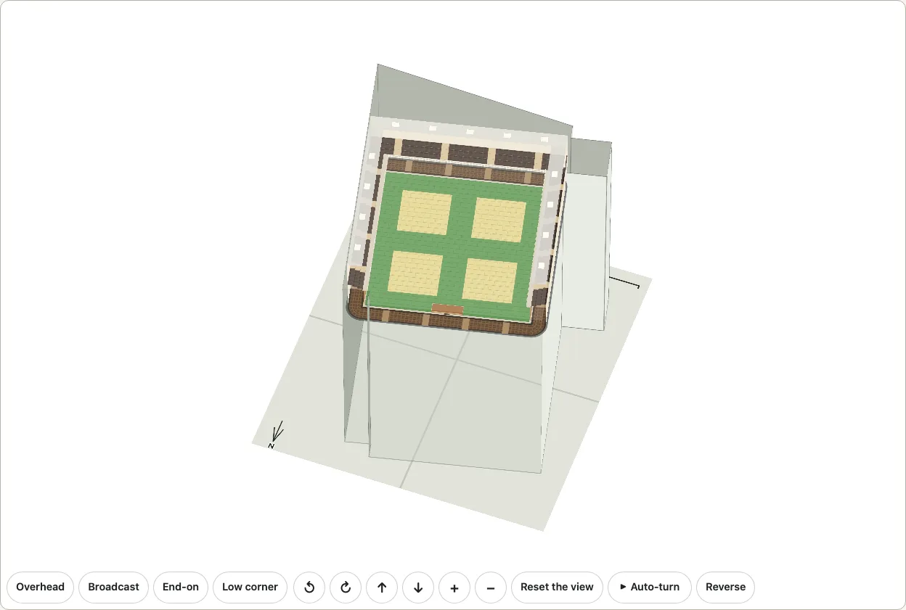

```ts
import { planDistrict } from "@johnmorrisdotca/kyogijo-stadiums/district";

const plan = planDistrict({ venues: ["kodokan"] });
const member = plan.members[0].member;
console.log(member.key, member.kind, member.seats, (member.elevation! / 3.28084).toFixed(1));
// kodokan hall 900 31.9
```

- **What a source says.** The main dojo is on the 7th floor, has 420 mats and four official contests can be held in it at the same time; the gallery is on the 8th floor and seats about 900; the building has eight floors and a basement. The Kodokan's own page ([its facilities page](https://kdkjudo.org/%e6%96%bd%e8%a8%ad%e3%81%ae%e3%81%94%e6%a1%88%e5%86%85/)), [English Wikipedia](https://en.wikipedia.org/wiki/Kodokan_Judo_Institute) (read on 2026-10-22; last edited 2026-04-20) and the [IJF](https://www.ijf.org/news/show/kodokan-an-institution-a-legendary-place-and-a-training-venue) say it. The floor is drawn as 420 jō (the atlas's count, a floor of 26.4 metres square, on which the four 8-metre areas fit), the gallery with 3 rows of seats on each side.
- **What the building says.** PLATEAU's model of Bunkyo ward has it as one building: 8 storeys above ground, 43.1 metres, an outline of ten points (OpenStreetMap's way 170598646, with 8 levels and Wikidata Q1165384, is the same outline, read as a check and not copied). The 7th floor is six storeys up at the building's own storey height, 5.4 metres, which puts the floor 32.3 metres up; the room is 11.2 metres high (the dojo's 4.5-metre walls, the gallery level with their tops, the lid), two storeys, so the floor is set at 31.9 metres to leave the room under the roof.
- **What is ours.** No source gives the shape of the floor or the room's place in the building, so the floor is a square, and the room (walls and gallery, 31.8 metres square) is put where it stands farthest from the building's walls, whichever way it is turned (`scripts/build-plateau.mjs`; 0.18 metre clear). Its wood is none: the atlas draws 4 metres of wood all round the mats, which would not stand inside the real outline. The storey height is the building's average.
- **The building.** `building: "xray"` (the default) draws it with each wall giving way to the eye as the view comes round to that side and looks in, to a trace of itself, and the roof nearly clear; `"solid"` draws it whole; `"none"` leaves it out and the dojo floats on its floor alone. On the plan it is a pale ghost, in its tone of height when solid, under the room. The building of the model that is the same one is left out of the surrounding `context`, whichever you ask.
- **The credit.** A district with the Kodokan carries PLATEAU's credit in its description, with or without the surrounding buildings.

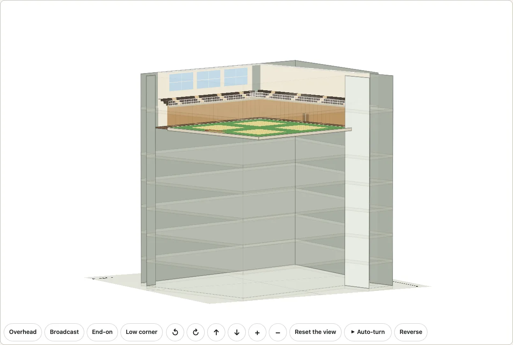

**A floor is a slab.** Seen from the side a floor is not a sheet: the great dojo's floor, and every floor of the building, is a slab with a top, sides shaded by the way they face, and a thickness of 0.6 metres (a floor and its beams: ours, a plausible figure, since a reinforced-concrete floor with its beams is some 0.4 to 0.8 metres of structure) or ten pixels at the page's own size, whichever is more, and no more than half a storey. The floors of the building are faint slabs, the chosen one picked out. The walls on the eye's side of the room give way at every turn and tilt, the near ones to a trace and the far ones whole behind it, and a test turns the view round in steps of fifteen degrees at seven tilts, and at the angle a reader sent, to find none drawn over the room's floor.

The demo's [district page](https://johnmorrisdotca.github.io/kyogijo-stadiums/district.html?venues=tokyo-dome,korakuen-hall,kodokan) has the Kodokan as a choice in the Tokyo district and a preset, "Tokyo Dome City and the Kodokan", with the building's three states in the address (`building=solid`, `building=none`). The main camera looks over the district from the south, where taller buildings stand in front of the Kodokan: turn the view with the arrows, or open it with `yaw` and `pitch` in the address, as [this view from the north](https://johnmorrisdotca.github.io/kyogijo-stadiums/district.html?venues=tokyo-dome,korakuen-hall,kodokan&view=3d&yaw=150&pitch=55) does.

### The floors of the building

`floor` (0 to 8, with 0 the basement) shows one floor of the Kodokan's building: its plate is picked out at its level with the floor's name over it, the walls are see-through, and what is drawn on the other floors is left out. Without it the great dojo stands as it did, on its floor, with nothing picked out.

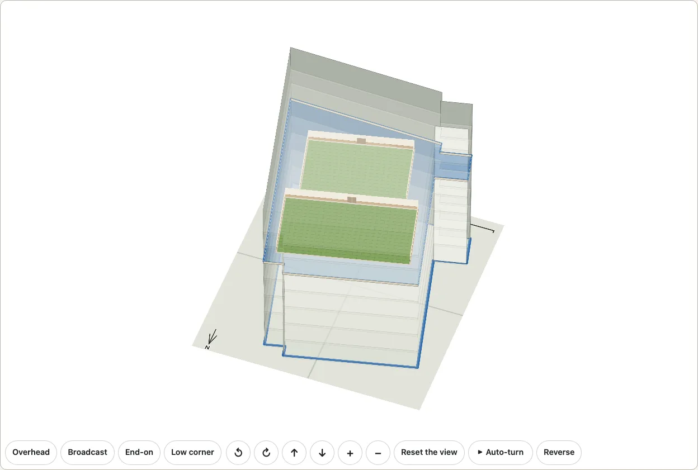

```ts
import { planDistrict } from "@johnmorrisdotca/kyogijo-stadiums/district";

const plan = planDistrict({ venues: ["kodokan"], floor: 6 });
const member = plan.members[0].member;
console.log(member.parts!.map((part) => part.key).join(" "), (member.plate!.level / 3.28084).toFixed(1));
// school international 26.9
```

| Floor | What the Kodokan's floor guide lists | Drawn |
| --- | --- | --- |
| 8F | the spectators' gallery, about 900 seats | the gallery of the great dojo: its seats, rail and roof |
| 7F | the main dojo, 420 jō | the great dojo as above, without its gallery |
| 6F | the school dojo, 240 jō, and the international dojo, 192 jō | both dojos, at their counts |
| 5F | the women's dojo, 240 jō, the boys' dojo, 114 jō, and a special dojo (no count given) | the three dojos: the special dojo at 40 jō, ours |
| 4F | the dojo guidance office, the dojo reception and the changing rooms | the plate of the floor |
| 3F | accommodation | the plate of the floor |
| 2F | the museum and library, a classroom, meeting rooms 3 and 4 | the plate of the floor |
| 1F | nothing in the guide; English Wikipedia: parking, a bank and a store | the plate of the floor |
| B1 | the dining hall, the training room and the disaster-prevention centre | nothing: it is under the ground |

- **Where the words come from.** The floors are those of [the Kodokan's own floor guide](https://kdkjudo.org/%e6%96%bd%e8%a8%ad%e3%81%ae%e3%81%94%e6%a1%88%e5%86%85/) (read on 2026-10-22): the International Judo Center, the new building, from the 8th floor down to the basement, with the count of jō of each dojo where it gives one. The guide's entry for the 1st floor is empty, so that row is [English Wikipedia's](https://en.wikipedia.org/wiki/Kodokan_Judo_Institute) ("The first floor has parking, a bank, and a store"); the Kodokan's own page puts its shop in the main building, which is another building. English Wikipedia says the same of the other floors, in fewer words (the fifth, sixth and seventh floors are training space).
- **What is ours.** No source publishes a plan of any floor. The rooms are the dojo builder's own shape for their counts (240 jō is 27.3 by 14.56 metres, 192 jō 21.84 by 14.56, 114 jō 17.29 by 10.92, 40 jō 9.1 by 7.28), laid out in rows a metre and a half apart (the 6th floor's two one above the other, the 5th floor's big one above the smaller two side by side) and each floor's block put where it stands farthest from the building's walls (`scripts/build-plateau.mjs`; about 2.5 metres clear). That the guide's two dojos of a floor stand on the two sides of it is not published either: the layout is ours. The special dojo's size, the plain plates, and the storey height (the building's height over its eight storeys, 5.4 metres, so the 6th floor's level is 26.9 metres) are ours too. The great dojo's floor is set a little under the 7th storey's level so that its room stays under the roof; the gallery's plate is at the room's wall height over it.

## In 3D

`buildDistrictTurn` makes a [`TurnModel`](./turn.md) like any other, so the camera, the four viewpoints, the controls, the pointer, the keys and the auto-turn are the 3D view's own, and its fit is steady: the scale and the place are one for the whole circle, so turning never zooms in and out or sways. Each venue is built as it is on its own (`buildTurn`: the stands, the walls and the roof with `venue: { roof: true }`, the goals and the posts), its planes turned about the middle of its surface and moved to its place; the floor is the district's plan with each building's outline only.

**The buildings are drawn one after another.** The 3D view stacks its planes by the depth of their middles, which puts the roof of a far building over the wall of a near one when the two stand close. A district gives each building its planes' `group` and the model its buildings' convex hulls (`TurnModel.groups`); from a view, one building is in front of another when a line can be put between them and the eye is on its side of it (and a nearer middle where no line can), and the far one is drawn first. For BC Place and Rogers Arena this puts the buildings in the right order in every one of 168 views tried (every five degrees of turn at three tips) where depth alone got 56 of them wrong; within a building the planes go by depth as before. `groupRanks` is the rule.

The viewpoints turn with the map (`districtPresets`): the main camera looks over the district from the south when north is up. `labels` stands a name over each building on a sign that faces the eye.

## Among the streets of downtown Vancouver

`context: [VANCOUVER_CENTRE]` (from `@johnmorrisdotca/kyogijo-stadiums/osm`) puts BC Place and Rogers Arena among the streets and buildings OpenStreetMap maps round them, as the `context` of [Tokyo Dome City](#among-its-buildings-project-plateau) does with PLATEAU's: the carriageways, the viaducts (the Georgia and the Dunsmuir), the SkyTrain's guideway, the sidewalks and the paths flat on the floor under the venues, and the buildings round them flat and, the biggest 130 of them, standing in 3D, shaded by height. Each building has the height OpenStreetMap maps for it (its `height`, else its `building:levels` at 3.2 metres, else 10 metres, which is ours: 54 of the 204 map neither). The frame is the venues' with 150 metres of ground round them: the towers do not widen it. A venue's own building is the venue's, and is left out. The credit, "(c) OpenStreetMap contributors, ODbL 1.0", is in the drawing's description.


```ts
import { planDistrict } from "@johnmorrisdotca/kyogijo-stadiums/district";
import { VANCOUVER_CENTRE } from "@johnmorrisdotca/kyogijo-stadiums/osm";

const plan = planDistrict({ venues: ["bc-place", "rogers-arena"], context: [VANCOUVER_CENTRE] });
console.log(plan.context!.blocks.length > 30, plan.context!.streets!.length > 300, plan.context!.owned);
// true true 3
```

- **The streets** are a `streets` layer beside the `buildings` one in the area's data: each a line with a kind (0 a carriageway at street level, 1 one on a viaduct or a bridge, 2 a railway, 3 a sidewalk or a path) and a width in grid steps, drawn flat under the buildings, so that a sidewalk lies over the carriageway beside it and a viaduct's deck over the street under it. A viaduct is drawn flat: its height is not.
- **`landmark`** is an area's own height in metres for a building the frame grows to take in (`CONTEXT_LANDMARK`, 100, when missing): downtown Vancouver sets it above its towers.
- Made by `pnpm osm-context` from the raw answer [the crowd's walkable mask](./outside.md#how-the-mask-is-made) is made from, and held to it by `src/vancouver.raw.test.js`.

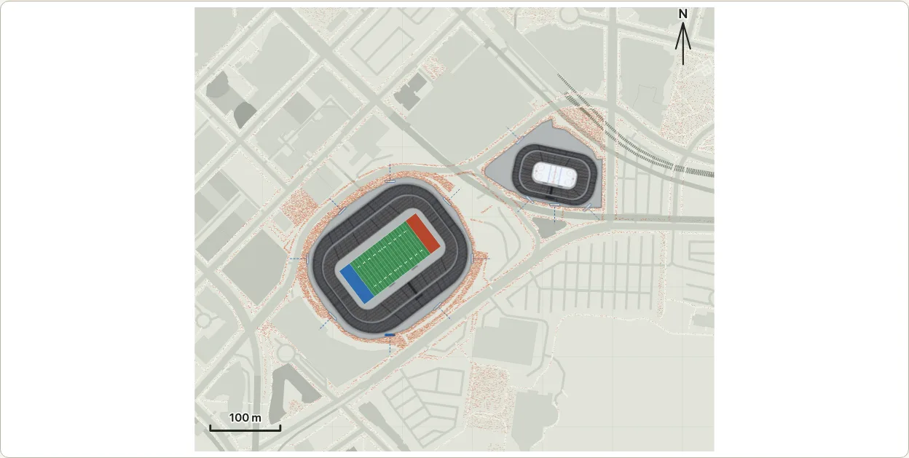

## Among its streets, buildings, water and trees: Vancouver and Seattle

Seattle stands in its city the same way, and Vancouver gains its water, parks and trees. `@johnmorrisdotca/kyogijo-stadiums/cityctx` has the areas as the same `context` data (one frame, separate layers) and `contextFor(venues)` says which go with a choice of venues: downtown Vancouver's buildings and streets ([above](#among-the-streets-of-downtown-vancouver)) with `VANCOUVER_NATURE`, its land cover and trees, for BC Place and Rogers Arena; `SEATTLE_SODO` for Lumen Field and T-Mobile Park; `SEATTLE_CENTER` for Climate Pledge Arena; and `SEATTLE_CITY`, with the streets and the buildings that matter from far, for a district that holds venues of both (three kilometres apart: the venues are specks in a real city).

```ts
import { planDistrict } from "@johnmorrisdotca/kyogijo-stadiums/district";
import { contextFor } from "@johnmorrisdotca/kyogijo-stadiums/cityctx";

const venues = ["t-mobile-park:mlb", "lumen-field:nfl", "climate-pledge-arena"];
const areas = contextFor(venues);
const plan = planDistrict({ venues, mode: "city", context: areas });
const { blocks, streets, land } = plan.context!;
console.log(areas.map((a) => a.key).join(), blocks.length > 500, streets!.length > 1000, land!.some((s) => s.cls === 0));
// seattle-city true true true
```


- **Only the areas a page shows.** Each area is one file of data (Seattle's city view alone is 150 kilobytes), and `contextFor` carries all of them. A page that shows one choice of venues asks for that choice's areas instead: `loadAreasFor(venues)` of `@johnmorrisdotca/kyogijo-stadiums/areas` reads the files of those areas with a dynamic `import()` and no others, and gives the same areas `contextFor` does (and Tokyo Dome City's, for the Tokyo venues). `loadArea(key)` reads one by its key, `areaKeysFor(venues)` says the keys without reading anything, and a bundler splits each file into a chunk of its own. The demo's district page does this: it opens on Rogers Arena without Seattle's or Tokyo's data.

```ts
import { loadAreasFor } from "@johnmorrisdotca/kyogijo-stadiums/areas";
import { planDistrict } from "@johnmorrisdotca/kyogijo-stadiums/district";

const venues = ["climate-pledge-arena"];
const plan = planDistrict({ venues, context: await loadAreasFor(venues) });
console.log(plan.context!.blocks.length > 100);
// true
```

- **What is drawn.** Under the venues and faint so that a crowd reads on it, from the lowest up: water, green and wood in flat tones, the streets (the same `streets` layer and look as Vancouver's), single trees as dots, and the buildings in four tones by height; in 3D the 130 biggest as blocks, as PLATEAU's. The water, the streets and the trees are the floor's own and add no plane to the 3D view.
- **The areas.** Four, each its own frame: Vancouver's nature (450 metres round the middle of the two venues: the water of False Creek, the parks, and 1,370 trees), Seattle's SoDo (650 metres), Seattle Center (550 metres) and Seattle's city view (3 kilometres, on a grid of two metres, with only the buildings that matter from far, those 1,200 square metres or more on the ground or 24 metres or more tall, the carriageways, viaducts and railways but not the service lanes, sidewalks or paths, and no trees).
- **Where each layer comes from.** *Buildings (Seattle):* outlines from OpenStreetMap; heights from the City where it has them (Building Outlines 2015: its roof apex elevation, less the ground under the building from USGS 3DEP, gives the height above ground), else the `height` or `building:levels` OpenStreetMap gives, else 10 metres, which is ours (the same default as Vancouver's); a City outline OpenStreetMap does not have is a building of its own. *Streets:* OpenStreetMap's, by the rule the crowd's mask shares (`streetOf`: carriageways, viaducts and bridges, railways, and in a detail area the sidewalks and paths). *Water, green and wood:* the grid of land cover VoxCity makes from OpenStreetMap, vectorized. *Trees:* the City's tree inventories (Vancouver's Public trees, Seattle's Combined Tree Point) and OpenStreetMap's tree nodes and rows, a crown radius from each trunk diameter, one to every four metres, none under a building, the largest crowns first and at most 1,400 to an area.
- **VoxCity.** [VoxCity](https://github.com/kunifujiwara/VoxCity) (MIT) is run locally at build time (`pnpm cityctx:vox`; Python 3.10 to 3.13) with its one land cover source that needs no account, `OpenStreetMap`; the city view is asked for in tiles of two kilometres, because Overpass will not answer one request for six, and a tile OpenStreetMap maps nothing in is water where the tiles beside it are. Its other land cover sources and its tree canopy heights need a Google Earth Engine account and are not used. Nothing of VoxCity is shipped or run at run time.
- **How it is made, once, at build time.** `pnpm cityctx:fetch` asks Overpass, the City of Seattle's and the City of Vancouver's open data services and USGS 3DEP one request at a time and keeps each answer, dated, in `data-sources/cityctx/<date>/`; `pnpm cityctx:vox` makes the land cover grids; `pnpm cityctx` cuts everything down (outlines simplified to 0.6 metres on a half-metre grid, 3.5 metres on a two-metre grid for the city view) and writes `src/cityctx.data.ts`, with the helpers `pnpm osm-context` uses. Nothing is read or requested at run time, and a district that does not ask for `context` carries none of the data.
- **Size.** State bytes of each area as data (JSON before gzip, which takes it to about a third): Vancouver's nature 12 KB, SoDo 68 KB, Seattle Center 91 KB, the city 150 KB. The cost of a frame in 3D is the planes of the blocks, at most 130 blocks and about 1,000 planes whatever the city, the same as PLATEAU's district; the floor is one element. The flat plan of the whole city is about 230 KB of markup, a venue's 50 to 120.

**The terms.** OpenStreetMap's data is ODbL 1.0 ("(c) OpenStreetMap contributors, ODbL 1.0, openstreetmap.org/copyright"); the file that holds it is a derived database kept apart from the CC0 files and from PLATEAU's. The City of Seattle's Open Data Policy lets a dataset on its portal be used with no licence requirement or restriction, if the source, the version and what was changed are shown, and the City gives no warranty of accuracy, which the credit says; USGS 3DEP elevation is a US Government work in the public domain. The City of Vancouver's Public trees are under the Open Government Licence - Vancouver (free to use, the City credited). Each layer has its credit in English and Japanese, and a district that uses the area carries them in its description, once: for Seattle, "(c) OpenStreetMap contributors, ODbL 1.0, openstreetmap.org/copyright; Building outlines and roof heights: City of Seattle, Building Outlines 2015 (the City gives no warranty of its accuracy); ground levels: USGS 3D Elevation Program; simplified and edited by Kyogijo Stadiums; Land cover made with VoxCity (MIT) from OpenStreetMap; Trees: City of Seattle, Combined Tree Point". The sources are listed in [the references](./references.md) and the [NOTICE](../NOTICE.md).

## New York and Montreal

The same keys and the same `context` give the east coast: New York's six venues, Madison Square Garden (the NHL's venue, in Midtown), Barclays Center (a basketball court, in Brooklyn), Yankee Stadium (the Bronx), Citi Field (Queens), MetLife Stadium (the Meadowlands, New Jersey) and UBS Arena (Belmont Park, Elmont), and Montreal's two, the Bell Centre and the Olympic Stadium with its tower. [The stadiums page](./stadiums.md#the-east-coast) says what each is made from.

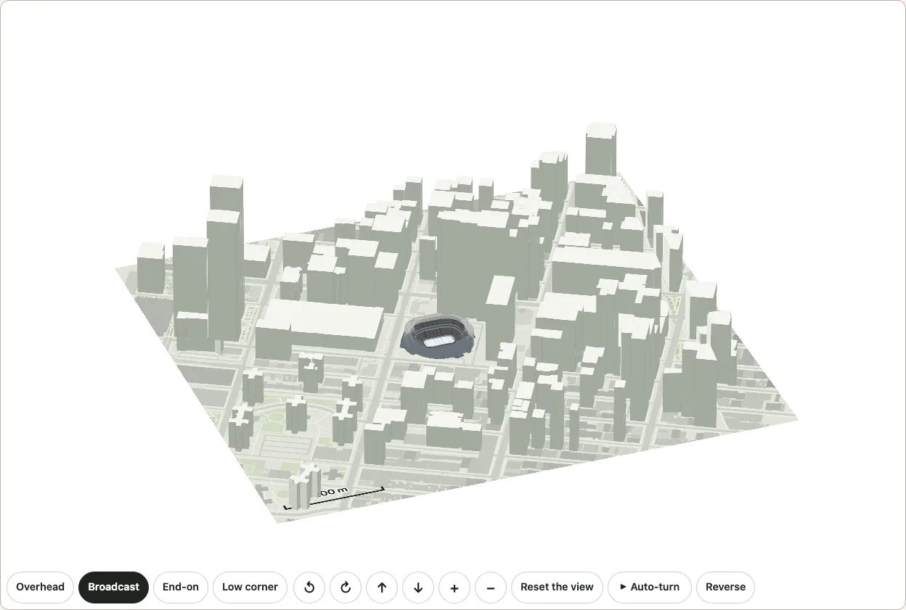

```ts
import { loadAreasFor } from "@johnmorrisdotca/kyogijo-stadiums/areas";
import { planDistrict } from "@johnmorrisdotca/kyogijo-stadiums/district";

const york = ["madison-square-garden", "barclays-center:nba", "yankee-stadium:mlb", "citi-field:mlb", "metlife-stadium:nfl", "ubs-arena"];
const plan = planDistrict({ venues: york, mode: "city", turn: "auto" });
console.log(plan.members.length, Math.round(plan.between[0].metres));
// 6 7706
const midtown = ["madison-square-garden"];
const among = planDistrict({ venues: midtown, context: await loadAreasFor(midtown) });
console.log(among.context!.blocks.length > 800, among.context!.attribution.en.join(" ").includes("City of New York"));
// true true
```

- **Six venues at their real distances** (`mode: "city"`, the demo's "New York: six venues at their real distances"): Madison Square Garden to Barclays Center 7.7 kilometres, to Yankee Stadium 10.4, to MetLife Stadium 9.8 and to UBS Arena 22.9; MetLife Stadium to UBS Arena 31.5. A venue is a small building on a large ground, and the 3D view zooms to the one chosen. Such a choice has **no surroundings**: more than two of the city's venues lie in more than two boroughs and states, and a patch of buildings round each would be a speck and, together, a megabyte of drawing (`MOST_DETAIL_AREAS`, `areaKeysFor`).
- **One venue, or two, among their own streets.** Each venue has an area of its own (`nyc-midtown`, `nyc-bronx`, `nyc-flushing`, `nyc-brooklyn`, `meadowlands`, `belmont-park`, `montreal-downtown`, `montreal-olympic`): the buildings round it flat and the tallest 130 in 3D, as Seattle's are, with the streets, the water, the parks and the trees. Two of New York's venues take their two areas; the Bell Centre and the Olympic Stadium together take **the city between them** (`montreal-city`, 4.2 kilometres round the middle on a grid of three metres: the buildings that matter from far, the main streets and the St. Lawrence).
- **Where the layers come from.** *Buildings:* the outlines are OpenStreetMap's; in New York the heights are the City's, the roof height above ground of the City of New York's Building Footprints (NYC Open Data, dataset 5zhs-2jue, read on 2026-10-30), which gives a height to 94 to 99 buildings in a hundred, by area (Midtown 97; the rest take the `height` or `building:levels` OpenStreetMap gives, else 10 metres, which is ours), and a footprint that OpenStreetMap lacks is a building of its own. New Jersey's, Elmont's and Montreal's are OpenStreetMap's alone: the Meadowlands and Belmont Park have few mapped heights (a car park and a racecourse, and most buildings take the 10 metres), and Montreal's are the tagged ones. *Streets, water, parks, grass and woods:* OpenStreetMap's, as mapped (the water, wetland, park, grass and wood outlines of these areas are not VoxCity's, as Seattle's are). *Trees:* OpenStreetMap's tree nodes and rows, one to every four metres, none under a building.
- **Montreal's tower is the stadium's.** OpenStreetMap maps the Montreal Tower as a building 165 metres high; as a block it would stand up straight, so `montreal-olympic` leaves it out (`exclude` in `scripts/cityctx.data.json`) and [the stadium draws it](./stadiums.md#the-east-coast) leaning at the 45 degrees its article gives.
- **Only the areas a page shows.** Each area is one file, read by `loadArea(key)` when asked for, so a page that shows Madison Square Garden carries Midtown's file and no other. State bytes as data (JSON before gzip, gzipped in brackets): Midtown 95 KB (34), the Bronx 82 KB (29), Flushing Meadows 43 KB (17), Brooklyn 129 KB (42), the Meadowlands 36 KB (14), Belmont Park 73 KB (24), downtown Montreal 109 KB (39), Olympic Park 121 KB (41) and Montreal's city view 109 KB (39). The cost of a frame in 3D is the same as Seattle's: at most 130 blocks and about a thousand planes whatever the city.
- **Presets.** The demo's [district page](https://johnmorrisdotca.github.io/kyogijo-stadiums/district.html?venues=madison-square-garden) has four: "New York Midtown: Madison Square Garden", "New York: six venues at their real distances", "Montreal: the Olympic Stadium and its tower" and "Montreal: the Bell Centre and the Olympic Stadium" (fitted across the page, as the two lie north and south); every other venue is in its Venues choice, and each takes its own surroundings.

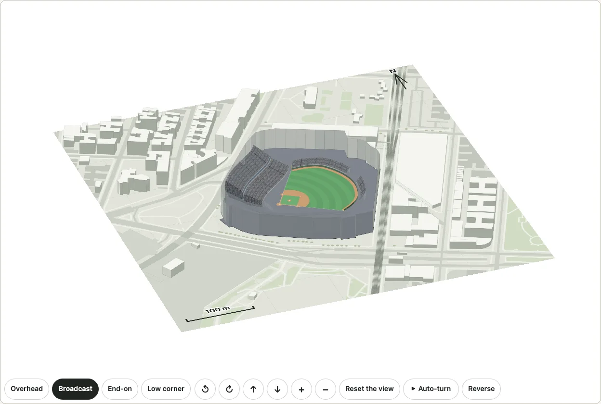

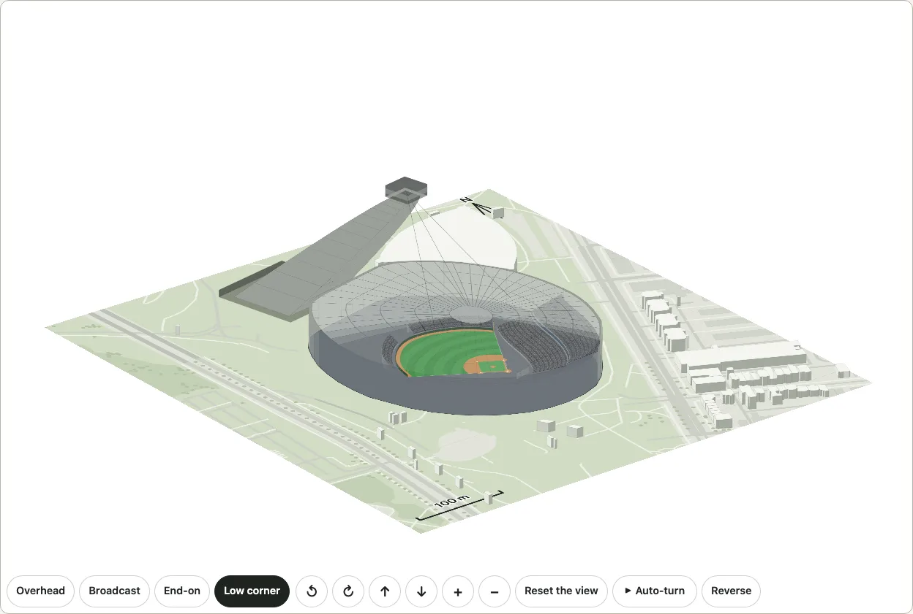


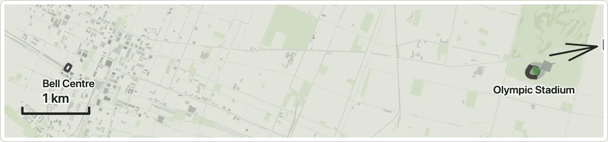

**The terms.** OpenStreetMap's data is ODbL 1.0 ("(c) OpenStreetMap contributors, ODbL 1.0, openstreetmap.org/copyright"); each file is a derived database kept apart from the CC0 files. The City of New York's Building Footprints are a public data set under its Open Data Law (Administrative Code 23-502: no registration, licence requirement or restriction on use; the City may ask that the source and the version be named and what was changed said), and the City gives no warranty of its accuracy, which the credit says: "Building outlines and roof heights: City of New York, Building Footprints, NYC Open Data (no warranty of accuracy); simplified and edited by Kyogijo Stadiums". Each layer has its credit in English and Japanese and a district that uses the area carries them in its description, once. [NOTICE](../NOTICE.md) lists the sources.

## A page that carries only the venues it shows

Every entry has every arena, park and ground there is data for (about 440 kilobytes of data before gzip, 58 after), the real venues of the NHL's arenas (79), the words in both languages (156) and the layers part of the drawing (about 300 kilobytes of code), because the drawing reads a venue's record from a table the full lists fill and the layers when the options ask for them. A page that shows one district needs a few of them. `@johnmorrisdotca/kyogijo-stadiums/district-lean` is the district with none of it: the same exports, a table that is empty, and `loadVenueDataFor(venues)`, which reads the file of each venue's record (`arenas/rogers-arena.data.js`, 0.9 kilobytes; for an arena of the NHL also its real venue's two files, `venues/rogers-arena.data.js` and `venues/rogers-arena.osm.data.js`, about 2 kilobytes together) with a dynamic `import()` and holds it for the drawing. Call it before the first `planDistrict`, `drawDistrict`, `mountDistrict` or `mountDistrictTurn` and again when the venues change (a record that is held is not read twice); it is what `loadAreasFor` is for the areas. `loadStrings(language)` does the same for the words of a language (below).

```ts
import { drawDistrict, loadAreasFor, loadStrings, loadVenueDataFor } from "@johnmorrisdotca/kyogijo-stadiums/district-lean";

const venues = ["bc-place:cfl", "rogers-arena"];
await Promise.all([loadVenueDataFor(venues), loadAreasFor(venues), loadStrings("en")]);
console.log(drawDistrict({ venues, context: await loadAreasFor(venues) }).startsWith("<svg"));
// true
```

- **The same drawing.** `src/venue-data.test.ts` draws every preset of the demo in 2D and in 3D, in English and in Japanese, with its surroundings and its crowd outside, through the `district` entry and through this one, and the two are the same characters.
- **The walkable ground of the crowd outside is read the same way.** The data of a district's crowd outside (Vancouver's, 83 KB, 24 KB gzipped) is a file of its own (`walk/vancouver.data.js`), read by `await loadOutside(venues)`, which the lean district needs before `planDistrict`, `drawDistrict`, `mountDistrict` or `mountDistrictTurn` is given `outside`, and which reads nothing for venues that no mask names (the demo calls it for a choice with a crowd to show, and so a page of Seattle or Tokyo never fetches it). `hasOutside`, `OUTSIDE_VENUES` and the plan itself need no data: the index says which venues stand on a mask. Asked for a crowd before it is read, `outsideCrowd` throws and says so. The `district` entry holds every district's data and `outsideCrowd(plan)` stays synchronous there, as documented. `src/venue-data.test.ts` holds the crowd to the same people, to the last bit.
- **The words are one file for each language.** The drawing's words (`KYOGIJO_STRINGS`) are 156 KB, a language each of two files, and a page shows one: `strings.en.js` (66 KB) and `strings.ja.js` (87 KB), and the lean district holds neither until `await loadStrings("en")` or `loadStrings("ja")` has read the language it is about to draw in (call it again when the language changes: a language that is held is not read twice, and the other is read when it is first chosen). Drawing in a language not read throws and says which call reads it. `KYOGIJO_STRINGS` stays what it was on every other entry, synchronous, with both languages; the words themselves are moved to the two files and not changed, and `src/venue-data.test.ts` holds the lean district's words to the full table's, every key and every character.
- **The real venues are read the same way.** The facts and the outline of an NHL arena's venue (`VENUES`, 79 KB for the 32) are two files for each venue (`venues/<key>.data.js`, the facts, and `venues/<key>.osm.data.js`, what OpenStreetMap gave, kept apart for their licences), read by `loadVenueDataFor` with the arena's record. `VENUES` is a table of the venues held, filled with all 32 by every entry that has always had them and with those read by the lean district; a venue not read yet throws, from `venueById`, and says so.
- **A list of names without the records.** `venueName(key, language)` is the name `districtMember(key, language).name[language]` gives, from a list of names alone (`arenas.index.js` and its two like), so that a page can list every venue to choose from (the demo's district page does) and read only the records of those chosen.
- **The layers are not carried.** A drawing that asks for `layers` through this entry throws and says so; a district never does. Every other entry has them, as it always had.
- **`district`, `turn`, `stadiums` and the rest are unchanged.** Each imports `full.js` (listed in `sideEffects`), which holds every record and fills the table of the drawing's parts, so a bundler that keeps the entry keeps them. `src/venue-data.budget.test.js` holds each entry to what it had.
- **Made by the generators.** `pnpm arenas`, `pnpm parks` and `pnpm grounds` write, besides the table of every record (`arenas.data.ts` and its two like), a file for each record (`src/arenas/<key>.data.ts`) and the list of keys with their names and the `import()` of each file (`arenas.index.ts`).

## BC Place's roof, masts and gates

The 3D view of BC Place has its roof's **36 masts**, each 47.5 metres over the rim and leaning out, and its **retractable roof open or closed** (`venue: { roofOpen: true }`, `turn.update(options, { venue: { roofOpen } })`, a Retractable roof open choice on the demo's page, kept in the address as `roofopen=1`: the fabric gathers into the pod and only the pod stays). [The stadiums page](./stadiums.md) says what is known and what is ours; the masts are one of the sources' facts, cited. Rogers Arena's roof is closed in the middle with a long skylight along the rink (ours). `gates: true` marks each venue's [gates](./gates.md).

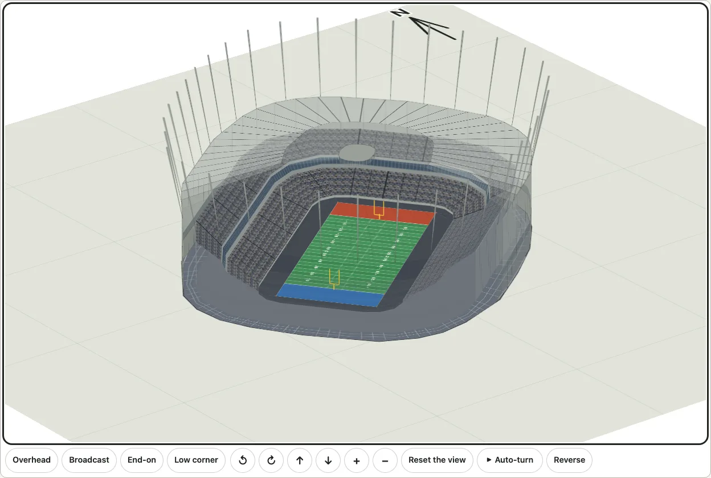

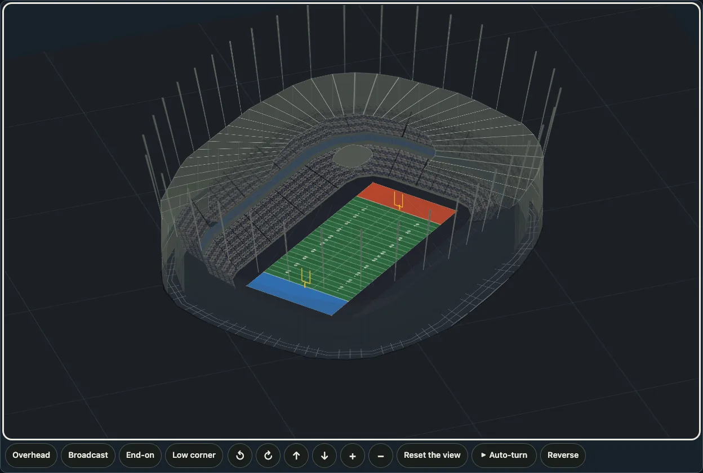

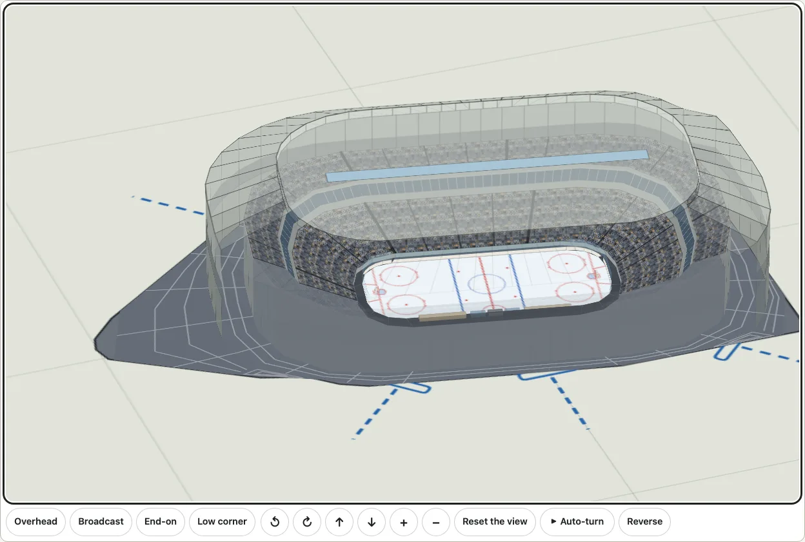

## The crowd outside

`outside: { level: 25 }` puts a quarter of the venues' seats' worth of people on the sidewalks, plazas and grounds round the buildings, never on a road, in 2D (`mountDistrict`) and in 3D, for BC Place and Rogers Arena. It is [its own page](./outside.md): the walkable ground it stands on, the levels, the licence and the cost.

## Limits

- The plan is the venues' own outlines and, with `context`, what lies round them (PLATEAU's buildings in Tokyo; the streets and buildings of downtown Vancouver; the streets, buildings, water and trees of Seattle and the water and trees of Vancouver), drawn faintly for company: it is not a map to find your way by, and a district with no `context` has no street, water or park (a [crowd outside](./outside.md) shows where the roads are by where it is not). `city` is the real distances without a base map (a base map from OpenStreetMap, or Chizu's, is not here).
- A venue a few kilometres off is a small building on a large ground: the 3D view zooms to it, and flying from one to the next is [the fly-through](./flythrough.md)'s, which does not take a district.
- A building's outline is OpenStreetMap's: where it takes in a plaza or a wing, so does the plan, and two outlines can touch.
- Depth between buildings is exact for buildings a line can separate; two that no line separates (outlines that overlap) are ordered by their middles.
- The ground is flat: no hill or street level.

Every drawing and view carries the credit `VENUE_ATTRIBUTION` in its description: (c) OpenStreetMap contributors, ODbL 1.0, openstreetmap.org/copyright; one with `context` carries the credit of its buildings too.
