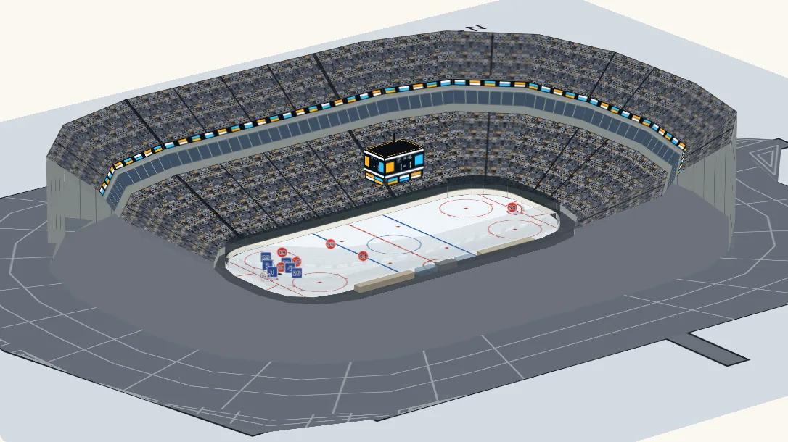

# Example games

A whole game to replay, for trying the [replay](./replay.md) on something longer than a play: [`examples/games/canada-japan.json`](../examples/games/canada-japan.json), a made-up game of hockey between Canada and Japan, all three periods, about fifteen minutes long, nearly half of it the dead time of its stoppages.

**A made-up game, shaped from a public NHL play-by-play; teams and players are invented.** The kinds of its events and, roughly, where on the ice and in what order they came are a real game's; nothing else is. The sides are national sides with their countries' names and colours only (no federation's or team's mark), every player's name and number is invented, the places are turned, mirrored across the rink and jittered, every gap is re-timed, an overtime is left out and the result is changed, so that the game it was shaped from cannot be read from it. The play-by-play has events only, so the five skaters and the goaltender of each side are moved between the events in a plausible shape round the puck, and the goaltenders stay in their crease. Its stoppages are hockey's ([stoppages](./replay.md#stoppages-the-clock-stops-the-players-line-up)): at every goal, whistle and period's end the game clock stops, the puck is dead, the players glide to the face-off's line-up at the spot the rules give (a line going off goes to its bench and the next comes on from it), and the clock runs again at the drop. Its penalties are the source's (their kinds and the moments they were called; the players who serve them are invented): the penalized player sits in his side's box for his time on the game clock while his side plays a skater short, and a power-play goal ends a minor ([penalties](./replay.md#penalties-and-the-power-play)).

## What is in the file

| Field | What it is |
| --- | --- |
| `kind`, `version` | `"kyogijo-game"` and `1`. |
| `sport` | `"nhl"`: the surface it is played on. |
| `note` | The sentence above, in English and Japanese (`{ en, ja }`). |
| `teams.home`, `teams.away` | Each side's `name` (`{ en, ja }`), `abbr`, `flag` (a country code) and `color`. |
| `rosters.home`, `rosters.away` | Every player: `id` (the id in the frames), `number`, `name` (`{ en, ja }`) and `position` (`G`, `F` or `D`). |
| `score` | The final score, `home` and `away`, and `byPeriod`: `[home, away]` for each period. |
| `periods` | Each period's `number` and its `start` and `end` on the timeline's clock, in seconds. |
| `timeline` | A [replay timeline](./replay.md#the-timeline) in the `nhl-api` frame (feet from centre ice): key frames twice a second while play is on, at every event and at each moment of a stoppage, each with the twelve players on the ice and the puck (out of sight while it is dead), the events (`pass`, `shot`, `goal`, `whistle`, `faceoff`), the `stoppages` (each one's `start` and `end`, its `reason` and the face-off spot, `x` and `y`) and the `penalties` (who sat in the box, from when to when, for how many minutes). |

It is 1.1 MB as it is and about 105 kB compressed, as a web server sends it; the frames are key frames, and the replay moves everything between them. It is not in the npm package, whose size it would multiply for something only a demo needs: it is in the repository and on the demo's site, at `https://johnmorrisdotca.github.io/kyogijo-stadiums/examples/games/canada-japan.json`.

## The index

`examples/games/index.json` lists the games, and says which surface each is played on. The demo reads it, and offers **Play a game** only on a surface that has a game in it: today the NHL rink, which has this one. A new game is its file in `examples/games/` and one line here, and no code: the button then shows wherever its surface is on show (on the Try it surface, flat or in 3D, and, for the rink, on the home page's arena and the real arenas in 3D), and the surface picker marks the surface.

```json
{
  "kind": "kyogijo-games",
  "version": 1,
  "games": [
    {
      "id": "canada-japan",
      "sport": "nhl",
      "file": "canada-japan.json",
      "frame": "nhl-api",
      "title": { "en": "Canada v Japan, a made-up game of hockey", "ja": "…" }
    }
  ]
}
```

| Field | What it is |
| --- | --- |
| `kind`, `version` | `"kyogijo-games"` and `1`. |
| `games[].id` | The game's own name, in kebab case, once in the index. |
| `games[].sport` | The surface it is played on: a key of `SPORTS` (`"nhl"`), the same as the file's own `sport`. |
| `games[].file` | The game's file, beside the index. |
| `games[].frame` | The frame its timeline is in (`"nhl-api"`), a frame of that surface: the same as the file's `timeline.from`. |
| `games[].title` | The game's name in English and Japanese (`{ en, ja }`). |

An entry that lacks one of these is left out. A test (`src/example-games.test.js`) holds the index to the folder: every file in it is listed, and each line agrees with its file's surface and frame.

## Play it



In 3D, the players standing up on the ice and the view turning while it plays ([the replay in 3D](./replay.md#in-3d)):

```ts no-run
import { mountKyogijoTurn } from "@johnmorrisdotca/kyogijo-stadiums/turn";

const game = await (await fetch("https://johnmorrisdotca.github.io/kyogijo-stadiums/examples/games/canada-japan.json")).json();
const view = mountKyogijoTurn(document.querySelector("#rink")!, {
  sport: "nhl",
  home: { name: "Canada", abbr: "CAN", color: "#d52b1e", score: 0 },
  away: { name: "Japan", abbr: "JPN", color: "#1d3f8f", score: 0 },
}, { preset: "broadcast" });
const replay = view.replay(game.timeline);
// A period's buttons: seek to its start.
replay.seek(game.periods[1].start);
replay.play();
```

Flat, on the same rink, with `mountKyogijo` of `/mount` in place of `mountKyogijoTurn` and `mount.replay(game.timeline)` in place of `view.replay`. Or with no script of your own but the line that loads the game, as an element: `<kyogijo-field sport="nhl" turn>` and `element.timeline = game.timeline`.

In Node, a frame of it as SVG, from the file in this repository:

```js
import { readFileSync } from "node:fs";
import { drawFrame, replayInfo } from "@johnmorrisdotca/kyogijo-stadiums/replay";

const game = JSON.parse(readFileSync("examples/games/canada-japan.json", "utf8"));
const timeline = game.timeline;
console.log(game.score.home, game.score.away, game.periods.length, Math.round(replayInfo(timeline).duration / 60));
const svg = drawFrame({ sport: "nhl", home: { name: "Canada", score: 0 }, away: { name: "Japan", score: 0 } }, timeline, game.periods[1].start);
console.log(svg.startsWith("<svg"), svg.includes("Shirt numbers"));
// 6 5 3 15
// true true
```

The score at a time is the goals at or before it (`timeline.events`, `kind: "goal"`, by `team`); the names in a language are the roster's (`name.en`, `name.ja`), which a page can put on the frames' objects as their `label` for the tooltip. A scoreboard hung over a real arena's ice follows the game too, with its period and clock, when the timeline is given its periods: `view.replay({ ...game.timeline, periods: game.periods.map((p) => ({ ...p, length: 1200 })) })` (a period of twenty minutes on the board's clock; [the scoreboard over the arena](./replay.md#the-scoreboard-over-the-arena-follows-the-game)). The demo does that and both of the above: [A game on the ice, in 3D](https://johnmorrisdotca.github.io/kyogijo-stadiums/#game), and **Play a game** plays it on the arena at the top of the page, in front of its crowd, on the Try it surface, flat or in 3D, and on [the real arenas](https://johnmorrisdotca.github.io/kyogijo-stadiums/venues.html?view=3d&game=1) in 3D.

## How it is made

`scripts/game-fiction.mjs` makes it, pure and seeded, so that the same play-by-play gives the same game every time; `node scripts/make-game.mjs <play-by-play.json>` writes the file. The play-by-play is read from a file kept outside the repository and is never committed: only the made-up game is. Its dead time is the package's own: the face-off spot after each stoppage is `hockeyFaceoffDot`, the line-up `hockeyFormation`, and `addDeadTime` with `HOCKEY_RULES` opens each stoppage into the walk to the line-up ([hockey's rules](./replay.md#hockeys-rules)). The play-by-play does not say where a side not at fault chose the spot's side after icing or a penalty, or where the puck crossed the line for an offside, so those sides are the source's face-off's; nothing else of its face-offs is kept. Its test (`scripts/game-fiction.test.mjs`) runs on a few invented plays, and `src/replay.stoppage.test.ts` holds the file to the rules.
