# Recipes

Short examples to copy, one for each thing the package does. Each is run against the built package by `pnpm test:readme`, and each links to the page that has the rest. They were the README's examples; the README keeps a few and this page has them all.


## A score on the rink

```ts
import { drawKyogijo } from "@johnmorrisdotca/kyogijo-stadiums";

const svg = drawKyogijo({
  sport: "nhl",
  away: { name: "USA", abbr: "USA", score: 3, color: "#1c3f7a" },
  home: { name: "Canada", abbr: "CAN", score: 2, color: "#d52b1e" },
  status: "final-ot",
  competition: "Cup Final, Game 7",
  date: "June 24",
});
console.log(svg.includes("Cup Final, Game 7"), svg.includes("Final/OT"));
// true true
```

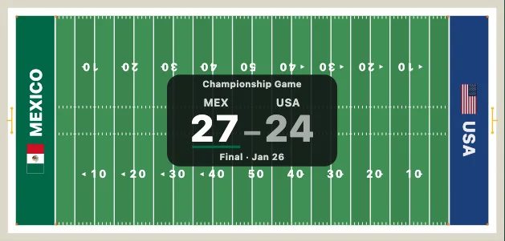

*A football field: the end zones in the teams' colours, the score at midfield.*

## Trophies, medals, balls and crests

Kyogijo draws none of its own. Plug in [Dougu Sports](https://johnmorrisdotca.github.io/dougu-sports/) (`npm install @johnmorrisdotca/dougu-sports`) once, and its 167 emblems are ids: [Emblems](./emblems.md).

```ts
import { drawKyogijo, useEmblems } from "@johnmorrisdotca/kyogijo-stadiums";
import { renderEmblem } from "@johnmorrisdotca/dougu-sports/emblems";

useEmblems(renderEmblem);

const svg = drawKyogijo({
  sport: "soccer",
  away: { name: "Brazil", abbr: "BRA", score: 2, color: "#009739", logo: "crest:shield" },
  home: { name: "England", abbr: "ENG", score: 1, color: "#c8102e", logo: "crest:roundel" },
  status: "final",
  pageant: { style: "stage", emblem: "trophy:soccer-globe", emblemName: "Northern Cup" },
});
console.log(svg.includes(encodeURIComponent(">BRA<")), svg.includes("Northern Cup"));
// true true
```

## A bare surface, and tall for a phone

```ts
import { drawKyogijo, drawSurface } from "@johnmorrisdotca/kyogijo-stadiums";

// No teams: just the NFL field at its true shape, 120 by 53⅓ yards with 12 feet of ground round it.
console.log(/viewBox="-12 -12 384 184"/.test(drawSurface({ sport: "nfl" })));
// true
const game = { away: { name: "Mexico", score: 27 }, home: { name: "USA", score: 24 }, status: "final" };
const wide = drawKyogijo({ sport: "nfl", ...game, orientation: "landscape" });
const tall = drawKyogijo({ sport: "nfl", ...game, orientation: "portrait" });
const box = (svg: string) => /viewBox="[^ ]+ [^ ]+ ([^ ]+) ([^ "]+)"/.exec(svg)!.slice(1).map(Number);
console.log(box(wide), box(tall));
// [ 384, 184 ] [ 184, 384 ]
```

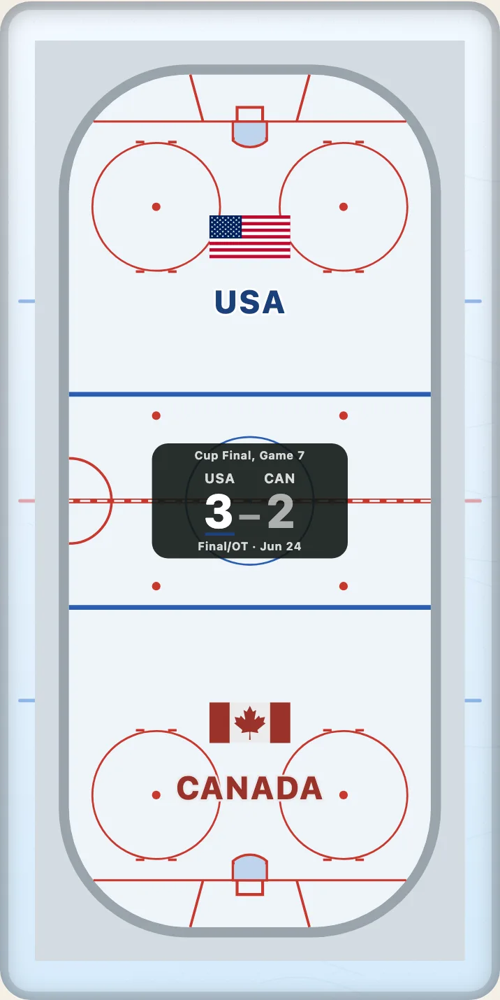

*The same game tall: the teams top and bottom, every word upright.*

[The surfaces](./surfaces.md) lists the forty-three, with their sizes and what is drawn; [score and layout](./score.md) has the options of a score, a strip and a compact card.

## A league's rulebook

```ts
import { drawKyogijo } from "@johnmorrisdotca/kyogijo-stadiums";

// A court as FIBA marks it is not the NBA's.
console.log(drawKyogijo({ sport: "nba", league: "fiba" }) === drawKyogijo({ sport: "nba" }));
// false
```

Thirty-five leagues, each with its figures and its sources, are in [league variants](./variants.md).

## A ballpark, by name

```ts
import { PARKS, drawKyogijo } from "@johnmorrisdotca/kyogijo-stadiums";

const park = PARKS["hanshin-koshien-stadium"];
console.log(park.name, park.nameJa, park.points.length);
// Koshien Stadium 甲子園球場 5
const svg = drawKyogijo({ sport: "mlb", park: "hanshin-koshien-stadium", language: "ja" });
console.log(svg.includes("甲子園球場のグラウンド"), svg.includes("阪神甲子園球場のグラウンド"), svg.includes("正式名称は阪神甲子園球場です"));
// true false true
```

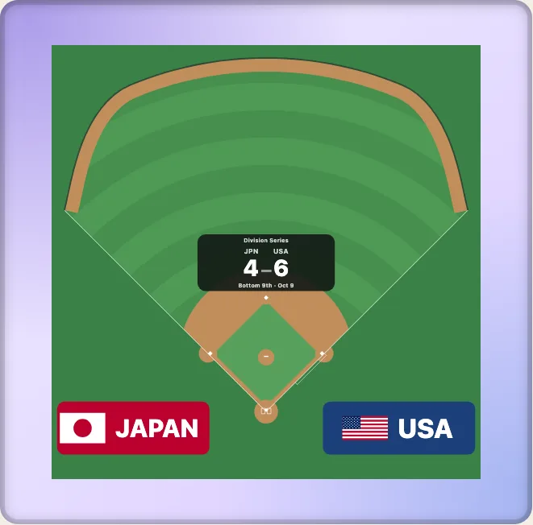

*A ballpark's fence, drawn through the distances its article publishes.*

## A ballpark of the past, in a season

```ts
import { PARKS, parkPointsIn, drawKyogijo } from "@johnmorrisdotca/kyogijo-stadiums";

const polo = PARKS["polo-grounds"];
console.log(polo.name, polo.from, polo.to, parkPointsIn(polo, 1915).map(([, feet]) => feet));
// Polo Grounds 1891 1963 [ 277, 433, 258 ]
console.log(drawKyogijo({ sport: "mlb", park: "polo-grounds", year: 1915 }) === drawKyogijo({ sport: "mlb", park: "polo-grounds", year: 1930 }));
// false
```

Your own fence (`fence: { left: 310, center: 420 }`) and every park's key are in [ballparks](./ballparks.md) and [parks](./parks.md).

## A rink in a ballpark

```ts
import { drawKyogijo } from "@johnmorrisdotca/kyogijo-stadiums";
import { EVENTS, eventOptions } from "@johnmorrisdotca/kyogijo-stadiums/events";

// The 2009 Winter Classic: the NHL's rink, 200 by 85 feet, on the infield of Wrigley Field.
const game = EVENTS["winter-classic-2009"];
console.log(game.name.en, game.dates[0], game.venue.en);
// 2009 NHL Winter Classic 2009-01-01 Wrigley Field
const svg = drawKyogijo({
  ...eventOptions("winter-classic-2009"),
  away: { name: "Detroit Red Wings", abbr: "DET", score: 6, color: "#ce1126" },
  home: { name: "Chicago Blackhawks", abbr: "CHI", score: 4, color: "#111111" },
  status: "final",
});
console.log(svg.includes("Detroit Red Wings 6, Chicago Blackhawks 4"), svg.includes("lies outside the outline"));
// true true
```

The host, the rink and where it stood are each cited, and each game says whether its place is a source's or a convention: [special games](./special-games.md).

## A badge for a list

```ts
import { drawBadge } from "@johnmorrisdotca/kyogijo-stadiums";

const badge = drawBadge({
  sport: "nba",
  away: { name: "Australia", abbr: "AUS", score: 98, color: "#00843d" },
  home: { name: "Japan", abbr: "JPN", score: 104, color: "#bc002d" },
  status: "Q4 2:31",
});
console.log(/viewBox="0 0 440 64"/.test(badge));
// true
```

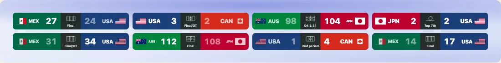

*Badges for a list of games.*

## A court of your own look

```ts
import { COURT_THEMES, drawKyogijo } from "@johnmorrisdotca/kyogijo-stadiums";

const svg = drawKyogijo({
  sport: "nba",
  court: { ...COURT_THEMES.twoTone, baselineText: ["SUMMIT PEAKS", "METRO BOLTS"], paintThreePoint: true },
});
console.log(svg.includes("--ky-key:#1e4f8f"), svg.includes("METRO BOLTS"));
// true true
```

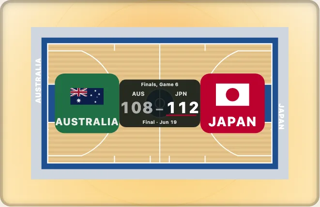

*A court in a look of its own: the paint, the border and the words on the baselines are options.*

The five court looks, the eight looks of every sport and every colour property are in [theming](./theming.md).

## Turn it, and see the net

```ts no-run
import { mountKyogijoTurn } from "@johnmorrisdotca/kyogijo-stadiums/turn";

const view = mountKyogijoTurn(document.querySelector("#court")!, { sport: "volleyball", status: "live" }, { preset: "end" });
view.preset("corner");
view.setDirection("clockwise"); // the auto-turn goes the other way (`direction` in the settings says it at the start)
```

```ts
import { turnMarkup, uprightsFor } from "@johnmorrisdotca/kyogijo-stadiums/turn";

const { items } = uprightsFor({ sport: "volleyball" }, { netHeight: "women" });
const html = turnMarkup({ sport: "volleyball" }, { preset: "end" });
console.log(items.map((item) => item.kind).join(), html.includes("preserve-3d"));
// net,netposts,antennae false
```

The flat drawing is the floor, turned by a drag, a swipe, the keys or four viewpoints, with what the rulebook stands on it at its height; each part is one `matrix3d`. The auto-turn waits for Play, and turns either way: `counterclockwise` (the near side swinging to the viewer's right) by default, `clockwise` on the Reverse button. In the element: `<kyogijo-field sport="nhl" turn turn-view="broadcast">`. [The 3D view](./turn.md).

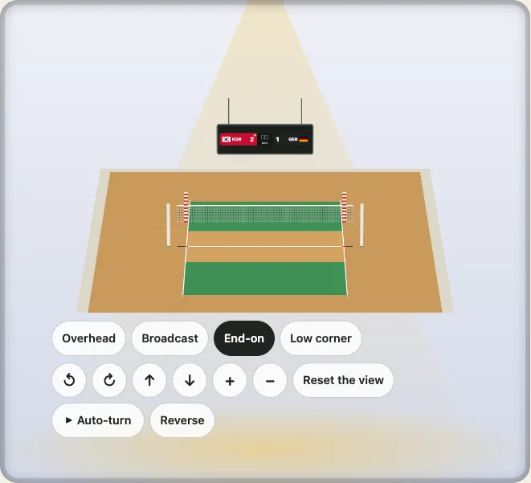

*A volleyball net at its rulebook height, with its posts and antennae.*

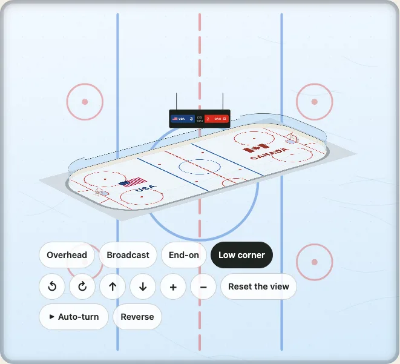

*A rink with its boards, glass and goals.*

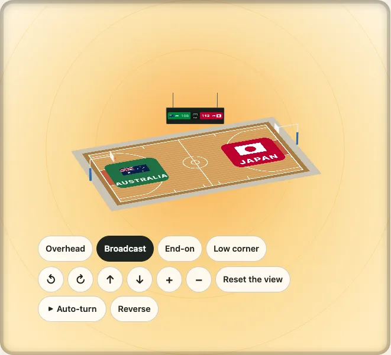

*A court with a basket at each end, the rim at 10 feet.*

## A shoot-out, and a famous ground

```ts
import { drawKyogijo, soccerSpec } from "@johnmorrisdotca/kyogijo-stadiums";

const svg = drawKyogijo({
  sport: "soccer",
  away: { name: "USA", abbr: "USA", score: 2, penalties: 4, color: "#1c3f7a" },
  home: { name: "Canada", abbr: "CAN", score: 2, penalties: 2, color: "#d52b1e" },
  status: "final-pens",
  ground: "metlife-stadium",
});
console.log(svg.includes("Final · 2-4 pens"), soccerSpec({ length: 110, width: 70, unit: "yd" }).length.toFixed(2));
// true 100.58
```

Pitch sizes, mowing patterns, goals and providers are in [soccer](./soccer.md); the 64 grounds are in [the grounds](./grounds.md).

## A surface in a season

```ts
import { drawKyogijo, rulesFor } from "@johnmorrisdotca/kyogijo-stadiums";

const rink = rulesFor("nhl", 1960);
console.log(rink.season, rink.rules.centreLine, rink.rules.trapezoid);
// 1960–61 true null
console.log(drawKyogijo({ sport: "nba", year: 1978 }) === drawKyogijo({ sport: "nba", year: 1979 }));
// false
```

Every change and its source is in [surfaces through the years](./eras.md).

## Units and a provider's frame

```ts
import { convertLength, surfaceSize } from "@johnmorrisdotca/kyogijo-stadiums/geometry";
import { convert, toSurface } from "@johnmorrisdotca/kyogijo-stadiums/frames";

console.log(surfaceSize("nfl").unit, convertLength(100, "yd", "ft"));
// yd 300
// The right end-zone face-off dot, in the NHL API's feet and in HockeyTech's canvas, is one place.
console.log(toSurface([[69, 22]], { from: "nhl-api" }), convert("hockeytech", "nhl-api")([[600, 0]]));
// [ [ 169, 20.5 ] ] [ [ 100, 42.5 ] ]
```

[Units](./units.md) and [coordinate frames](./frames.md) have the tables of every surface's unit and every frame's range, origin and source.

## Data on a surface

```ts
import { drawKyogijo } from "@johnmorrisdotca/kyogijo-stadiums";

// The NHL API's coordinates are feet from centre ice: `from` puts them on the rink.
const svg = drawKyogijo({
  sport: "nhl",
  layers: [
    {
      kind: "points",
      name: "shots",
      from: "nhl-api",
      data: [
        { x: 69, y: 22, team: "home", outcome: "goal", value: 0.31 },
        { x: 54, y: -8, team: "home", outcome: "shot", value: 0.07 },
        { x: -61, y: 12, team: "away", outcome: "blocked", value: 0.04 },
      ],
      style: { size: { range: [2, 5] }, outcomes: { blocked: { hollow: true, shape: "x" } } },
    },
  ],
});
console.log(svg.includes("3 shots"), svg.includes("By outcome: goal 1, shot 1, blocked 1."));
// true true
```

Zoom to a part with `range`: the data follows the crop ([display ranges](./ranges.md)).

```ts
import { drawKyogijo } from "@johnmorrisdotca/kyogijo-stadiums";

const zone = drawKyogijo({ sport: "nhl", range: "offensive-zone", layers: [{ kind: "points", name: "shots", data: [{ x: 169, y: 20.5 }, { x: 150, y: 40 }] }] });
console.log(zone.includes('data-range="offensive-zone"'), zone.includes("Shows only the offensive zone at the right end."));
// true true
```

Lines, arrows, text, heat maps, hexagons, zones and contours are in [data layers](./layers.md); shot, spray and pass charts in [charts](./charts.md); pass networks, formations, lineups, Voronoi cells and flow fields are layers too ([team shape](./team-shape.md)).

## Small multiples on a card

Many drawings in one SVG, with a title, a credit line and a ground behind them ([layouts and backgrounds](./layouts.md)).

```ts
import { drawGrid } from "@johnmorrisdotca/kyogijo-stadiums/layouts";

const svg = drawGrid(
  ["fenway-park", "wrigley-field", "oracle-park"].map((park) => ({ drawing: { sport: "mlb", park }, label: park })),
  { preset: "card", title: "Three ballparks", endnote: "Drawn with Kyogijo", background: "grass" },
);
console.log(svg.includes('viewBox="0 0 1200 675"'), svg.includes("Three ballparks"));
// true true
```

## Several surfaces on one floor

`drawMulti` lays the package's own surfaces out for one large event, to scale, on one floor, with the officials' chairs and boards and places for the event's words (`sample: true` fills them with an invented event; [tournament layouts](./multi.md)). `multiFit` says whether it fits a hall, `stadium: true` sets it inside stands, `mountMultiTurn` turns it in 3D.

```ts
import { drawMulti, multiLayout } from "@johnmorrisdotca/kyogijo-stadiums/multi";

const svg = drawMulti({ preset: "judo-1x3", sample: true });
const layout = multiLayout({ preset: "judo-1x3" });
console.log(svg.startsWith("<svg"), layout.cells.length);
// true 3
console.log(layout.needs.length, layout.needs.width);
// 47 19
```

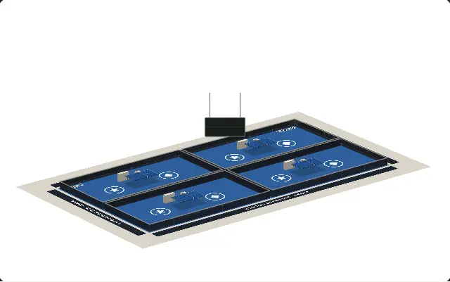

*A tournament layout, turning: four table tennis areas under one scoreboard.*

## Boards over a surface

`board` lays a results board, a bout presentation or a medal table, any SVG, over a surface in 2D and 3D, off its middle and never stretched ([boards](./boards.md)).

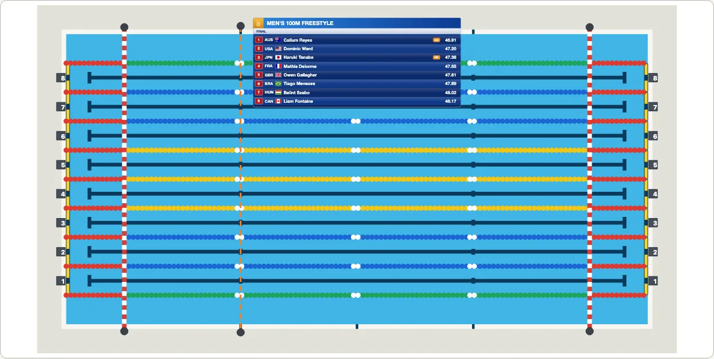

*A final over the pool.*

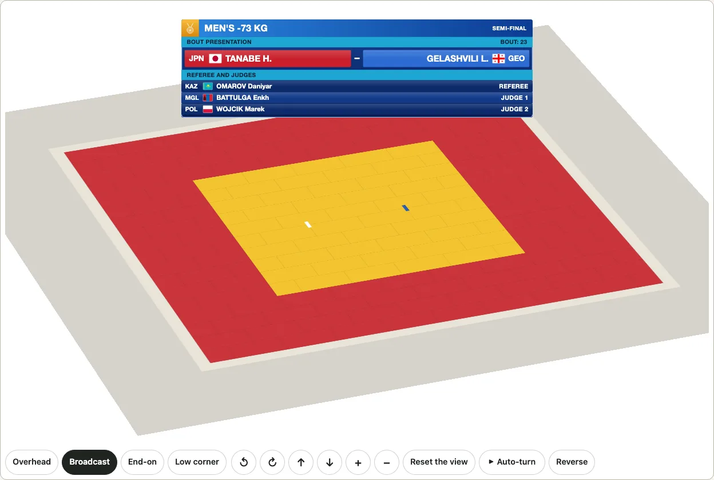

*A bout over the mat, in 3D.*

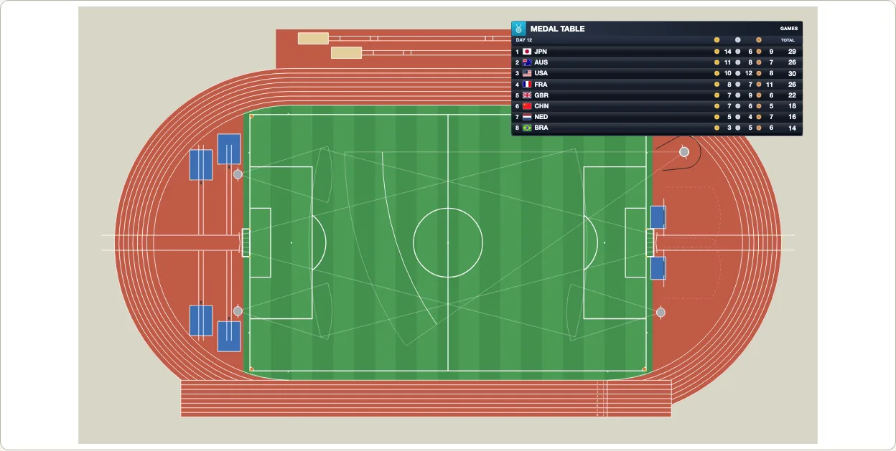

*A medal table in a corner.*

## The real venues

`crowd: { real: true }` draws an NHL arena in its building: the outline from OpenStreetMap, the rink lying along the building where it says so, and a plausible bowl of the seats, tiers and roof the sources give. All thirty-two arenas of the league, division by division ([the real venues](./venues.md)). `boards: true` adds LED ribbon boards and a hung scoreboard, generic content ([LED boards](./venues.md#led-boards)). In 3D the demo's [venues page](https://johnmorrisdotca.github.io/kyogijo-stadiums/venues.html) turns while the pointer is over it, with the stands, walls, roof, LED boards, lighting, building, markings and labels switched on the view while it turns.

```ts
import { drawKyogijo } from "@johnmorrisdotca/kyogijo-stadiums";
import { planVenue, venueById } from "@johnmorrisdotca/kyogijo-stadiums/venues";

const svg = drawKyogijo({ sport: "nhl", arena: "climate-pledge-arena", crowd: { real: true } });
console.log(svg.includes("ky-cr-shell"), planVenue(venueById("climate-pledge-arena")!).total);
// true 17151
```

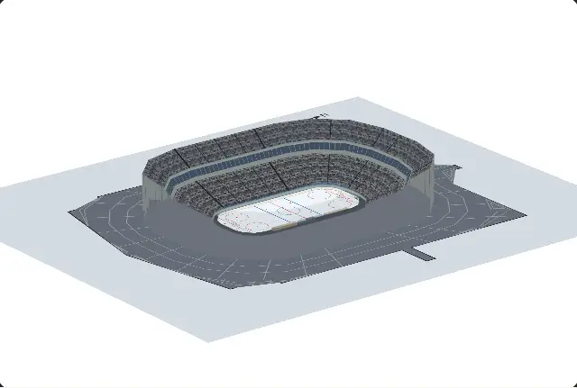

*A real arena, turning: Climate Pledge Arena in the outline of its building (OpenStreetMap).*

## A real stadium, and a district

`stadium: "bc-place"` draws BC Place for football or soccer under its cable roof, and Lumen Field, T-Mobile Park, Tokyo Dome, Koshien Stadium (`park`) and Korakuen Hall (`sport: "boxing"`) likewise ([stadiums](./stadiums.md)); `drawDistrict({ venues: ["bc-place", "rogers-arena"] })` puts venues at their real positions, tight as neighbours or spread as a city, to turn together in 3D ([districts](./district.md)).


*BC Place, in 3D.*


*BC Place and Rogers Arena.*


*Seattle's SoDo.*

## A fly-through

`mountFlythrough` flies one camera from a map to a real arena: the map falls to the city and the building, which rises into 3D, the roof lifts away, and the camera comes in to a seat, where a made-up play runs on the ice ([the fly-through](./flythrough.md)).


*The fly-through to Climate Pledge Arena, sped up.*

## Who judges where

`drawJudging` puts each judo mat's officials by seat in the picture and in a chart ([judging](./judging.md)).

The broadcast view puts the mat large, with the officials on a board at its side; `judgingPrint` prints one mat to an A4 or US letter page.

## A table tennis area

A table in the ITTF's playing area, 14 m by 7 m, with surrounds and chairs ([courts](./courts.md#the-table-tennis-playing-area)).

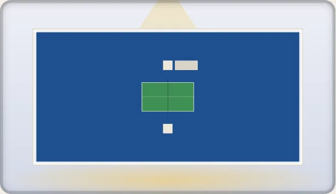

*The table in its playing area.*

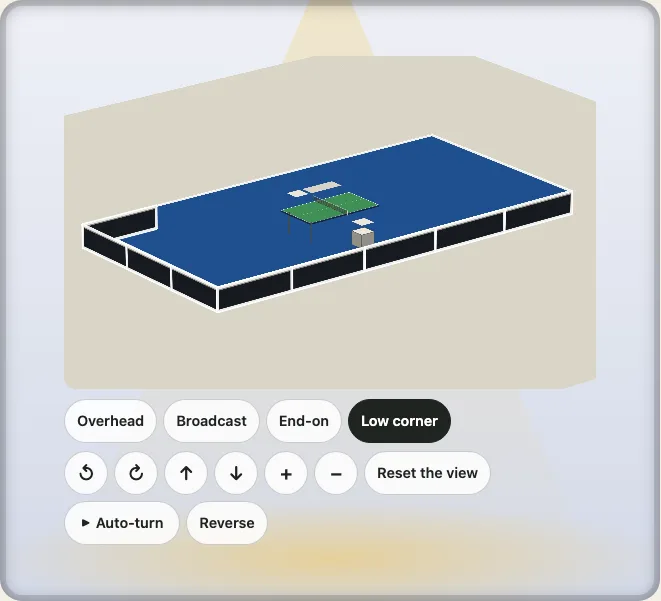

*The same area in 3D.*

## A judo kata area

`budo: { style: "kata" }` is the IJF's kata area: a tape at the centre and one 3 m either side, and with `officials` the five judges and the coach's chair ([the budō page](./budo.md#the-kata-area)).

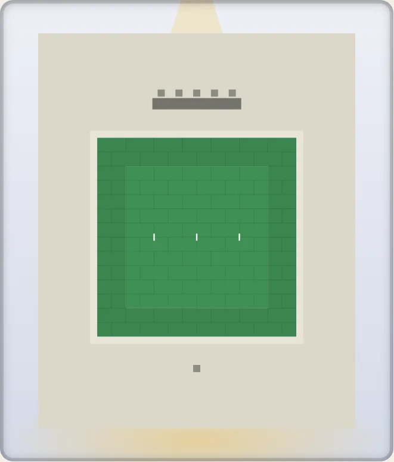

*The kata area, its judges and the coach's chair.*

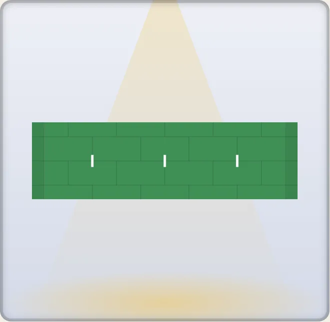

*Close up: the centre tape and the two starting tapes.*

## The combat sports

An MMA cage, rings and wrestling mats ([the combat sports page](./combat.md)).

## The element in a page

```html
<script type="module" src="https://cdn.jsdelivr.net/npm/@johnmorrisdotca/kyogijo-stadiums@0/dist/element-define.js"></script>

<!-- score is home-away; home-score and away-score say it the other way -->
<kyogijo-field sport="nba" size="compact" orientation="auto"
  home="Japan" away="Australia" score="112-108"
  home-color="#c2410c" away-color="#14233f" status="final"></kyogijo-field>
```

The attributes are the options' names in kebab case, and the parts you can style are listed in [getting started](./getting-started.md#3-a-custom-element).

## In React

```tsx no-run
import React from "react";
import { createKyogijo, kyogijoProps } from "@johnmorrisdotca/kyogijo-stadiums/react";

// A component made from your React, which measures its box for orientation="auto":
const Kyogijo = createKyogijo(React);
export const Game = () => (
  <Kyogijo sport="nhl" orientation="auto" away={{ name: "USA", score: 3 }} home={{ name: "Canada", score: 2 }} status="final" />
);

// Or props to spread onto your own element; nothing here imports React:
export const Plain = () => <div {...kyogijoProps({ sport: "nba" })} />;
```

## In Vue

```vue
<script setup>
import "@johnmorrisdotca/kyogijo-stadiums/element/define";
</script>

<template>
  <kyogijo-field sport="nfl" orientation="auto" away="Mexico" home="USA" away-score="27" home-score="24" status="final" />
</template>
```

Tell Vue the tag is a custom element with `compilerOptions.isCustomElement: (tag) => tag === "kyogijo-field"`.

## In Svelte

```svelte
<script>
  import "@johnmorrisdotca/kyogijo-stadiums/element/define";
  import { drawKyogijo } from "@johnmorrisdotca/kyogijo-stadiums";
  export let home = 0;
  export let away = 0;
  $: svg = drawKyogijo({ sport: "nhl", away: { name: "USA", score: away }, home: { name: "Canada", score: home } });
</script>

<!-- the string of SVG, or the element: either works -->
{@html svg}
<kyogijo-field sport="nhl" away="USA" home="Canada" away-score={away} home-score={home} />
```

A page that moves (`mountKyogijo`), a file written on a server and a frame for a page with no script are in [getting started](./getting-started.md).

