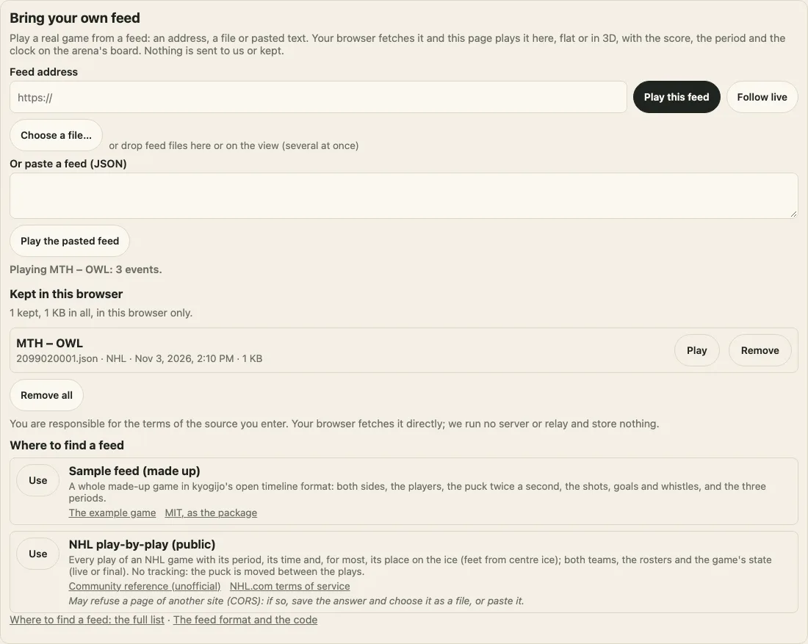

# フィード

日本語 · [English](feeds.md)

フィードとは、試合をデータとして表したものです。選手やボールの位置の時間変化、試合中に起きたこと（シュート、ゴール、笛など）、そして両チームとピリオドの情報から成ります。[リプレイ](./replay.md)はフィードを平面表示でも[3D表示](./replay.md#in-3d)でも再生でき、アリーナのスコアボードにはスコア、ピリオド、試合時間が表示されます。当パッケージはフィードを配信せず、リーグのデータも保存しません。フィードは利用者自身のものです。選んだファイル、貼り付けたテキスト、指定したアドレスのいずれかから読み込み、アドレスの場合は**閲覧者のブラウザー**が取得します。[フィードの入手先](./where-to-find-a-feed.ja.md)には、競技ごとに知られているフィードを、当サイトの架空のサンプルを先頭にして掲載しています。

## 守っているルール

- **当サイトのサーバーや中継サーバーは使いません。** アドレスは閲覧者のブラウザーがCookieもリファラーも付けずに取得し、ほかの場所には何も送りません。
- **ブラウザーの外には何も出しません。** パッケージ自体は何も保存しません（ページを開いている間を超えて残るキャッシュも保存もなく、リポジトリにも何も取り込みません）。デモでは、ドロップまたは選択したフィードのファイルを閲覧者自身のブラウザーにだけ保存します。
- **名前は実行時にフィードから表示します。** パッケージにはリーグやチームの名前、ロゴ、マークを含めていません。フィードに含まれる名前は、ページを開いている間だけテキストとして表示します。
- **利用規約は提供元のものです。** アドレス欄の横の注記にもあるとおり、入力した提供元の利用規約の遵守は閲覧者の責任です。
- **テストには当方で作成した架空の応答だけを使い**、実際のリクエストは送りません。

## オープンなタイムライン

kyogijo独自の形式は、JSONで書いた[リプレイのタイムライン](./replay.md#the-timeline)です。`frames`（それぞれ時刻 `t` と `objects` を持ち、各オブジェクトは `id`、`home`・`away`・`ball`・`puck`・`official` のいずれかの `team`、`x` と `y` を持ちます）、`events`（`t`、`pass`・`shot`・`goal`・`whistle` などの `kind`、`team`、位置）、スコアボード用の `periods`（それぞれ `number`、`start`、`end`、そしてリプレイの時間を実際の試合時間と変えている場合に、スコアボードの時計で数えるピリオドの長さ `length`）と `clock`（残り時間を数える `down` か、経過時間を数える `up`）から成ります。両チームは `teams`（`home` と `away`、それぞれ `abbr`、`name`、`color`）に書き、`readFeed` はそれを試合の `teams` として返します。`from` は位置の座標系を指定します（`nhl-api`、`opta` など。[座標系](./frames.md)を参照）。[サンプルの試合](./example-games.md)のような試合ファイル（`kind: "kyogijo-game"`）は、タイムラインに両チーム、ロースター、ピリオドを加えたもので、どちらの形でも読み込めます。

```json
{
  "from": "nhl-api",
  "frames": [{ "t": 0, "objects": [{ "id": "puck", "team": "puck", "x": 0, "y": 0 }] }, { "t": 30, "objects": [{ "id": "puck", "team": "puck", "x": 80, "y": 4 }] }],
  "events": [{ "t": 30, "kind": "goal", "team": "home", "x": 80, "y": 4 }],
  "periods": [{ "number": 1, "start": 0, "end": 1200 }],
  "teams": { "home": { "abbr": "AAA" }, "away": { "abbr": "BBB" } }
}
```

値はすべて読み込み時に検査します。時刻のないフレーム、位置のないオブジェクトや不明なチームのオブジェクト、時刻のないイベントは取り除きます。テキストはあくまでテキストとして扱い、長すぎる部分は切り詰めます。リストの件数にはすべて上限（`FEED_LIMITS`）があるため、壊れた応答や悪意のある応答でページが動かなくなることはありません。

## フィードを読み込む

`@johnmorrisdotca/kyogijo-stadiums/feeds` は、応答を試合データとして読み込みます。得られるのは `timeline`、フィード上で試合が終了しているかどうか（`ended`）、フィードに含まれる選手（`players`）です。`readFeed(json, format?)` は形式を自動で判別するか（`auto`）、`kyogijo` または `nhl` の指定を受け付けます。`readFeedText(text)` は、ファイルや貼り付けで得たテキストを受け取って読み込みます。問題があった場合は、`kind` と説明文を持つ `FeedError` を投げます。

```ts
import { readFeed } from "@johnmorrisdotca/kyogijo-stadiums/feeds";

const game = readFeed({
  frames: [{ t: 0, objects: [{ id: "puck", team: "puck", x: 0, y: 0 }] }, { t: 30, objects: [{ id: "puck", team: "puck", x: 80, y: 4 }] }],
  events: [{ t: 30, kind: "goal", team: "home" }],
});
console.log(game.format, game.timeline.frames.length, game.ended);
// kyogijo 2 true
```

### ファイルや貼り付けから

ブラウザーからフィードに接続できない場合でも再生できます。閲覧者が応答を保存してファイルとして選ぶか、貼り付けます。

```ts no-run
import { mountKyogijoTurn } from "@johnmorrisdotca/kyogijo-stadiums/turn";
import { readFeedText } from "@johnmorrisdotca/kyogijo-stadiums/feeds";

const view = mountKyogijoTurn(document.querySelector("#rink")!, { sport: "nhl" }, { preset: "broadcast" });
document.querySelector<HTMLInputElement>("#file")!.addEventListener("change", async (event) => {
  const file = (event.target as HTMLInputElement).files?.[0];
  if (file !== undefined) view.replay(readFeedText(await file.text()).timeline).play();
});
```

## アダプター

アダプターとは、フィード独自の形式をオープンなタイムラインに変換する純粋関数で、当方で作成した架空の応答でテストしています。各アダプターと、それが読み込む内容は次のとおりです。

| 形式 | 関数 | 読み込む内容 |
| --- | --- | --- |
| `kyogijo` | `kyogijoFeed` | オープンなタイムライン、または試合ファイル。 |
| `nhl` | `nhlPlayByPlay` | NHLの公開データと同じ形のプレーバイプレー。`plays`（それぞれ `periodDescriptor`、`timeInPeriod`、`typeDescKey`、`sortOrder`、そして `xCoord`・`yCoord`・`eventOwnerTeamId`・選手IDを含む `details`）、`homeTeam` と `awayTeam`（`id`、`abbrev`、`commonName`）、`rosterSpots`、`gameState`。 |

プレーバイプレーにはイベントだけがあり、トラッキングデータはありません。そのため `nhlPlayByPlay` は、パックをプレーの位置から次のプレーの位置まで直線で動かし（既知の位置の間を補間したものです）、シュート、ゴール、笛をそれぞれ起きた位置に表示します。すべてのプレーは試合本来の時間軸に置きます（1ピリオド20分、延長はレギュラーシーズンが5分、プレーオフが20分。シュートアウトは含めず、そのゴールもスコアには数えません）。チームは `abbrev`、選手は名前で、いずれも実行時に表示します。`gameState` が `OFF` または `FINAL` になると、`ended` が true になります。

## アドレスから

`/feeds` エントリーを一度読み込むと、すべてのマウントと3D表示の `replay` に `fromUrl` が加わります。閲覧者のブラウザーがアドレスを取得し（Cookie・リファラー・キャッシュなし）、読み込んで再生します。`loadFeed(url)` は、再生せずに取得と読み込みだけを行います。

```ts no-run
import "@johnmorrisdotca/kyogijo-stadiums/feeds";
import { mountKyogijoTurn } from "@johnmorrisdotca/kyogijo-stadiums/turn";

declare const address: string;
const view = mountKyogijoTurn(document.querySelector("#rink")!, { sport: "nhl", crowd: { boards: true } }, { preset: "broadcast" });
try {
  const replay = await view.replay.fromUrl(address, { format: "auto" });
  console.log(replay.feed.teams);
  replay.play();
} catch (error) {
  // A FeedError: error.kind is "cors", "http" (with error.status), "format", "address", "too-large", "network" or "empty".
}
```

読み込むのは `http` または `https` のアドレスだけで（相対アドレスはページのアドレスを基準に解決します）、ログイン情報を含むアドレスは読み込みません。応答の上限は20 MBです。

**ブラウザーで読み取れない場合。** 多くのサーバーは、ほかのサイトのページからの読み取りを許可していません。`Access-Control-Allow-Origin` を返さないため、ブラウザーが応答を拒否します（CORS）。ページからはサーバーが停止している場合と区別できないため、エラーでは両方の可能性を伝えます（`cors`）。その場合は、応答を保存してファイルとして選ぶか貼り付けるか、ヘッダーを付ける中継サーバーを自分で用意して指定してください。当サイトは中継サーバーを運用せず、パッケージが中継サーバーを求めることもありません。

## ライブ

`replay.follow(url, options)` は、試合の進行中にフィードを追います。アドレスをすぐに取得し、その後は15秒ごと（`every`、10秒未満にはできません）に、ページが表示されている間だけ再取得します。内容が変わった応答はそのつど再生し（閲覧者がいた位置から、または閲覧者が最新の時点にいた場合は最新の時点から）、フィード上で試合が終了したとき（`ended`）や、サーバーから拒否されたとき（403または429）に停止します。エラーの後は待ち時間を2倍にし、最長2分まで延ばします。`stop()` は取得を止め、リプレイはそのまま残します。

```ts no-run
import "@johnmorrisdotca/kyogijo-stadiums/feeds";
import type { KyogijoTurn } from "@johnmorrisdotca/kyogijo-stadiums/turn";

declare const view: KyogijoTurn;
declare const address: string;
const live = view.replay.follow(address, { onState: (state) => console.log(state), onError: (error) => console.log(error.kind) });
// later
live.stop();
```

`followFeed(url, { onGame })` は取得だけを行う関数で、独自の方法で試合を再生するページ向けです。ページが非表示の間はタイマーを動かさず、タイマーは常に1つまでです。

## デモでは



デモの試合のセクションにある[自分のフィードを再生](https://johnmorrisdotca.github.io/kyogijo-stadiums/#feed)では、アドレス（**ライブで追う**も可）、ファイル、貼り付けのいずれかで指定でき、アドレス欄の横に[フィードの入手先](./where-to-find-a-feed.ja.md)を当サイトの架空のサンプルを先頭にして表示します。**使う**を押すと、そのアドレスが欄に入ります。

**パソコンにあるフィードのファイル**：1つまたは複数のフィードのファイルを、パネルまたはビューにドロップするか（Finder、ダウンロードフォルダー、同期したDropboxのフォルダーから）、選択してください。NHLのプレーバイプレーのファイルは公開されているプレーバイプレーの応答と同じ形で、kyogijoのタイムラインはそのまま読み込めます。最初に読み込めたフィードを再生し、フィードではないファイルはファイル名を示して受け付けません。フィードはすべてこのブラウザーに保存され、試合、ファイル名、競技、日付、サイズとともに一覧に表示されます。**再生**、**削除**、**すべて削除**のボタンがあり、使用している容量も表示します。ページを再読み込みしても残ります。合計がおよそ4 MBまではlocalStorageに、それを超えるとIndexedDBに保存します。自分のパソコンのフォルダーをまるごとドロップすることもできます。フォルダー内のファイルは1つずつ読み込まれ、パネルに進行状況が表示されます。一度に読み込めるのは200件まで、保存できるのは合計200 MBまでで、それを超える分は理由を示して受け付けません。ブラウザーに書き込むのはファイルをドロップ・選択・削除したときだけで、タイマーで書き込むことはなく、ブラウザーの外には何も送りません。ブラウザーが何も保存しない場合（プライベートウィンドウ、保存の無効化、容量不足）でも、ドロップしたフィードは再生でき、保存されなかったことをパネルに表示します。
