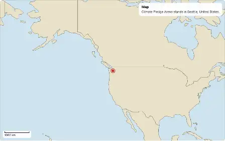

# The fly-through

One smooth camera from a map to a real arena, into its bowl and onto a game. It starts on a map drawn with [chizu](https://github.com/johnmorrisdotca/chizu), falls to the city and to the building of an arena as OpenStreetMap maps it, and the building rises into the [3D arena](./turn.md), which turns. Then the roof lifts away, the camera comes in over the stands and down to the ice, and settles at a seat's viewpoint, from where the rink turns, and a short play comes onto the ice: skaters and a puck, moving. `@johnmorrisdotca/kyogijo-stadiums/flythrough` has one function for a page, `mountFlythrough`, and the plain path it flies, which can be worked out and tested in Node.

The arena is one of the [real venues](./venues.md) (all thirty-two of the NHL's arenas). No team's or league's mark is drawn: the map is land and sea, the building is an outline, and the arena is the same plausible bowl as the venues page's, never a seat map. The seat's viewpoint is a place and a height of our own choosing, not a real seat's, and the play is made up for the picture (a replay's own timeline, see [the game](#the-game)): it says so on the screen and in its words, and it is no real game's data.



The demo's [fly-through page](https://johnmorrisdotca.github.io/kyogijo-stadiums/flythrough.html) flies each of the thirty-two; `flythrough.html?arena=honda-center` opens it on one (`lang=ja`, `theme=dark`, `map=plain` and `stages=city,arena` are in the address too).

```ts no-run
import { mountFlythrough } from "@johnmorrisdotca/kyogijo-stadiums/flythrough";
import WORLD from "@johnmorrisdotca/chizu/world";
import { drawChizu } from "@johnmorrisdotca/chizu/draw";
import { projectPoint } from "@johnmorrisdotca/chizu";

const trip = mountFlythrough(document.querySelector("#trip")!, {
  arena: "honda-center",
  start: { map: WORLD, draw: drawChizu, project: projectPoint },
});
trip.goTo("city"); // glide there along the path
trip.pause();
```

## The call

`mountFlythrough(host, options, settings?)` writes the stage, the controls and the credit into `host` and gives back the handle below. It throws for an arena that has no real venue (`VENUE_IDS` lists the keys) and for an empty list of stages.

| Option | Meaning |
| --- | --- |
| `arena` | The arena's key in `ARENAS`, one of the venues. |
| `start` | The map to start on: `{ map, draw, project, span?, centre? }`. See [the map](#the-map). Without one the start is a plain graticule. |
| `stages` | Which stages to fly, in the order of the path: `map`, `city`, `arena`, `bowl`, `rink`, `game`; all by default. A stage left out keeps its seconds, and the camera crosses them in one smooth run, so a list of `["city", "arena"]` starts at the city. |
| `language` | `en` (the default) or `ja`. |
| `theme` | `light` or `dark`; without one the device's setting decides. |
| `roof` | Whether the building has its roof (true): it is there over the arena and lifts away as the camera comes into the bowl. `false` keeps it off for the whole flight, with the walls still standing. The demo's page has a Roof pill for it, kept in the address as `roof=0`. |

| Setting | Meaning |
| --- | --- |
| `motion` | `auto` (the default) flies unless the reader prefers reduced motion; `smooth` flies anyway, `none` shows stills. |
| `autoPlay` | Whether it starts flying when mounted (true, unless the reader prefers reduced motion). |
| `speed` | How many times faster than the path's own pace the clock runs (1). |
| `controls` | Whether the buttons are drawn (true); the keys work either way. |
| `id` | The prefix of the ids in the page, for a page with more than one. |
| `onStage`, `onPlayChange` | Called when the camera enters a stage, and when it starts or stops flying. |

The demo's page (`flythrough.html`) opens still (`autoPlay: false`), flies while the pointer is over the stage (a tap on a phone starts it and a second tap holds it) and takes `speed=0.5` unless the address says another, half the package's own pace; `?play=1` has it fly from the start. The fly-through has no direction to reverse: its path is one run from the map to the play, and the turn of the arena in it is part of that path.

The handle: `play()`, `pause()`, `toggle()`, `next()`, `back()`, `goTo(stage)` (a name or a place in `stages`), `seek(seconds)` (the camera at once at a moment of the path: a scrubber, a test), `camera()`, `stage`, `stages`, `time`, `duration`, `playing`, `mode` and `destroy()`.

## The stages

| Stage | What is seen | Starts |
| --- | --- | --- |
| `map` | The map, with a pin on the arena and a scale bar. It holds a moment, then the camera falls. | 0 s |
| `city` | The map has given way to the building's plan, from OpenStreetMap, on a plain ground with a grid, the map having turned to the venue's own orientation. The camera comes in until the plan is as large as the arena will be. | 6.6 s |
| `arena` | The arena rises out of the plan, tips from straight above to the sport's main camera and turns, at 12 degrees a second, with its roof on. | 10.6 s |
| `bowl` | The camera comes in over the stands as the roof dissolves away, tipping lower, nearer, and through a shorter lens as it goes: a plausible bowl of the venue's seats in its tiers, and the walls nearest the eye give way as the 3D view's own rule has them. | 17.3 s |
| `rink` | The camera has settled at a seat's viewpoint, inside the bowl, looking across the ice at the stands opposite, and the rink turns, at 8 degrees a second. | 21.7 s |
| `game` | The play comes onto the ice (it fades in over a moment), with a label that says it is illustrative: six a side as dots with their shirt numbers, the puck and its trail, the passes, the shot and the goal. It runs for ten seconds, holds for one and a half, fades out and starts again, for as long as it is left, and the rink goes on turning. | 23.7 s |

The controls are Back, Play or Pause, Next, and a button for each stage. Space plays and pauses, the arrow keys go back and forward a stage, the number keys choose one and Home starts again. Back, as a media player's, goes to the start of the stage once the stage has run a moment, and from its start to the stage before. A skip is not a cut: the clock glides to the stage's start along the path, quickly (under two seconds), so that the camera still never jumps.

## One path, no jumps

The camera is thirteen numbers: how far in it is (the metres the stage's width shows, as a logarithm), where the arena stands on the screen, how far the map is turned, how much of the map, the plan, the 3D arena, its roof and the play shows, and the 3D view's turn, tip, zoom and lens. The path is a short list of keyframes, and each number runs through them as a monotone cubic (Fritsch and Carlson). That makes it smooth where it passes a keyframe (its speed does not jump), still at its first keyframe, and never an overshoot between two: a layer's share stays between none and all. The turn carries on at the speed the path ends with, so the end is not a stop. It slows from 12 degrees a second for the arena to 8 for the rink, never stopping or reversing, and the path's last stage keeps turning for ever.

The three layers are one picture of one place at one scale:

- **The map** is drawn once and moves only by its `viewBox`, turned about the arena inside a square that covers the stage. The viewBox is true to the ground round the arena (`mapFrame` finds the metres a canvas unit is there from the map's own projection, and the map's box is stretched to match: the world's projection is not true to the ground, and the same map, stretched, is). No word is drawn in it, so none is stretched: the pin, the scale bar and the caption are HTML at a fixed size.
- **The plan** is the building's outline and the rink in the drawing's own feet, in pixels at the same scale, turned as the map is, so that the rink lies along the page once the map has turned to the venue's orientation.
- **The 3D arena** is [`mountKyogijoTurn`](./turn.md) with the roof and walls, seen from straight above where the plan hands over to it. Going into the bowl uses what that view already has: its zoom, its tip and its `lens` setting (how far away the eye is, as a multiple of the stage's longer side: 8 from outside, about 1 from a seat, which puts the eye inside the building and gives the bowl a real perspective), and the roof is dissolved with a CSS `filter: opacity()` over the view's own cutting away of the walls, so the two never fight over one property. The mount measures where the arena's floor falls on the screen from above, in the stage as it is, and sets the plan to that size and place: the plan and the arena are the same size where one gives way to the other, and the steady camera of the 3D view (one scale for the whole turn) keeps it from swelling as it turns.

The path is in `flightPlan({ north, siteSpan, ... })` (and `seat: { pitch, zoom, lens }`, `turn` and `rinkTurn` to change the seat's viewpoint and the two speeds); `cameraAt(flight, seconds)` is the camera at a moment and `stageAt` the stage. They are pure and make no use of a page:

```ts
import { cameraAt, flightPlan } from "@johnmorrisdotca/kyogijo-stadiums/flythrough";

const flight = flightPlan({ north: 0, siteSpan: 400 });
console.log(flight.stages.map((stage) => `${stage.id} ${stage.start.toFixed(1)}`).join(", "));
// map 0.0, city 6.6, arena 10.6, bowl 17.3, rink 21.7, game 23.7
console.log(cameraAt(flight, 0).map, cameraAt(flight, flight.end).arena);
// 1 1
```

The tests walk it frame by frame, at 60 frames a second, for every list of stages: no number changes by more than a small step from one frame to the next, nor changes its speed with a jump; every stage is reachable and the stages come in order; and in a browser the plan and the arena, the pin and the scale bar are checked on the screen at 30 frames a second, with the plan and the arena's floor the same size where they hand over.

## The game

The play is `ILLUSTRATIVE_PLAY`, a [replay](./replay.md) timeline in the surface's own feet: 101 frames a tenth of a second apart, six a side (five skaters and a goalie, who are only shirt numbers: no name, no team, no league, no real player or play), a puck, two passes, a shot and a goal. The home team carries it up the ice to the right and scores. The dots, their numbers, the puck's trail and the events' marks are drawn by the replay's own layers (`replayLayers` through `renderLayers`), so the play looks as the [replay](./replay.md) does; `playMarkup(moment, { id })` is a moment of it as the layers' SVG, pure and the same every time, and `playAlpha(moment)` how much of it shows (it fades at the ends of a run, so that the dots never jump back in view).

The dots are drawn on a plane that lies on the floor of the 3D arena: the plane takes the floor's own transform after each paint, and stands in the same layer of the stack as the floor, above it and under everything that stands up, so the glass, the boards and the stands in front of the ice hide the play as they hide the ice. Its moment is worked out from the seconds the clock has run, not from the folded time of the turn, so the play does not jump when the turn comes round. A reader who prefers reduced motion gets the moment after the shot, as a still.

The play is the only thing in the fly-through that is not a fact or an inference from one, which is why it is labelled on the screen (`Illustrative play`), in the stage's words and here. A page that wants a real play uses [the replay](./replay.md) itself with its own tracking data.

## The map

The package has no dependency, so the map is handed over: `start.map` is chizu's `WORLD` (or any map with `width` and `height`), `start.draw` its `drawChizu` (called with `{ style: true, language }`) and `start.project` its `projectPoint`. A map for which `project` has no place for the arena is not used. Without a `start` the map is a graticule, a line for every five degrees round the arena, which says where on the earth the camera is and how far it has come, and nothing more.

`start.span` is the metres the stage's width shows at the start (9,000 km: most of a continent) and `start.centre` is `[longitude, latitude]` where the camera first looks: the arena stands off the middle of the screen and comes to it as the camera falls.

The world map is Natural Earth's 1:110 million, so a coast is coarse at the city's scale: the map has given way to the plan by about 12 km, before that shows. A finer chizu map can be handed over the same way.

## Reduced motion

A reader who prefers reduced motion (or a page that sets `motion: "none"`) gets each stage as a still picture, not a flight: the map, the plan, the arena at the main camera, the bowl with the roof lifted away, the rink from the seat and the play on the ice a moment after the shot, with nothing half-faded and nothing turning. Next, Back, the stage buttons and the keys show the next still at once, Play steps to the next one every five seconds and stops at the last, and a sentence under the buttons says why. A change of the setting while the page is open takes effect at once.

## Light, dark, phone and desk

The colours are custom properties of `.kf` (`--kf-bg`, `--kf-sea`, `--kf-land` and the rest), light and dark, following the device unless `theme` forces one. The stage is 16 by 10 on a desk and 4 by 5 on a phone, every control is at least 44 pixels square, and nothing is wider than the screen.

## Accessibility

The stage is a focusable group with a name and a description, and the layers are hidden from a screen reader: it is told the stage's words instead, in a polite live region at each change (`Stage 2 of 6: City. The building of Honda Center from above, as OpenStreetMap maps it.`). The 3D layer is inert, so a reader cannot be caught in it. The credit is on the page under the stage whatever the stage.

## Credits and licences

The building's outline is OpenStreetMap's, ODbL 1.0, `(c) OpenStreetMap contributors`, and the credit (`VENUE_ATTRIBUTION`) is shown under the stage in both languages; the map is [Natural Earth](https://www.naturalearthdata.com/) (public domain) drawn by chizu (MIT), and the credit says so when a chizu map is used. No team's or league's mark is drawn, and no seat map is read or drawn.

## What it does not do yet

The play is one made-up sequence for every arena, not a real game and not worked out for each building. The seat's viewpoint is one view for every arena (a pitch, a zoom and a lens), not a place worked out from each building's seats, and the walls nearest the eye are cut away by the 3D view's own rule, so the stands in front of the eye are not drawn. Where the browser cannot draw the 3D view the arena is the flat drawing and the play is not drawn. Only the venues of the package can be flown to, which are NHL arenas so far, and the city is a plain ground with a grid: there is no street map.
