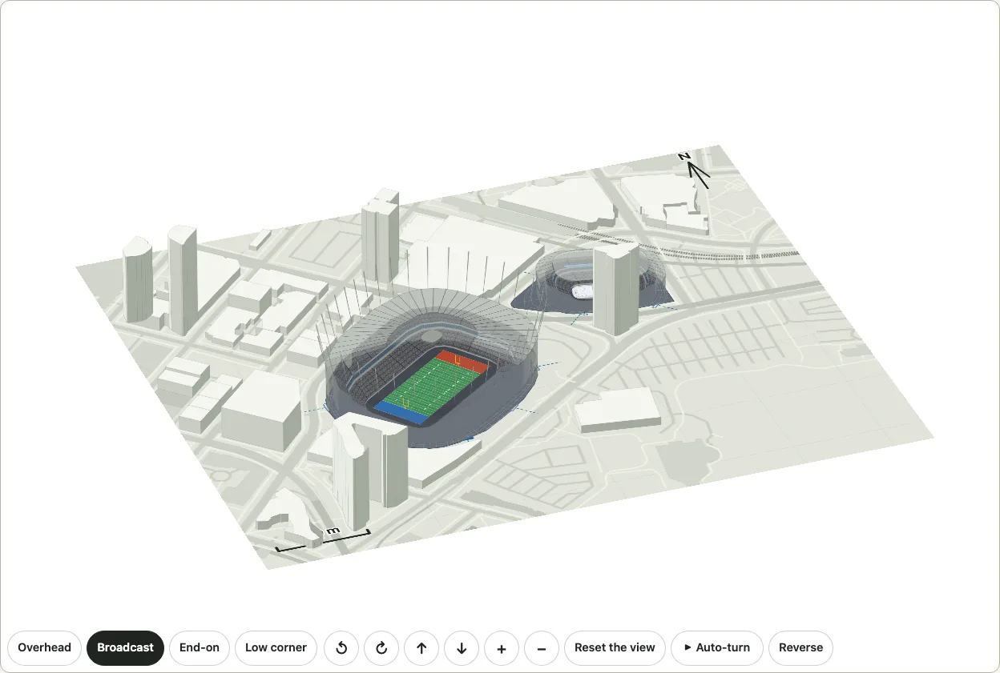

# The gates of a venue

Where the crowd goes in. A gate is a point on the building's outline (OpenStreetMap's, ODbL 1.0) with the way it faces, a name in English and Japanese, and how it is known: `documented` where a source cited with it says it, `plausible` where it is ours. `venueGates("bc-place")` gives BC Place's eight, `venueGates("rogers-arena")` Rogers Arena's four; a venue with none gives `[]`. For now only Vancouver's two venues have gates.



```ts
import { venueGates } from "@johnmorrisdotca/kyogijo-stadiums/district";

const gates = venueGates("bc-place");
console.log(gates.length, gates.filter((g) => g.basis === "documented").map((g) => g.name.en).join(", "));
// 8 Gate G
const south = gates.find((g) => g.id === "south")!;
console.log(south.key, south.bearing, south.name.ja);
// bc-place:south 180 ゲートG
console.log(venueGates("rogers-arena").map((g) => g.id).join(" "));
// south south-west south-east north-west
```

## What a gate is

| | |
| --- | --- |
| `key`, `venue`, `id` | `bc-place:south`, `bc-place`, `south`: the same on every run |
| `name` | English and Japanese: the source's where a source names the gate (`Gate G`), else its side (`South-west gate`) |
| `at` | `[longitude, latitude]` on the building's outline: where a ray from the middle of the surface at `bearing` first meets it, to a metre |
| `bearing` | the way its outward normal points, degrees clockwise from north: the way a queue at the gate runs |
| `basis`, `read` | `documented` or `plausible`, and what is read from where |

The facts (`GATE_FACTS`) are a bearing, a basis and a reading for each gate; the positions are worked out from the outline, so a venue whose outline changes keeps its gates on it (a test holds each within half a metre of the outline, on its bearing).

## What is known and what is ours

- **BC Place: Gate G** is on the south side: the English Wikipedia article (revision 1372065649) says a tear in the old roof was "close to Gate G on the south side where the roof meets the top of the concrete bowl". Where on the south side is ours. That is the one `documented` gate.
- **BC Place's other seven** are ours: one to each side of the building (north, north-east, east, south-east, south-west, west, north-west), on the street sides the brief names (Pacific Boulevard to the south, Robson and Beatty Streets). The sources say a stadium has gates round the bowl, not where each is, and the package does not read a club's or a venue's own map.
- **Rogers Arena's four** are ours, from the brief: the south front and the two south corners on the Pat Quinn Way side, and one at the north-west on the side of the Georgia Viaduct.

No gate is given a letter or a number the sources do not give it.

## On the plan and in 3D

`gates: true` on a [district](./district.md) marks them: a door's bar across each gate on the building's outline, and a dashed stub running out from it the way a queue would. A gate a source names is drawn filled; one that is ours is drawn hollow. The marks are on the plan's drawing, so they are on the floor of the 3D view too. The demo's [district page](https://johnmorrisdotca.github.io/kyogijo-stadiums/district.html?gates=1) has a Gates choice, kept in the address as `gates=1`.

```ts
import { drawDistrict, planDistrict } from "@johnmorrisdotca/kyogijo-stadiums/district";

const options = { venues: ["bc-place", "rogers-arena"], gates: true } as const;
console.log(planDistrict(options).gates.length, drawDistrict(options).includes('data-gate="bc-place:south"'));
// 12 true
```

## For the crowd's walk in and out

The data is made for the timelapse of [the crowd outside the venue](./outside.md) that comes later: each person's queue position at a gate is a distance along its `bearing` from `at`, the line runs over the [walkable ground](./outside.md#how-the-mask-is-made) and a person's entry time follows from its place in the line. Nothing of that is drawn yet: today the gates are marks, and the crowd stands still.

## Limits

- Two venues have gates. Every other venue has none, and `gates: true` on its district marks nothing.
- A gate is a point, not a door: how wide it is, how many doors a gate has, and which gate a ticket names are not in the data.
- Seven of BC Place's eight and all of Rogers Arena's are ours.
