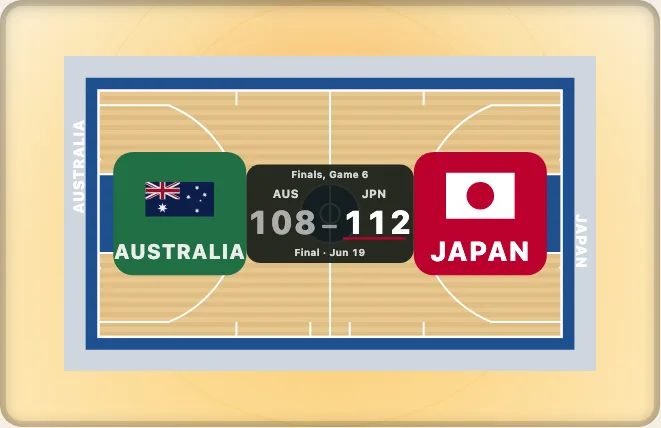

# Data on a surface: layers, frames and zones

[日本語](ja/data-on-a-surface.md) · English

Your tracking data, shot data or pass data arrives in a provider's own numbers: feet from centre ice, a canvas of 600 by 300, tenths of a foot from the hoop. This guide takes data from the provider's numbers to a picture, to a table and back to a click, with the four parts of the package that do it. Nothing is fetched, nothing is sent, and nothing is stored.



## 1. A layer of points

`layers` in the options of `drawKyogijo` lays data on the surface. A layer is `{ kind, data, from, style }`: `from` names the provider's frame, so the numbers are used as they came.

```ts
import { drawKyogijo } from "@johnmorrisdotca/kyogijo-stadiums";

const svg = drawKyogijo({
  sport: "nhl",
  layers: [
    {
      kind: "points",
      name: "shots",
      from: "nhl-api",
      data: [
        { x: 69, y: 22, team: "home", outcome: "goal", value: 0.31 },
        { x: 54, y: -8, team: "home", outcome: "shot", value: 0.07 },
        { x: -61, y: 12, team: "away", outcome: "blocked", value: 0.04 },
      ],
      style: { size: { range: [2, 5] } },
    },
  ],
});
console.log(svg.includes("3 shots"), svg.includes("By outcome: goal 1, shot 1, blocked 1."));
// true true
```

A miss is drawn hollow and a failed pass dashed, so an outcome is never told by colour alone. The standard outcomes are in `OUTCOMES`; add your own words with `style.outcomes`.

## 2. Frames: moving between providers

A `Frame` says how a provider's numbers lie on the surface. `toSurface` and `fromSurface` convert points; `convert(from, to)` goes from one provider to another. There are 48 frames to start with, and `registerFrame` adds yours.

```ts
import { FRAMES, convert, toSurface } from "@johnmorrisdotca/kyogijo-stadiums/frames";

// The same point in two providers' numbers lands on the same place of the surface.
const a = toSurface([[69, 22]], { from: "nhl-api" });
const b = toSurface([[507, 150 - (22 * 300) / 85]], { from: "hockeytech" });
console.log(a[0].map((n) => Math.round(n * 100) / 100), b[0].map((n) => Math.round(n * 100) / 100));
console.log(convert("hockeytech", "nhl-api")([[600, 0]]), "nhl-api" in FRAMES);
// [ 169, 20.5 ] [ 169, 20.5 ]
// [ [ 100, 42.5 ] ] true
```

If a team attacked the left end in a period, pass `attacking: "left"` and its points are turned a half turn so that every shot attacks the right.

## 3. A table for the screen reader

Each layer has a `<title>` and a `<desc>` ("3 shots", "By outcome: ..."), and `layerTable` writes an HTML table for the same data. Show it beside the picture, or under a disclosure, so the data is available without the drawing.

```ts
import { layerTable } from "@johnmorrisdotca/kyogijo-stadiums";

const table = layerTable([{ kind: "points", name: "shots", from: "nhl-api", data: [{ x: 69, y: 22, outcome: "goal" }] }]);
console.log(table.includes("<table"), table.includes("<caption>1 shots") || table.includes("<caption>"));
// true true
```

## 4. Zones: where is that, by the rules?

`zoneAt` says where a point lies in the sport's own terms, with names in English or Japanese and an id that is the same in every language.

```ts
import { zoneAt } from "@johnmorrisdotca/kyogijo-stadiums/zones";

const dot = zoneAt("nhl", [69, 22], { frame: "nhl-api" });
console.log(dot.zone, dot.subzone, dot.names["faceoff-circle"]);
// offensive-zone faceoff-circle Face-off circle
```

Ask a question in the rules' words (`isThreePointer`, `inPaint`, `inPenaltyArea`, `isHomeRun`) instead of comparing coordinates yourself; the answer then stays right when a rule changed in a season.

## 5. A click as a place

Draw with `pointer: true` and `clientPointToField` turns a click into a place in a provider's numbers and its zone. It reads the browser's own matrix, so it follows everything the page did to the drawing: a tall layout, a crop, padding, a different `viewBox`.

```ts no-run
import { drawKyogijo } from "@johnmorrisdotca/kyogijo-stadiums";
import { clientPointToField } from "@johnmorrisdotca/kyogijo-stadiums/pointer";

declare const host: HTMLElement;
host.innerHTML = drawKyogijo({ sport: "nhl", pointer: true });
const svg = host.querySelector<SVGSVGElement>("svg")!;
svg.addEventListener("click", (event) => {
  const at = clientPointToField(svg, event.clientX, event.clientY, { provider: "nhl-api" });
  if (at !== null) console.log(at.x, at.y, at.zone, at.inBounds);
});
```

It answers `null` where there is nothing to ask: a drawing made without `pointer`, a badge, or the [3D view](the-3d-view.md).

## 6. Charts, heat and replay

The `charts` entry has ready-made charts (an NBA shot chart, an NHL shot map, an MLB spray chart, an NFL pass chart, a soccer shot map, curling stones, swimming splits). `heat` layers count marks into cells, hexagons, named zones or a density, and `network`, `voronoi` and `hull` read where a team stood. A `replay` plays tracking data frame by frame and moves only when told to. Its game clock stops in a stoppage while the replay plays on: in hockey the puck is dead, the players glide to the face-off's line-up at the spot the rules give, and the clock runs again at the drop ([stoppages](../replay.md#stoppages-the-clock-stops-the-players-line-up)). A penalized player sits in his side's penalty box for his time on the game clock while his side plays a skater short, and the board shows the power play and each penalty's clock ([penalties](../replay.md#penalties-and-the-power-play)).

```ts
import { nbaShotChart } from "@johnmorrisdotca/kyogijo-stadiums/charts";

const chart = nbaShotChart([{ x: 0, y: 20, made: true }, { x: -120, y: 90, made: false }], { minShots: 1 });
console.log(Object.keys(chart).join(" "));
// options layers title summary totals key draw table
```

A chart is a set of layers and a `draw` function, so you can take its `options` and add a score, a different look or a year. The cost is bounded: 1,000 points add under 70 kB and 10,000 draw in under 250 ms. See [layers](../layers.md), [frames](../frames.md), [zones](../zones.md), [charts](../charts.md) and [replay](../replay.md) for every option.
