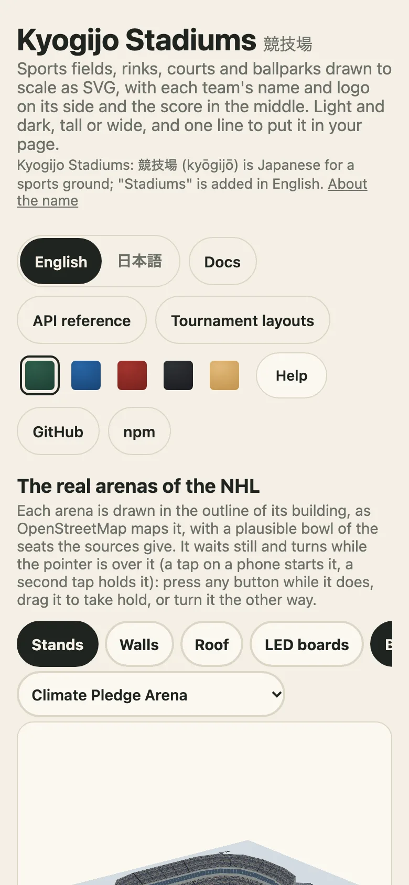

# Embedding: a container, an element, a frame

[日本語](ja/embed-in-a-page.md) · English

A drawing is a string, so any page that can show a string can show one. This guide covers the four ways to put it in a page and how to choose between them, from the most control to the least script.

| You have | Use | Needs script |
| --- | --- | --- |
| A server, a build step or a framework | the string from `drawKyogijo` | no (on the page) |
| A page of your own that updates a score | `mountKyogijo` | yes |
| HTML you write by hand, or a CMS that allows a tag | `<kyogijo-field>` | yes, one import |
| A forum, a newsletter archive, a site builder | the demo's `embed.html` in an `<iframe>` | none of yours |



## A container that follows its box

`mountKyogijo(element, options)` draws into the element and returns `update`, `svg`, `orientation` and `destroy`. With `orientation: "auto"` it watches the element and draws again, tall or wide, when the element's shape changes. `containerAspect` is the measurement it uses.

```ts no-run
import { mountKyogijo } from "@johnmorrisdotca/kyogijo-stadiums/mount";

const card = mountKyogijo(document.querySelector("#game")!, {
  sport: "nhl",
  orientation: "auto",
  away: { name: "USA", score: 1 },
  home: { name: "Canada", score: 0 },
  status: "live",
});

// A goal: draw again with the new score. The score swells once and settles; with reduced motion it only fades in.
card.update({ sport: "nhl", orientation: "auto", away: { name: "USA", score: 2 }, home: { name: "Canada", score: 0 }, status: "live" });
// Leaving the page: stop watching the element.
card.destroy();
```

`update` takes the whole options again, not a patch, so keep the options in one object in your page and pass it each time. Because a drawing is a pure function of its options, an update with the same options changes nothing.

## The custom element

`<kyogijo-field>` is a standard custom element. Import the registration once, from the package or a CDN, and use the tag. Its attributes are the options' names in kebab case.

```html
<script type="module" src="https://cdn.jsdelivr.net/npm/@johnmorrisdotca/kyogijo-stadiums@0/dist/element-define.js"></script>

<kyogijo-field sport="nba" size="compact" orientation="auto"
  home="Japan" away="Australia" score="112-108"
  home-color="#c2410c" away-color="#14233f" status="final"></kyogijo-field>
```

`score` is home-away; `home-score` and `away-score` say it the other way. An option with no attribute goes in `options` as JSON. The element's shadow DOM exposes the parts `figure`, `svg`, `surface`, `plate`, `team`, `home`, `away`, `score`, `home-score`, `away-score` and `badge` for styling from outside, and every custom property of the [theme](looks-and-colours.md) crosses the boundary.

```ts
import { KYOGIJO_ATTRIBUTES, KYOGIJO_TAG } from "@johnmorrisdotca/kyogijo-stadiums/element";

console.log(KYOGIJO_TAG, KYOGIJO_ATTRIBUTES.includes("home-score"), KYOGIJO_ATTRIBUTES.includes("orientation"));
// kyogijo-field true true
```

Import `@johnmorrisdotca/kyogijo-stadiums/element` instead to get the class `KyogijoField` without registering the tag, so a page can register it under its own name with `defineKyogijoField`.

## A frame, for a page that runs no script

The demo site serves `embed.html`, a page made for an `<iframe>` that draws what its address says. Paste the tag; no script is yours to run.

```html
<iframe
  src="https://johnmorrisdotca.github.io/kyogijo-stadiums/embed.html?sport=nhl&away=USA&home=Canada&ascore=3&hscore=2&status=final-ot"
  title="USA 3, Canada 2, Final/OT"
  loading="lazy"
  style="width:100%;aspect-ratio:2.3;border:0"
></iframe>
```

The address takes `sport`, `park`, `year`, `size`, `orientation`, `theme`, `lang`, `away`, `home`, `aabbr`, `habbr`, `ascore`, `hscore`, `acolor`, `hcolor` (six hex digits, no `#`), `alogo`, `hlogo` (an https address), `status`, `competition`, `date`, `label` and `winner`. Always give the frame a `title`: it is the name a screen reader gives the frame. The demo's Embed section writes the tag for what you have chosen.

## Many drawings, one stylesheet

On a page of many, pass `style: "none"` to each and put `KYOGIJO_STYLE` in the page once; the [looks guide](looks-and-colours.md#many-drawings-on-one-page) shows it. For a grid of small multiples with a shared title and key, `drawGrid` in the `layouts` entry draws up to 200 drawings and writes the stylesheet once.

## Choosing

Start with the string. It is the least code, it works with caching and with server rendering, and every other way is the same string drawn by something else. Move to `mountKyogijo` when the page changes the score while it is open, to the element when you write HTML, and to the frame when you cannot run script at all. If the drawing is wrong in a page, the [troubleshooting guide](troubleshooting.md) starts with the five most common reasons.
