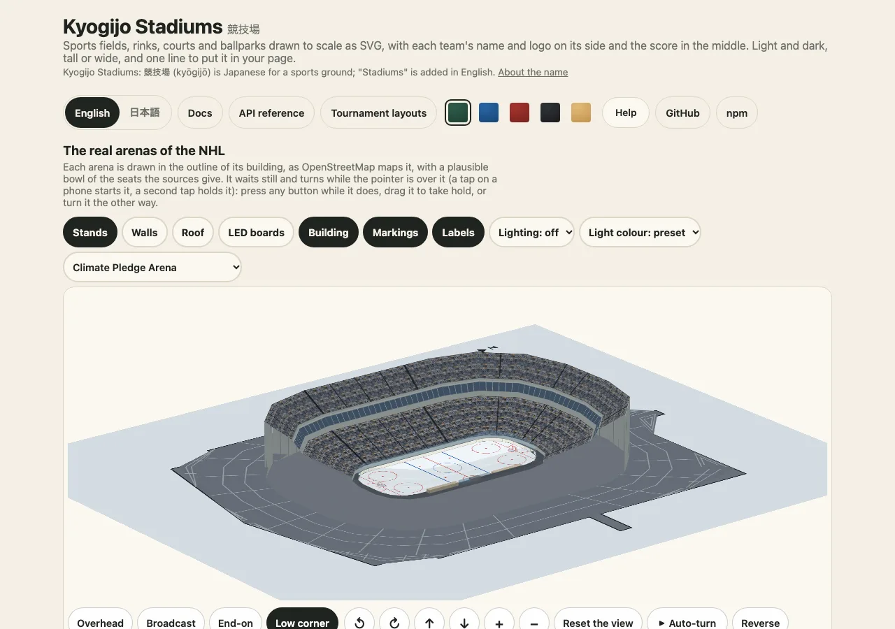

# Getting started: a results page

[日本語](ja/getting-started.md) · English

This guide builds a small results page from nothing: a strip for every game in a list, one large drawing for the game that was opened, and the same drawing tall for a phone. It uses only the main entry, so nothing here needs a DOM, a bundler or a network. The other pages of the docs go deeper into each part; this one is the path through them.



## 1. Install and draw once

```sh
npm install @johnmorrisdotca/kyogijo-stadiums
```

The package is plain ES modules with types, needs Node 22 or later on a server and depends on nothing. `drawKyogijo` takes the options and returns a string of SVG.

```ts
import { drawKyogijo } from "@johnmorrisdotca/kyogijo-stadiums";

const game = {
  sport: "nhl",
  away: { name: "USA", abbr: "USA", score: 3, color: "#1c3f7a" },
  home: { name: "Canada", abbr: "CAN", score: 2, color: "#d52b1e" },
  status: "final-ot",
  competition: "Cup Final, Game 7",
} as const;

const svg = drawKyogijo(game);
console.log(svg.startsWith("<svg"), svg.includes("USA 3, Canada 2"));
// true true
```

The string is the whole drawing, stylesheet included, so it can go into `innerHTML`, a saved `.svg` file, an email or an `` made from a data address. The same options give the same text every time, so a drawing can be cached by its options.

## 2. A strip for every game of a list

`size: "badge"` draws the strip alone: the two teams and the score, small enough for a phone and for a list of fifty. Pass `style: "none"` to leave the stylesheet out of each one and put it in the page once.

```ts
import { KYOGIJO_STYLE, drawKyogijo } from "@johnmorrisdotca/kyogijo-stadiums";

const games = [
  { sport: "nhl", away: { name: "USA", score: 3 }, home: { name: "Canada", score: 2 }, status: "final-ot" },
  { sport: "nba", away: { name: "Australia", score: 108 }, home: { name: "Japan", score: 112 }, status: "final" },
  { sport: "soccer", home: { name: "Japan", score: 1 }, away: { name: "Brazil", score: 1 }, status: "final-pens" },
] as const;

const strips = games.map((game) => drawKyogijo({ ...game, size: "badge", style: "none" }));
const page = `<style>${KYOGIJO_STYLE}</style>${strips.join("\n")}`;
console.log(strips.length, strips.every((strip) => !strip.includes("<style>")), page.includes("--ky-surface"));
// 3 true true
```

Each strip has its own `<title>` ("USA 3, Canada 2") so a screen reader says the result. [Score and layout](../score.md) lists every status and every option of a team.

## 3. The game that was opened

For the opened game use the full size, which puts the score on the surface. `orientation: "auto"` is for a container that follows its box (see the [embedding guide](embed-in-a-page.md)); on a server, choose: `landscape` or `portrait`.

```ts
import { drawKyogijo } from "@johnmorrisdotca/kyogijo-stadiums";

const game = { sport: "nfl", away: { name: "Mexico", score: 27 }, home: { name: "USA", score: 24 }, status: "final" } as const;
const box = (svg: string) => /viewBox="[^ ]+ [^ ]+ ([^ ]+) ([^ "]+)"/.exec(svg)!.slice(1).map(Number);

console.log(box(drawKyogijo({ ...game, orientation: "landscape" })), box(drawKyogijo({ ...game, orientation: "portrait" })));
// [ 384, 184 ] [ 184, 384 ]
```

On a tall drawing the surface is turned a quarter and every word is turned back upright, so a phone shows the field standing and the text readable.

## 4. A bare surface

Without teams, `drawSurface` draws the place alone, at its true shape, for a poster, a lesson or a plan.

```ts
import { drawSurface } from "@johnmorrisdotca/kyogijo-stadiums";

console.log(/viewBox="-12 -12 384 184"/.test(drawSurface({ sport: "nfl" })));
// true
```

## Where to go from here

- Your own colours and the eight named looks: [Looks, colours and dark mode](looks-and-colours.md).
- A custom element, a container that follows its box, a frame for a page with no script: [Embedding](embed-in-a-page.md).
- React, Vue, Svelte and Angular: [Frameworks](frameworks.md).
- Real ballparks, arenas, grounds and districts: [Real venues](real-venues.md).
- Something went wrong: [Troubleshooting](troubleshooting.md). How the pieces fit: [Architecture](architecture.md).
