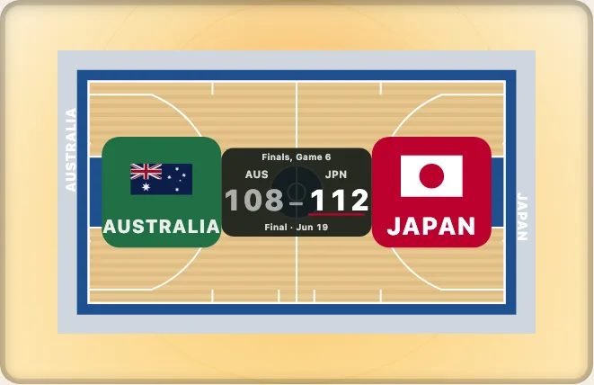

# 競技面の上のデータ：レイヤー、座標系、ゾーン

日本語 · [English](../data-on-a-surface.md)

トラッキングデータ、シュートデータ、パスのデータは、提供元それぞれの数値で届きます。センターアイスからのフィート、600 × 300 のキャンバス、リングからの 10 分の 1 フィート、といった具合です。このガイドでは、そのデータを提供元の数値から図へ、表へ、さらにクリックから元の数値へ戻すまでを、パッケージの四つの部分で説明します。何も取得せず、何も送信せず、何も保存しません。



## 1. 点のレイヤー

`drawKyogijo` のオプションの `layers` は、データを競技面に重ねます。レイヤーは `{ kind, data, from, style }` で、`from` に提供元の座標系の名前を渡すと、届いた数値がそのまま使えます。

```ts
import { drawKyogijo } from "@johnmorrisdotca/kyogijo-stadiums";

const svg = drawKyogijo({
  sport: "nhl",
  layers: [
    {
      kind: "points",
      name: "shots",
      from: "nhl-api",
      data: [
        { x: 69, y: 22, team: "home", outcome: "goal", value: 0.31 },
        { x: 54, y: -8, team: "home", outcome: "shot", value: 0.07 },
        { x: -61, y: 12, team: "away", outcome: "blocked", value: 0.04 },
      ],
      style: { size: { range: [2, 5] } },
    },
  ],
});
console.log(svg.includes("3 shots"), svg.includes("By outcome: goal 1, shot 1, blocked 1."));
// true true
```

外れたシュートは中抜きで、失敗したパスは破線で描くので、結果が色だけで伝わることはありません。標準の結果は `OUTCOMES` にあり、`style.outcomes` で独自の語を追加できます。

## 2. 座標系：提供元の間を移る

`Frame` は、提供元の数値が競技面のどこに当たるかを表します。`toSurface` と `fromSurface` が点を変換し、`convert(from, to)` は一つの提供元から別の提供元へ変換します。はじめから 48 の座標系があり、`registerFrame` で自分のものを足せます。

```ts
import { FRAMES, convert, toSurface } from "@johnmorrisdotca/kyogijo-stadiums/frames";

// 二つの提供元の数値で表した同じ点は、競技面の同じ場所に着きます。
const a = toSurface([[69, 22]], { from: "nhl-api" });
const b = toSurface([[507, 150 - (22 * 300) / 85]], { from: "hockeytech" });
console.log(a[0].map((n) => Math.round(n * 100) / 100), b[0].map((n) => Math.round(n * 100) / 100));
console.log(convert("hockeytech", "nhl-api")([[600, 0]]), "nhl-api" in FRAMES);
// [ 169, 20.5 ] [ 169, 20.5 ]
// [ [ 100, 42.5 ] ] true
```

あるピリオドでチームが左のゴールを攻めていたなら、`attacking: "left"` を渡すと、その点は 180 度回転され、すべてのシュートが右を攻める形になります。

## 3. スクリーンリーダー向けの表

各レイヤーには `<title>` と `<desc>`（「3 shots」「By outcome: ...」）があり、`layerTable` は同じデータの HTML の表を書き出します。図の横か折りたたみの中に置けば、図がなくてもデータが手に入ります。

```ts
import { layerTable } from "@johnmorrisdotca/kyogijo-stadiums";

const table = layerTable([{ kind: "points", name: "shots", from: "nhl-api", data: [{ x: 69, y: 22, outcome: "goal" }] }]);
console.log(table.includes("<table"), table.includes("<caption>1 shots") || table.includes("<caption>"));
// true true
```

## 4. ゾーン：ルール上、そこはどこか

`zoneAt` は、点が競技固有の用語でどこにあるかを答えます。名前は英語か日本語で、ID はどの言語でも同じです。

```ts
import { zoneAt } from "@johnmorrisdotca/kyogijo-stadiums/zones";

const dot = zoneAt("nhl", [69, 22], { frame: "nhl-api" });
console.log(dot.zone, dot.subzone, dot.names["faceoff-circle"]);
// offensive-zone faceoff-circle Face-off circle
```

座標を自分で比べるのではなく、ルールの言葉で問いかけます（`isThreePointer`、`inPaint`、`inPenaltyArea`、`isHomeRun`）。そうすれば、シーズンによってルールが変わっても答えは正しいままです。

## 5. クリックを場所にする

`pointer: true` で描くと、`clientPointToField` がクリックを提供元の数値の場所とそのゾーンに変えます。ブラウザー自身の変換行列を読むので、縦長のレイアウト、切り抜き、余白、別の `viewBox` など、ページが図に施したことすべてに追従します。

```ts no-run
import { drawKyogijo } from "@johnmorrisdotca/kyogijo-stadiums";
import { clientPointToField } from "@johnmorrisdotca/kyogijo-stadiums/pointer";

declare const host: HTMLElement;
host.innerHTML = drawKyogijo({ sport: "nhl", pointer: true });
const svg = host.querySelector<SVGSVGElement>("svg")!;
svg.addEventListener("click", (event) => {
  const at = clientPointToField(svg, event.clientX, event.clientY, { provider: "nhl-api" });
  if (at !== null) console.log(at.x, at.y, at.zone, at.inBounds);
});
```

尋ねる対象がない場合は `null` を返します。`pointer` なしで描いた図、`badge` サイズの図、そして[3D 表示](the-3d-view.md)です。

## 6. チャート、ヒート、リプレイ

`charts` エントリーポイントには、用意済みのチャートがあります（NBA のシュートチャート、NHL のシュートマップ、MLB のスプレーチャート、NFL のパスチャート、サッカーのシュートマップ、カーリングのストーン、水泳のスプリット）。`heat` レイヤーはマークをセル、六角形、名前付きゾーン、密度に集計し、`network`、`voronoi`、`hull` はチームがどこに立っていたかを読みます。`replay` はトラッキングデータをフレームごとに再生し、指示されたときにしか動きません。プレーが止まっている間（ストッページ）は、リプレイが進んでもゲームクロックは止まったままです。アイスホッケーではパックがデッドになり、選手はルールで定められたフェイスオフスポットで配置につくために滑って移動し、パックがドロップされるとクロックが再び動き出します（[ストッページ](../../replay.md#stoppages-the-clock-stops-the-players-line-up)）。ペナルティを受けた選手は、ゲームクロックで計った時間だけ自チームのペナルティボックスに入り、その間チームは1人少ない状態でプレーします。スコアボードにはパワープレーと各ペナルティの残り時間が表示されます（[ペナルティ](../../replay.md#penalties-and-the-power-play)）。

```ts
import { nbaShotChart } from "@johnmorrisdotca/kyogijo-stadiums/charts";

const chart = nbaShotChart([{ x: 0, y: 20, made: true }, { x: -120, y: 90, made: false }], { minShots: 1 });
console.log(Object.keys(chart).join(" "));
// options layers title summary totals key draw table
```

チャートはレイヤーの集まりと `draw` 関数なので、その `options` を取り出して、スコア、別の見た目、年を足せます。コストには上限があります。1,000 点を足しても増えるのは 70 kB 未満、10,000 点でも描画は 250 ms 未満です。各オプションの詳細は[レイヤー](../../layers.md)、[座標系](../../frames.md)、[ゾーン](../../zones.md)、[チャート](../../charts.md)、[リプレイ](../../replay.md)を参照してください。
