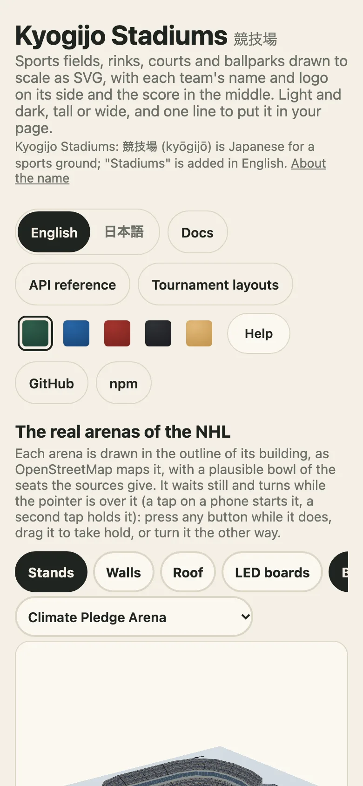

# 埋め込み：コンテナ、要素、フレーム

日本語 · [English](../embed-in-a-page.md)

図は文字列なので、文字列を表示できるページならどこにでも置けます。このガイドでは、図をページに置く四つの方法と、その選び方を、制御の自由度が高いものからスクリプトが少ないものへ順に説明します。

| 手元にあるもの | 使うもの | ページ側のスクリプト |
| --- | --- | --- |
| サーバー、ビルド手順、フレームワーク | `drawKyogijo` が返す文字列 | 不要 |
| スコアを更新する自分のページ | `mountKyogijo` | 必要 |
| 手書きの HTML、タグを許す CMS | `<kyogijo-field>` | 必要（インポートが一つ） |
| フォーラム、メールマガジンのアーカイブ、サイトビルダー | デモの `embed.html` を `<iframe>` で | 自分では不要 |



## ボックスに追従するコンテナ

`mountKyogijo(element, options)` は要素の中に描き、`update`、`svg`、`orientation`、`destroy` を返します。`orientation: "auto"` なら要素を監視し、形が変わると縦長か横長かを選んで描き直します。測定に使うのは `containerAspect` です。

```ts no-run
import { mountKyogijo } from "@johnmorrisdotca/kyogijo-stadiums/mount";

const card = mountKyogijo(document.querySelector("#game")!, {
  sport: "nhl",
  orientation: "auto",
  away: { name: "USA", score: 1 },
  home: { name: "Canada", score: 0 },
  status: "live",
});

// ゴール：新しいスコアで描き直します。スコアは一度だけ膨らんで落ち着きます。動きを減らす設定ではフェードインだけです。
card.update({ sport: "nhl", orientation: "auto", away: { name: "USA", score: 2 }, home: { name: "Canada", score: 0 }, status: "live" });
// ページを離れるとき：要素の監視をやめます。
card.destroy();
```

`update` は差分ではなく、オプション全体を受け取ります。ページ内でオプションを一つのオブジェクトに持ち、そのたびに渡してください。図はオプションだけで決まる純粋な関数なので、同じオプションで更新しても何も変わりません。

## カスタム要素

`<kyogijo-field>` は標準のカスタム要素です。登録をパッケージか CDN から一度インポートして、タグを使います。属性はオプションの名前をケバブケースにしたものです。

```html
<script type="module" src="https://cdn.jsdelivr.net/npm/@johnmorrisdotca/kyogijo-stadiums@0/dist/element-define.js"></script>

<kyogijo-field sport="nba" size="compact" orientation="auto"
  home="Japan" away="Australia" score="112-108"
  home-color="#c2410c" away-color="#14233f" status="final"></kyogijo-field>
```

`score` は「ホーム-アウェイ」の順です。`home-score` と `away-score` を使えば、別々の属性で指定できます。属性にないオプションは `options` に JSON で渡します。要素のシャドウ DOM は、外からスタイルを当てるために `figure`、`svg`、`surface`、`plate`、`team`、`home`、`away`、`score`、`home-score`、`away-score`、`badge` の各パートを公開し、[テーマ](looks-and-colours.md)のカスタムプロパティはすべて境界を越えて届きます。

```ts
import { KYOGIJO_ATTRIBUTES, KYOGIJO_TAG } from "@johnmorrisdotca/kyogijo-stadiums/element";

console.log(KYOGIJO_TAG, KYOGIJO_ATTRIBUTES.includes("home-score"), KYOGIJO_ATTRIBUTES.includes("orientation"));
// kyogijo-field true true
```

タグを登録せずにクラス `KyogijoField` だけを使いたいときは、代わりに `@johnmorrisdotca/kyogijo-stadiums/element` をインポートします。そうすれば、ページは `defineKyogijoField` で好きな名前を付けて登録できます。

## スクリプトを実行しないページ向けのフレーム

デモのサイトは、`<iframe>` 用に作られた `embed.html` を配信しています。URL に指定された内容を描くページです。タグを貼るだけでよく、自分で実行するスクリプトは要りません。

```html
<iframe
  src="https://johnmorrisdotca.github.io/kyogijo-stadiums/embed.html?sport=nhl&away=USA&home=Canada&ascore=3&hscore=2&status=final-ot"
  title="USA 3, Canada 2, Final/OT"
  loading="lazy"
  style="width:100%;aspect-ratio:2.3;border:0"
></iframe>
```

URL には `sport`、`park`、`year`、`size`、`orientation`、`theme`、`lang`、`away`、`home`、`aabbr`、`habbr`、`ascore`、`hscore`、`acolor`、`hcolor`（`#` なしの 16 進 6 桁）、`alogo`、`hlogo`（https の URL）、`status`、`competition`、`date`、`label`、`winner` を指定できます。フレームには必ず `title` を付けてください。スクリーンリーダーがフレームに付ける名前になります。デモの「ページに組み込む」の項目は、選んだ内容に合うタグを書き出します。

## 多数の図、一つのスタイルシート

たくさんの図を置くページでは、それぞれに `style: "none"` を渡し、`KYOGIJO_STYLE` をページに一度だけ置きます。[見た目のガイド](looks-and-colours.md#一つのページにたくさんの図)に例があります。共通のタイトルと凡例を持つスモールマルチプル（小さな図の並び）には、`layouts` エントリーポイントの `drawGrid` が最大 200 の図を描き、スタイルシートは一度だけ書き出します。

## 選び方

まず文字列から始めてください。コードが最も少なく、キャッシュにもサーバーでの描画にも向いていて、ほかの方法はすべて同じ文字列を別のものが描いているだけです。開いたままスコアを更新するなら `mountKyogijo`、HTML を手で書くなら要素、スクリプトがまったく動かせないならフレームに進みます。ページの中で図がおかしいときは、[困ったとき](troubleshooting.md)に最もよくある五つの原因が先頭にあります。
