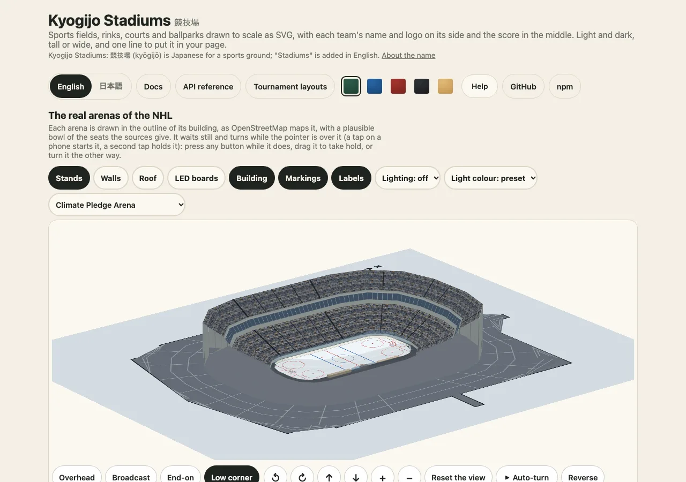

# はじめに：結果ページを作る

日本語 · [English](../getting-started.md)

このガイドでは、何もない状態から小さな結果ページを作ります。試合の一覧に並べる試合ごとのストリップ、開いた試合の大きな図、そして同じ図をスマートフォン向けに縦長にしたものです。使うのはメインのエントリーポイントだけなので、DOM もバンドラーもネットワークも要りません。ほかのドキュメントのページは各部分を詳しく説明しますが、このページはそれらをたどる道筋です。



## 1. インストールして一度描く

```sh
npm install @johnmorrisdotca/kyogijo-stadiums
```

パッケージは型付きの ES モジュールで、サーバーでは Node 22 以降が必要で、依存パッケージはありません。`drawKyogijo` はオプションを受け取り、SVG の文字列を返します。

```ts
import { drawKyogijo } from "@johnmorrisdotca/kyogijo-stadiums";

const game = {
  sport: "nhl",
  away: { name: "USA", abbr: "USA", score: 3, color: "#1c3f7a" },
  home: { name: "Canada", abbr: "CAN", score: 2, color: "#d52b1e" },
  status: "final-ot",
  competition: "Cup Final, Game 7",
} as const;

const svg = drawKyogijo(game);
console.log(svg.startsWith("<svg"), svg.includes("USA 3, Canada 2"));
// true true
```

この文字列がスタイルシートも含めた図のすべてです。そのまま `innerHTML` に入れても、`.svg` ファイルに保存しても、メールに貼っても、データ URL にして `` に使ってもかまいません。同じオプションからは毎回同じ文字列ができるので、オプションをキーにして図をキャッシュできます。

## 2. 一覧に並べる試合ごとのストリップ

`size: "badge"` は、両チームとスコアだけのストリップを描きます。スマートフォンでも、50 試合の一覧でも収まる小ささです。各ストリップにスタイルシートを入れないよう `style: "none"` を渡し、ページに一度だけ置きます。

```ts
import { KYOGIJO_STYLE, drawKyogijo } from "@johnmorrisdotca/kyogijo-stadiums";

const games = [
  { sport: "nhl", away: { name: "USA", score: 3 }, home: { name: "Canada", score: 2 }, status: "final-ot" },
  { sport: "nba", away: { name: "Australia", score: 108 }, home: { name: "Japan", score: 112 }, status: "final" },
  { sport: "soccer", home: { name: "Japan", score: 1 }, away: { name: "Brazil", score: 1 }, status: "final-pens" },
] as const;

const strips = games.map((game) => drawKyogijo({ ...game, size: "badge", style: "none" }));
const page = `<style>${KYOGIJO_STYLE}</style>${strips.join("\n")}`;
console.log(strips.length, strips.every((strip) => !strip.includes("<style>")), page.includes("--ky-surface"));
// 3 true true
```

各ストリップには自分の `<title>`（「USA 3, Canada 2」）があるので、スクリーンリーダーが結果を読み上げます。ステータスとチームのオプションの一覧は[得点とレイアウト](../../score.md)にあります。

## 3. 開いた試合

開いた試合は、スコアを競技面の上に置く full サイズで描きます。`orientation: "auto"` はボックスの形に追従するコンテナ向けです（[埋め込みのガイド](embed-in-a-page.md)を参照）。サーバーでは `landscape` か `portrait` を選びます。

```ts
import { drawKyogijo } from "@johnmorrisdotca/kyogijo-stadiums";

const game = { sport: "nfl", away: { name: "Mexico", score: 27 }, home: { name: "USA", score: 24 }, status: "final" } as const;
const box = (svg: string) => /viewBox="[^ ]+ [^ ]+ ([^ ]+) ([^ "]+)"/.exec(svg)!.slice(1).map(Number);

console.log(box(drawKyogijo({ ...game, orientation: "landscape" })), box(drawKyogijo({ ...game, orientation: "portrait" })));
// [ 384, 184 ] [ 184, 384 ]
```

縦長の図では、競技面を 90 度回し、文字はすべて読める向きに戻します。そのため、スマートフォンではフィールドが縦向きに表示され、文字も読めます。

## 4. 競技面だけを描く

チームを渡さない `drawSurface` は、場所だけを本来の形で描きます。ポスター、授業の資料、見取り図などに使えます。

```ts
import { drawSurface } from "@johnmorrisdotca/kyogijo-stadiums";

console.log(/viewBox="-12 -12 384 184"/.test(drawSurface({ sport: "nfl" })));
// true
```

## 次に読むもの

- 独自の色と、名前の付いた八つの見た目：[見た目・色・ダークモード](looks-and-colours.md)。
- カスタム要素、ボックスに追従するコンテナ、スクリプトを実行できないページ向けのフレーム：[埋め込み](embed-in-a-page.md)。
- React、Vue、Svelte、Angular：[フレームワーク](frameworks.md)。
- 実在の球場、アリーナ、スタジアム、地区：[実在の会場](real-venues.md)。
- うまくいかないとき：[困ったとき](troubleshooting.md)。各部分のつながり：[設計](architecture.md)。
