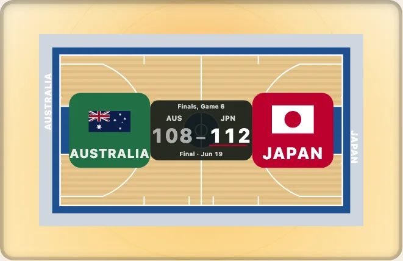

# 見た目・色・ダークモード

日本語 · [English](../looks-and-colours.md)

図にはブランドが入っていません。色はすべて図の `svg` 上のカスタムプロパティで、既定値は詳細度が 0 の `:where()` ルールに置かれています。ライトとダークの二組が端末の設定に追従します。このガイドでは、色を変える四つの方法を広いものから狭いものへ順に示し、たくさんの図を置くページを軽く保つ方法も説明します。



## 見た目を選ぶ

`look` は、すべての競技について、ライトとダークの両方で、図全体を一つのパレットで塗ります。名前は `LOOK_NAMES` にあります。

```ts
import { LOOK_NAMES, LOOKS, contrastOf, drawKyogijo, lookPalette } from "@johnmorrisdotca/kyogijo-stadiums";

console.log(LOOK_NAMES.join(", "));
const svg = drawKyogijo({ sport: "nba", look: "chalkboard", theme: "dark" });
const palette = lookPalette("chalkboard", "dark", "nba");
console.log(svg.includes('data-palette="chalkboard"'), Object.keys(LOOKS).length >= 8, contrastOf(palette.line, palette.surface)! >= 3);
// grass, night, chalkboard, blueprint, print, broadcast, high-contrast, line-drawing
// true true true
```

テストが、すべての見た目を、両方のモードで、すべての競技について、WCAG 2.2 が求めるコントラストに照らして確認しています。塗られたすべての線は下地に対して 3:1 を、図の中の文字はエプロン（競技面の周りの部分）に対して 4.5:1 を満たします。`print` と `line-drawing` は、カラー印刷ができない（白黒の）プリンター向けです。

## ライト、ダーク、端末の設定

既定では、図は `prefers-color-scheme` に追従します。ページ側で決めることもできます。オプションの `theme: "light"` か `"dark"`、またはページのルート要素の `data-theme` です。端末に追従させるには `theme: "auto"`（既定）を渡します。

```ts
import { drawKyogijo } from "@johnmorrisdotca/kyogijo-stadiums";

const dark = drawKyogijo({ sport: "nhl", theme: "dark" });
const auto = drawKyogijo({ sport: "nhl" });
console.log(dark !== auto, dark.includes("data-theme"));
```

## コードから色を指定する

`colors` は、短い名前でどのカスタムプロパティも設定できます。色は検査されます。16 進の色、`rgb()`、`hsl()`、色名、`var(--name)` のいずれかで、64 文字までです。それ以外は無視され、マークアップには書き込まれません。

```ts
import { COLOR_PROPERTIES, drawKyogijo, safeColour } from "@johnmorrisdotca/kyogijo-stadiums";

const svg = drawKyogijo({ sport: "nhl", style: "none", colors: { surface: "#dfe9f3" } });
console.log(svg.includes("--ky-surface:#dfe9f3"), COLOR_PROPERTIES.surface);
console.log(safeColour("#d52b1e"), safeColour("red; background:url(x)"));
// true --ky-surface
// #d52b1e undefined
```

## 名前の付いた部分に色を付ける

`featureColors` は、競技面の部分を名前で指定して色を付けます。名前は `FEATURES[sport]` に一覧があります。その競技にない名前を渡すとエラーになり、使える名前の一覧が表示されるので、覚えるにはそれが早道です。

```ts
import { FEATURES, drawKyogijo } from "@johnmorrisdotca/kyogijo-stadiums";

const names = FEATURES.nhl;
console.log(names.includes("blue-lines"));
const svg = drawKyogijo({ sport: "nhl", featureColors: { "blue-lines": "#1d4f8f" } });
console.log(svg.includes("#1d4f8f"));
// true
// true
```

## 独自のコート

バスケットボールやネット競技のコートには `court` オブジェクトを渡せます。木目、エプロン、ペイントエリア、線、センターのロゴ、ベースラインの文字を指定できます。出発点にできる五つのテーマが `COURT_THEMES` にあります。

```ts
import { COURT_THEMES, drawKyogijo } from "@johnmorrisdotca/kyogijo-stadiums";

const svg = drawKyogijo({ sport: "nba", court: { ...COURT_THEMES.twoTone, baselineText: ["SUMMIT PEAKS", "METRO BOLTS"], paintThreePoint: true } });
console.log(svg.includes("--ky-key:#1e4f8f"), svg.includes("METRO BOLTS"));
// true true
```

## 一つのページにたくさんの図

各図はそれぞれのスタイルシート（8〜10 kB）を持っています。多数を置くページでは、それぞれに `style: "none"` を渡し、すべての見た目を含む `KYOGIJO_STYLE` をページに一度だけ置きます。優先される順に並べると、ページ自身のルール、`colors`、`court` の見た目、名前付きの `look` です。

```ts
import { KYOGIJO_STYLE, drawKyogijo } from "@johnmorrisdotca/kyogijo-stadiums";

const one = drawKyogijo({ sport: "nhl", style: "none" });
console.log(one.includes("<style>"), KYOGIJO_STYLE.includes("--ky-surface"));
// false true
```

各部分にはクラス（`ky-surface`、`ky-line`、`ky-banner`、`ky-plate`、`ky-score`、`ky-winbar`）も付いていて、プロパティが届かない部分に使えます。プロパティの一覧は[テーマと色](../../theming.md)に、競技面の両半分に重ねる旗は[ハーフに広げる旗とエンブレム](../../pageant.md)にあります。
