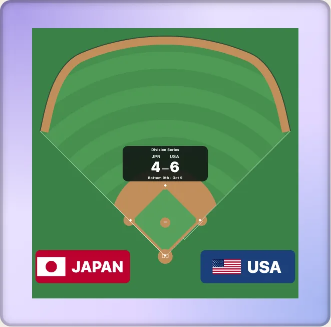

# 球場、スタジアム、アリーナ、実在の会場

日本語 · [English](../real-venues.md)

競技面だけの図は、どこでも同じです。たとえば NHL のリンクは 200 × 85 フィートです。しかし実在の場所はそうではありません。このガイドでは、球場のフェンスから、一枚の図に建物を並べた地区まで、「どこか」を表す四つの段階と、それぞれがどのエントリーポイントにあるかを示します。どれも、描かなくてもデータとして読めます。



## 名前で選ぶ球場

`park` には `PARKS` のキーを渡します（94 か所：現在の MLB の 30 球場、過去の 44 球場、日本プロ野球の 20 球場）。フェンスは、その球場の記事が公表している距離を通る滑らかな曲線なので、公表値より外へ膨らむことはありません。`year` を渡すと、そのシーズンのフィールドを描きます。

```ts
import { PARKS, drawKyogijo } from "@johnmorrisdotca/kyogijo-stadiums";
import { parkByName } from "@johnmorrisdotca/kyogijo-stadiums/parks";

const park = PARKS["hanshin-koshien-stadium"];
console.log(park.name, park.nameJa, park.points.length);
console.log(parkByName("Camden Yards")?.id, parkByName("ハマスタ")?.id);
const svg = drawKyogijo({ sport: "mlb", park: "hanshin-koshien-stadium", language: "ja" });
console.log(svg.includes("甲子園球場のグラウンド"));
// Koshien Stadium 甲子園球場 5
// oriole-park-at-camden-yards yokohama-stadium
// true
```

`parkByName` は、球場がこれまで呼ばれたどの名前でも、英語でも日本語でも見つけます。正式名は `parkOfficialName(park, "ja")` で得られます。自分の距離を使いたいときは `fence: { left, leftCenter, center, rightCenter, right }` を渡します。詳しくは[球場](../../ballparks.ja.md)を参照してください。

## サッカーのスタジアム

`GROUNDS` には、公表されたピッチの大きさ、都市、収容人数、開催した大会が 64 か所分あります。公表された大きさのないスタジアムは既定の 105 × 68 メートルのままで、その理由も書かれています。

```ts
import { GROUND_IDS, groundById } from "@johnmorrisdotca/kyogijo-stadiums/grounds";

const ground = groundById("maracana")!;
console.log(GROUND_IDS.length, ground.name, ground.city, ground.country);
// 64 Maracanã Stadium Rio de Janeiro BR
```

## アリーナとその建物

NHL のアリーナは、建物の輪郭の中に、出典に書かれた座席数、階層、屋根の種類から組み立てた、すり鉢状の客席を入れて描けます。輪郭は OpenStreetMap のもの（ODbL。帰属表示は `VENUE_ATTRIBUTION` にあります）で、すり鉢状の客席は測量したものではなく、もっともらしく組み立てたもので、その旨が明記されています。

```ts
import { drawKyogijo } from "@johnmorrisdotca/kyogijo-stadiums";
import { VENUE_ATTRIBUTION } from "@johnmorrisdotca/kyogijo-stadiums/venues";

const svg = drawKyogijo({ sport: "nhl", arena: "honda-center", crowd: { real: true } });
console.log(svg.includes("ky-cr-shell"), typeof VENUE_ATTRIBUTION);
// true string
```

建物の輪郭を表示する場所には、必ずこの帰属表示を載せてください。各建物の情報と出典は[実在の会場](../../venues.md)に、スタジアムと球場は[実在のスタジアム](../../stadiums.md)にあります。

## 地区：一枚の図に並ぶ複数の会場

`drawDistrict` は、一つの都市の会場を実際の位置に、実際の向きで置きます。`planDistrict` は、その配置をデータとして返します。モード、構成要素、その間の距離です。

```ts
import { drawDistrict, planDistrict } from "@johnmorrisdotca/kyogijo-stadiums/district";

const plan = planDistrict({ venues: ["bc-place", "rogers-arena"] });
console.log(plan.mode, plan.members.map((m) => m.member.key).join(" "), Math.round(plan.between[0].metres));
console.log(drawDistrict({ venues: ["bc-place:soccer", "rogers-arena"] }).includes('data-venue="bc-place:soccer"'));
// neighbours bc-place:cfl rogers-arena 264
// true
```

`会場:構成` の形のキー（`bc-place:soccer`）で、スタジアムの構成を選びます。`context` を足すと、`osm`、`cityctx`、`plateau` のデータから、周りの建物・水・木を描きます。各エリアは一つずつのファイルで、`loadAreasFor` はページが見せるものだけを読みます。`district-lean` エントリーポイントは、描く会場のデータだけを含むページ向けの地区です。詳しくは[会場の地区](../../district.md)を参照してください。

## 何があるかを調べる

カタログは、今日描ける会場、制作中の会場、今後追加したい会場のすべてを、ID、英語と日本語の名前、Wikidata の項目付きで、JSON ファイルと型付きのエントリーポイントの両方で一覧にしています。

```ts
import { CATALOGUE, catalogueByStatus, catalogueCoverage } from "@johnmorrisdotca/kyogijo-stadiums/catalogue";

const nhl = catalogueCoverage("nhl");
console.log(CATALOGUE.length > 400, catalogueByStatus("supported").length > 0, nhl.venues, nhl.outline, nhl.notYet);
// true true 32 32 0
```

アトラス（`PLACES`、`placeById`、`placesBy`）は、地図のピン向けの同じ仕組みです。座標と本拠地のチームを持つ 330 か所があります。パッケージが何を描けるかを調べるにはカタログを、場所を地図に置くにはアトラスを選んでください。

## どのエントリーポイントをインポートするか

| 目的 | インポート |
| --- | --- |
| 球場のデータ、フェンス | `.../parks` |
| スタジアムの情報 | `.../grounds` |
| アリーナの建物 | `.../venues` |
| スタジアムや球場の建物 | `.../stadiums` |
| 一枚の図に複数の会場 | `.../district`（または `.../district-lean`） |
| すべての一覧 | `.../catalogue` |

どれも単独で成り立っているので、`parks` をインポートしてもアリーナや地区は読み込まれません。
