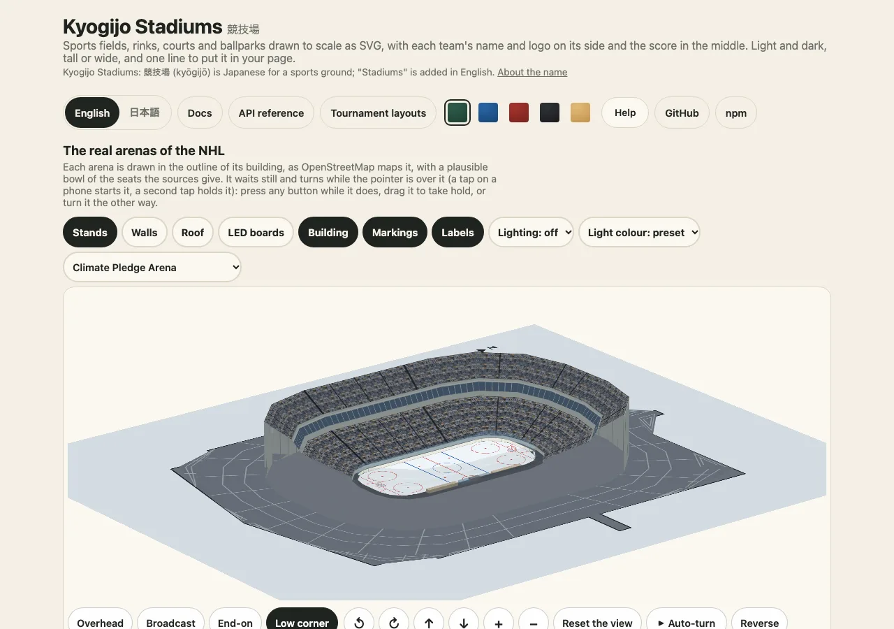

# 競技面にスコアを載せる

日本語 · [English](../score-and-layout.md)

このパッケージのほとんどの用途は、試合結果を、その試合が行われた場所の上に載せることです。このガイドでは、そのために大切なオプションを説明します。チーム、試合のステータス、ホームチームがどちら側か、三つのサイズ、ボックスの形です。すべてのオプションの一覧表は[得点とレイアウト](../../score.md)にあります。



## チーム

`home` と `away` を渡します。各チームには `name`、省略可能な `abbr`、`score`、`color` があります。`logo` は、https または相対の URL、画像のデータ URL、または SVG のテキストです。画像として描かれるのでスクリプトは実行できず、それ以外の種類の URL は無視されます。`flag` は国コードで、Hata が描きます。

```ts
import { drawKyogijo } from "@johnmorrisdotca/kyogijo-stadiums";

const svg = drawKyogijo({
  sport: "soccer",
  home: { name: "Japan", abbr: "JPN", score: 2, flag: "JP", color: "#1d3f8f" },
  away: { name: "Canada", abbr: "CAN", score: 1, flag: "CA", color: "#d52b1e" },
  status: "final",
  competition: "Friendly",
  date: "June 10",
});
console.log(svg.includes("Japan 2, Canada 1"), svg.includes("Friendly"));
// true true
```

## 試合のステータス

`status` は `final`、`final-ot`、`final-so`、`final-aet`、`final-pens`、`live`、`half`、`postponed`、`retired`、`walkover`、カーリングの `end-6`、ネット競技の `set-3`、または `Bottom 9th` のような任意の文字列です。名前の付いたステータスは翻訳され、任意の文字列はそのまま使われます。

```ts
import { drawKyogijo, statusLabel, winnerOf } from "@johnmorrisdotca/kyogijo-stadiums";

const game = { sport: "nhl", away: { name: "USA", score: 3 }, home: { name: "Canada", score: 2 } } as const;
console.log(winnerOf({ ...game, status: "final" }), winnerOf({ ...game, status: "live" }));
console.log(drawKyogijo({ ...game, status: "Bottom 9th" }).includes("Bottom 9th"));
console.log(statusLabel("final-ot", "en"), "|", statusLabel("final-ot", "ja"));
// away none
// true
// Final/OT | 試合終了（延長）
```

`winner` の既定値は `auto` で、ステータスが試合終了を表すものになると、リードしている側が勝者になります。勝者はスコアの下の棒で示され、負けた側は薄く描かれるので、結果が色だけで伝わることはありません。

## ホームチームはどちら側か

スコアは、その競技の表記順で描かれます。サッカーやラグビーなど世界の多くの競技はホームチームを先に書くので、ホームは左です。北米のリーグはビジターを先に書く（「away at home」）ので、ホームは右です。`homeSide: "left"` か `"right"` でどちらも上書きでき、`homeSideFor(sport)` が既定値を返します。

```ts
import { homeSideFor } from "@johnmorrisdotca/kyogijo-stadiums";

console.log(homeSideFor("soccer"), homeSideFor("nhl"));
// left right
```

この設定は、タイトルと説明の中のチームの順、カーリングのスコアボードの行、スコアが変わったときのパルス表示の向きを決めます。ホーム側を直すためにデータそのものを入れ替えず、`homeSide` を設定してください。

## 三つのサイズ

`size` は `full`（競技面の上にスコア）、`compact`（競技面とその下のストリップ）、`badge`（ストリップだけ）です。一覧には `badge`、カードには `compact` を使います。三つとも同じ `<title>` を持ちます。

```ts
import { drawKyogijo } from "@johnmorrisdotca/kyogijo-stadiums";

const game = { sport: "nba", away: { name: "Australia", score: 108 }, home: { name: "Japan", score: 112 }, status: "final" } as const;
const sizes = (["full", "compact", "badge"] as const).map((size) => drawKyogijo({ ...game, size }).length);
console.log(sizes[0] > sizes[2], sizes[1] > sizes[2]);
// true true
```

## 横長、縦長、ボックスへの追従

`orientation` は `landscape`、`portrait`、`auto` です。サーバーでは一つを選びます。`mountKyogijo` とカスタム要素は、ボックスを測って自動で選びます。縦長の図では競技面を回し、文字はすべて読める向きに戻します。`range` は競技面の一部（`offensive-zone`）に切り出しますが、その上に描いたものの座標は変えません。

## スコアがより細かい競技

ネット競技では各セットの得点と進行中のポイント、カーリングでは各エンドの得点とハンマー、クリケットではラン・ウィケット・オーバー、オーストラリアンフットボールではゴールとビハインドを持てます。これらは同じチームオブジェクトのプロパティで、[得点とレイアウト](../../score.md#score-mode)と、[ネット競技](../../courts.md)、[フィールド競技](../../field-sports.md)のページに一覧があります。

次は、[埋め込み](embed-in-a-page.md)で図をページに置くか、[見た目と色](looks-and-colours.md)で色を変えましょう。
