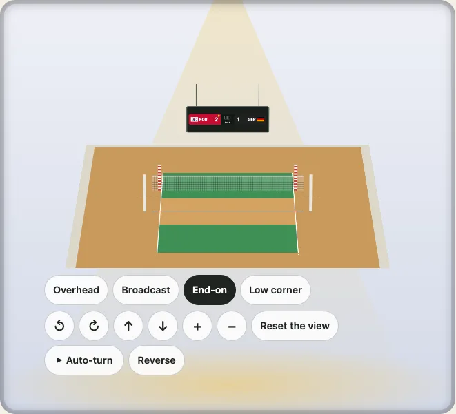

# 3D 表示

日本語 · [English](../the-3d-view.md)

平らに描いた競技面では、その上に立つものが見えません。ネット、バスケットゴール、ゴール、フットボール場のポストなどです。`turn` エントリーポイントは、どの競技面も回せる床として見せ、ルールブックが定める高さで、ルールブックが置くものを立てます。このガイドでは、使い方の二通り、切り替えられる部分、スマートフォンへの負担を説明します。



## しくみ

床は、スコアとレイヤーを含む平らな図そのものです。マウス、指、キーボードで傾けたり回したりでき、ホイールやピンチでズームもできます。その上に立つ各部分は `matrix3d` を一つずつ持ちます。使うのは DOM と CSS だけで、キャンバスも WebGL も依存パッケージもありません。そのため 3D 表示は印刷でき、自分の CSS でスタイルを当てられ、負担は平らな図の要素と変わりません。

## ページの中で

`mountKyogijoTurn(container, options, settings)` がコントローラーを返します。視点は `preset` で、`set` は任意の視点を受け取ります。

```ts no-run
import { mountKyogijoTurn } from "@johnmorrisdotca/kyogijo-stadiums/turn";

const view = mountKyogijoTurn(
  document.querySelector("#court")!,
  { sport: "volleyball", home: { name: "Japan", score: 3 }, away: { name: "USA", score: 2 }, status: "final" },
  { preset: "end" },
);
view.preset("corner"); // 視点までなめらかに動く
view.set({ yaw: 60 }); // または任意の視点へ
view.update({ sport: "nba" }); // 視点を保ったまま別の競技面を描く
```

自動回転は「再生」を押すまで待ち、どちら向きにも回れます（設定の `direction`、または `view.setDirection("clockwise")`）。ページが隠れているときや、表示が画面の外にあるときは何もしません。`autoPlay: true` ならマウントした時点で始まりますが、動きを減らす設定の人には自動では始まらず、その人の表示は視点の間をなめらかに動く代わりに、すぐに切り替わります。各コントロールは 44 ピクセル以上で、フォーカスがはっきり見えます。

カスタム要素では属性になります：`<kyogijo-field sport="nhl" turn turn-view="broadcast">`。

## サーバー側のマークアップとして

`turnMarkup` は同じ表示を文字列として返し、`uprightsFor` は競技面の上に立つものの一覧を返すので、ページはそれを言葉で伝えられます。

```ts
import { turnMarkup, uprightsFor } from "@johnmorrisdotca/kyogijo-stadiums/turn";

const { items } = uprightsFor({ sport: "volleyball" }, { netHeight: "women" });
const html = turnMarkup({ sport: "volleyball" }, { preset: "end" });
console.log(items.map((item) => item.kind).join(), html.includes("preserve-3d"));
// net,netposts,antennae false
```

## スタンド、屋根、観客

サッカーのスタジアムやアリーナでは、設定に `venue` を渡せます。壁、屋根、すり鉢状のスタンドです。観客はスタンドの中のマークとして描けますし、実在のアリーナなら実際の客席の形として描けます。

```ts
import { turnMarkup, uprightsFor } from "@johnmorrisdotca/kyogijo-stadiums/turn";

const options = { sport: "soccer", crowd: true } as const;
const kinds = uprightsFor(options, { venue: { id: "bowl" } }).items.map((item) => item.kind);
console.log(kinds.filter((kind) => kind === "stands" || kind === "roof").join(" "));
// stands
const html = turnMarkup(options, { venue: { roof: true } });
console.log(html.includes("ky-up-roof"), html.includes("ky-crowd"));
// true false
```

## 会場、地区、フライスルー

実在のアリーナやスタジアム、複数の会場の地区、サーキットには、それぞれ専用の 3D 表示があります。`mountDistrictTurn`、`mountCircuitTurn`、`mountJudgingTurn` です。`mountFlythrough` は、一つのカメラを地図からアリーナへ、すり鉢の中へ、氷の上のプレーへと飛ばします。カメラは共通なので、訪問者が一つの操作を覚えれば、すべてで同じように使えます。

## 画質と速さ

3D 表示は多数の要素でできていて、回転の一歩ごとに、動かす要素の数に比例した負担がブラウザーにかかります。設定の `quality` は、どれだけ描くかを決めます。`auto`（既定）は、回転中に実際に出ているフレームレートから選び、`high`、`medium`、`low` はその段階に固定します。ブラウザーの名前や端末の機種は決して見ません。パッケージ自身の速度確認は、CI で三つの端末クラスを実行します。デスクトップ、中級のスマートフォン、CPU を 6 倍遅くした低速の Android です。3D 表示が多いページが遅いときは、表示を一つだけにして、残りは平らな図にしてください。

各設定の意味は[3D 表示](../../turn.md)と[画質](../../quality.md)に、会場の 3D 表示は[実在の会場](real-venues.md)にあります。
