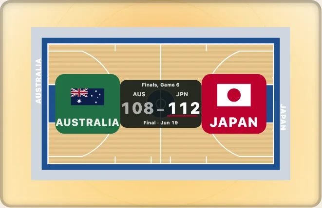

# Looks, colours and dark mode

[日本語](ja/looks-and-colours.md) · English

Nothing in a drawing is branded. Every colour is a custom property on the drawing's `svg`, the defaults sit in `:where()` rules with no weight, and a light set and a dark set follow the device. This guide shows the four ways to change a colour, from the broadest to the narrowest, and how to keep a page of many drawings light.



## Pick a look

`look` paints a whole drawing in one palette, for every sport, light and dark. The names are in `LOOK_NAMES`.

```ts
import { LOOK_NAMES, LOOKS, contrastOf, drawKyogijo, lookPalette } from "@johnmorrisdotca/kyogijo-stadiums";

console.log(LOOK_NAMES.join(", "));
const svg = drawKyogijo({ sport: "nba", look: "chalkboard", theme: "dark" });
const palette = lookPalette("chalkboard", "dark", "nba");
console.log(svg.includes('data-palette="chalkboard"'), Object.keys(LOOKS).length >= 8, contrastOf(palette.line, palette.surface)! >= 3);
// grass, night, chalkboard, blueprint, print, broadcast, high-contrast, line-drawing
// true true true
```

A test holds every look, in both modes and for every sport, to the contrast WCAG 2.2 asks: every painted line is 3:1 against what it is painted on and the drawing's words 4.5:1 against the apron. `print` and `line-drawing` are for a printer with no colour.

## Light, dark and the device

By default the drawing follows `prefers-color-scheme`. A page can choose instead: `theme: "light"` or `"dark"` in the options, or `data-theme` on the page's root. Pass `theme: "auto"` (the default) to follow the device.

```ts
import { drawKyogijo } from "@johnmorrisdotca/kyogijo-stadiums";

const dark = drawKyogijo({ sport: "nhl", theme: "dark" });
const auto = drawKyogijo({ sport: "nhl" });
console.log(dark !== auto, dark.includes("data-theme"));
```

## Colours from code

`colors` sets any custom property by its short name. Colours are checked: a hex colour, `rgb()`, `hsl()`, a name or `var(--name)`, 64 characters at most. Anything else is ignored, never written into the markup.

```ts
import { COLOR_PROPERTIES, drawKyogijo, safeColour } from "@johnmorrisdotca/kyogijo-stadiums";

const svg = drawKyogijo({ sport: "nhl", style: "none", colors: { surface: "#dfe9f3" } });
console.log(svg.includes("--ky-surface:#dfe9f3"), COLOR_PROPERTIES.surface);
console.log(safeColour("#d52b1e"), safeColour("red; background:url(x)"));
// true --ky-surface
// #d52b1e undefined
```

## Colour a named part

`featureColors` colours a part of a surface by its name, and `FEATURES[sport]` lists the names. A name the sport does not have is an error that lists the ones it has, which is the quickest way to learn them.

```ts
import { FEATURES, drawKyogijo } from "@johnmorrisdotca/kyogijo-stadiums";

const names = FEATURES.nhl;
console.log(names.includes("blue-lines"));
const svg = drawKyogijo({ sport: "nhl", featureColors: { "blue-lines": "#1d4f8f" } });
console.log(svg.includes("#1d4f8f"));
// true
// true
```

## A court of your own

A basketball or net court takes a `court` object: its wood, apron, key, lines, centre logo and baseline text. `COURT_THEMES` has five to start from.

```ts
import { COURT_THEMES, drawKyogijo } from "@johnmorrisdotca/kyogijo-stadiums";

const svg = drawKyogijo({ sport: "nba", court: { ...COURT_THEMES.twoTone, baselineText: ["SUMMIT PEAKS", "METRO BOLTS"], paintThreePoint: true } });
console.log(svg.includes("--ky-key:#1e4f8f"), svg.includes("METRO BOLTS"));
// true true
```

## Many drawings on one page

Each drawing carries its stylesheet, 8 to 10 kB. For a page of many, pass `style: "none"` and put `KYOGIJO_STYLE` in the page once, which has every look. In the order of weight, a rule of your page beats `colors`, which beats a `court` look, which beats a named `look`.

```ts
import { KYOGIJO_STYLE, drawKyogijo } from "@johnmorrisdotca/kyogijo-stadiums";

const one = drawKyogijo({ sport: "nhl", style: "none" });
console.log(one.includes("<style>"), KYOGIJO_STYLE.includes("--ky-surface"));
// false true
```

Every part also carries a class (`ky-surface`, `ky-line`, `ky-banner`, `ky-plate`, `ky-score`, `ky-winbar`) for anything a property cannot reach. All the properties are in [theming](../theming.md); the pageant of flags laid over each half is in [the pageant](../pageant.md).
