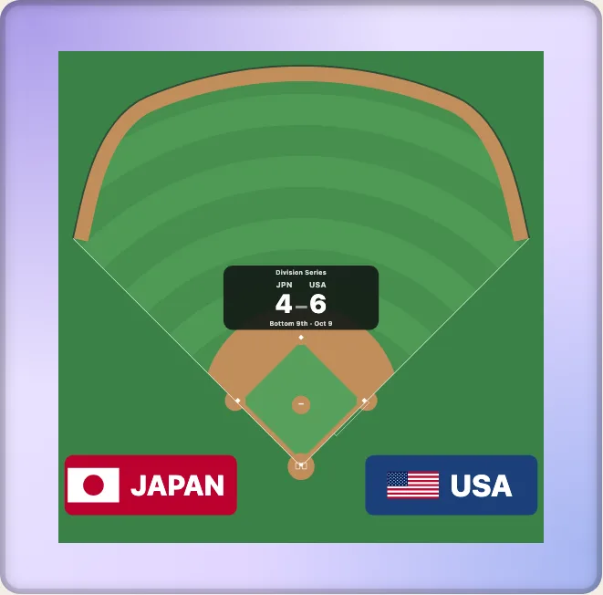

# Ballparks, grounds, arenas and real venues

[日本語](ja/real-venues.md) · English

A bare surface is the same everywhere: a rink is 200 by 85 feet. A real place is not. This guide shows the four levels of "where", from a park's fence to a district of buildings on one plan, and which entry holds each. Every one is data you can read without drawing.



## A ballpark by name

`park` takes a key of `PARKS` (94 of them: the 30 current MLB parks, 44 past, and 20 grounds of Nippon Professional Baseball). The fence is a smooth curve through the distances the park's article publishes, so it never swings out past them. `year` draws the field as it was in a season.

```ts
import { PARKS, drawKyogijo } from "@johnmorrisdotca/kyogijo-stadiums";
import { parkByName } from "@johnmorrisdotca/kyogijo-stadiums/parks";

const park = PARKS["hanshin-koshien-stadium"];
console.log(park.name, park.nameJa, park.points.length);
console.log(parkByName("Camden Yards")?.id, parkByName("ハマスタ")?.id);
const svg = drawKyogijo({ sport: "mlb", park: "hanshin-koshien-stadium", language: "ja" });
console.log(svg.includes("甲子園球場のグラウンド"));
// Koshien Stadium 甲子園球場 5
// oriole-park-at-camden-yards yokohama-stadium
// true
```

`parkByName` finds a park by any name it has been called, in either language, and `parkOfficialName(park, "ja")` gives the formal one. Pass your own distances instead with `fence: { left, leftCenter, center, rightCenter, right }`. Details: [ballparks](../ballparks.md).

## A soccer ground

`GROUNDS` holds 64 grounds with their published pitch sizes, city, capacity and the tournaments they hosted. A ground without a published size stays at the default 105 by 68 metres and says why.

```ts
import { GROUND_IDS, groundById } from "@johnmorrisdotca/kyogijo-stadiums/grounds";

const ground = groundById("maracana")!;
console.log(GROUND_IDS.length, ground.name, ground.city, ground.country);
// 64 Maracanã Stadium Rio de Janeiro BR
```

## An arena and its building

An NHL arena can be drawn in the outline of its building, with a bowl of seats fitted inside from what the sources say: seats, tiers and the kind of roof. The outline is OpenStreetMap's (ODbL, credited by `VENUE_ATTRIBUTION`); the bowl is plausible, not surveyed, and is marked so.

```ts
import { drawKyogijo } from "@johnmorrisdotca/kyogijo-stadiums";
import { VENUE_ATTRIBUTION } from "@johnmorrisdotca/kyogijo-stadiums/venues";

const svg = drawKyogijo({ sport: "nhl", arena: "honda-center", crowd: { real: true } });
console.log(svg.includes("ky-cr-shell"), typeof VENUE_ATTRIBUTION);
// true string
```

Keep the attribution in your page wherever the building outline shows. The facts of each building and where each came from are in [the real venues](../venues.md); stadiums and ballparks are in [the real stadiums](../stadiums.md).

## A district: several venues on one plan

`drawDistrict` puts venues of one city at their real positions, turned as they lie. `planDistrict` returns the plan as data: the mode, the members and the distances between them.

```ts
import { drawDistrict, planDistrict } from "@johnmorrisdotca/kyogijo-stadiums/district";

const plan = planDistrict({ venues: ["bc-place", "rogers-arena"] });
console.log(plan.mode, plan.members.map((m) => m.member.key).join(" "), Math.round(plan.between[0].metres));
console.log(drawDistrict({ venues: ["bc-place:soccer", "rogers-arena"] }).includes('data-venue="bc-place:soccer"'));
// neighbours bc-place:cfl rogers-arena 264
// true
```

A `venue:config` key picks a configuration of a stadium (`bc-place:soccer`). Add `context` to draw the buildings, water and trees around, from the `osm`, `cityctx` or `plateau` data. Each area is its own file; `loadAreasFor` reads only the ones a page shows, and the `district-lean` entry is the district for a page that carries only the venues it draws. [A district of venues](../district.md).

## Find what exists

The catalogue lists every venue drawn today, the ones being built and the ones wanted, with ids, English and Japanese names and Wikidata items, as a JSON file as well as a typed entry.

```ts
import { CATALOGUE, catalogueByStatus, catalogueCoverage } from "@johnmorrisdotca/kyogijo-stadiums/catalogue";

const nhl = catalogueCoverage("nhl");
console.log(CATALOGUE.length > 400, catalogueByStatus("supported").length > 0, nhl.venues, nhl.outline, nhl.notYet);
// true true 32 32 0
```

The atlas (`PLACES`, `placeById`, `placesBy`) is the same idea for map pins: 330 places with their coordinates and tenants. Pick the catalogue to ask what the package can draw, and the atlas to put a place on a map.

## Which entry to import

| You want | Import |
| --- | --- |
| A park's data or fence | `.../parks` |
| A ground's facts | `.../grounds` |
| An arena's building | `.../venues` |
| A stadium or ballpark's building | `.../stadiums` |
| Several venues on one plan | `.../district` (or `.../district-lean`) |
| The list of everything | `.../catalogue` |

Each stands apart, so importing `parks` loads no arena and no district.
