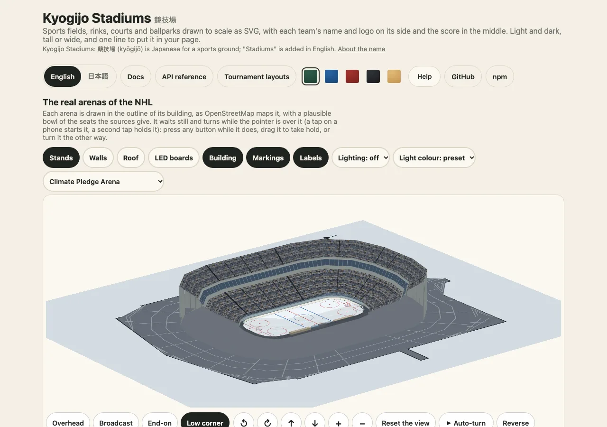

# A score on a surface

[日本語](ja/score-and-layout.md) · English

Most uses of the package are a game's result on the place it was played. This guide covers the options that matter for that: the teams, the state of the game, which side the home team is on, the three sizes and the shape of the box. The reference table of every option is in [score and layout](../score.md).



## The teams

Pass `home` and `away`. Each team has a `name`, an optional `abbr`, a `score` and a `color`. A `logo` is an https or relative address, an image data address, or the text of an SVG. It is drawn as an image, so it cannot run a script, and an address of any other kind is ignored. A `flag` is a country code, drawn by Hata.

```ts
import { drawKyogijo } from "@johnmorrisdotca/kyogijo-stadiums";

const svg = drawKyogijo({
  sport: "soccer",
  home: { name: "Japan", abbr: "JPN", score: 2, flag: "JP", color: "#1d3f8f" },
  away: { name: "Canada", abbr: "CAN", score: 1, flag: "CA", color: "#d52b1e" },
  status: "final",
  competition: "Friendly",
  date: "June 10",
});
console.log(svg.includes("Japan 2, Canada 1"), svg.includes("Friendly"));
// true true
```

## The state of the game

`status` is `final`, `final-ot`, `final-so`, `final-aet`, `final-pens`, `live`, `half`, `postponed`, `retired`, `walkover`, a curling `end-6`, a net sport's `set-3`, or any text such as `Bottom 9th`. A named status is translated; your own text is used as written.

```ts
import { drawKyogijo, statusLabel, winnerOf } from "@johnmorrisdotca/kyogijo-stadiums";

const game = { sport: "nhl", away: { name: "USA", score: 3 }, home: { name: "Canada", score: 2 } } as const;
console.log(winnerOf({ ...game, status: "final" }), winnerOf({ ...game, status: "live" }));
console.log(drawKyogijo({ ...game, status: "Bottom 9th" }).includes("Bottom 9th"));
console.log(statusLabel("final-ot", "en"), "|", statusLabel("final-ot", "ja"));
// away none
// true
// Final/OT | 試合終了（延長）
```

`winner` is `auto` by default: the leader, once the status is a final one. The winner is marked by a bar under the score and the loser's side is lighter, so the result is not told by colour alone.

## Which side is the home team on?

A score is drawn the way the sport lists it. Soccer, rugby and most of the world's codes write the home team first, so it is on the left. The North American leagues write the visitor first ("away at home"), so the home team is on the right. `homeSide: "left"` or `"right"` overrides either; `homeSideFor(sport)` returns the default.

```ts
import { homeSideFor } from "@johnmorrisdotca/kyogijo-stadiums";

console.log(homeSideFor("soccer"), homeSideFor("nhl"));
// left right
```

The side decides the order of the teams in the title and the description, the rows of a curling board, and the way a changed score pulses. Do not swap your own data to fix the side; set `homeSide`.

## Three sizes

`size` is `full` (the score on the surface), `compact` (the surface with a strip under it) or `badge` (the strip alone). Use `badge` for a list and `compact` for a card. All three carry the same `<title>`.

```ts
import { drawKyogijo } from "@johnmorrisdotca/kyogijo-stadiums";

const game = { sport: "nba", away: { name: "Australia", score: 108 }, home: { name: "Japan", score: 112 }, status: "final" } as const;
const sizes = (["full", "compact", "badge"] as const).map((size) => drawKyogijo({ ...game, size }).length);
console.log(sizes[0] > sizes[2], sizes[1] > sizes[2]);
// true true
```

## Wide, tall or following the box

`orientation` is `landscape`, `portrait` or `auto`. The server chooses one; `mountKyogijo` and the element measure the box and choose for you. In a tall drawing the surface is turned and every word is turned back upright. `range` crops to a part of the surface (`offensive-zone`) without changing the coordinates of anything drawn on it.

## Sports with a richer score

A net sport has the score in each set and the point in play; curling has the score of each end and the hammer; cricket has runs, wickets and overs; Australian football has goals and behinds. These are fields of the same team object, listed in [score and layout](../score.md#score-mode) and in the pages of [net sports](../courts.md) and [field sports](../field-sports.md).

Next: put the drawing in a page with [Embedding](embed-in-a-page.md), or change its colours with [Looks and colours](looks-and-colours.md).
