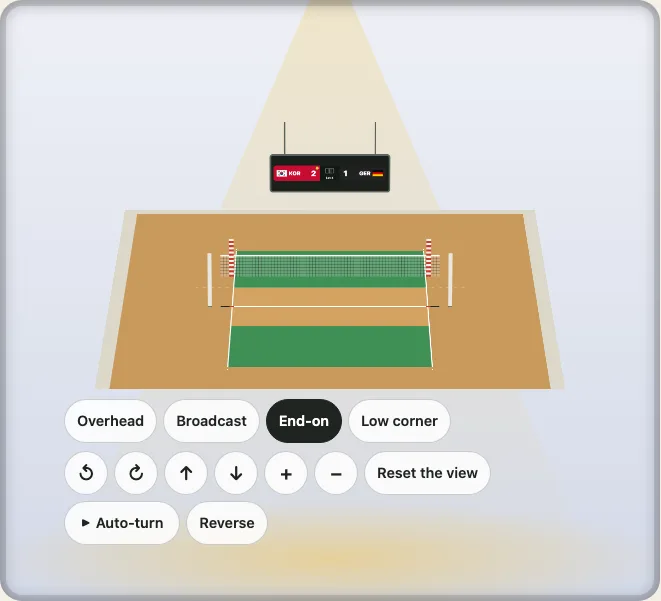

# The 3D view

[日本語](ja/the-3d-view.md) · English

A surface drawn flat hides what stands on it: a net, a basket, a goal, the posts of a football field. The `turn` entry shows any surface as a floor that turns, with what the rulebook puts on it standing up at the rulebook's height. This guide covers the two ways to use it, the parts you can switch, and what it costs a phone.



## How it works

The floor is the flat drawing itself, with its score and layers. It is tipped and turned by the mouse, a finger or the keys, and zoomed by the wheel or a pinch, and each part that stands on it is one `matrix3d`. It is plain DOM and CSS: no canvas, no WebGL, no dependency. That means the 3D view prints, can be styled with your CSS, and costs no more than the flat drawing's elements.

## In a page

`mountKyogijoTurn(container, options, settings)` returns the controller. A viewpoint is a `preset`; `set` takes any view.

```ts no-run
import { mountKyogijoTurn } from "@johnmorrisdotca/kyogijo-stadiums/turn";

const view = mountKyogijoTurn(
  document.querySelector("#court")!,
  { sport: "volleyball", home: { name: "Japan", score: 3 }, away: { name: "USA", score: 2 }, status: "final" },
  { preset: "end" },
);
view.preset("corner"); // glide to a viewpoint
view.set({ yaw: 60 }); // or to any view
view.update({ sport: "nba" }); // draw another surface, keeping the view
```

The auto-turn waits for Play, turns either way (`direction` in the settings, or `view.setDirection("clockwise")`) and does nothing while the page is hidden or the view is scrolled out of sight. With `autoPlay: true` it starts when mounted, but not for a reader who prefers reduced motion; that reader's view jumps between viewpoints instead of gliding. Each control is 44 pixels or more with a visible focus.

In the custom element it is an attribute: `<kyogijo-field sport="nhl" turn turn-view="broadcast">`.

## As markup, on a server

`turnMarkup` returns the same view as a string, and `uprightsFor` lists what stands on the surface, so a page can state it in words.

```ts
import { turnMarkup, uprightsFor } from "@johnmorrisdotca/kyogijo-stadiums/turn";

const { items } = uprightsFor({ sport: "volleyball" }, { netHeight: "women" });
const html = turnMarkup({ sport: "volleyball" }, { preset: "end" });
console.log(items.map((item) => item.kind).join(), html.includes("preserve-3d"));
// net,netposts,antennae false
```

## Stands, roof and crowd

For a soccer ground or an arena, the settings take a `venue`: walls, a roof and a bowl of stands. The crowd can be drawn as marks in the stands, or, for the real arenas, as the actual bowl.

```ts
import { turnMarkup, uprightsFor } from "@johnmorrisdotca/kyogijo-stadiums/turn";

const options = { sport: "soccer", crowd: true } as const;
const kinds = uprightsFor(options, { venue: { id: "bowl" } }).items.map((item) => item.kind);
console.log(kinds.filter((kind) => kind === "stands" || kind === "roof").join(" "));
// stands
const html = turnMarkup(options, { venue: { roof: true } });
console.log(html.includes("ky-up-roof"), html.includes("ky-crowd"));
// true false
```

## A venue, a district, a fly-through

The real arenas and stadiums, a district of several venues and a circuit each have their own turn: `mountDistrictTurn`, `mountCircuitTurn`, `mountJudgingTurn`. `mountFlythrough` flies one camera from a map to an arena, into its bowl and to a play on the ice. They share the camera, so a visitor who learns one knows them all.

## Quality and speed

A 3D view is many elements, and a step of the turn costs the browser in proportion to how many it moves. `quality` in the settings says how much the view draws: `auto` (the default) chooses by the frames the view really makes while it turns, and `high`, `medium` and `low` hold a tier. It never looks at the browser's name or the device's model. The package's own speed checks run three device classes in CI: a desk, a mid phone and a slow Android with the CPU slowed six times. If a page with many views is slow, show one view and flat drawings for the others.

For what each setting does, see [the 3D view](../turn.md) and [quality](../quality.md); a venue's turn is in [real venues](real-venues.md).
