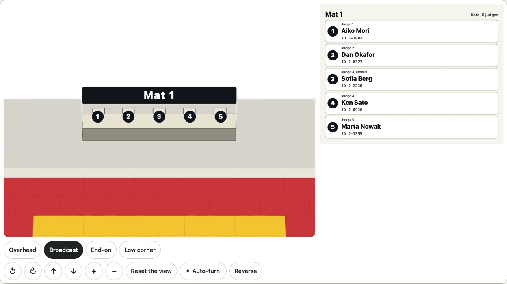
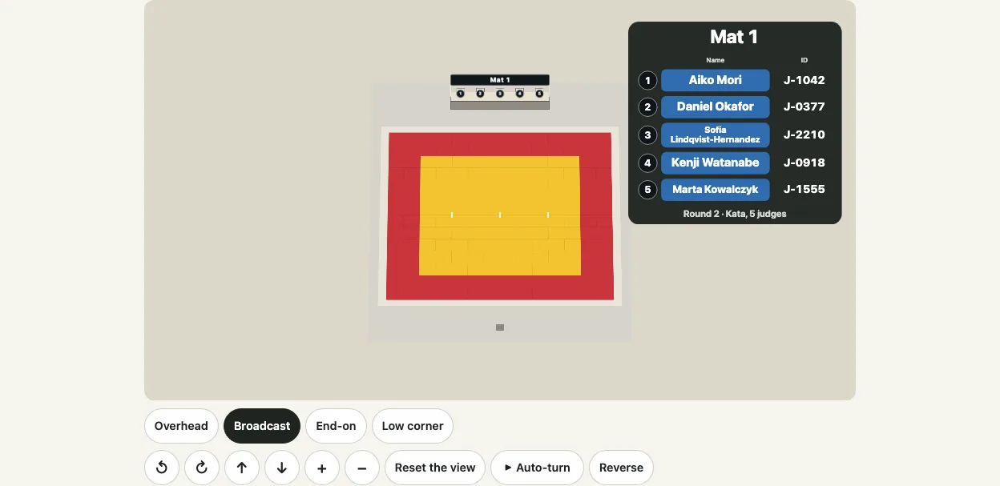
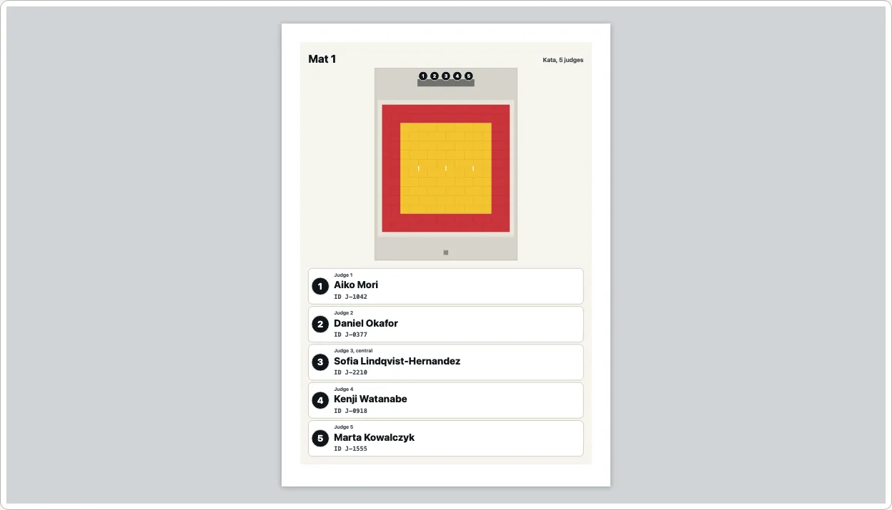

# Judging assignments

Who judges where. An organiser sets how many mat areas a judo tournament has, the style each is officiated in (`kata` or `shiai`, the contest) and, for each mat, who sits in which seat, with a name and an ID. `drawJudging` draws that as one picture for a tablet that the judges read live: each mat's area with a round numbered badge at every seat, and beside it the chart that is the key: a row for each seat with its number, its role, its name and, under the name, its ID, in rows that grow until every name and ID is whole. A name can also be put on its seat (`seatNames: true`). The same assignment is also a [3D view](#in-3d) that turns.

```ts
import { drawJudging, judgingChart, judgingTable } from "@johnmorrisdotca/kyogijo-stadiums/judging";

const options = {
  style: "kata",
  mats: [
    { label: "Mat 1", officials: [
      { seat: 1, name: "Aiko Mori", id: "J-1042" },
      { seat: 2, name: "Daniel Okafor", id: "J-0377" },
      { seat: "central", name: "Sofia Lindqvist-Hernandez", id: "J-2210" },
      { seat: 4, name: "Kenji Watanabe", id: "J-0918" },
      { seat: 5, name: "Marta Kowalczyk", id: "J-1555" },
    ] },
    { label: "Mat 2", officials: [{ seat: 1, name: "Li Wei", id: "J-3001" }] },
  ],
} as const;
const svg = drawJudging(options);
console.log(svg.startsWith("<svg"), svg.includes("Sofia"), svg.includes("J-2210"));
// true true true
console.log(judgingChart(options).includes("ky-ju-chart-row"), judgingTable(options).includes("Mat 2"));
// true true
```

[The gallery](https://johnmorrisdotca.github.io/kyogijo-stadiums/docs/gallery-judging.html) shows one mat and several, the chart, the bench close up, a tablet both ways up, dark and Japanese. The names in the pictures are invented. The demo, [judging assignments](https://johnmorrisdotca.github.io/kyogijo-stadiums/judging.html), lets you type the mats, names and IDs and keeps them in its address (`d=`): nothing is sent anywhere and nothing is stored.

## The seats of a kata area

A kata area is judged by five judges on the shomen side, about 1.25 m apart, the central judge at the centre of the area, and no referee: the Sport and Organisation Rules of 21 January 2026 (B1.8 and the judges' article) and the Kata Commission's Tournament Handbook of 2024, the same sources as [the kata area](./budo.md#the-kata-area). The seats are the ones [the judo plan](./budo.md#the-kata-area) draws (`budoPlan`), so what is named is what is drawn.

| Seat | Number | Role | Where |
| --- | --- | --- | --- |
| `judge-1` | 1 | Judge 1 | left of the table, as the plan lies with the shomen at the top |
| `judge-2` | 2 | Judge 2 | |
| `judge-3` | 3 | Judge 3, central | at the centre of the area |
| `judge-4` | 4 | Judge 4 | |
| `judge-5` | 5 | Judge 5 | right of the table |

The rules do not number the judges: **the numbers are ours**, counted from the left of the plan with the shomen at the top. `seat` takes the number (`3`, `"3"`), the key (`"judge-3"`, `"Judge 3"`) or `"central"`, and nothing else: another seat is a `RangeError` that names the seats there are. The table's size (0.8 m deep and as long as the seats) and the chairs (0.5 m) are ours too.

## The seats of a contest

`style: "shiai"` is a contest area. The Sport and Organisation Rules of 21 January 2026 give it a referee on the tatami, two technical officials for timing and scoring, the IJF Referee Supervisor(s) on the technical table, and, for an event with no CARE system, two side judges:

| Seat | Number | Role | Where, and the source |
| --- | --- | --- | --- |
| `referee` | 1 | Referee | on the tatami at its centre, 2 m back from the line the athletes start on, facing the technical table (Article 9; the Refereeing Rules' Article 2) |
| `timekeeper` | 2 | Timekeeper | at the technical table, one of the two technical officials a tatami should have for timing and scoring (the Refereeing Rules' opening article, 2026 page 128) |
| `scorekeeper` | 3 | Scorekeeper | the other, at the table |
| `supervisor` | 4 | Referee supervisor | on the technical table, with the CARE replay system and a radio to the referee (the same article) |
| `side-judge-1`, `side-judge-2` | 5, 6 | Side judge 1, 2 | for non-IJF events with no CARE system, "two (2) side judges can be used and a majority of three rule applied" (Article 13, 5); drawn only with `sideJudges: true` or when a mat names them |

**What is ours:** the numbers; which of the three chairs at the table is whose (timekeeper, scorekeeper, supervisor, from the left, 1 m apart); the place of the side judges (the Rules give none: two opposite corners of the contest area, 2 m out from them); the chairs (0.5 m) and the table (3 m by 0.8 m); and the cards' sizes. Referees who are not officiating are "seated at the technical table" (Article 3) and are not given seats here, since how many there are is the event's. The referee and the side judges are on the mat and its corners, so the close-up of the bench (`focus: "bench"`) shows the table's three only and the others' names are in the chart; in 3D the referee's and a side judge's cards stand on posts.


## The seats, the chart and the names on the seats

- **The seats are numbers.** By default every seat shows only its number on a round badge, the same badge the chart's rows have, drawn large; the chart beside the plan is the key. Nothing on the plan is squeezed to fit a name.
- **The chart.** One row for each seat of each mat, in order: the badge, the role (`Judge 3, central`), the name in a large heavy face (up to 34 units, wrapped to three lines before it shrinks to 22) and the ID under it in a fixed-width face. A name that is still too long for the row at 22 units is wrapped as often as it takes and a word wider than the row is broken inside, and the row grows to hold it, so that **nothing is ever truncated**: a name of 120 characters and an ID of 64 are whole. A seat with nobody in it says "Not assigned".
- **Names on the seats, on request.** `seatNames: true` also puts each name and ID on a card at its seat. The type is the chart's own face and weight, scaled evenly (never stretched or condensed: no `textLength`, no horizontal scaling anywhere), set in the biggest size that fits the card, one size for all the cards of a mat so that the row reads evenly, and **never below a floor** of 1.2 % of the picture's width (12 units in the default 1000): a name that fits only below it does not fit, and its seat shows its number alone, as every seat does without the option.

`chart` says when the chart is drawn: `auto` (the default) always, unless `seatNames` is on and every name fits its seat (the plan is then first given the room the chart would have taken), `always`, or `never`.

| Option | What it does |
| --- | --- |
| `style` | `"kata"` (five judges) or `"shiai"` (a referee and the technical table). |
| `mats` | The mat areas, 1 to 6. Each `{ label?, officials? }`; `label` is `Mat 1`, `Mat 2` (`第1試合場`, `第2試合場` in Japanese) when missing, at most 40 characters. |
| `officials` of a mat | Each `{ seat, name?, id? }`: the seat, a name (at most 120 characters) and an ID (text or a number, at most 64 characters). A seat named twice is an error; a seat not named is not assigned. |
| `seatNames` | Put the names on the seats too (off by default: the seats are numbers and the chart is the key). |
| `sideJudges` | Shiai: draw the two side judges' seats too (off by default; a side judge a mat names is drawn anyway, on every mat). |
| `view` | `plan` (the default: the plan with the chart, the layout to print) or `broadcast` (the mat large with the board of the officials at its side). |
| `line` of a mat | The line before the style at the broadcast board's foot (`Round 2`, `Pool B`), at most 60 characters. |
| `mat` | Draws one mat alone (counting from 1): one tab of a page that has a tab for each mat. All of them, one under another, when missing. |
| `chart` | `auto`, `always` or `never`. |
| `orientation` | `landscape` (the default) puts the chart beside the plan, `portrait` under it. |
| `focus` | `mat` (the default) shows the whole area; `bench` shows the judges' bench close up, so that the names in the seats are as large as they can be. |
| `width` | The picture's own width in units, 480 to 2000 (1000 by default). The picture scales to whatever it is shown in; this only sets how large its type is against its width. |
| `language`, `theme`, `id`, `className`, `title`, `description`, `css` | As for every drawing: English or Japanese, a forced `light` or `dark`, the prefix of the ids, a class, the title and the description, and `css: "none"` to leave the stylesheet (`KYOGIJO_STYLE` and `KYOGIJO_JUDGING_STYLE`) to the page. |

`judgingChart(options)` is the chart alone, for a page that puts it beside the 3D view; `judgingDrawing(options)` is the picture with what was worked out (its size, whether the chart is drawn, and for each seat whether its name is in the seat); `judgingTable(options)` is the same thing as a table.

## The judges' bench close up

`focus: "bench"` crops the plan to the five seats, their table and a few rows of mats, so that the same seats are drawn about twice as large (the numbers larger, and with `seatNames` the names of ordinary length fit).

```ts
import { judgingDrawing } from "@johnmorrisdotca/kyogijo-stadiums/judging";

const mats = [{ officials: [{ seat: 1, name: "Li Wei", id: "J-1" }, { seat: 2, name: "Ana Ruiz", id: "J-2" }] }];
// Names on the seats, with the chart beside the plan: the plan is half the width and the seats are too small for any but the shortest names:
console.log(judgingDrawing({ style: "kata", mats, seatNames: true, chart: "always" }).cards.map((card) => card.fits).join());
// false,false,true,true,true
console.log(judgingDrawing({ style: "kata", mats, seatNames: true, chart: "always", focus: "bench" }).cards.map((card) => card.fits).join());
// true,true,true,true,true
```

A seat with nobody in it counts as fitting. With `seatNames: true` and `chart: "auto"` the plan is first given the whole width, and short names like these then fit even on the whole mat, so no chart is drawn.

## In 3D

`mountJudgingTurn(host, options, settings)` mounts the assignment as the package's [3D view](./turn.md): the same controls, keys, pointer, auto-turn and camera as every other, over the judo floor (one area for each mat side by side, or the one `mat` names). The judges' table and the five chairs stand on it (the table 75 cm high and the chairs 45 cm, ours), **a large numbered badge stands on the table in front of each judge** (a name card with `seatNames: true`; a badge where a name does not fit), and the mat's name is on a sign over the table. Badges, cards and sign **lean back to face the eye squarely** as the view is tipped (`Plane.lean`): a card that stands upright is seen foreshortened from above, and its type looks squeezed, so they are turned and never stretched, and read the same from every angle. The chart goes beside the view (`judgingChart`). `judgingTurnMarkup` is the still markup, for a server; `buildJudgingTurn` is the model.



The view opens from the mat's side at a pitch of 42 degrees (`JUDGING_PRESETS.broadcast`), (the cards lean to face the eye, so the pitch does not squash their type). `focus: "bench"` fits the view to the judges' bench and makes the scene turn about it, so the cards are about three times larger on the screen than in the view of the whole floor. A name on a card keeps the same floor: type no smaller than 0.19 m on the floor, about 11 pixels at the opening view of a 960-pixel box. The view keeps its size through a whole turn, as every 3D view does: the camera's fit is one scale and one place for every angle, tested for the whole floor and for the bench. With several benches in view the scene turns about the middle of them and the view has a longer lens of its own (`TurnModel.lens`), so that a bench several metres off the axis does not swell as it swings toward the eye; `lens` in the settings overrides it.

## The broadcast view

`view: "broadcast"` is the other picture of the same assignment: the mat **large and prominent**, as a television would show it, with the officials **superimposed on a board at its side** like a graphic. The plan-and-chart layout above stays as it is (it is the one to print); this one is for a screen on the wall, a tablet at the table or a stream.

The pictures of the 2D view (a kata area, a contest area, dark, Japanese, the bench close up) are in [the gallery](https://johnmorrisdotca.github.io/kyogijo-stadiums/docs/gallery-judging.html), drawn by the build from the code under them.

The board is the package's own [score panel](./score.md) drawn for officials, in the same classes, so the two read as one family: the dark rounded plate (semi-transparent, so the mat shows through at its edges), the mat's name where a score panel has the competition, the column heads, then **a row for each seat**: its number on the round badge the seats on the mat wear, the name on a coloured chip as a team's is, and the ID where a score would be; and under it the line of the style (`Kata, 5 judges`), with the mat's own `line` before it (`Round 2 · Kata, 5 judges`). A seat with nobody in it is a hollow badge and a dashed chip that says "Not assigned". A name is on one line where it stays at a size that reads, and wraps (or breaks inside a word) at the floor, and the row grows to hold it: nothing is cut here either.

```ts
import { drawJudging, judgingBoard, judgingDrawing } from "@johnmorrisdotca/kyogijo-stadiums/judging";

const options = {
  style: "kata",
  view: "broadcast",
  mats: [{ label: "Mat 1", line: "Round 2", officials: [
    { seat: 1, name: "Aiko Mori", id: "J-1042" },
    { seat: 2, name: "Daniel Okafor", id: "J-0377" },
    { seat: "central", name: "Sofia Lindqvist-Hernandez", id: "J-2210" },
  ] }],
} as const;
const drawing = judgingDrawing(options);
console.log(drawing.width, drawing.height, drawing.chart);
// 1000 563 false
console.log(drawJudging(options).includes("Round 2 · Kata, 5 judges"), judgingBoard(options).includes("Aiko Mori"));
// true true
```

- **Where the board goes, and where it never goes.** The mat is fitted into the room the board leaves, so **the board never lies over the contest area**: `judgingDrawing(...).boards` gives, for each mat, the board's box, the box of the mat's picture and the middle of the contest area in the picture's units, and a test holds the board clear of the mat and of that point for a kata and a contest area, the bench close up, six long names and every width. The camera is close, on the tatami and the seats, not on the whole free zone, so the mat fills the picture's height. A board that would be taller than the picture is made narrower until it fits.
- **The seat badges stay on the seats.** Each is where its official sits (the chair, or on the mat for the referee and at a corner for a side judge), the same number as on the board's row. `seatNames: true` still puts the names on the seats that fit one; `focus: "bench"` still shows the judges' bench close up, with the board beside it.
- **Nothing is stretched.** Every size is a share of the picture's width and the picture scales as a whole when it is shown: at twice the width every font size is exactly twice as large (a test), and no text has `textLength`, `lengthAdjust` or a scale of two numbers. The faces are the score panel's own (`var(--ky-font)`, weight 800 and 700).
- **Tablet and television.** The picture is 16:9 (`BROADCAST_RATIO`); `width` (480 to 2000) sets how large its type is against its width, and the demo fits it to the screen, so the type is as sharp on a tablet as on a television. Light and dark follow the device and the page, `theme` forces one, and `language: "ja"` writes the board in Japanese.

### The broadcast view in 3D

`mountJudgingBroadcast(host, options, settings)` mounts the same view in 3D: the mat from the **Broadcast camera** (`JUDGING_PRESETS.broadcast`: from the mat's side at 42 degrees) in a 16:9 box with every control of the [3D view](./turn.md), and over its top right corner **the same board**, drawn by `judgingBoard` and laid by the page's own layout as a share of the view's width, so it grows and shrinks with the view and never takes the pointer (a drag on it turns the mat). Where the view is narrower than 640 px the board has no room beside the mat without covering it, so it stands under the view. It returns the handle every 3D view returns (`preset`, `set`, `update`, `play`, `destroy`); `update` redraws both. Where the browser cannot turn the view, the flat broadcast picture, which carries its own board, is shown alone.



The demo opens it with **`?view=broadcast`** (3D; the picture above) or **`?view=broadcast&dim=2d`** (2D), with `mat=2`, `style=shiai`, `lang=ja` and `theme=dark` as on every other view of that page; the editor has a field for each mat's line.

### No box over the mat

A `<title>` that is a direct child of the root `<svg>` is the browser's tooltip for the whole drawing: rest the pointer on the plan and a box with its words ("Judging assignments: Kata, 5 judges, 2 mats") pops up on top of the mat. A judging picture keeps its title and description in a `<defs>` instead: no tooltip is made, and the picture is still named and described by them (`aria-labelledby` points at both). The drawing of a surface is unchanged byte for byte; the demo's pages move its title into a `<defs>` after they draw it (`demo/quiet.js`, which a page of your own that wants no box over a mat can copy), so the same box is gone from a score on a surface too.

## Printing

The plan-and-chart layout is the one to print, and `judgingPrint` lays it out on paper: **one mat to a page, on A4 or US letter**, always in the light colours (a dark theme is not printed), the picture scaled as a whole to the page's printable area and anchored at its top.



```ts
import { JUDGING_PAPER, judgingPrint, judgingPrintSheets, judgingPrintStyle } from "@johnmorrisdotca/kyogijo-stadiums/judging";

const options = { style: "kata", mats: [
  { label: "Mat 1", officials: [{ seat: 1, name: "Aiko Mori", id: "J-1042" }] },
  { label: "Mat 2", officials: [{ seat: 1, name: "Li Wei", id: "J-3001" }] },
] } as const;
const html = judgingPrint(options, { paper: "letter" });
console.log(html.startsWith("<!doctype html>"), html.includes("@page{size:Letter portrait;margin:12mm}"));
// true true
console.log(judgingPrintSheets(options).split("<section").length - 1, JUDGING_PAPER.a4.height, judgingPrintStyle().includes("size:A4 portrait"));
// 2 297 true
```

- **`judgingPrint(options, { paper, orientation, margin })`** is a whole HTML document. Open it in a browser and print, or choose "Save as PDF" for a file. On a screen it shows each sheet as a page of the paper on a grey desk. Nothing in it is fetched.
- **`judgingPrintSheets`** is the pages alone (one `<section class="ky-ju-sheet">` for each mat, or the one `mat` names) and **`judgingPrintStyle`** the stylesheet (`@page` with the paper's name, how it lies and the margin; a page break after each sheet but the last; each sheet the printable area less a millimetre, because a sheet exactly as tall as the page makes some browsers print a blank page after it; `print-color-adjust: exact`), for a page that prints its own way.
- `paper` is `a4` (210 by 297 mm, the default) or `letter` (215.9 by 279.4 mm); `orientation` is `portrait` (the plan above the chart, the default) or `landscape` (the chart beside the plan); `margin` is 5 to 30 mm (12 by default). A paper, an orientation or a margin that is not one is an error.
- The picture is the plan-and-chart layout whatever `view` and `theme` were asked, and its `preserveAspectRatio` is `xMidYMin meet`: it is scaled evenly (no text is stretched) and a mat with a long chart never runs onto a second page.
- The demo's **"Print or save as PDF"** prints every mat, one to a page, on the paper chosen (`?paper=letter`); the rest of the page is hidden for print.

## On a tablet

The picture is made to be read at arm's length by people who are doing something else:

- **Large type, heavy faces and high contrast.** The names are 22 to 34 units in a picture 1000 units wide, so 22 to 34 pixels on a tablet 1000 pixels across; the ink on a row is at least 12 to 1 against it in light and in dark, and the secondary text (the role, the ID) at least 7 to 1. A test holds the ratios.
- **Both ways up.** `orientation: "landscape"` puts the chart beside the plan; `portrait` puts it under the plan, full width, for a tablet held upright. The demo follows the screen's shape (and `orientation` in its address pins one).
- **Light and dark** follow the device and the page, and `theme` forces one.
- **A tab for each mat.** `mat: 2` draws one mat alone, so that five names with their IDs take the whole screen; the demo has a tab for each mat and one for all of them.
- **Words in English and Japanese**; names and IDs are the caller's and are never translated or changed.

## Data stays with you

Nothing is fetched, stored or sent: the options in, a string out. Everything that comes from outside is text, made safe before it is drawn (control characters become spaces, runs of spaces one, markup is escaped), held to its length, and a test draws a name that is markup. A drawing is a pure function of its options: the same options give the same string, and the ids inside it come from a hash of them unless `id` is given.

## Japanese

`language: "ja"` writes the mat (`第1試合場`), the seats (`審判員1` to `審判員5`, `審判員3（中央）`), the style (`形（5人制）`), the chart's "not assigned" (`未定`), the title, the description and the table in Japanese. The names stay as they were given; a name in Japanese is set with the same rules (a full-width character counts as one em wide, and a name with a space between family and given name wraps there).

## The text alternative

`judgingTable(options)` is the picture as a table (mat, seat, name, ID), and the title and the description of the picture itself say every seat and who sits in it: "Mat 1: Judge 1 Aiko Mori, ID J-1042; Judge 2 not assigned; ...".

```ts
import { judgingDrawing, judgingTable } from "@johnmorrisdotca/kyogijo-stadiums/judging";

const options = { style: "kata", mats: [{ officials: [{ seat: 3, name: "Daniel Okafor", id: "J-0377" }] }] } as const;
console.log(judgingDrawing(options).description.slice(0, 74));
// Mat 1: Judge 1 not assigned; Judge 2 not assigned; Judge 3, central Daniel
console.log(judgingTable(options).includes("<td>Judge 3, central</td><td>Daniel Okafor</td><td>J-0377</td>"));
// true
```
