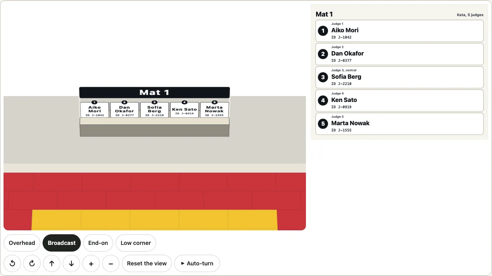

# Judging assignments

Who judges where. An organiser sets how many mat areas a judo tournament has, the style each is officiated in (`kata` or `shiai`, the contest) and, for each mat, who sits in which seat, with a name and an ID. `drawJudging` draws that as one picture for a tablet that the judges read live: each mat's area with a badge at every judge's seat, the name and ID in the seat where they fit, and beside it a chart of mat, seat, name and ID whose rows grow until every name and ID is whole. The same assignment is also a [3D view](#in-3d) that turns.

```ts
import { drawJudging, judgingChart, judgingTable } from "@johnmorrisdotca/kyogijo-stadiums/judging";

const options = {
  style: "kata",
  mats: [
    { label: "Mat 1", officials: [
      { seat: 1, name: "Aiko Mori", id: "J-1042" },
      { seat: 2, name: "Daniel Okafor", id: "J-0377" },
      { seat: "central", name: "Sofia Lindqvist-Hernandez", id: "J-2210" },
      { seat: 4, name: "Kenji Watanabe", id: "J-0918" },
      { seat: 5, name: "Marta Kowalczyk", id: "J-1555" },
    ] },
    { label: "Mat 2", officials: [{ seat: 1, name: "Li Wei", id: "J-3001" }] },
  ],
} as const;
const svg = drawJudging(options);
console.log(svg.startsWith("<svg"), svg.includes("Sofia"), svg.includes("J-2210"));
// true true true
console.log(judgingChart(options).includes("ky-ju-chart-row"), judgingTable(options).includes("Mat 2"));
// true true
```

[The gallery](https://johnmorrisdotca.github.io/kyogijo-stadiums/docs/gallery-judging.html) shows one mat and several, the chart, the bench close up, a tablet both ways up, dark and Japanese. The names in the pictures are invented. The demo, [judging assignments](https://johnmorrisdotca.github.io/kyogijo-stadiums/judging.html), lets you type the mats, names and IDs and keeps them in its address (`d=`): nothing is sent anywhere and nothing is stored.

## The seats of a kata area

A kata area is judged by five judges on the shomen side, about 1.25 m apart, the central judge at the centre of the area, and no referee: the Sport and Organisation Rules of 21 January 2026 (B1.8 and the judges' article) and the Kata Commission's Tournament Handbook of 2024, the same sources as [the kata area](./budo.md#the-kata-area). The seats are the ones [the judo plan](./budo.md#the-kata-area) draws (`budoPlan`), so what is named is what is drawn.

| Seat | Number | Role | Where |
| --- | --- | --- | --- |
| `judge-1` | 1 | Judge 1 | left of the table, as the plan lies with the shomen at the top |
| `judge-2` | 2 | Judge 2 | |
| `judge-3` | 3 | Judge 3, central | at the centre of the area |
| `judge-4` | 4 | Judge 4 | |
| `judge-5` | 5 | Judge 5 | right of the table |

The rules do not number the judges: **the numbers are ours**, counted from the left of the plan with the shomen at the top. `seat` takes the number (`3`, `"3"`), the key (`"judge-3"`, `"Judge 3"`) or `"central"`, and nothing else: another seat is a `RangeError` that names the seats there are. The table's size (0.8 m deep and as long as the seats) and the chairs (0.5 m) are ours too.

## The seats of a contest

`style: "shiai"` is a contest area. The Sport and Organisation Rules of 21 January 2026 give it a referee on the tatami, two technical officials for timing and scoring, the IJF Referee Supervisor(s) on the technical table, and, for an event with no CARE system, two side judges:

| Seat | Number | Role | Where, and the source |
| --- | --- | --- | --- |
| `referee` | 1 | Referee | on the tatami at its centre, 2 m back from the line the athletes start on, facing the technical table (Article 9; the Refereeing Rules' Article 2) |
| `timekeeper` | 2 | Timekeeper | at the technical table, one of the two technical officials a tatami should have for timing and scoring (the Refereeing Rules' opening article, 2026 page 128) |
| `scorekeeper` | 3 | Scorekeeper | the other, at the table |
| `supervisor` | 4 | Referee supervisor | on the technical table, with the CARE replay system and a radio to the referee (the same article) |
| `side-judge-1`, `side-judge-2` | 5, 6 | Side judge 1, 2 | for non-IJF events with no CARE system, "two (2) side judges can be used and a majority of three rule applied" (Article 13, 5); drawn only with `sideJudges: true` or when a mat names them |

**What is ours:** the numbers; which of the three chairs at the table is whose (timekeeper, scorekeeper, supervisor, from the left, 1 m apart); the place of the side judges (the Rules give none: two opposite corners of the contest area, 2 m out from them); the chairs (0.5 m) and the table (3 m by 0.8 m); and the cards' sizes. Referees who are not officiating are "seated at the technical table" (Article 3) and are not given seats here, since how many there are is the event's. The referee and the side judges are on the mat and its corners, so the close-up of the bench (`focus: "bench"`) shows the table's three only and the others' names are in the chart; in 3D the referee's and a side judge's cards stand on posts.


## Names in the seats, and the chart

A name goes in its seat when it fits there, and the chart is for the rest:

- **A card in the seat.** The seat is a card as wide as the seats are apart and as deep as the chair and the table in front of it, with the number on a round badge on its top edge, the name on one line or wrapped at its spaces over two or three, and the ID under it. The name is set in the biggest size that fits, one size for all five cards of a mat so that the row reads evenly, and **never below a floor** of 1.2 % of the picture's width (12 units in the default 1000): a name that fits only below it does not fit.
- **The badge.** A seat whose name does not fit, or that has a name too long for any card, shows its number alone on the badge (hollow and dashed when nobody is in the seat). Nothing is cut and nothing is shrunk past the floor.
- **The chart.** One row for each seat of each mat, in order: the number, the role (`Judge 3, central`), the name in a large heavy face (up to 34 units, wrapped to three lines before it shrinks to 22) and the ID under it in a fixed-width face. A name that is still too long for the row at 22 units is wrapped as often as it takes and a word wider than the row is broken inside, and the row grows to hold it, so that **nothing is ever truncated**: a name of 120 characters and an ID of 64 are whole. A seat with nobody in it says "Not assigned".

`chart` says when the chart is drawn: `auto` (the default) when any name or ID does not fit in its seat, `always`, or `never`. With `auto`, the plan is given the room the chart would have taken first, and the chart is drawn only if a name still does not fit.

| Option | What it does |
| --- | --- |
| `style` | `"kata"` (five judges) or `"shiai"` (a referee and the technical table). |
| `mats` | The mat areas, 1 to 6. Each `{ label?, officials? }`; `label` is `Mat 1`, `Mat 2` (`第1試合場`, `第2試合場` in Japanese) when missing, at most 40 characters. |
| `officials` of a mat | Each `{ seat, name?, id? }`: the seat, a name (at most 120 characters) and an ID (text or a number, at most 64 characters). A seat named twice is an error; a seat not named is not assigned. |
| `sideJudges` | Shiai: draw the two side judges' seats too (off by default; a side judge a mat names is drawn anyway, on every mat). |
| `mat` | Draws one mat alone (counting from 1): one tab of a page that has a tab for each mat. All of them, one under another, when missing. |
| `chart` | `auto`, `always` or `never`. |
| `orientation` | `landscape` (the default) puts the chart beside the plan, `portrait` under it. |
| `focus` | `mat` (the default) shows the whole area; `bench` shows the judges' bench close up, so that the names in the seats are as large as they can be. |
| `width` | The picture's own width in units, 480 to 2000 (1000 by default). The picture scales to whatever it is shown in; this only sets how large its type is against its width. |
| `language`, `theme`, `id`, `className`, `title`, `description`, `css` | As for every drawing: English or Japanese, a forced `light` or `dark`, the prefix of the ids, a class, the title and the description, and `css: "none"` to leave the stylesheet (`KYOGIJO_STYLE` and `KYOGIJO_JUDGING_STYLE`) to the page. |

`judgingChart(options)` is the chart alone, for a page that puts it beside the 3D view; `judgingDrawing(options)` is the picture with what was worked out (its size, whether the chart is drawn, and for each seat whether its name is in the seat); `judgingTable(options)` is the same thing as a table.

## The judges' bench close up

`focus: "bench"` crops the plan to the five seats, their table and a few rows of mats, so that the same seats are drawn about twice as large and the names of ordinary length fit them.

```ts
import { judgingDrawing } from "@johnmorrisdotca/kyogijo-stadiums/judging";

const mats = [{ officials: [{ seat: 1, name: "Li Wei", id: "J-1" }, { seat: 2, name: "Ana Ruiz", id: "J-2" }] }];
// With the chart beside the plan, the plan is half the width and the seats are too small for any but the shortest names:
console.log(judgingDrawing({ style: "kata", mats, chart: "always" }).cards.map((card) => card.fits).join());
// false,false,true,true,true
console.log(judgingDrawing({ style: "kata", mats, chart: "always", focus: "bench" }).cards.map((card) => card.fits).join());
// true,true,true,true,true
```

A seat with nobody in it counts as fitting. With `chart: "auto"` the plan is first given the whole width, and short names like these then fit even on the whole mat, so no chart is drawn.

## In 3D

`mountJudgingTurn(host, options, settings)` mounts the assignment as the package's [3D view](./turn.md): the same controls, keys, pointer, auto-turn and camera as every other, over the judo floor (one area for each mat side by side, or the one `mat` names). The judges' table and the five chairs stand on it (the table 75 cm high and the chairs 45 cm, ours), **a name card stands on the table in front of each judge** and turns to face the eye, so that it is read from wherever the view is, and the mat's name is on a sign over the table. A seat whose name does not fit a card has a badge instead; the chart goes beside the view (`judgingChart`). `judgingTurnMarkup` is the still markup, for a server; `buildJudgingTurn` is the model.



The view opens from the mat's side at a pitch of 42 degrees (`JUDGING_PRESETS.broadcast`), where an upright card's type is still two thirds as tall as it is wide; a high eye would squash it. `focus: "bench"` fits the view to the judges' bench and makes the scene turn about it, so the cards are about three times larger on the screen than in the view of the whole floor. The cards keep the same floor: type no smaller than 0.19 m on the floor, about 11 pixels at the opening view of a 960-pixel box. The view keeps its size through a whole turn, as every 3D view does: the camera's fit is one scale and one place for every angle, tested for the whole floor and for the bench. With several benches in view the scene turns about the middle of them and the view has a longer lens of its own (`TurnModel.lens`), so that a bench several metres off the axis does not swell as it swings toward the eye; `lens` in the settings overrides it.

## On a tablet

The picture is made to be read at arm's length by people who are doing something else:

- **Large type, heavy faces and high contrast.** The names are 22 to 34 units in a picture 1000 units wide, so 22 to 34 pixels on a tablet 1000 pixels across; the ink on a row is at least 12 to 1 against it in light and in dark, and the secondary text (the role, the ID) at least 7 to 1. A test holds the ratios.
- **Both ways up.** `orientation: "landscape"` puts the chart beside the plan; `portrait` puts it under the plan, full width, for a tablet held upright. The demo follows the screen's shape (and `orientation` in its address pins one).
- **Light and dark** follow the device and the page, and `theme` forces one.
- **A tab for each mat.** `mat: 2` draws one mat alone, so that five names with their IDs take the whole screen; the demo has a tab for each mat and one for all of them.
- **Words in English and Japanese**; names and IDs are the caller's and are never translated or changed.

## Data stays with you

Nothing is fetched, stored or sent: the options in, a string out. Everything that comes from outside is text, made safe before it is drawn (control characters become spaces, runs of spaces one, markup is escaped), held to its length, and a test draws a name that is markup. A drawing is a pure function of its options: the same options give the same string, and the ids inside it come from a hash of them unless `id` is given.

## Japanese

`language: "ja"` writes the mat (`第1試合場`), the seats (`審判員1` to `審判員5`, `審判員3（中央）`), the style (`形（5人制）`), the chart's "not assigned" (`未定`), the title, the description and the table in Japanese. The names stay as they were given; a name in Japanese is set with the same rules (a full-width character counts as one em wide, and a name with a space between family and given name wraps there).

## The text alternative

`judgingTable(options)` is the picture as a table (mat, seat, name, ID), and the title and the description of the picture itself say every seat and who sits in it: "Mat 1: Judge 1 Aiko Mori, ID J-1042; Judge 2 not assigned; ...".

```ts
import { judgingDrawing, judgingTable } from "@johnmorrisdotca/kyogijo-stadiums/judging";

const options = { style: "kata", mats: [{ officials: [{ seat: 3, name: "Daniel Okafor", id: "J-0377" }] }] } as const;
console.log(judgingDrawing(options).description.slice(0, 74));
// Mat 1: Judge 1 not assigned; Judge 2 not assigned; Judge 3, central Daniel
console.log(judgingTable(options).includes("<td>Judge 3, central</td><td>Daniel Okafor</td><td>J-0377</td>"));
// true
```
