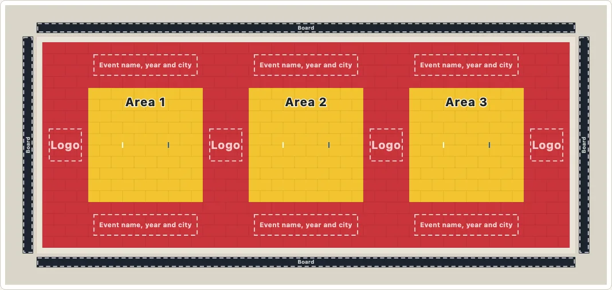
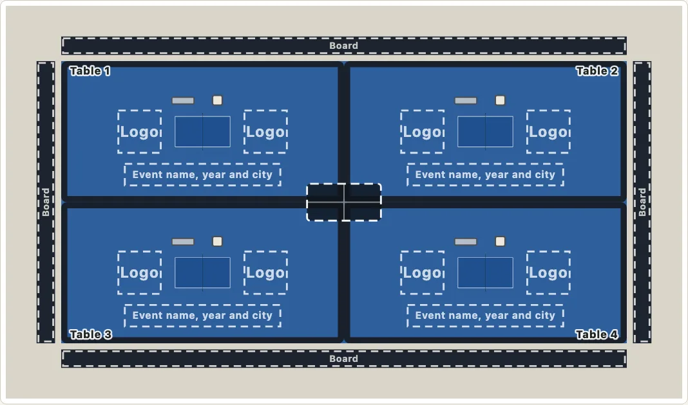

# Tournament layouts

Some sports run several playing surfaces at once for one event: four table tennis areas on one floor under one scoreboard, a row of three judo contest areas on one coloured floor of mats, four curling sheets side by side, a block of pickleball courts. `drawMulti` lays the package's own surfaces out together like that, to scale, on one floor, as one SVG, and says how much floor the layout needs and whether it fits a hall.

```ts
import { drawMulti, multiLayout } from "@johnmorrisdotca/kyogijo-stadiums/multi";

const svg = drawMulti({ preset: "tabletennis-4" });
const layout = multiLayout({ preset: "tabletennis-4" });
console.log(svg.startsWith("<svg"), layout.cells.length);
// true 4
console.log(layout.needs.length, layout.needs.width, layout.needs.area);
// 28 14 392
```





Each surface is the one `drawKyogijo` draws (a table, a court, a sheet, the sport's own several judo or karate areas), with its own lines, moved to its place: nothing is drawn a second way. The layout adds the floor, and, where the sport has them, the barriers, the officials' chairs, a scoreboard hung over the middle of the floor, the boards along its edges and the empty places for the event's own words and marks. It is one picture, with a title and a description for a screen reader, light and dark like every drawing, and [`multiTable`](#the-text-alternative) says the same thing as a table.

The [tournament layouts demo](https://johnmorrisdotca.github.io/kyogijo-stadiums/halls.html) lets you pick a preset, set it in a hall, switch the stadium on and off, and turn the whole floor in [3D](#in-3d) (`view=3d` in its address); [the gallery](https://johnmorrisdotca.github.io/kyogijo-stadiums/docs/gallery-multi.html) shows every preset.

## The presets

A preset is a real configuration, with the rule it is laid out by. `rows x columns` is counted the same way everywhere: a row of N areas is 1 x N (curling sheets and badminton and tennis courts stand across the layout, turned a quarter, so four sheets are 1 x 4). "Floor" is what the layout needs, in metres, along the layout and then across it, from the rule. The basis says how sure the arrangement is:

- **rulebook**: the spacing is what a rulebook or a federation's specification asks for (the least, or the recommendation it names), laid out in the grid it allows. No event's plan is drawn.
- **event**: the numbers are a rulebook's, and the arrangement (how many areas, one floor, one scoreboard) is what an event used, read from reports and from photographs. The event's own plan was not seen, so it is not drawn as measured.

| Key | Grid | Surfaces | Floor (m) | Area (m²) | Basis | Event named |
| --- | --- | --- | --- | --- | --- | --- |
| `tabletennis-4` | 2 x 2 | 4 | 28 by 14 | 392 | event | ITTF World Team Table Tennis Championships Finals 2026, OVO Arena Wembley |
| `tabletennis-8` | 2 x 4 | 8 | 56 by 14 | 784 | rulebook | none sourced |
| `pickleball-2x2` | 2 x 2 | 4 | 39.01 by 20.73 | 808.6 | rulebook | none sourced |
| `pickleball-2x4` | 2 x 4 | 8 | 78.03 by 20.73 | 1617.3 | rulebook | none sourced |
| `pickleball-4x4` | 4 x 4 | 16 | 78.03 by 41.45 | 3234.5 | rulebook | none sourced (the PPA Tour asks a host for at least 16 courts) |
| `curling-1x4` | 1 x 4 | 4 | 19 by 45.72 | 868.7 | event | Olympic Winter Games 2022, Beijing National Aquatics Centre |
| `judo-1x3` | 1 x 3 | 3 | 47 by 19 | 893 | event | World Judo Championships 2018, National Gymnastics Arena, Baku |
| `judo-1x4` | 1 x 4 | 4 | 61 by 19 | 1159 | rulebook | none sourced |
| `karate-2x3` | 2 x 3 | 6 | 32 by 22 | 704 | rulebook | Karate1 Series A 2025 (the league's six; that event's own count is not published) |
| `karate-2x4` | 2 x 4 | 8 | 42 by 22 | 924 | rulebook | none sourced |
| `badminton-1x4` | 1 x 4 | 4 | 39.4 by 17.4 | 685.6 | rulebook | none sourced (4 m between courts: only recommended at Grade 1 and 2) |
| `badminton-1x4-min` | 1 x 4 | 4 | 31.9 by 17.4 | 555.1 | rulebook | none sourced (the required least: 1.5 m between courts) |
| `tennis-1x3` | 1 x 3 | 3 | 54.87 by 36.57 | 2006.9 | rulebook | none sourced |

Every figure, with the rule and the document it is from, is in [the sources](./sources.md#tournament-layouts), which also says plainly what is ours and what was not found. The rest of the sports that run several surfaces at once, with the ones left out and why, are in [the research note](../docs/research/multi-surface-research.md).

`rows`, `columns` and `stagger` change a preset's grid; `layout` takes a layout of your own (a `MultiSpec`). A judo or karate layout takes `columns` as its areas in a row and `rows` as its rows, from 1 to 6, as the sport's own `budo.areas` does.

```ts
import { multiLayout } from "@johnmorrisdotca/kyogijo-stadiums/multi";

const wide = multiLayout({ preset: "tabletennis-4", rows: 3, columns: 5 });
const staggered = multiLayout({ preset: "tabletennis-4", stagger: 0.5 });
console.log(wide.cells.length, wide.needs.length, wide.needs.width);
// 15 70 21
console.log(staggered.needs.length, staggered.cells[2].x > staggered.cells[0].x);
// 35 true
```

## The branding places

Every place for the event's own words and marks is an empty, dashed rectangle with what it is for written in it ("Event name, year and city", "Logo", "Board"): nothing real is printed and the package holds no brand, sponsor or event's marks. `slots: false` draws neither the places nor the boards.

- On a **judo or karate** floor the places are on the mats themselves, because that is where those sports print them: the event's words in the safety area above and below each contest area, and a mark in the end safety areas and in the common safe zones between areas. They sit inside the tatami and never over a contest area.
- On a **table tennis, pickleball, badminton, curling or tennis** floor there are two places for a mark at the ends of each surface and one for words beside it (the ITTF's Handbook allows up to six advertisements on the floor of a playing area, 3.2.5.5), and boards along the four edges of the floor.

## A hall, and whether the layout fits

A layout is drawn to true scale, so it needs a real amount of floor, and only a large arena has one. `multiFit(layout, venue)` says whether a layout fits a hall's floor, turned a quarter or not, and how much is left, and `venue` in the options sets the layout in the hall and says so in the description.

| Key | The floor | From |
| --- | --- | --- |
| `copper-box-arena` | 60 by 40 m, up to 2,700 m² | the venue's own pages |
| `ovo-arena-wembley` | 2,655 m², no length or width published | the venue's own page |
| `nhl-ice-pad` | 200 by 85 feet: an NHL rink, the ice an arena lays for hockey | the NHL's Rule 1 |
| `iihf-ice-pad` | 60 by 30 m: an IIHF rink at the widest the rules allow | the IIHF's Rule 1 |
| `nippon-budokan` | an octagon 55 m across the flats, 2,513 m² | the Budokan's own leaflet |

A floor that is a rectangle takes a layout if it fits, as drawn or turned a quarter (four curling sheets stand across the layout and fit an NHL ice pad turned). An octagon takes it if its four corners are inside. A floor of which only the area is published is compared by area, and the answer is "it may fit" or "it does not": the shape could still refuse it. A floor of your own is `{ length, width, unit }`. The package holds only floors it could source; for any other hall, give the size.

```ts
import { fitSentence, multiFit, multiLayout } from "@johnmorrisdotca/kyogijo-stadiums/multi";

const four = multiFit(multiLayout({ preset: "curling-1x4" }), "nhl-ice-pad");
const six = multiFit(multiLayout({ preset: "curling-1x4", columns: 6 }), "nhl-ice-pad");
console.log(four.fits, four.turned, six.fits);
// true true false
console.log(fitSentence(four));
// it fits, with 15.24 by 6.91 metres to spare, turned a quarter.
const maybe = multiFit(multiLayout({ preset: "tabletennis-4" }), "ovo-arena-wembley");
console.log(maybe.fits, maybe.by, fitSentence(maybe));
// null area it may fit: it needs 392 of its 2,655 square metres, and the shape of the floor is not published.
```

The presets tie to the halls where a source ties them: the table tennis four to OVO Arena Wembley (an area-only floor, so a "may fit"), the curling four to the ice an arena lays. A layout that does not fit is still drawn, hanging over the hall's floor in a dashed red line, so that the shortfall is seen.

## A real stadium round the layout

`stadium: true` draws the hall round the layout at the same scale: the walls and the stands and the crowd the package already draws for a surface (the [crowd model](./crowd.md): `layoutOf` and `drawCrowd`, not a copy), in the profile of the sport, or of the hall when it has one (an ice pad's is a hockey arena's). It is off by default. With a `venue` the stands stand round that floor (an octagon's wall is an octagon); without one they stand round the floor the layout needs.

```ts
import { drawMulti } from "@johnmorrisdotca/kyogijo-stadiums/multi";

const plain = drawMulti({ preset: "curling-1x4", venue: "nhl-ice-pad" });
const inArena = drawMulti({ preset: "curling-1x4", venue: "nhl-ice-pad", stadium: true });
console.log(plain.includes('class="ky-crowd"'), inArena.includes('class="ky-crowd"'));
// false true
```

`stadium` takes `{ crowd, density, roof, shape, detail }` too: `crowd: false` leaves the seats empty, `density` is the share of seats taken, `detail: "plain"` draws blocks for a small picture. The distances between the floor and the first row, and the depth of the tiers, are the package's conventions for a venue of the sport (no rulebook gives them; see [the crowd page](./crowd.md)), not a published plan of any of the halls above.

## In 3D


`mountMultiTurn` turns a layout, as [the 3D view](./turn.md) turns one surface: the same four viewpoints (overhead, broadcast, end-on and low corner), the same drag, keys, pinch, zoom, reset and auto-turn, and the same camera, whose scale is fixed for the whole turn so that the floor never swells or shrinks as it goes round and none of it is cut off at any angle. It is the 3D view and not a second renderer: the layout's model is a `TurnModel`, so the camera, the controls and the tests are the ones every surface has.

```ts no-run
import { mountMultiTurn } from "@johnmorrisdotca/kyogijo-stadiums/multi";

const view = mountMultiTurn(document.querySelector("#hall")!, { preset: "tabletennis-4", stadium: true }, { preset: "broadcast", venue: { roof: true } });
view.preset("end");                                   // glide to a viewpoint
view.update({ preset: "tabletennis-8", stadium: true }); // draw another layout, keeping the view
```

`multiTurnMarkup(options, settings)` is the same view as a string, for a server; `buildMultiTurn(options, settings)` is its model. The options are `drawMulti`'s, and the settings are the 3D view's (`preset`, `view`, `controls`, `uprights`, `venue`, `touch`, `motion`, `lens`, `autoPlay`, `speed`, `onChange`): `uprights: false` leaves everything flat on the floor, and `uprights: { boards: false }` leaves the surrounds out.

```ts
import { multiTurnMarkup } from "@johnmorrisdotca/kyogijo-stadiums/multi";

const html = multiTurnMarkup({ preset: "tabletennis-4" }, { preset: "end" });
console.log(html.includes('data-part="c1-net"'), html.includes('data-part="c4-table-top"'));
// true true
console.log(html.includes('data-part="scoreboard"'), html.includes("ky-up-surround"));
// true true
```

What stands up is what the flat drawing draws, each at a height from the rules or, where a rule gives none, ours:

| What | In 3D |
| --- | --- |
| Each surface | As on its own page ([the 3D view](./turn.md#what-stands-on-each-surface)): the nets and posts of every net sport, and a table tennis table as a top 76 cm over the floor (with the table's own drawing on it) on its skirt and four legs, with the net and clamps over it and a soft shadow on the floor. A court turned across the layout is turned with its net. The parts are named for their cell: `c1-net`, `c3-table-top`. |
| The surrounds | A wall of 75 cm round each area's bay, in pieces of at most 3 m (the ITTF's 3.2.3.3: 50 cm to 100 cm, all of one dark colour; 75 cm is ours, within it). A table tennis bay is the playing space of [a single table](./courts.md#the-table-tennis-playing-area), 14 m by 7 m. They are whole from overhead and from a high tip, and give way a little (to 35 per cent at the most) to an eye low on their side, since a low wall there would hide the table behind it. |
| Chairs and score tables | An umpire's chair (seat 45 cm, ours) and a score table (top 76 cm, 2.5 feet, ours) as solid blocks where the flat drawing has them. |
| Scoreboards | The one hung over the middle of the floor, its lower edge 4 m up on cables (ours), facing the eye, divided into the panels of the areas; or one on legs at each surface. |
| The stadium | `stadium: true` raises the stands of [the crowd model](./crowd.md) round the hall: every tier a few raked planes with the crowd on it, the walks between the tiers, and, with `venue: { roof: true }` (or `stadium: { roof: true }`), a lid over a hall or a canopy in the open air. They give way to the eye as the walls of every other 3D view do. |
| Judo, karate, curling | Flat, as on their own pages: a judo or karate floor of mats has nothing standing on it; the stands round it can. |

The viewpoints are turned to the layout: a net sport's end-on view looks along its surfaces, where the nets are seen whole (so a layout of badminton courts turned across the floor looks along them the other way), and a floor taller than it is wide is turned a quarter so that its long way runs across the screen (`multiPresets`).

## The text alternative

`multiTable(options)` is the same layout as a table: each surface with its row, column, place and size in metres, and each empty place, under a caption that says what the layout needs. The picture's description says what it is, how it is laid out, what it is tied to, how sure that is and, with a `venue`, how it fits.

```ts
import { multiTable } from "@johnmorrisdotca/kyogijo-stadiums/multi";

const table = multiTable({ preset: "tabletennis-4" });
console.log(table.startsWith('<table class="ky-table"'), table.includes("Table 4"));
// true true
```

`language: "ja"` writes the words in Japanese (the names of the surfaces, the places, the description, the table, the fit); proper names of events and halls are not translated. `theme: "light"` or `"dark"` forces a theme on the picture; without it the picture follows the device and the page, and every colour is a custom property of `KYOGIJO_MULTI_STYLE`, with a value for dark. `style: "none"` leaves the stylesheet to the page (`KYOGIJO_STYLE` has the rules of the surfaces, and `KYOGIJO_MULTI_STYLE` the layout's own).

## What is not here

- **Not sourced, so left out.** Beach volleyball's centre court with side courts (the free zone is read only from secondary pages), small-sided football pitches marked inside one pitch (an overlay, not a grid), kendo's shiai-jo in rows (no event with a count was found), padel (the FIP's rules name no gap), squash banks (courts in a bank share walls and are not a flat marked area), 3x3 basketball (no multi-court event layout was found), indoor volleyball.
- **Needs a surface the package does not draw yet:** fencing's pistes around a raised final piste, wrestling, taekwondo, snooker and pool tables, lawn bowls, pétanque, tenpin. [The research note](../docs/research/multi-surface-research.md) ranks them with their sources.
- **The London table tennis hall's staggered arrangement is not a preset.** The owner's photographs show the Worlds hall of 2026 with its areas stepped or staggered, but no source read gives that hall's count of areas, their spacing or the floor (only the 2,655 m² of OVO Arena Wembley and the 60 by 40 m of the Copper Box Arena, where the other stage was held), so only the Handbook's 2 x 2 and 2 x 4 grids are presets. `stagger` is in the engine (`stagger: 0.5` moves every other row along by half a bay) for a layout of your own.
- **No event's own plan.** The photographs behind the table tennis, judo and curling arrangements are the owner's, are not in this repository (their licences are not known), and show an arrangement, not a measured floor; the figures drawn are the rules'.
