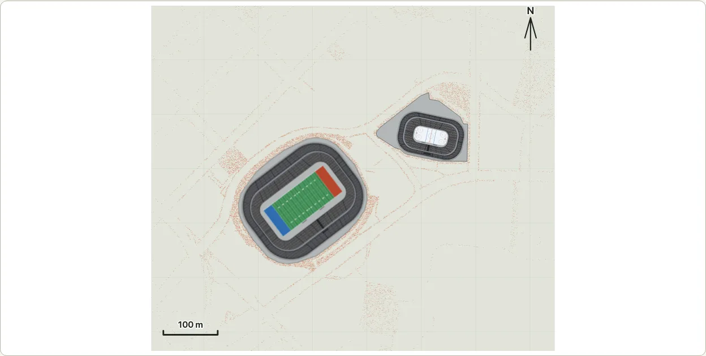
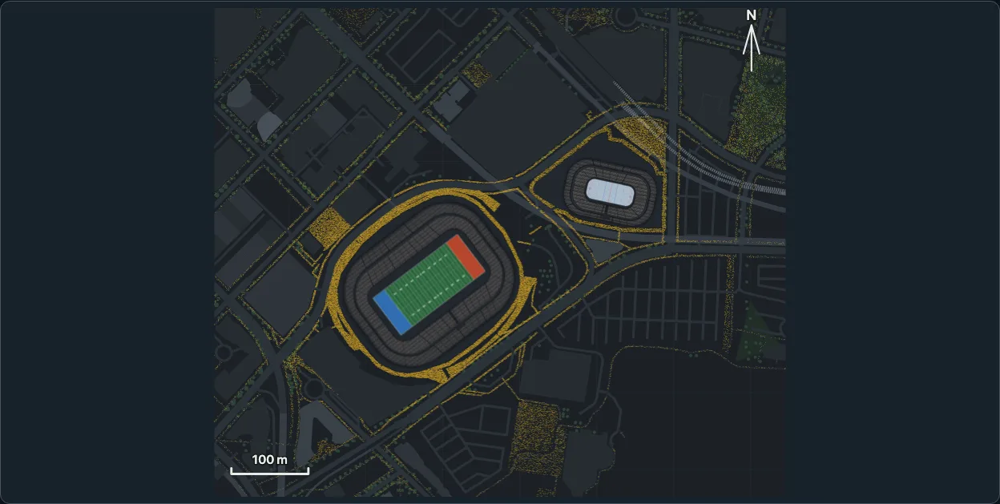

# The crowd outside the venue

People standing outside a district's venues, on the ground people may stand on: sidewalks, plazas, parks, platforms and the venues' own grounds, never on a carriageway, a railway, water or a building. `outside: { level: 50 }` on a [district](./district.md) puts half of the venues' seats' worth of people there, in 2D and in 3D, at 0, 25, 50, 75 or 100 percent. For now the ground is mapped for one district, **Vancouver: BC Place and Rogers Arena**; the other venues come in later releases, and so does the crowd walking in and out.


Roads are never drawn. The crowd's shape is what shows them: the bands with nobody on them are the carriageways, the railway and the water.

```ts
import { OUTSIDE_LEVELS, outsideCount, outsideCrowd, planDistrict } from "@johnmorrisdotca/kyogijo-stadiums/district";

const plan = planDistrict({ venues: ["bc-place", "rogers-arena"], outside: { level: 50 } });
const crowd = outsideCrowd(plan)!;
console.log(crowd.venues.map((v) => `${v.key} ${v.placed}`).join(", "));
// bc-place:cfl 54500, rogers-arena 18871
console.log(OUTSIDE_LEVELS.map((level) => outsideCount(crowd, level)).join(" "));
// 0 18343 36686 55028 73371
```

## Showing it

`outside` is an option of the district. It is off when left out, and the defaults are unchanged: asking for it, at any level, is all that changes the plan.

```ts no-run
import { mountDistrict, mountDistrictTurn } from "@johnmorrisdotca/kyogijo-stadiums/district";

const options = { venues: ["bc-place", "rogers-arena"], outside: { level: 25 } } as const;
const plan = mountDistrict(document.querySelector("#plan")!, options);
const turning = mountDistrictTurn(document.querySelector("#city")!, options, { autoPlay: true });
plan.setOutside(100);     // the crowd only: the plan is not drawn again
turning.setOutside?.(100); // and the view goes on turning
console.log(plan.outsideCost(), turning.outsideCost?.());
```

- **`mountDistrict(host, options)`** writes the plan (`drawDistrict`) into a container and lays one canvas over it. `setOutside(level)` changes the level without drawing the plan again, `update(options)` draws it afresh, `outsideCost()` says what the last paint took.
- **`mountDistrictTurn(host, options, settings)`** is the [3D view](./turn.md) with the crowd on its floor, as one canvas the floor's own matrix carries round. `setOutside(level)` changes the level and the turn goes on; `update(options)` keeps the view and the auto-turn as for every 3D view.
- **`drawDistrict`** stays a pure string of SVG with no element for a person: with a level it says so in the root's `data-outside` and in the description (in English and Japanese: "People outside: 50 percent of the seats of the venues, 36,686 people, stand on the sidewalks, plazas and grounds round them, and none on a road."), and the mounts draw the people.
- **Room.** A district that asks for a crowd keeps `OUTSIDE_ROOM` (160 metres) of ground round the buildings for it, at every level including 0, so that the plan does not move when the level does. A district with no mask (`OUTSIDE_VENUES` lists the venues that have one) is not changed.
- The demo's [district page](https://johnmorrisdotca.github.io/kyogijo-stadiums/district.html?outside=50) has a bar of the five levels over the plan, kept in the address as `outside=50`, in English and Japanese; `view=3d` shows the same crowd in 3D.



## The levels are prefixes

The crowd of a district is one ordered list of people, and a level shows the first of them: 25 percent is the first quarter of the list, 50 percent the first half, and so on. Moving the level up only adds people, moving it down only takes some away, and nobody moves as the level changes. The list mixes the venues so that every prefix holds the same share of each: at 25 percent BC Place has a quarter of its 54,500 and Rogers Arena a quarter of its 18,871, to a person. The same options always give the same list: a seeded generator, integer arithmetic, no clock and no random number.

The seats are the ones the district already holds for each venue and configuration (`districtMember(key).seats`): `bc-place:soccer` has 52,497, so its crowd is smaller than the football configuration's 54,500.

## How the mask is made

The mask is the cells of a grid half a metre across, on the ground round the venues, where a person may stand. It is made from [OpenStreetMap](https://www.openstreetmap.org/copyright) in two steps, and the crowd is worked out from it when it is asked for.

1. **`pnpm walk:fetch`** asks OpenStreetMap, through the Overpass API, for everything mapped within 350 metres of the venues: one request, a pause after it, a User-Agent that names the project, and the answer kept as it came in `data-sources/walk/<date>/osm-vancouver.json`. The raw file is ODbL 1.0 data and stays apart from the package's other files.
2. **`pnpm walk`** (`scripts/build-walk.mjs`, by the rules of `scripts/walk-rules.mjs`) lays the features flat in metres from the district's middle, simplifies them to 30 centimetres and writes them to `src/walk.data.ts`, in quarter-metres: lines with a width and rings, and nothing else (no name, no id, no tag). The file is a derived database under the ODbL, with the credit at its head.

**What a person may stand on:** the paths and sidewalks (a footway at its `width`, 2.4 metres for a sidewalk and 2 for any other path), steps, pedestrian streets, plazas and squares, parks and gardens that are open to all, platforms, a shared cycle path, and a band 5 metres wide round each venue's building, which is its own ground.

**What stops a crowd:** carriageways at the width their lanes give them (3.2 metres a lane, 2.4 more for each side parked along, 3.5 for a service road, or the `width` where it is mapped), cycle tracks, railways at street level, water, and every building, the venues' own included (a roof with no walls is not a building: people walk under it).

**What is left out:** crossings and traffic islands (they are on the carriageway), anything above or below street level (a viaduct, a tunnel, a corridor, an overpass), a private or paid garden, parking and grass that no one has marked as a place to stand, pitches, and piers.

The mask is held to the raw answer, not only to itself: `src/outside.raw.test.js` reads the file OpenStreetMap returned and checks all 73,371 people against it with plain geometry. None stands on a carriageway, a cycle track or a railway (within a metre, which is what half-metre cells and simplified lines allow), none inside a building or in water, and every one is on ground someone may stand on.

## Where the people stand

For each venue in turn the crowd takes its seats' worth of people and places them on the cells nobody has filled: thickest by the building and thinning with distance (a weight of 1 / (1 + (d / 60)²), with d in metres from the building's wall), scaled until the seats are all placed, and never with more than `OUTSIDE_DENSITY` (3) people to a square metre, so that a crowd that is too big for the ground nearby spreads along the streets and into the plazas and parks beyond. A person is somewhere in the middle of a cell. Then the list is shuffled, so that any prefix is a random share of the crowd. The people are not at the doors yet: entrances and the walk in and out are the timelapse's, a later release.

## Drawing it, and what it costs

A crowd of 73,371 is not 73,371 elements. It is two typed arrays of positions and one loop (`rasterOutside`, `src/outside.paint.ts`) that stamps each person into one buffer of RGBA bytes, which a single `putImageData` puts on a canvas:

- **2D:** one canvas laid exactly over the plan's drawing.
- **3D:** one canvas as a child of the floor, so the floor's own `matrix3d` carries it round with the turn. The people lie on the ground, and every wall and roof of the scene stands in front of them as it does in front of the floor.
- **Level of detail.** A person is 0.55 metres across. Where that is under 1.2 pixels (a district seen whole) a person is one pixel and the crowd is read as density, the alpha of a pixel saying how many stand on it; where it is more, each is a small disc. The 3D view paints at 1.4 times the floor's own size, and at 2.4 times (3,072 pixels wide at most) once the view is zoomed in past 1.5.
- **Nothing animates.** The canvas is painted when the level, the size, the zoom's detail or the theme's colour changes, and never because the view turned or a pointer moved. A reader who prefers reduced motion sees the same crowd, still; the hover rule of the demo's 3D views is the view's, not the crowd's.

Measured at 100 percent, BC Place and Rogers Arena together, 73,371 people (`pnpm outside:cost` for Node; `e2e/district.demo.mjs` for the browser; Chromium on a desktop Mac, 1,280 by 900):

| | Cost |
| --- | --- |
| The mask and the crowd, once, on the first level above 0 (idle time after the mount when a page asked for the crowd) | about 250 ms |
| A paint of the plan (800 pixels wide, density) | 1.7 ms in Node, 1.5 ms in the browser (5 ms the first time, which allocates) |
| A paint of the 3D floor (1,960 pixels wide, discs of 3 pixels) | 8 ms in Node, 8 ms in the browser (10 to 16 ms the first time) |
| A paint of the near 3D floor (3,072 pixels wide) | 15 ms in Node, 17 ms in the browser |
| A frame of the 3D view turning, script time | 1.35 ms with the crowd and 1.36 ms without |
| A frame of the 3D view turning, the main thread's whole task | 3.3 ms with the crowd and 3.0 ms without: 0.3 ms more |
| Frames a second while turning | 60 with the crowd and 60 without |
| `putImageData` calls while the view turns | 0 |

A test holds the budget: no more than 13 pixel stamps a person at any size the views use, each size painted in under 250 ms, and the first work under two seconds.



## Licence

The ground the people stand on is OpenStreetMap's: **(c) OpenStreetMap contributors, ODbL 1.0, openstreetmap.org/copyright**. `src/walk.data.ts` is a derived database offered under the ODbL and kept in its own file; the package is MIT, and the crowds and drawings made from the data are produced works that carry the credit (`VENUE_ATTRIBUTION`, in every drawing's description). The data never mixes with the CC0 and CC BY-SA files of the package, and the raw answer is in `data-sources/walk/`.

## Limits

- One district so far: Vancouver. A district with no mask draws no crowd and keeps its plan.
- The people stand still, at no door in particular. Entrances, queues and the walk in and out are a later release.
- The mask is as good as OpenStreetMap's map of the sidewalks: a sidewalk that is not mapped has no one on it, and a road drawn too narrow has people at its edge. Positions are good to a metre.
- A person is a dot on the ground, not a figure: from a low view the dots of a far plaza lie flat.
