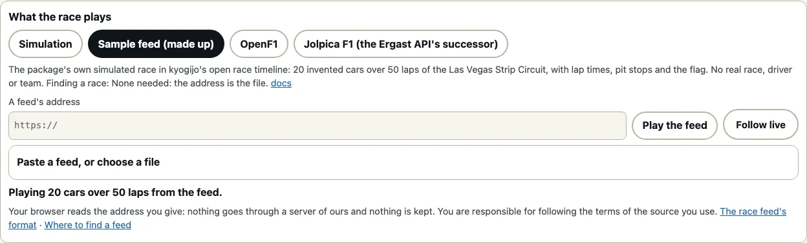

# レースフィードの形式

日本語 · [English](race-feed.md)

[サーキット](./circuits.ja.md)のレースは、[シミュレーション](./circuits.ja.md#レース)の代わりにフィードから再生することもできます。再生できるフィードは、**kyogijoのオープンなレースタイムライン**（どんなフィードでもファイルでもプログラムでも書き出せる、小さなJSON形式）か、アダプターで読み込む、OpenF1形式のAPIの周回データです。フィードは利用者のものです。利用者が入力したアドレス（または貼り付けたテキストや選んだファイル）は、利用者自身のブラウザが直接読み込みます。kyogijoのサーバーは経由せず（サーバーはありません）、ページの外には何も保存しません。名前、略号、チーム、タイムは、そのフィードからそのページの中だけに表示します。使うフィードの提供元が定める利用条件を守る責任は、利用者にあります。既知の提供元とその利用条件は[フィードの探し方](./where-to-find-a-feed.ja.md)にまとめています。

```ts
import { raceAt, raceFromFeed } from "@johnmorrisdotca/kyogijo-stadiums/circuits";

const race = raceFromFeed({
  kind: "kyogijo-race",
  version: 1,
  circuit: "las-vegas",
  laps: 2,
  cars: [{ id: "a", code: "AAA", name: "Made-up A", team: "Made-up Team", colour: "#3366cc" }, { id: "b", code: "BBB" }],
  crossings: [{ car: "a", lap: 1, t: 101.2 }, { car: "b", lap: 1, t: 102 }, { car: "a", lap: 2, t: 198.4 }, { car: "b", lap: 2, t: 199.9 }],
});
const end = raceAt(race, race.duration);
console.log(race.laps, end.standings.map((s) => s.car.driver.code).join(" "), end.standings[1].gap!.toFixed(1));
// 2 AAA BBB 1.5
```

## オープンなレースタイムライン

| フィールド | 内容 |
| --- | --- |
| `kind`、`version` | `"kyogijo-race"` と `1`。それ以外は理由を文で示して読み込みません。 |
| `circuit` | フィードに含まれている場合は、サーキットのキー（`las-vegas`）。ページは表示中のサーキットにフィードを描きます。 |
| `laps` | フィードに含まれている場合は、レースの周回数。なければ、最も多く周回したマシンの周回数。 |
| `title` | レースの出所を示す1行。 |
| `cars` | 各マシン：フィードの他の部分で使う `id`（文字列か数値）と、あれば `code`（タイミングボードに出す3文字）、`name`、`team`、`colour`（`#rrggbb`）、グリッド順位 `grid`。最大40台。 |
| `crossings` | 各マシンが各周を終えた時刻：`{ car, lap, t }`。`t` はスタート（シグナルが消えた瞬間）からの秒数。1周目はスタート後に初めてタイミングラインを通過した時です。少なくとも1つ必要です。 |
| `pits` | マシンがピットレーンに入った時刻とコースに戻った時刻：`{ car, in, out, stop? }`。`stop` は停止していた時間。 |
| `out` | マシンがリタイアした時刻：`{ car, t }`。 |
| `positions` | マシンの位置。フィード自身の座標系（単位も向きも任意）で：`{ car, t, x, y }`。 |
| `live` | レースが続いている間は `true`。最後に見た周回が最後とは限らず、ページは読み込み直せます。 |

**厳密に読み込みます。** `readRaceFeed` はこの形式でないもの（オブジェクトでない、`kind` や `version` が違う、マシンがない、同じidのマシンが2台ある、マシンが40台を超える、一覧が20万行を超える、周回が1つもない）を理由を示す文とともに拒否し、表にないフィールドはすべて捨て、フィードにないマシンの行は読み飛ばし、フィードの文字列は文字列のまま扱います。名前がページの中でマークアップとして働くことはありません。

**フィードが示す時刻の間は、マシンはそのコースの速度で走ります。** フィードが示すのは各マシンがラインを通過した時刻で、その間にどこにいたかではありません。`raceFromFeed` は各マシンを、サーキットの線が許す速度（[`paceProfile`](./circuits.ja.md#レース)）で各通過時刻に合うように引き伸ばして周回させるので、実際のマシンと同じくコーナーでは遅く、直線では速く走ります。ピットストップでは、`in` から `out` までの間にピットレーンを通ります。ライブのフィードが途切れたときに走行中のマシンは、最後の周のペースで周回を続けます。**位置のサンプルはサーキット自身の線の上に置きます。** フィードの位置はフィード自身の座標系で、図の座標系とは違うので、各サンプルはその数値ではなく、周回のどこまで進んだか（あるマシンがタイミングラインから1周する間に描いた道筋に沿った割合）で配置します。そのため点はコースから外れません。

`raceToFeed(race)` は任意のレースをこの形式で書き出します。デモの**サンプルフィード**は、このパッケージ自身のシミュレーションレースをこの形式で書き出したもので、デモのサイトの `examples/races/las-vegas-sample.json` にあります（`node scripts/make-sample-race.mjs` で作り、ファイルがスクリプトの出力と一致することをテストで確かめています）。候補の一覧では「サンプルフィード（架空）」として最初に表示します。

## OpenF1形式のデータ

`openF1Feed({ laps, pit?, drivers?, location? })` は、OpenF1形式のAPIの応答をフィードに変換します。各周は `date_start` に `lap_duration` を足した時刻に終わったものとし（所要時間がない場合は次の周の開始時刻）、スタートは1周目の開始時刻のうち最も早いもの、ピットストップはその行の `date` からピットレーンの所要時間までとし、ドライバーの `name_acronym`、`last_name`、`team_name`、`team_colour` でマシンに名前を付けます。必要なのは周回データだけで、それ以外がなければカーナンバーでレースを再生します。`feedFromText` と `loadRaceFeed` は、周回データをその形（`driver_number` と `lap_number`）で見分けます。

## アドレスから、貼り付けて、ファイルから

```ts no-run
import { loadRaceFeed, mountCircuitRace, raceFromFeed } from "@johnmorrisdotca/kyogijo-stadiums/circuits";

const feed = await loadRaceFeed("https://example.org/a-race.json");
const race = mountCircuitRace(document.querySelector("#race")!, { circuit: "las-vegas", language: "ja" }, { race: raceFromFeed(feed, "las-vegas") });
race.play();
```

`loadRaceFeed(address)` は、httpかhttpsのアドレスを利用者のブラウザで読み込みます。Cookieもリファラーも送りません。OpenF1形式の周回データのアドレス（`…/laps?session_key=…`）の場合は、同じ提供元に同じセッションのピットストップとドライバーも問い合わせ、得られなければそれなしで再生します。失敗したときは、何が起きたかをメッセージで説明する `RaceFeedError` を投げます。アドレスでない、**ほかのサイトのページからの読み込みを許可していない提供元**（CORS）である（回避するには、応答を貼り付けるか、保存してファイルを選びます）、拒否された（401か403）、リクエストが多すぎる（429）、その他のステータス、30 MBを超える、JSONでない、フィードでない、のいずれかです。`feedFromText(text)` は、貼り付けたテキストやファイルの内容をどちらの形式でも読み込みます。提供元のCORSを回避するための中継やプロキシを、kyogijoが動かすことはありません。必要な場合は、自分で用意してください。

## 続いているレースを追う

```ts no-run
import { followRaceFeed, mountCircuitRace, raceFromFeed } from "@johnmorrisdotca/kyogijo-stadiums/circuits";

let view: ReturnType<typeof mountCircuitRace> | undefined;
const follow = followRaceFeed("https://example.org/live-race.json", (feed) => {
  const race = raceFromFeed(feed, "las-vegas");
  if (view === undefined) view = mountCircuitRace(document.querySelector("#race")!, { circuit: "las-vegas", language: "ja" }, { race });
  else view.replace(race);
});
```

`followRaceFeed(address, onFeed)` は、ページが表示されている間だけ、15秒ごと（`every`、10秒より短くはしません）にアドレスを読み込み直します。ページが隠れている間は何も問い合わせず、再び表示されるとすぐに読み込みます。フィードが `live` でなくなったとき、提供元に拒否されたとき（403）、混み合っていると言われたとき（429）には、自動で止まります。`stop` を呼んでも止まります。それ以外の失敗のあとは、待ち時間を毎回2倍にします（最大2分）。`view.replace(race)` は、時計の位置を保ったまま、同じ表示で新しいレースを再生します。OpenF1形式の周回データには `live` の印がないので、それを追うページが、ライブであることを自分で指定します。

## デモでは



サーキットのページで「レース」をオンにすると、レースが再生するものを選べます。シミュレーション、「サンプルフィード（架空）」、または[フィードの探し方](./where-to-find-a-feed.ja.md)の候補です。候補を選ぶとアドレス欄に入り、その横に提供内容、レースのIDの見つけ方、ドキュメントと利用条件を表示します。「フィードを再生」でアドレスを読み込み、「ライブで追う」でレースが続く間は読み込み直し、「フィードを貼り付けるか、ファイルを選ぶ」で、ブラウザから読み込めない提供元のテキストやファイルを読み込みます。アドレスはページ自身のアドレス（`feed=`）に残し、貼り付けたテキストはどこにも保存しません。

## テスト

フィードのテストはすべて、テストのために作った架空のスタブで動きます。架空のマシンと時刻、存在しないホスト（`*.example.test`）のアドレスを使い、ネットワークの代わりにスタブが応答します。単体テストでもブラウザのテストでも、実際のリクエストは一切しません。
