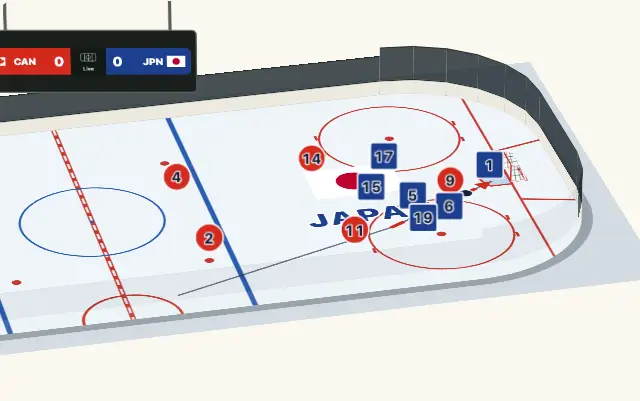

# リプレイ

日本語 · [English](replay.md)

リプレイは、トラッキングデータ（選手、ボールやパック、審判が刻々とどこにいたか）を競技面の上で再生します。パス、シュート、ゴールは起きた時点で描かれます。日本語のこのページでは、プレーを追うカメラについて説明します。タイムラインの形式、関数、ページでの再生、3D表示などの説明は[英語のページ](replay.md)にあります。

## プレーを追うカメラ

リプレイは、プレーを追うカメラで見ることができます。プレーがリンクの片側に集まるとカメラはそこに寄り、選手が再び散らばると引いて広く映します。パックを追い続けることもできます。読者が選ぶまでは使われません。リプレイの操作バーには、そのためのボタンが2つあります。**プレー**と**パック**（ボールを使う競技では**ボール**）です。どちらも押すたびにオンとオフが切り替わり、一度にオンにできるのは1つだけです。オンになっているボタンをもう一度押すと、カメラは止まります。設定の `follow`（`"action"`、`"puck"`、`"off"`）で最初の状態を決められます。コントローラーの `setFollow(mode)` で切り替えると、リスナーに理由 `follow` で知らせます。要素では `<kyogijo-field follow="action">` と書きます。デモは、再生するどの試合でも、この選択をアドレスに残します（`follow=action`、`follow=puck`）。

| モード | カメラが映すもの |
| --- | --- |
| `action` | パックまたはボールと、それにいちばん近い5人の選手です。周りに余白（競技面の長さの6パーセントずつ）をとり、プレーが読み取れるよう、競技面全体の2.5倍より大きくは寄りません。選手が片側に固まるとそこに寄り、散らばるにつれて引いて、最大で競技面全体まで映します。 |
| `puck` | パックまたはボールを中央に置き、競技面全体の2倍で映します。 |
| プレーが止まっているとき | 笛またはゴールから、位置（`x`、`y`）をもつ次の `faceoff` イベントまでは、そのフェイスオフスポットを、限度いっぱいまで寄って映します。`faceoff` イベントのないタイムラインでは、プレーが止まっている間もほかのときと同じように追います。 |

カメラの動き方は次のとおりです。

- **なめらかに動きます。** 画面の中心とズームは、臨界減衰のばねで目標に近づきます。行き過ぎることはなく、約1.5秒で落ち着きます。ズームは対数で動かすので、寄るときと引くときの時間は同じです。
- **小さな動きでは動きません。** 目標の移動が画面の8パーセント未満のとき、またはズームの変化が8パーセント未満のときは、新しい目標としません。選手の一歩ごとに画面が揺れることはありません。
- **競技面の外は映しません。** 画面はいつも競技面の上にあり（ボードの外は映りません）、限度より寄ることはなく、いつもパックを含みます。カメラの動きより先にパックが走っても、画面がパックといっしょに動くので、飛ぶことはありません。
- **プレーが止まれば、カメラも止まります。** 落ち着いたカメラは目標の位置にぴったり止まり、それ以上は何も書き換えません。

平面のリプレイでは、図の `viewBox`（属性1つ）を書き換えて図の一部を映し、全体から寄って、また全体に戻ります。3D表示では、床の上の注目する点と、ビュー自身のズームに重ねるズームとして働きます。カメラがプレーを追う間も、自動回転はプレーの周りを回り続け、どの視点（真上、中継カメラ、エンド側から、低い角度から）でも角度はそのままです。ドラッグ、ピンチ、ホイール、矢印キー、ビューの回転とズームのボタンを使うと、カメラは読者が動かしたところで止まり、リプレイの操作バーに**追う**ボタンが出ます。このボタンを押すまで、カメラは止まったままです。視点のボタン、リセット、ダブルクリックでもカメラは止まり、ビューは競技面全体が入った状態でその視点へなめらかに移ります。動きを減らす設定の読者には、コマ送りで表示します。リプレイを1コマ進めるたびに、カメラはすぐにあるべき位置へ移ります。

目標の計算は副作用のない純粋な計算なので、独自にリプレイを描くページやサーバーでも使えます。関数は `followShot`（プレーが求める画面）、`followCamera`（そこへなめらかに近づくカメラ）、`followStop`（プレーが止まっている間のフェイスオフスポット）、`followWindow`（平面の図で映す範囲）で、例と一覧は[英語のページ](replay.md#following-the-play)にあります。

負荷について：カメラは独自の処理を持ちません。リプレイ自身のアニメーションフレームの中で（3D表示では、ビューとリプレイが共有する1つのフレームの中で）、その時刻のリプレイのフレームから動きます。リプレイが一時停止している間、ページが隠れている間、ビューが画面の外にある間は何も動かず、カメラがオフ、またはオンでも落ち着いていれば何もしません。ブラウザーのテストで、次のことを確かめています。なめらかに動くこと（フレームの間で飛ばないこと）、読者のドラッグで止まり、**追う**ボタンで戻ること、一時停止中、ページが隠れている間、画面の外にある間はフレームを求めず、自動回転と同時でも1フレームに1回しか求めないこと、カメラをオンにして繰り返し再生を10周しても要素とリスナーの数が変わらないこと、`destroy` でビューが元に戻ること。
