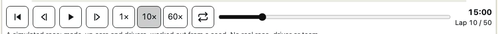
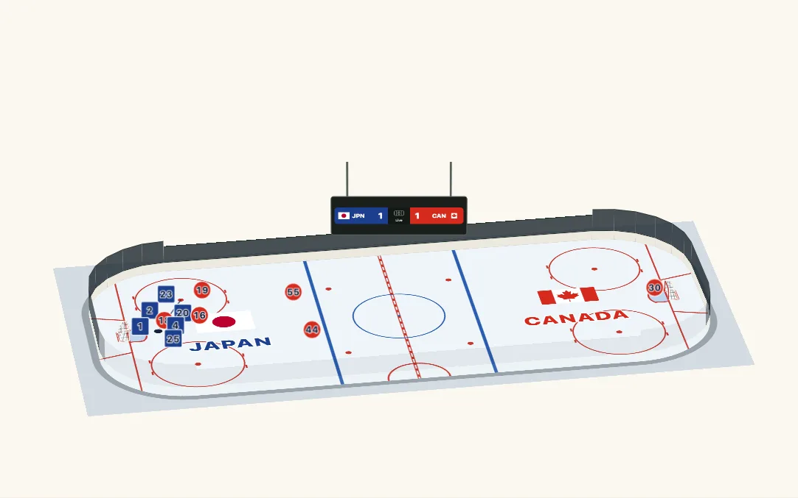
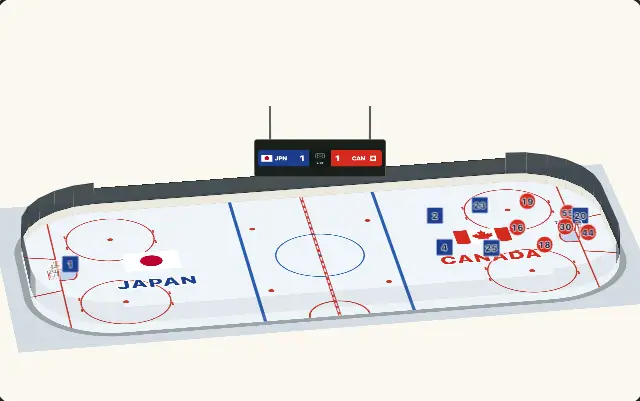
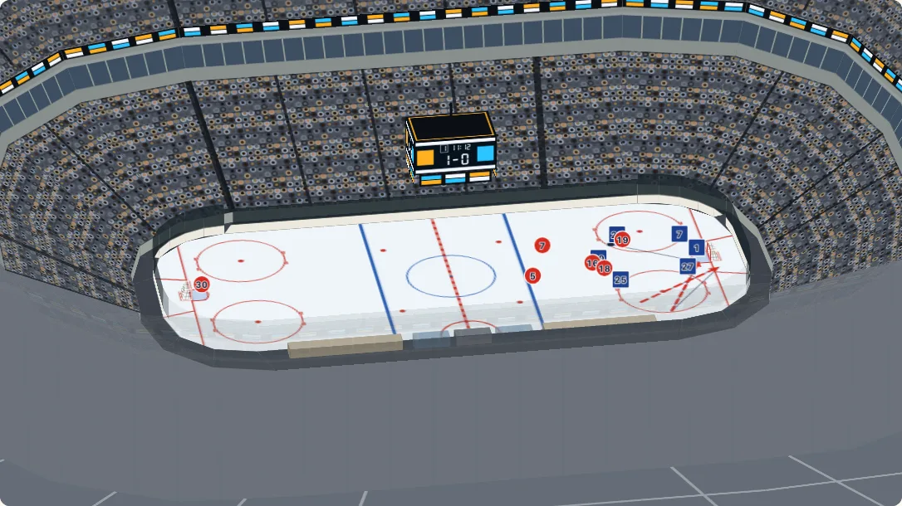
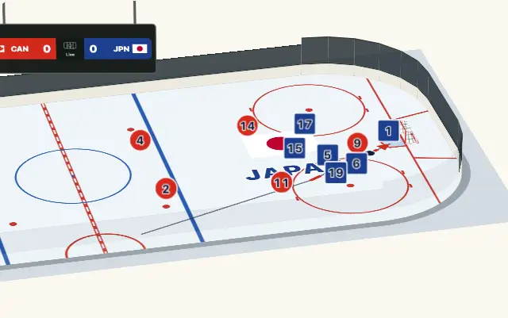
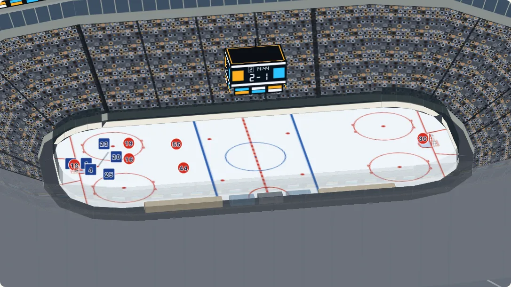
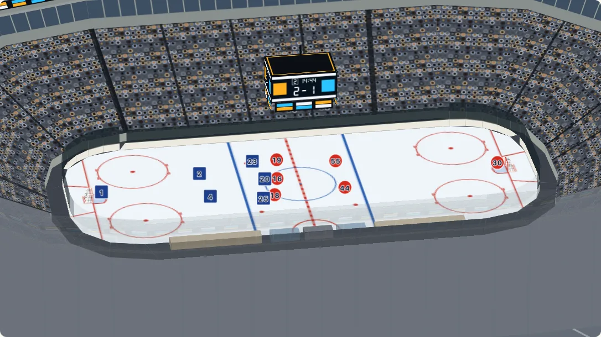
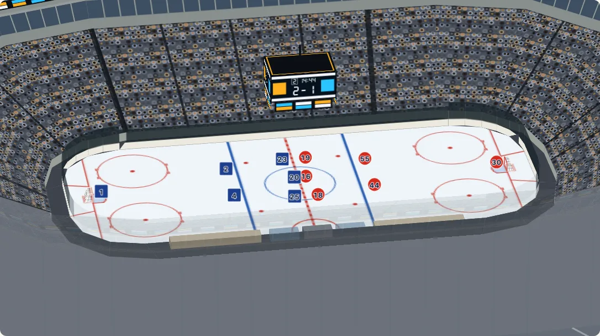

# Replay

[日本語](replay.ja.md) · English

A replay plays tracking data on a surface: where each player, the ball and the officials were, second by second, with the passes, the shots and the goals marked as they happen. The data is yours and nothing is fetched. `@johnmorrisdotca/kyogijo-stadiums/replay` has the frame as a string (`drawFrame`) and the pure functions behind it; `mountKyogijo(...).replay(...)` and `<kyogijo-field>` play it in a page.

It is built on the [data layers](./layers.md) and the [coordinate frames](./frames.md): the positions are in a provider's frame (`from: "nhl-api"`, `from: "opta"`) or the surface's own feet, and every mark is an element of the drawing in the surface's own frame, cut to nothing and turned back upright when the surface lies tall.

## One frame

```ts
import { drawFrame } from "@johnmorrisdotca/kyogijo-stadiums/replay";

const frames = [0, 1, 2].map((t) => ({
  t,
  objects: [
    { id: "h9", team: "home" as const, number: 9, x: 10 + t * 12, y: 5 },
    { id: "a4", team: "away" as const, number: 4, x: 40 - t * 5, y: -8 },
    { id: "puck", team: "puck" as const, x: 10 + t * 12, y: 5 },
  ],
}));
const timeline = { from: "nhl-api", frames, events: [{ t: 2, kind: "goal", team: "home" as const }] };
const svg = drawFrame({ sport: "nhl" }, timeline, 1.5);
console.log(svg === drawFrame({ sport: "nhl" }, timeline, 1.5), svg.includes("Shirt numbers"));
console.log(svg.includes("Replay, 0:02. 3 tracked objects. By team: home 1, away 1, puck 1. 1 event."));
// true true
// true
```

`drawFrame(options, timeline, t, look?)` is `drawKyogijo` with the replay's layers added to the ones in `options`. The same options, timeline and time always give the same string; the ids inside the drawing come from the options and the timeline, not from the time, so every frame of a replay has the same ids (give an `id` of your own when two replays share a page). The drawing's description says what the replay is (its length, what it tracks, how many events) and does not change with the time. [The gallery](https://johnmorrisdotca.github.io/kyogijo-stadiums/docs/gallery-data.html#replay) draws a frame on the rink and on the pitch from the code beside it.

## The timeline

```ts no-run
const timeline = {
  from: "nhl-api",                 // the frame the positions are in (a name in FRAMES, or a Frame); without it, the surface's own feet
  frames: [
    { t: 0, possession: "h9", objects: [{ id: "h9", team: "home", number: 9, label: "Rivera", x: 12, y: 4 }, { id: "puck", team: "puck", x: 12, y: 4 }] },
    { t: 0.04, objects: [/* ... */] },
  ],
  events: [{ t: 5.2, kind: "pass", team: "home", by: "h9", to: "h17", until: 5.8 }],
};
```

| Field | What it is |
| --- | --- |
| `frames[].t` | Seconds. The frames run forward in time (they are sorted when they do not). A gap of 0.04 s is 25 frames a second; the gaps need not be equal. |
| `frames[].objects[]` | `id` (the same in every frame the object is in), `team` (`home`, `away`, `ball`, `puck` or `official`), `x` and `y` in the timeline's frame, and optionally `label` (the tooltip) and `number` (written on a player). |
| `frames[].possession` | Who has the ball or puck, when the data says: an object's `id`, or `home` or `away`; `null` for nobody. It holds until a later frame says otherwise. |
| `events[]` | `t`, `kind` (`pass`, `shot`, `goal`, `whistle`, `faceoff`, or a word of your own), `team`, where it was (`x`, `y`, or the object `by`, else the ball's place), where it ended (`x2`, `y2`, or the object `to` at `until`), `until` and `label`. |
| `from`, `units`, `attacking`, `surfaceSize`, `anchors` | As for a [layer](./layers.md#what-a-layer-takes): the frame, the unit and the rest that put the numbers on the surface. |
| `periods`, `clock` | The periods of the game and which way its clock counts: what the [scoreboard over the arena](#the-scoreboard-over-the-arena-follows-the-game) shows. |
| `penalties` | Who sat in the box and for how long: each one's `team`, `by` (the player), `start` (the call) and `end` (when he left), `minutes` on the game clock, `kind`, `short: false` for one that does not make his side play short, and `endedBy: "goal"` for a minor a power-play goal ended. [Penalties](#penalties-and-the-power-play). |
| `stoppages` | When play was dead: the game clock stands still from each one's `start` to its `end` (the drop of the puck) while the replay plays on through it. [Stoppages](#stoppages-the-clock-stops-the-players-line-up). |

An object in two neighbouring frames moves between them; one only in the earlier frame stays where it was until the next; one only in the later frame appears when its frame comes. Objects without a place are left out. A timeline is read once and kept: make a new one rather than changing one that has been used.

What is drawn: the home team as circles and the away team as squares (so that the teams are never told by colour alone), with their numbers; the ball or the puck, smaller and on top, with a trail of the last two seconds; officials as triangles; a pass or a shot as an arrow from where it began to where it ended, dashed for a shot; a goal as a star; a whistle as a cross; a face-off has no mark of its own (the puck on the dot is the mark), and is said. An event stays on the surface for three seconds after it. `look` (the fourth argument, and in the settings below) changes `trail` (seconds, 0 for none), `trailOf` (whose trail), `hold` (seconds an event stays), `numbers`, `scale` and `smooth`.

## The functions

Each is pure and takes the timeline and a time in seconds.

```ts
import { activeEvents, interpolate, possession, trails } from "@johnmorrisdotca/kyogijo-stadiums/replay";

const frames = [0, 1, 2, 3].map((t) => ({
  t,
  possession: t < 2 ? "h7" : null,
  objects: [
    { id: "h7", team: "home" as const, x: t * 4, y: 0 },
    { id: "ball", team: "ball" as const, x: t * 4 + 1, y: 0 },
  ],
}));
const timeline = { frames, events: [{ t: 2, kind: "shot", team: "home" as const, by: "h7" }] };
console.log(interpolate(timeline, 1.5).map((o) => `${o.id} ${o.x}`).join());
console.log(trails(timeline, 3, 2, { teams: ["ball"] })[0].points.map((p) => p[0]).join());
console.log(possession(timeline, 1), possession(timeline, 2.5));
console.log(activeEvents(timeline, 2.5).map((a) => `${a.event.kind} at ${a.x}`).join());
// h7 6,ball 7
// 5,9,13
// { holder: 'h7', team: 'home' } undefined
// shot at 8
```

| Function | What it gives |
| --- | --- |
| `interpolate(timeline, t, { smooth? })` | The objects at `t`, in a straight line between frames, or along a Catmull-Rom curve through them (`smooth: true`, or a share from 0 to 1). `t` is held to the first and last moments. |
| `trails(timeline, t, seconds, { teams?, ids?, smooth? })` | The path of each object over the last `seconds`, oldest place first. |
| `possession(timeline, t)` | `{ holder?, team? }` from the latest frame that says, or `undefined` when none does or the latest says nobody. |
| `activeEvents(timeline, t, hold?)` | The events on the surface at `t`, with their places worked out. |
| `eventsBetween(timeline, from, to)` | The events with a time in `(from, to]`: what went by while the clock moved. |
| `describeEvent(event, language?)` | What is said of an event: its `label`, else its kind and team, then the time: "Goal, home, 1:12". |
| `drawFrame`, `replayLayers`, `replaySnapshot` | The frame as a string; its data layers, to put in the `layers` of a drawing of your own; what is on the surface at a time. |
| `replaySummary`, `replayTable` | The sentence a replay adds to the description, and an HTML table of its events for a reader who cannot see the drawing. |
| `replayInfo`, `replayTimes`, `replayEvents`, `replayClock` | The length, the frame times, the events and `0:12` for 12 seconds. |
| `replayBoard(timeline, t)` | The scoreboard at `t`: the score, the period and the game clock, from the goals and the periods. |
| `replayGameClock(timeline, t)` | The game clock at `t`: the period, the seconds of it played and left, and whether it is running (not in a stoppage). |
| `replayStoppages`, `stoppageAt`, `restartsBetween` | The [stoppages](#stoppages-the-clock-stops-the-players-line-up), the one a time is in, and the restarts (the drops of the puck) a move of the clock went by. |
| `addDeadTime(timeline, stops, rules)` | A timeline with each stoppage opened into its dead time, by a sport's rules (`HOCKEY_RULES`). |
| `hockeyFaceoffDot`, `hockeyFormation`, `hockeyStopOf` | Hockey's rules: the face-off spot after a stoppage, the line-up at a spot, and the NHL's words for a stoppage as the rules'. |
| `penaltiesAt(timeline, t)`, `replayGameTime` | The [penalties](#penalties-and-the-power-play) being served at `t` with their game seconds left, and each side's skaters; the game seconds played since the start. |
| `hockeyPenaltyEnds`, `hockeyPenaltyKind`, `hockeyPenaltyBox` | Hockey's penalties: when each is served on the game clock (power-play goals, coincidental penalties, never fewer than three skaters), the NHL's kinds, and where each side's box is. |

## Playing it in a page

```ts no-run
import { mountKyogijo } from "@johnmorrisdotca/kyogijo-stadiums/mount";
import type { ReplayTimeline } from "@johnmorrisdotca/kyogijo-stadiums/replay";

declare const timeline: ReplayTimeline;
const mount = mountKyogijo(document.querySelector("#rink")!, { sport: "nhl", language: "en" });
const replay = mount.replay(timeline, { speed: 1, loop: false });
replay.play();
replay.seek(12.4);
replay.step(1);      // the next frame
replay.destroy();    // takes the replay and its controls away; the surface stays
```

`mount.replay(timeline, settings?)` puts the stage and the controls in the container and returns the controller. The controls are [the replay bar](#the-replay-bar): back to the start, one frame back and on, play and pause, the speed as buttons (0.25, 0.5, 1, 2, 4), a loop switch, a position slider and the clock. `update()` keeps the replay, so a theme or a score can change under it. In React, call `mount.replay` from an effect on the container: the component of `/react` draws a still.

```html
<kyogijo-field id="rink" sport="nhl" loop speed="2"></kyogijo-field>
<script type="module">
  import "@johnmorrisdotca/kyogijo-stadiums/element/define";
  document.getElementById("rink").timeline = timeline;   // a timeline is too large for an attribute
</script>
```

The element takes the data as the property `timeline` (and `replaySettings` for the rest), the switches as attributes (`loop`, `autoplay`, `controls="false"`) and the numbers `speed` and `trail`; `element.replay` is the controller.

| Setting | What it does |
| --- | --- |
| `speed`, `loop` | 0.25 to 4, and start again at the end. |
| `autoplay` | Play when attached. Ignored for a reader who prefers reduced motion, and while the page is hidden. Nothing plays by itself otherwise. |
| `controls` | `false` leaves out the bar; the keyboard and the live region stay. |
| `announce` | `false` stops the live region. |
| `motion` | `auto` (the default) follows `prefers-reduced-motion`; `smooth` and `step` force one. |
| `stepSeconds`, `start` | The seconds a step moves in step mode (1), and the time to begin at. |
| `trail`, `trailOf`, `hold`, `numbers`, `scale`, `smooth` | How a frame is drawn, as above. |

How it moves: the drawing is written once. Each animation frame moves only the marks that move (a `transform` on each player, the number and the ball, and the `d` of each trail); a mark that comes or goes (an event that begins, a trail that starts) redraws the replay's own layer and nothing else, and the surface is never redrawn. Nothing runs while the replay is paused or the page is hidden, and nothing is a timer: the clock is `requestAnimationFrame`. A test moves a replay for a while and holds the surface's elements to be the same ones at the end.

| Key | What it does |
| --- | --- |
| Space | Play or pause (in step mode, one step on). |
| Left and right arrow | The previous or the next frame (in step mode, a step). |
| Shift with an arrow | Five seconds back or on. |
| Home and End | The first and the last moment. |

The keys work with the focus on the drawing or on a button; the slider keeps its own.

## The replay bar

Every replay, a game's flat or on [the 3D view](./turn.md) and [a race on a circuit](./circuits.md#a-race), has the same bar, made once (`src/replay.bar.ts`): **back to the start**, **one step back**, **play or pause**, **one step on** (a frame, or a lap for a race), the **speeds as buttons** (each replay gives its own set: 0.25, 0.5, 1, 2 and 4 for a game, 1×, 10× and 60× for a race; the one in use is pressed in), **loop**, the **position slider** and the **clock line**: a game's time and length, a race's time since the start with the lap and the flag under it. It looks the same in light and dark and at phone width (the buttons wrap onto a second row), and the keys are the same everywhere: Space, the arrows (comma and full stop over a 3D view), Shift for a bigger step (5 seconds for a game, a minute for a race), Home and End.



The bar has three places for the buttons other features add, so that nothing needs a bar of its own. Each is an empty element that shows only while it holds something, and what is in it stays when the words change:

| Slot | For | Found as |
| --- | --- | --- |
| follow | the follow camera: Auto-follow, Action, Puck, Resume | `.ky-slot[data-slot="follow"]`; `race.slots.follow` for a race |
| sound | the sound toggle, its volume and the crowd levels | `.ky-slot[data-slot="sound"]`; `race.slots.sound` |
| extra | anything else | `.ky-slot[data-slot="extra"]`; `race.slots.extra` |


## In 3D

The same replay plays on [the 3D view](./turn.md): the rink can be tipped and turned by the mouse, a finger, the wheel or the keys while the game goes on. `view.replay(timeline, settings?)` on the handle `mountKyogijoTurn` gives back is the whole of it, and gives the same controller as `mount.replay`.



```ts no-run
import { mountKyogijoTurn } from "@johnmorrisdotca/kyogijo-stadiums/turn";
import type { ReplayTimeline } from "@johnmorrisdotca/kyogijo-stadiums/replay";

declare const timeline: ReplayTimeline;
const view = mountKyogijoTurn(document.querySelector("#rink")!, { sport: "nhl" }, { preset: "broadcast" });
const replay = view.replay(timeline, { speed: 2, loop: true });
replay.play();
view.preset("corner"); // the view still turns while the game plays
replay.destroy();      // takes the replay away; the view stays
```

How it is drawn, and why:

- **The players stand up.** Each player and official is a disc that stands on the floor and faces the eye, as a scoreboard does: the flat replay's own marks (a circle for the home side, a square for the away side, a triangle for an official, the number over it, in the same colours, light and dark), turned up. On a flat floor seen from low down a circle is a sliver; standing up, a mark reads from any angle, and its number is always the right way round. A disc is about 6.5 feet across on a rink and 12 on a pitch (3 per cent of the playing surface's diagonal, times `scale`): a mark, not a person. `stand: false` keeps them flat on the floor, as the flat replay draws them.
- **The puck stays on the ice.** The ball or the puck, its trail, the passes, the shots and the goals are the floor's own replay layer, drawn and moved as the flat replay moves them: they are where they happened, on the surface.
- **Only what moves is touched.** Each frame moves the marks on the floor that moved (a `transform` or a `d`) and writes the `matrix3d` of the discs that moved; a disc goes up and down the stack of the view's parts when a player passes in front of a goal or behind one. The rest of the view (the boards, the glass, the goals, the stands, the floor's drawing) is not written while the camera is still. A disc that is not on the ice at the time (a line on the bench) is hidden, not taken away, so that the elements stay the same for the whole game.



The controls are the flat replay's [bar](#the-replay-bar), under the view's. The keys do not fight the view's:

| Where the focus is | Space | Comma and full stop | The arrow keys | Home and End |
| --- | --- | --- | --- | --- |
| On the view | Play or pause the replay | A frame back or on (with Shift, 5 seconds) | Turn and tip the view, as always | Home puts the view back; End goes to the end |
| On the replay's controls | Play or pause | | A frame back or on (with Shift, 5 seconds) | The first and the last moment |

The view's Auto-turn button still turns it, and the auto-turn and the replay share one animation frame. A reader who prefers reduced motion gets steps, as on the flat replay. The element does it too: `<kyogijo-field turn>` with a `timeline` plays the replay on its 3D view.

What it costs: nothing runs while the replay is paused, while the page is hidden or while the view is out of sight (no animation frame is asked for), one frame is asked for at a time while it plays, with the auto-turn on or off, and the elements of the view are the same ones after ten times round a looping game: a browser test holds each of these. `destroy` on the replay (or on the view) takes its controls, its listeners and its frame away. Where the browser cannot draw the 3D view, `view.replay` plays the flat replay instead.

### The scoreboard over the arena follows the game



A venue with its LED boards on (`crowd: { boards: true }`, or the demo's Boards button) has a scoreboard hung over the middle of the ice. While a replay plays on that view, the board shows the replay's own score, period and game clock, taken from the same timeline and the same clock as the controls: the **score** is the goals (`events` of kind `goal`, by `team`) at or before the time, the **period** is the one the clock is in (`timeline.periods`), and the **game clock** counts the period's time down (or up, with `clock: "up"`). With no replay, or when the replay ends (`destroy`), the board is what the options made it, as before.

```ts
import { replayBoard } from "@johnmorrisdotca/kyogijo-stadiums/replay";

const frames = [0, 60, 120].map((t) => ({ t, objects: [{ id: "puck", team: "puck" as const, x: 0, y: 0 }] }));
const timeline = {
  frames,
  events: [{ t: 30, kind: "goal", team: "home" as const }],
  periods: [{ start: 0, end: 60, length: 1200 }, { start: 60, end: 120, length: 1200 }],
};
const at = (t: number) => JSON.stringify(replayBoard(timeline, t));
console.log(at(0));
console.log(at(30));
console.log(at(90));
// {"score":[0,0],"period":1,"clock":"20:00"}
// {"score":[1,0],"period":1,"clock":"10:00"}
// {"score":[1,0],"period":2,"clock":"10:00"}
```

| Field of the timeline | What it does |
| --- | --- |
| `periods[]` | `start` and `end` (seconds on the timeline's clock), `number` (its place in the list when missing) and `length`. With no periods the whole replay is one period with no number on the board. |
| `periods[].length` | How long the period is on the game clock, in seconds. A replay re-timed to minutes (the example game plays a period in about four) gives `1200` for a hockey period, and the board counts twenty minutes through it. Without it the clock runs in the timeline's own seconds. |
| `clock` | `"down"` (the default: the time left, as hockey, basketball and football count) or `"up"` (the time gone, as soccer does). |

What it costs: the board is written only when what it shows changes. A goal, a new period, a seek, a step, the period buttons and a pause set it at once; while the replay plays, the clock is written at most once a second (a period's clock may change more often than that at 4 times speed, and a write is skipped until a second has passed). Only the SVG of the board's four faces is written, never the view; nothing runs while the replay is paused, hidden or out of sight, and the elements stay the same ones. `view.replay(timeline, { board: false })` leaves the board as the options made it. A page that draws a board of its own reads `replayBoard(timeline, t)`, which is pure: a seek back finds the score as it was.

The model of a frame is pure, as `drawFrame` is: `replayTurnModel(model, timeline, t, look)` lays the replay on a 3D view's model at a time (its floor, and a disc for every one tracked), so the same options and time give the same picture.

```ts
import { buildTurn, replayTurnModel } from "@johnmorrisdotca/kyogijo-stadiums/turn";

const frames = [0, 1, 2].map((t) => ({
  t,
  objects: [
    { id: "h9", team: "home" as const, number: 9, x: 10 + t * 12, y: 5 },
    { id: "a4", team: "away" as const, number: 4, x: 40 - t * 5, y: -8 },
    { id: "puck", team: "puck" as const, x: 10 + t * 12, y: 5 },
  ],
}));
const timeline = { from: "nhl-api", frames };
const model = buildTurn({ sport: "nhl" });
const laid = replayTurnModel(model, timeline, 1.5);
console.log(laid.discs.size, laid.model.planes.length - model.planes.length, Math.round(laid.size * 10) / 10);
console.log(JSON.stringify(laid.model) === JSON.stringify(replayTurnModel(model, timeline, 1.5).model));
// 2 2 6.5
// true
```

The demo plays [a whole made-up game](./example-games.md) this way, and **Play a game** plays it wherever the rink is shown: the arena at the top of the page in front of its crowd, the Try it surface, flat or in 3D, and the real arenas in 3D.

## Following the play



A replay can be watched with a camera that follows the play: when all the action is at one end of the ice it closes in on it, and when the players spread out again it pulls back, or it moves with the puck. It is off until the reader asks for it. The replay's bar has two buttons for it, **Action** and **Puck** (**Ball** for a game played with a ball): each presses in and out, one at a time, and pressing the one that is in turns the camera off. The setting `follow` (`"action"`, `"puck"` or `"off"`) starts with one, the controller's `setFollow(mode)` changes it and says so to its listeners (the reason is `follow`), and `<kyogijo-field follow="action">` does it on the element. The demo keeps the choice in its address (`follow=action`, `follow=puck`) for every game it plays.

| Mode | What the camera frames |
| --- | --- |
| `action` | The puck or the ball and the five players nearest it, with room round them (6 per cent of the surface's length on each side), never closer than two and a half times the whole surface, so that the play still reads. When they bunch at one end it closes in there; as they spread it zooms out, as far as the whole surface. |
| `puck` | The puck or the ball in the middle, at twice the whole surface. |
| a stoppage | From a whistle or a goal until the next `faceoff` event that has a place (`x`, `y`), the faceoff dot, as close as the limits allow. A timeline with no `faceoff` events is followed through its stoppages as at any other time. |

How it moves:

- **It eases.** The middle of the frame and its zoom follow the shot with a critically damped spring, which never overshoots and settles in about a second and a half; the zoom eases as its logarithm, so that closing in and pulling back take the same time.
- **Small moves do not move it.** A shot that moved less than 8 per cent of the frame, or a zoom that changed by less than 8 per cent, is not a new goal: the frame does not swim with every stride.
- **It never leaves the surface.** The frame is always on the playing surface (it cannot look past the boards), never closer than the limit, and always holds the puck: a puck that runs ahead of the easing carries the frame with it, without a jump.
- **When the play is still, it is still.** At rest the camera is exactly at its shot, and nothing more is written.

**Auto-follow, beside Auto-turn.** On a 3D view the view's own row of buttons has an **Auto-follow** toggle right after **Auto-turn**, made like it (the same pill, pressed while it is on), so that the two read as a family and can be on together: the rink turns slowly while the camera follows the play. Pressing it takes up the mode last chosen in the bar (the action to begin with); pressed again, the camera eases back out to the whole surface. Pressing it is not a turn of the reader's, so it does not hold the camera. The demo keeps it in the address like the bar's buttons (`follow=action`, `follow=puck`). [A race on a circuit](./circuits.md#a-race) has the same toggle and a camera of its own.

Flat, the camera shows a part of the drawing by its `viewBox`, one attribute, from the whole frame to the action and back. In 3D it is a point of the floor to look at and a zoom on top of the view's own: the auto-turn goes on turning round the play while the camera follows, and every viewpoint (Overhead, Broadcast, End-on, Low corner) keeps its angle. A drag, a pinch, the wheel, the arrow keys or the view's turn and zoom buttons hold the camera where the reader left it, and a **Resume** button shows in the replay's bar until it is pressed; a viewpoint, Reset or a double click holds it too, and the view glides to that viewpoint with the whole surface in it. A reader who prefers reduced motion gets steps: each step of the replay puts the camera where it should be at once.

The shot is pure arithmetic, so a page that draws a replay of its own, or a server, can use it:

```ts
import { followCamera, followShot } from "@johnmorrisdotca/kyogijo-stadiums/replay";

const box = { x: 0, y: 0, w: 200, h: 85 };   // the surface, in the drawing's feet
// The puck in the far corner, five players round it and one back at the other end.
const objects = [
  { team: "puck" as const, x: 182, y: 20 },
  { team: "home" as const, x: 176, y: 12 },
  { team: "away" as const, x: 188, y: 26 },
  { team: "home" as const, x: 170, y: 30 },
  { team: "away" as const, x: 185, y: 8 },
  { team: "home" as const, x: 160, y: 22 },
  { team: "away" as const, x: 20, y: 42 },
];
const round = (s: { x: number; y: number; zoom: number }) => `${Math.round(s.x)} ${Math.round(s.y)} ${s.zoom.toFixed(2)}`;
console.log(round(followShot("action", { objects, box })), round(followShot("puck", { objects, box })));
// The camera starts from the whole surface and eases there over a second and a half.
const camera = followCamera();
const shots = Array.from({ length: 180 }, () => round(camera.update("action", { objects, box }, 1 / 60)));
console.log(shots[0], "|", shots[29], "|", shots[179]);
// 146 23 1.85 150 21 2.00
// 100 42 1.00 | 122 33 1.34 | 146 23 1.85
```

| Function | What it gives |
| --- | --- |
| `followShot(mode, { objects, box, stop? }, limits?)` | The shot the play asks for: `{ x, y, zoom }`, the middle of the frame in the drawing's feet and the magnification of the surface (the frame is the surface's size over `zoom`). |
| `followCamera(limits?)` | The camera that eases to it: `update(mode, input, dt)` moves it by `dt` seconds of the spring (at once without `dt`) and gives where it is. |
| `followStop(timeline, t)` | The faceoff dot while the play is stopped at `t`, or `undefined`. |
| `followWindow(shot, box, viewBox, map?)` | The part of a flat drawing to show for a shot, in its `viewBox` units. |
| `clampShot`, `frameOf`, `springStep`, `zoomFor`, `FOLLOW_LIMITS` | A shot held to the surface and the limits, the frame a shot shows, one step of the spring, the zoom of a view with room round the surface, and the limits (`maxZoom` 2.5, `puckZoom` 2, `near` 5, `pad` 0.06, `dead` 0.08, `omega` 3.2, `leash` 0.06). |

What it costs: nothing of its own. The camera moves inside the replay's own animation frame (on a 3D view, the one frame the view and the replay share), from the replay's frame at that time; nothing runs while the replay is paused, while the page is hidden or while the view is out of sight, and off and at rest it does nothing at all. A browser test holds that it eases (no jump between two frames), that the reader's drag holds it until Resume, that it asks for no frame while paused, hidden or out of sight and one a frame with the auto-turn running, that the elements and listeners are the same after ten times round a looping game with it on, and that `destroy` gives the view back as it was.

## Stoppages: the clock stops, the players line up

A replay keeps two clocks. **The replay's own clock** is the slider's: it moves on all the time the replay plays. **The game clock** is the scoreboard's: it runs only while play is on. When play stops (a goal, a save the goaltender holds, icing, offside, a penalty, any whistle, the end of a period), the game clock stands still; the puck is dead, so it stays where play stopped (in the net after a goal) and is then out of sight, as a linesman picks it up; the players glide to their places for the face-off at the spot the rules give; and the clock runs again when the puck is dropped. A timeline says when play was dead in `stoppages`, and everything that reads the clock follows them: `replayGameClock` and `replayBoard` stand still in a stoppage, the board over the arena shows the same time from the goal to the drop, and the live region says the drop (`Face-off, 6:39`).





```ts
import { HOCKEY_RULES, addDeadTime, hockeyFaceoffDot, interpolate, replayBoard, replayStoppages } from "@johnmorrisdotca/kyogijo-stadiums/replay";

// A goal at 30 s, the puck in the net; at 30.04 the centres are lined up on the spot the rules give, and play goes on to 60 s.
const at = (t: number, h: number[], a: number[], puck: number[]) => ({
  t,
  objects: [
    { id: "h9", team: "home" as const, x: h[0], y: h[1] },
    { id: "a4", team: "away" as const, x: a[0], y: a[1] },
    { id: "puck", team: "puck" as const, x: puck[0], y: puck[1] },
  ],
});
const dot = hockeyFaceoffDot({ reason: "goal", x: 89, y: 1 });
const game = {
  from: "nhl-api",
  frames: [at(0, [0, 0], [5, 0], [0, 0]), at(30, [80, 4], [75, -2], [90, 1]), at(30.04, [-2.5, 0], [2.5, 0], [...dot]), at(60, [40, 0], [45, 0], [50, 0])],
  events: [{ t: 29.6, kind: "goal", team: "home" as const }, { t: 30.04, kind: "faceoff", x: dot[0], y: dot[1] }],
  periods: [{ start: 0, end: 60, length: 1200 }],
};
const played = addDeadTime(game, [{ t: 30, reason: "goal", x: dot[0], y: dot[1] }], HOCKEY_RULES);
const stop = replayStoppages(played)[0];
const puck = (t: number) => interpolate(played, t).find((o) => o.id === "puck");
console.log(dot.join(), stop.start, stop.end, played.events?.at(-1)?.t);
console.log(replayBoard(played, 30).clock, replayBoard(played, 36).clock, replayBoard(played, stop.end).clock, replayBoard(played, stop.end + 10).clock);
console.log(puck(31)?.x, puck(36), puck(stop.end)?.x);
// 0,0 30 38.09 38.09
// 10:00 10:00 10:00 6:40
// 90 undefined 0
```

`addDeadTime(timeline, stops, rules)` takes a timeline with each stoppage as an instant (the play up to `t`, then at `until`, 0.04 seconds later by default, the players in the line-up and the puck on the dot) and opens each into the dead time of the rules: the puck stays where it stopped for a moment, then is out of sight; the players stand a moment (a goal is celebrated), then all glide to their places together, the farthest at the rules' speed and the rest slower; a player who goes off goes to his side's bench and the one who comes on comes from it; they stand in the line-up a moment, and the puck is dropped. Everything after is moved on by as much (the frames, the events, the periods and the stoppages already there), and each period keeps its length on the game clock. It is pure, and the same for any data: the example game is made with it, and a play-by-play feed (the puck's places from the plays) can be given its dead time the same way.

### Hockey's rules

`replay.hockey.ts` is the rule set, in the `nhl-api` frame (feet from centre ice, the goal lines at ±89, the blue lines at ±25, the players' benches on the side of negative y). Where play starts again is the NHL's (the nine spots of Rule 1.9; Rule 76 for the spot after a stoppage, Rule 81 for icing and Rule 83 for offside); the speeds and the seconds are ours, so that a stoppage reads in a replay that plays a period in a few minutes.

| Why play stopped (`reason`) | Where the face-off is (`hockeyFaceoffDot`) |
| --- | --- |
| `goal` | Centre ice. |
| `period-start` | Centre ice: the players are lined up and the clock reads the period's full time until the drop (1.5 seconds). |
| `save`, `frozen` (the goaltender or a player holds the puck) | The end-zone spot of that end, on the side of the rink the shot came from or the puck was. |
| `icing` | An end-zone spot in the end of the side that iced it (`defends`), wherever the puck went. |
| `penalty` | An end-zone spot in the end of the side that took the penalty. |
| `offside` | The neutral-zone spot just outside the zone the offending side attacked. |
| `whistle` (the puck out of play, a high stick, a time-out, anything else) | The nearest spot in the zone where play stopped: an end-zone spot in an end, a neutral-zone spot between the blue lines, never centre ice. |
| `period-end` | None: the horn, the players stand a moment, and the next period starts at centre. |

After icing and a penalty the side not at fault chooses the side of the rink, and after offside the spot is on the side the puck crossed the line: the rules take the side the puck was on, and a caller who knows better gives it as `y`.

| The line-up (`hockeyFormation(dot, attacks)`, Rule 76) | Where |
| --- | --- |
| Centre | On the dot, a step back on his own side. |
| Wingers | On their own side of the circle, outside it: on the hash marks at an end-zone spot, wide of the circle at centre and in the neutral zone. |
| Defence | At the blue line when the spot is in the end their side attacks; in front of their own net when it is in their own end; a stride back from the wingers at centre and in the neutral zone. |
| Goaltender | In his crease, square to the puck. |

| The dead time (`HOCKEY_DEAD_TIME`) | Seconds or feet a second |
| --- | --- |
| Before anyone heads for the face-off | 2.5 after a goal (it is celebrated), 0.6 after a whistle |
| The dead puck seen where it stopped | 2.5 after a goal, 1.2 after a whistle; then out of sight until the drop |
| The fastest a player glides to his place | 18 feet a second (about 12 miles an hour: a glide, not a sprint) |
| The least time to the line-up, and standing in it before the drop | 2, and 1 |
| The benches' gates | (-36, -41) for the home side, (36, -41) for the away side |

`hockeyStopOf(typeDescKey, reason)` reads the NHL's public play-by-play's words as the rules' (`goalie-stopped-after-sog` is a save, `puck-frozen` frozen, `icing`, `offside`, a `penalty`, any other stoppage a whistle; a delayed penalty is not a stoppage, since play goes on until the side it is against touches the puck).

Tests hold the example game to the rules: in every stoppage the game clock does not move and the dead puck does not move (it stays, then is out of sight until the drop); every face-off is on one of the nine spots with the puck on it at the drop; after every goal the next face-off is at centre ice; at every drop the players are still in the line-up (a centre of each side on the dot, nobody else in the circle, the goaltenders in their crease); nobody glides faster than the rules' speed; and the board reads the game clock at every moment.

### Penalties and the power play


A penalty is a stoppage too: play stops at the call, the face-off is in the end of the side that took it, and its player skates to his side's penalty box, across the ice from the benches, and sits there for the penalty's time on the game clock (which stands still in every stoppage, so two minutes are two minutes of play). His side plays a skater short meanwhile; when his time is up (or a power-play goal ends his minor) he leaves the box and comes back into the play. A timeline says so in `penalties`, and the board over the arena shows each side's strength (`data-strength="5-4"`) and each penalty's clock counting down: in a block of colour, the time left of the side that is short, and PP for the side with more skaters.

```ts
import { hockeyPenaltyEnds, penaltiesAt, replayBoard } from "@johnmorrisdotca/kyogijo-stadiums/replay";

// On the game clock: the away side takes a minor at 100 s and the home side scores on the power play at 160 s; the home side takes a major at 400 s, and a goal against it does not end it.
const calls = [{ team: "away" as const, kind: "minor" as const, at: 100 }, { team: "home" as const, kind: "major" as const, at: 400 }];
const goals = [{ team: "home" as const, at: 160 }, { team: "away" as const, at: 500 }];
console.log(hockeyPenaltyEnds(calls, goals).map((s) => `${s.from}-${s.to}${s.byGoal ? " by a goal" : ""}`).join(", "));
// A minor on a replay: called at 10 s (play stops till 12 s), over at 18 s; the period's 60 s of play are its twenty minutes.
const timeline = {
  frames: [{ t: 0, objects: [] }, { t: 62, objects: [] }],
  periods: [{ start: 0, end: 62, length: 1200 }],
  stoppages: [{ start: 10, end: 12, reason: "penalty" }],
  penalties: [{ team: "away" as const, by: "a4", start: 10, end: 18, minutes: 2 }],
};
console.log(penaltiesAt(timeline, 11).strength, replayBoard(timeline, 11).penalties, replayBoard(timeline, 15).penalties);
console.log(penaltiesAt(timeline, 18).strength);
// 100-160 by a goal, 400-700
// [ 5, 4 ] [ { team: 'away', left: '2:00', short: true } ] [ { team: 'away', left: '1:00', short: true } ]
// [ 5, 5 ]
```

| Hockey's penalties (NHL Rules 16 to 21) | What the rule set does |
| --- | --- |
| Minor, bench minor | 2 minutes; the side plays one short; a power-play goal (by the side with more skaters) ends it. A bench minor is served by a player of the side. |
| Double minor | 4 minutes, two minors back to back: a power-play goal ends the one it is in. |
| Major | 5 minutes short, served in full whatever is scored. |
| Misconduct | 10 minutes in the box; a substitute takes his place, so the side is not short. |
| Coincidental penalties | Called on both sides at once, as many each: the players sit their time, and substitutes keep the strength even. |
| Three or more against one side | Never fewer than three skaters: the third penalty's time waits for one of the first two to end. |
| On the ice | One short, the side plays without its right wing; two short, without both wings: a centre and two defencemen. The player whose time is up comes back into the wing his side was without. |
| The box (`hockeyPenaltyBox`) | Across the ice from the players' benches, one each side of centre, the home side's on the left, behind the boards: (-14, 45) and (14, 45) in the `nhl-api` frame. A stand-in for the rink's own benches and boxes; when they are in the package, it reads them. |

The players on the bench are not drawn: a player is drawn on the ice, in the box, or on his way between them and the bench's gate.

### The other sports, next

Only hockey has its rules today. The same model, a stoppage that stops (or does not stop) the game clock and a restart at a place the rules give, fits the others; what each would say:

| Sport | The game clock in a stoppage | Where play starts again, and the line-up |
| --- | --- | --- |
| Soccer | Runs on (the clock counts up and the time lost is added at the end of the half), so a stoppage there would mark the dead ball without stopping the board. | A kick-off at the centre spot after a goal, each side in its own half and the other side 10 yards (9.15 m) from the ball; a throw-in where the ball crossed the touchline; a goal kick in the goal area; a corner kick at the corner arc; a free kick where the foul was, with the wall 10 yards off. |
| Basketball | Stops at every whistle (fouls, the ball out of bounds, violations, time-outs), and in the NBA after a made basket in the last two minutes of the fourth quarter and of overtime; the shot clock resets. | A throw-in from the spot where the ball went out; free throws with the players on the lane's spaces; a jump ball at the centre circle to start the game. |
| American football | The play clock runs between plays; the game clock stops on an incomplete pass, a score, a time-out, a penalty, and on going out of bounds late in a half. | The ball spotted at the line of scrimmage, the offence in its formation behind it, the defence across it; the clock runs again at the snap (or at the signal, by rule). A kick-off after a score. |
| Rugby union | Runs on, except when the referee stops it (an injury, a review). | A scrum at the mark, a line-out where the ball went into touch, a kick-off from the halfway line after a score. |

## A swimming race

`raceTimeline` makes a timeline of a swimming race from the splits of its swimmers: each goes down the first length and back the next at the speed of each split, and the events are the turns and the finishes. It is described with the pool in [a race replay](./pools.md#a-race-replay); the timeline it gives is in the `swimming` frame, in metres, and every function of this page plays it.

## The clock

The controller is a state machine that knows nothing of the page: the caller tells it how many seconds went by. A test, a server and a page that has its own loop can use it as it is.

```ts
import { createReplay } from "@johnmorrisdotca/kyogijo-stadiums/replay";

const frames = [0, 1, 2, 3, 4].map((t) => ({ t, objects: [{ id: "ball", team: "ball" as const, x: t * 10, y: 0 }] }));
const replay = createReplay({ frames, events: [{ t: 2, kind: "goal" }] }, { speed: 2, loop: true });
replay.subscribe((change) => change.crossed.length > 0 && console.log(change.crossed.map((e) => e.kind).join()));
replay.play();
replay.advance(1.5);
replay.advance(1);
console.log(replay.state().t, replay.state().playing);
// goal
// 1 true
```

`play`, `pause`, `toggle`, `seek`, `step(±1)` (a frame; in step mode, `stepSeconds`), `jump(seconds)`, `setSpeed`, `setLoop`, `setMotion`, `advance(seconds)`, `state()` and `subscribe(listener)`. A listener is told the new state, why (`play`, `pause`, `seek`, `step`, `tick`, `speed`, `loop`, `motion`) and the events that went by in the move (going forward), which is what the live region says. At the end the clock stops (`ended: true`) unless it loops; playing at the end begins again.

## Care for the reader

- **Reduced motion.** With `prefers-reduced-motion: reduce` nothing plays by itself and nothing glides: the controls are the previous and next step and the slider, play steps one step on, the speed and loop controls are left out, and each step announces the events it passed. A reader who changes the setting while the page is open is switched over at once.
- **A hidden page pauses.** When the page is hidden (`visibilitychange`) the replay pauses, and it stays paused when the page comes back.
- **Events are announced.** A live region (`role="status"`, polite) says each goal, shot, pass or whistle as it goes by while playing or stepping, with its time: "Goal, home, 0:12". Scrubbing does not announce. `replayTable` lists every event as text.
- **Controls with names.** Every control has an accessible name in English or Japanese (the drawing's `language`), at least 44 pixels square, with a visible focus. The slider says its value in words ("0:09 of 0:14"). The drawing is a group with the keys it answers to in its description.
- **No network.** Nothing is fetched, stored or sent. A test holds the code to it.
- **Colour is not the only sign.** The teams differ in shape (circle and square) and in number, a shot is dashed, a goal a star.

A score that changes through `mount.update()` is highlighted too: the number swells and settles, or, for a reader who prefers reduced motion, only fades in. `highlight: false` in the mount's settings turns it off.

## Limits

Held by tests: 22 players and a ball for 60 seconds at 25 frames a second is 1,501 frames and 24 objects. Reading a position takes about 0.02 ms, a trail 0.01 ms and a whole frame as a string 0.5 ms (the test allows 8), a frame is 17 kB of SVG of which 8 kB is the stylesheet, and the replay's code is under 80 kB of source before it is built. Moving the marks of a frame is a few dozen attribute writes, so it is SVG and not a canvas; at around 200 objects or more a canvas would be the next step, and it is not here.

What it does not do: play video, stream or fetch data, or work out anything the data does not say (a player's speed, a pass's outcome, an offside).

The ideas of a timeline of positions played on a surface were taken from [hockey_rink](https://github.com/the-bucketless/hockey_rink) and [mplsoccer](https://github.com/andrewRowlinson/mplsoccer), which animate tracking data: see [references](./references.md#replay). No code of either is used.
