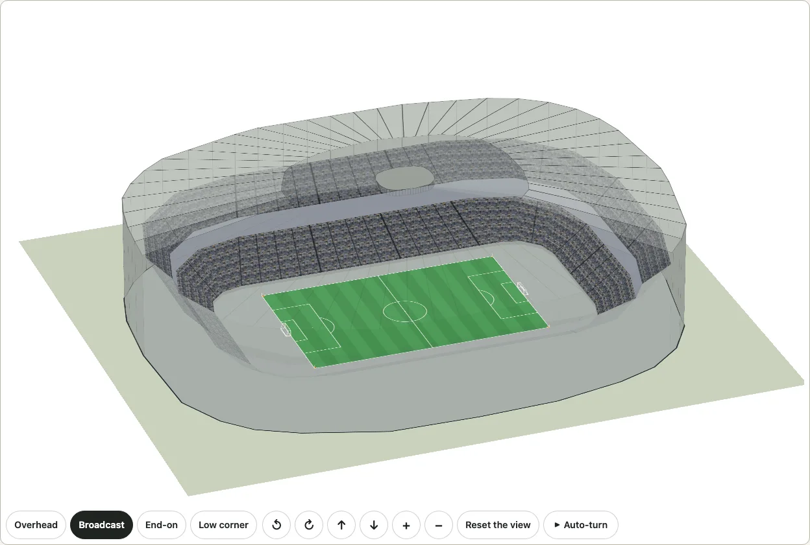
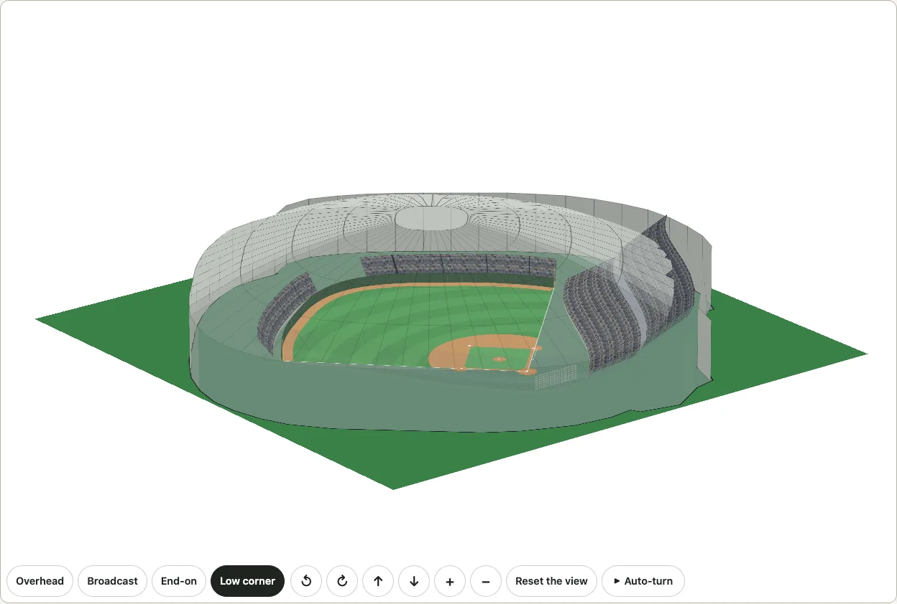
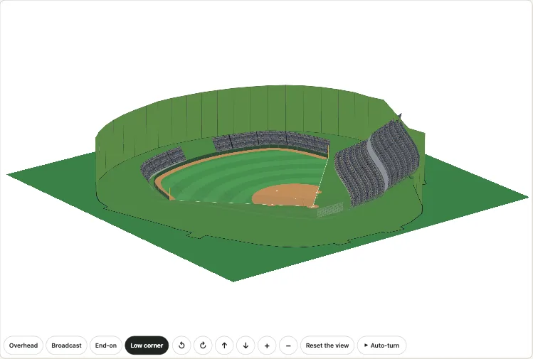

# The real stadiums

A stadium of football and soccer, a ballpark, or a hall with a boxing ring, drawn in the building it stands in: the outline of the building as OpenStreetMap maps it, the field lying in it, and a bowl of seats fitted inside it from what the sources say (how many seats in each configuration, how many seating bowls, what kind of roof). `drawKyogijo({ sport: "cfl", stadium: "bc-place", crowd: { real: true } })` draws one, and the [3D view](./turn.md) raises it. It is [the real venues](./venues.md)' counterpart for a field and not a rink. So far there are six: **BC Place** in Vancouver (the football field of the Canadian league and a soccer pitch, under its cable roof), **Lumen Field** in Seattle (the NFL's field and a soccer pitch, under its canopies), **T-Mobile Park**, the Mariners' ballpark (a baseball field, under its retractable roof), and in Japan **Tokyo Dome** (a baseball field under an air-supported roof), **Korakuen Hall** (a boxing ring in a hall of 1,403 seats) and **Koshien Stadium** (a baseball field in the open air, with its ivy and its all-dirt infield). [Beside each other](./district.md), the two of SoDo, a city view with Climate Pledge Arena, and Tokyo Dome City: Tokyo Dome and Korakuen Hall.

It is a plausible bowl, never a seat map. Nothing here is read or copied from a club's, a ticket seller's or a federation's seating chart: no section, row or seat of a real plan is drawn, and no mark of a club, a league or a tournament. The bowl has the right number of seats in the right number of bowls inside the right outline, and says so where it only looks right.



```ts
import { drawKyogijo } from "@johnmorrisdotca/kyogijo-stadiums";
import { planStadium, stadiumById } from "@johnmorrisdotca/kyogijo-stadiums/stadiums";

const svg = drawKyogijo({ sport: "soccer", stadium: "bc-place", crowd: { real: true } });
console.log(svg.includes("ky-cr-shell"), svg.includes("ky-cr-north"));
// true true
const plan = planStadium(stadiumById("bc-place")!, "soccer", { x: 0, y: 0, w: 344.5, h: 223.1 });
console.log(plan.orientation.basis, plan.seats.map((t) => `${t.tier} ${t.seats}`).join(", "), plan.total);
// opening lower 27695, upper 24802 52497
```

The stadium is the key in [`STADIUMS`](#the-stadiums) (the key of its ground in [`GROUNDS`](./grounds.md), or of its park in [`PARKS`](./ballparks.md)): `stadium` names it for a football field (`sport: "cfl"` or `"nfl"`), a soccer pitch (`sport: "soccer"`) or a boxing ring (`sport: "boxing"`, in a hall), and `park` for a baseball field (`sport: "mlb"`), and a soccer drawing whose `ground` is a stadium needs no other. Any other sport, a `league` of your own and `crowd: { real: false }` leave the stands as they were. The demo's [stadiums page](https://johnmorrisdotca.github.io/kyogijo-stadiums/stadiums.html) and the [gallery](https://johnmorrisdotca.github.io/kyogijo-stadiums/docs/gallery-stadiums.html) draw both configurations in 2D and in 3D, in English and Japanese, and puts the stadium [beside Rogers Arena](./district.md).

## BC Place: the two configurations

The building is one, and so is the bowl; what changes is the field and the seats the stadium has for it:

- **Football (`sport: "cfl"`).** The field of the Canadian league, 150 by 65 yards with its 20-yard end zones (the article says the stadium was the first to use a 20-yard end zone), and 54,500 seats: the infobox's first capacity, which Wikidata's capacity (P1083) also gives.
- **Soccer (`sport: "soccer"`).** The pitch at the international 105 by 68 metres, and 52,497 seats: the infobox's figure for the 2026 tournament, 2,003 fewer than its first (the article's own words say neither why nor which seats; the lower bowl is kept and the upper bowl takes the difference). The article gives the soccer pitch as 117 by 75 yards (about 107 by 69 metres), which is not a size of the infobox's for international matches, so [`GROUNDS`](./grounds.md) keeps the international size for this ground and so does the drawing.

The same 27,695 seats are the lower bowl in both: the infobox lists them as "lower bowl", and the article says the stadium's soccer club sold only the lower bowl for years.

## The two levels, in BC Place

**Level one is the building.** The outline is the closed way OpenStreetMap tags with the stadium's Wikidata item, read with the Overpass API on 2026-10-20 and simplified to a metre. It is drawn as it is, annexes and all, under the stands, in the colour of a concourse. The field lies along the **opening in the roof**: OpenStreetMap maps the roof as a multipolygon of its band and the opening in it, and the article says the opening is 100 by 85 metres, "the same size as the field below". The mapped opening measures 101.8 by 85.3 metres, long side 52.8 degrees from north, and the building's own main hall (the largest rectangle that fits its outline) runs the same way to within a few degrees. The drawing is turned so that the field lies along the page, and a small arrow marked N says where north is.

**Level two is the bowl.** From the first row, which stands from a football field's footprint where the package's own gridiron stands have it (42 feet from a side line, 28 from an end line), out to the wall of the building, between them the two bowls:

- The seats are the configuration's. Each bowl's outer edge is placed so that its band holds its share of them, with a walk between the bowls. A bowl that fits holds exactly the configuration's seats; BC Place's building has room for soccer's 52,497 at 3.8 square feet of floor a seat in the plan and for football's 54,500 at 3.4 (the bowl is steeper than the usual drawing's, whose seat takes 4.6), and the plan says `tight` where even 3 would not hold them.
- The lower bowl holds the share the infobox gives, 27,695 seats; the upper bowl the rest.
- The outer edge of the bowl is the largest rounded rectangle, between 1.15 and 1.6 times as long as it is wide, that fits inside the outline round the middle of the field, with a wall's depth to spare.
- The rows rise at most 36 degrees; the heights (5 feet for the first row, 38 and 62 feet of rise for the lower and the upper bowl, a suite level of 24 feet between them) are ours: no source gives them.
- **The roof** (3D, with `venue: { roof: true }`) is the one the article describes: a retractable roof supported by cables. Its rim stands where OpenStreetMap maps it, 48 metres (the building part's height of 61 metres less the roof's own 13), the roof rises 13 metres from the rim to the edge of the opening, and each piece of the roof carries a cable along its edge. Over the opening, with the roof closed, lies the fabric (drawn thin, so that the seats show through it), and in the middle of it the pod, a box hung at the crown's height (its size is ours: the article says the fabric retracts into a pod above the suspended video board, not how large it is). With `venue: { roof: true, roofOpen: true }` the fabric has gathered into the pod and only the pod stays.

## Lumen Field

A stadium with two configurations in one bowl: the NFL's field (`sport: "nfl"`, 120 by 53.3 yards, 68,740 seats: the infobox's figure, which the article says is expandable to 72,000 for special events) and a soccer pitch (`sport: "soccer"`, the 116 by 75 yards the article publishes, 37,722 seats for the league's matches). `drawKyogijo({ sport: "nfl", stadium: "lumen-field", crowd: { real: true } })` draws it, and a soccer drawing whose `ground` is `lumen-field` needs no `stadium`.

- **The field lies as OpenStreetMap maps the pitches**: both pitches, the American football one and the soccer one, are mapped inside the building and lie north and south (0 degrees), so the field's orientation is mapped, not inferred, and the arrow marked N points along the field.
- **One bowl, a configuration opens its seats from the lowest up.** The bowl holds 68,740 seats in three bowls (the article names the lower levels, the club and suite levels and the Summit levels above them) and is the same for both; the soccer configuration opens 37,722 of them from the lowest bowl up and the rest, the upper bowl and part of the middle one, are closed: drawn as empty seats, with no people. The share of the seats in each bowl is ours (the article does not say it).
- **The canopies.** The article says the roof covers 70 percent of the seats and leaves the field open, and OpenStreetMap maps it as two parts, one each side of the field, with their heights (36 metres at the top, a rise of 10). The drawing keeps their outlines, cut into strips by the rays from the middle of the field, each strip a pair of triangles; the low edge (26 metres, over the field's side) and the high one (over the back of the stands) are the map's, and which way a canopy slopes is ours. The bowl is lowered under it: the top row stands at least 6 feet under the canopy's low edge, so the bowl's heights are scaled to fit (ours).
- Walls stand on the building's outline up to just over the top row; the ends and the field are open.

## T-Mobile Park

A ballpark (`kind: "park"`), so its frame is home plate's, as every ballpark's is: `drawKyogijo({ sport: "mlb", park: "t-mobile-park", crowd: { real: true } })`, with the fence at the distances published for the park (331, 378, 401, 381 and 326 feet) and the stands behind it.

- **The seats**: 47,368 for baseball (the infobox's figure; Wikidata's own capacity, 47,476, is kept beside it). The usual ballpark stands (`parkLayout`: a lower and an upper band along the lines and round home plate, bleachers behind the outfield fence) with each band as deep as the seats of its levels need: the Main Level's 20,521 seats are the lower bowl, the Club (4,123), Suite (2,050) and View (15,902) levels the upper bowl, and the two bleacher sections' 3,666 the bleachers (all from the article's layout). The bands hold the seats to within two percent.
- **How home plate faces.** OpenStreetMap maps the infield (the grass inside the base paths, a square with its sides along the baselines, 4.4 degrees from north) but not which corner is home plate. The way to centre field is one of four, 45 degrees from the baselines; the one where the park's fence, and 20 metres of stands behind it, lie wholly inside the building's outline is 49.4 degrees (north-east), and the other three leave the fence outside it at several points. The build refuses to choose when the outline does not decide.
- **The roof.** A retractable roof in four sections (the article's count, not checked against another source) that does not fully enclose the ballpark, 217 feet above the field at its lowest and 269 at its top, and at rest over the railway to the east (all the article's). Closed, the drawing's roof is a band from the rim of the building's outline (92 percent of it) up to a crown over the middle with the fabric laid across it; open (`roofOpen`), the sections rest as slabs over the east third of the building. How they are cut into four and how thick they are is ours. The building's walls stand at the 21 metres OpenStreetMap maps for it, far under the roof.

## Tokyo Dome



A ballpark under an air-supported roof (`kind: "park"`): `drawKyogijo({ sport: "mlb", park: "tokyo-dome", crowd: { real: true } })`, with the fence at the distances published for the park in metres (100 to the poles, 110 to the power alleys, 122 to centre field: they were already the park's) and the stands behind it. Its Japanese name is `東京ドーム`.

- **The seats**: 45,600 for baseball (the infobox's figure; its range for events is 42,000 to 55,000, 57,000 at the most, and Wikidata's capacity, 55,000, is kept beside it). The usual ballpark stands, each band as deep as the seats need. The Japanese article says the infield stands are in two levels with a balcony level between and the outfield stands on one, so two levels are documented; the shares of the three bands are ours. The building is only 217 metres across, so the stands do not fit it at the usual floor a seat takes (4.6 square feet in plan): the plan makes the bowl steeper, a seat taking less (`ParkPlan.seatArea`, 3 square feet at the least), until they fit, as an arena's does; a corner or two still lies over the outline.
- **How home plate faces: not known.** OpenStreetMap maps the building, and the roof as a part of it, but no diamond inside, and the building is nearly round (1.13 times as long as it is wide), so there is no direction to read, and none is guessed. The drawing has to lie some way, so it takes the one in which the fence, and about 34 metres of stands beyond it and behind home plate, fit best inside the outline (55 degrees, home plate set so that the middle of the fair ground is the building's middle), says so (`axis.basis` is `none`: the heading is a stand-in, not a fact) and draws **no arrow to north**. A lead for later, not used: the Japanese article says the roof was designed to fall toward the outfield to spare the sunlight of the neighbouring garden, Koishikawa Korakuen, which lies to the north-west; that would put the outfield north-west, but it is an inference from an inference, not a measurement. Nor can a diamond be mapped from an aerial photograph of a covered stadium, which shows the roof; a survey or a photograph taken inside would say.
- **The roof** is the one the articles describe: an air-supported structure, a double membrane of glass cloth coated with fluoropolymer on a net of 28 wires 8.5 metres apart, held up by blowing the air inside 0.3 percent over the outside, which is why it never opens. OpenStreetMap maps the roof as a part of the building with its outline (198 metres across), its height to the top, 56.19 metres (the English article's internal height is 56) and its rise, 30 metres. The 3D roof (`venue: { roof: true }`) is a lens: its rim stands at 26.19 metres, the walls' height, and it rises to 56.19 over the middle, the height falling with the square of the way out from the crown (a shallow cap, ours: the sources give the heights, not the curve). It is drawn in rings of pieces, a pale skin with a thin line, which is the net of wires only in spirit (the drawing's pieces are not the roof's wires). `roofOpen` changes nothing: an air-supported roof does not retract. The roof's real lowering toward the outfield is not drawn, because the side it lowers toward is not known.

## Korakuen Hall

A hall with a boxing ring in the middle (`kind: "hall"`): `drawKyogijo({ sport: "boxing", stadium: "korakuen-hall", crowd: { real: true } })`. The hall stands in Tokyo Dome City, 140 metres from the Dome, on the fifth floor of its own building (the Japanese article says so), and its Japanese name is `後楽園ホール`. A hall has no ground or park of the package's: its names are Wikidata's labels.

- **The seats.** 1,403 seats (the infobox, and the Japanese article's list: 780 fixed seats on the south side, movable seats of 109 east, 109 west and 405 north) with the balconies on the east and west sides above, where the Japanese article says standing places are used; at the most 2,005 (Wikidata's capacity, too). The bowl holds 2,005 in two levels: the lower the floor's 1,403, to the seat, and the upper the balconies' 602 standing places, which the boxing configuration closes and the drawing leaves empty, as Lumen Field's closed bowls are. A hall's first row stands 8 feet from the ring's box on every side (ours).
- **The ring** is the boxing drawing's (a roped ring with its apron), in the middle of the hall; the fixed seats being on the south side is not drawn: the bowl is round the ring.
- **How it lies.** The building's long axis (1.82 times as long as it is wide), an inference, as for an arena: nothing in OpenStreetMap or the articles says which way the ring lies in the hall, so the data says `building` (inferred) and the drawing says so; an arrow to north is drawn.
- **The roof** is the building's own, drawn as a lid over the bowl (ours, `plausible`); the hall takes up only a part of the building's fifth floor, and the outline is the whole building's.

## Koshien Stadium



The ballpark of the high school tournaments, in the open air: `drawKyogijo({ sport: "mlb", park: "hanshin-koshien-stadium", crowd: { real: true } })`. Its Japanese name is `阪神甲子園球場` (the park's own short name, `甲子園球場`, is the package's `PARKS` name), and its fence is the park's published one (95 metres to the poles, 118 to the alleys and to centre field).

- **The seats**: 47,400 for baseball (the last of the infobox's capacities, which lists the earlier ones, 47,808 and 47,757, too; Wikidata's, 60,000, is the figure from its opening). The Japanese article says the stands are on one level, the largest of its kind in Japan, the infield stand's 50 rows 14.3 metres high; the usual ballpark stands are drawn, each band as deep as the seats need, the bowl made steeper where the building is too small for them, as Tokyo Dome's.
- **How home plate faces: from the mapped grass of the field.** OpenStreetMap maps the building as a relation (a stadium outline, 36,835 square metres) and the field as a pitch, the grass of the whole field, fair ground and foul, in an outline a little inside the fence (a way of 49 points). It is no infield square (the infield is all dirt), so the way the baselines run is found another way: the park's published fence is laid on the mapped field, and the heading and the position of home plate at which the two lie nearest are the way the field lies: **172 degrees**, out to centre field a little east of south, the fence 2.9 metres from the mapped edge on average (`axis.rms`). The fence is about a round arc, so the minimum is shallow: the heading is good to about ten degrees. The Japanese article agrees: it puts the annex on the stadium's south side behind centre field, and the sea breeze that blows from the south-west, from behind the right-field stand, to the left-field stand.
- **Ivy and dirt, as plain drawing choices.** The Japanese article says ivy was planted on the outer wall in 1924, taken off for the renovation and planted again, and the English article calls it a symbol of the stadium; the drawing's walls are green (`looks.ivyWalls`), nothing more. The infield is all dirt, the articles say; the 2D field has no grass inside the bases (`looks.dirtInfield`). Neither is a picture of plants or soil.
- **No roof over the field**: the outfield is natural grass and open to the air (the articles). The Ginsan roof over the grandstand behind home plate, the silver roof the stadium is known for, is not drawn: the 3D walls stand a little over the top row and nothing covers the bowl.

## The stadiums

<!-- stadiums-table -->
| Key | Stadium | City | Wikidata | Seats | Bowls | Roof | The field | Outline |
| --- | --- | --- | --- | --- | --- | --- | --- | --- |
| `bc-place` | BC Place | Vancouver, Canada | Q612227 | 54,500 (cfl), 52,497 (soccer) | 2, documented | retractable, cable-supported (documented) | along 52.8° (from the roof's opening) | way 24705904, 38,441 m² |
| `lumen-field` | Lumen Field | Seattle, United States | Q612736 | 68,740 (nfl), 37,722 (soccer) | 3, documented | canopy over 70 percent of the seats (documented) | along 0° (as OpenStreetMap maps the pitch) | relation 2305831, 49,516 m² |
| `t-mobile-park` | T-Mobile Park | Seattle, United States | Q1193117 | 47,368 (mlb) | 4, documented | retractable, in four sections (documented) | home to centre field 49.4° (from the mapped infield and the outline) | relation 3008332, 42,127 m² |
| `tokyo-dome` | Tokyo Dome | Tokyo, Japan | Q733748 | 45,600 (mlb) | 2, documented | air-supported dome (documented) | not known | way 20028328, 38,623 m² |
| `korakuen-hall` | Korakuen Hall | Tokyo, Japan | Q4389857 | 1,403 (boxing) | 2, documented | fixed (plausible) | along 6° (inferred) | way 45977418, 2,172 m² |
| `hanshin-koshien-stadium` | Koshien Stadium | Nishinomiya, Japan | Q959811 | 47,400 (mlb) | 1, documented | none, open to the air (documented) | home to centre field 172° (from the mapped grass of the field fitted to the fence, about 2.9 m off) | relation 9845926, 36,835 m² |
<!-- /stadiums-table -->

Made by `pnpm stadiums` from `scripts/stadiums.data.json` and the files of `data-sources/stadiums/2026-10-20/`; do not edit by hand. Each fact says whether a source says it (`documented`) or it is ours (`plausible`), and what was read, in the file the table is made from.

## Sources and licences

- **OpenStreetMap, ODbL 1.0, (c) OpenStreetMap contributors.** The outline (a way, or a relation whose outer ways are joined into a ring), the roof's heights and opening (BC Place's relation 5836463, whose outer way is the building's own and whose inner way is the opening), its outline and heights (Tokyo Dome's roof part) or canopies (Lumen Field's two roof parts), the pitches (Lumen Field's), the infield (T-Mobile Park's) or the grass of the field (Koshien Stadium's), and the axis worked out from them are a derived database. They live only in `src/stadiums.osm.data.ts` and in `data-sources/stadiums/`, are never copied into a CC0 or CC BY-SA file of the package and no such file is copied into them, and are offered under the ODbL with the credit `VENUE_ATTRIBUTION` (`(c) OpenStreetMap contributors, ODbL 1.0, openstreetmap.org/copyright`). A drawing made from them is a produced work: it carries the credit and the description says so.
- **Wikidata, CC0.** The capacity (P1083) and the coordinates of the stadium's item, and the labels in English and Japanese that name a hall.
- **English and Japanese Wikipedia, CC BY-SA 4.0.** The capacity of each configuration and of the lower bowl (the infobox's list), the seats of a ballpark's levels, the number of bowls, the kind of roof, the size of BC Place's opening, the share of Lumen Field's seats its canopies cover the heights of T-Mobile Park's roof, how Tokyo Dome's roof is held up, the levels of the Japanese stadiums' stands and the seats of Korakuen Hall's floor, each with the article and the revision (the Japanese article's as well, `ja`; the sentences each leans on are kept in `data-sources/stadiums/` as evidence and checked by the build); the facts are numbers and words of ours, not the text. The article is credited in [NOTICE.md](../NOTICE.md#the-stadiums-sources).
- **Raw answers** are kept as they were returned in `data-sources/stadiums/2026-10-20/` (`pnpm stadiums:fetch` fetches them: one request at a time, ten seconds apart, with a User-Agent that names the project). `pnpm stadiums` makes the two data files and this page's table from them, and refuses a figure the sources do not give.

## What fills the 3D view

The same fill as [the venues](./venues.md#the-two-levels): the walk between two bowls is the suite level, a wall with a band of windows; the apron round the surface is a thin dark floor; the back of each bowl is a wall, and behind it lies a darker concourse floor with its lanes, out to the building's outline; the bowls of a ballpark (not rounded rectangles round a field) have the suite wall and the back wall, and the building's floor in a darker tone, but no apron and no concourse floor of their own. None of it is a source's; it is the drawing's, so that no big flat sheet is left.

## Limits

- BC Place's orientation is inferred from the roof's opening, which the article says is the field's size; no source says it in so many words. Lumen Field's is mapped (its pitches); T-Mobile Park's is the mapped infield with the outline's choice of the way out. Koshien Stadium's is the mapped grass of the field fitted to the fence, good to about ten degrees. Where a stadium has none of these, the building's main hall is used, and where it has no direction nothing is said: Tokyo Dome's is not known, and its drawing lies the way that fits the building, with no arrow.
- The outline is OpenStreetMap's: where it takes in a plaza or a wing, so does the drawing, and the 3D walls and roof stand on the hall only.
- The bowls are fitted to the outline and the seats; real bowls have sections, overhangs, sightline corners and a suite level that are not drawn. The 3D heights, the pod and the cables' number are ours.
- The seats are the configuration's, from the sources named; they change with a renovation and with an event (the stadium's record crowds were more than either figure).
- BC Place's two configurations, Lumen Field's two and one each for the others are all there are (a hall's second sport, professional wrestling, which the same ring hosts, is not drawn). Rugby, BC Place's lower-bowl-only seating (22,120 in the infobox) and the stadiums' other events are not drawn; a ballpark's football configuration (the article's 30,144) is not either.
- A ballpark's stands are the usual ones scaled to its seats: the shape of its decks, its overhangs and its bleachers' real places are not. The roof's sections and the way a canopy slopes are drawn as the sources say and ours where they do not.
