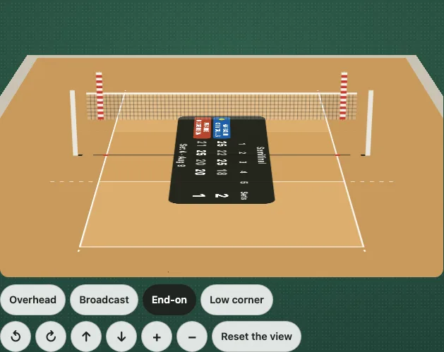
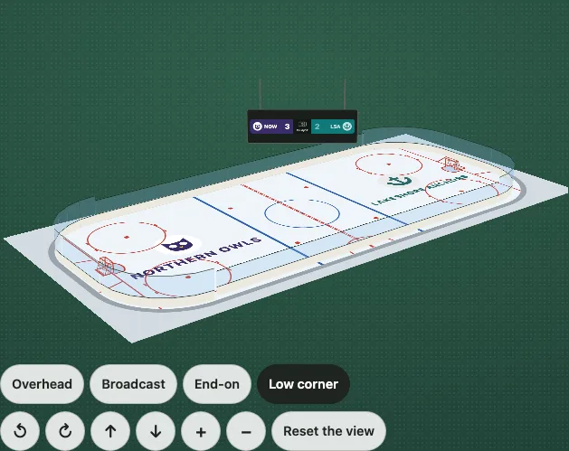
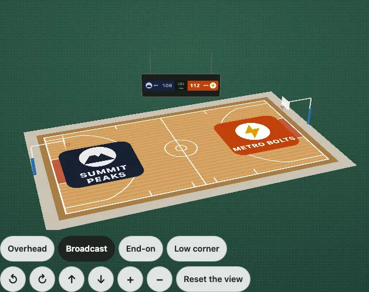

# The 3D view

A surface drawn flat hides what stands on it: a net, a basket, a goal, the posts of a football field. `@johnmorrisdotca/kyogijo-stadiums/turn` shows any surface as a floor that turns. The floor is the flat drawing itself, with its score, its data layers and its labels; it is tipped and turned by the mouse, a finger, the wheel or the keys, and what the rulebook puts on the surface stands up on it, at the rulebook's height.



It is plain DOM and CSS, with no dependency and no canvas. Each part that stands up (a net, a pane of glass, a backboard, the two strips that make a post) is a flat rectangle with a little SVG on it, and each carries its whole place on the screen in one `matrix3d`; the parts are stacked far to near by `z-index`. Nothing is nested in 3D (no `preserve-3d`, no `perspective` on a parent), so a browser that cannot keep nested 3D layers, as Safari on a phone sometimes cannot, draws it as it is meant. The drawing it is made from is the one `drawKyogijo` draws, so the 3D view is an enhancement over the static SVG, which stays what a server renders.

## Put one in a page

```ts no-run
import { mountKyogijoTurn } from "@johnmorrisdotca/kyogijo-stadiums/turn";

const view = mountKyogijoTurn(
  document.querySelector("#court")!,
  { sport: "volleyball", home: { name: "Harbour City Gulls", score: 3 }, away: { name: "Prairie Ridge Bison", score: 2 }, status: "final" },
  { preset: "end" },
);
view.preset("corner");        // glide to a viewpoint
view.set({ yaw: 60 });        // or to any view
view.update({ sport: "nba" }); // draw another surface, keeping the view
```

Or the custom element, with no script of your own:

```html
<script type="module" src="https://cdn.jsdelivr.net/npm/@johnmorrisdotca/kyogijo-stadiums@0/dist/element-define.js"></script>
<kyogijo-field sport="nhl" turn turn-view="broadcast"></kyogijo-field>
```

`turn` switches the 3D view on, `turn-view` names the viewpoint it opens on, `turn-controls="false"` leaves the buttons out, `turn-uprights="false"` leaves out what stands on the surface, `turn-score="floor"` leaves the score panel on the floor, and `turn-touch="turn"` keeps every touch for the view. Take it off and the flat drawing comes back. The element's `turn` property is the handle, and `turnSettings` takes the settings the attributes cannot say.

## The viewpoints

| Viewpoint | Key | Looks from |
| --- | --- | --- |
| `overhead` | 1 | Straight down. |
| `broadcast` | 2 | High on one side line, as the main camera, turned a little towards one end so that the boards, nets and goals show their faces. For the net sports, whose net runs across the court, high behind an end line, as a television camera: from the side line a net is a stick. A football field and a hockey rink are turned less, and a curling sheet is seen square on from the side. |
| `end` | 3 | Low, behind an end line, along the surface: where a net, a goal or a basket is best seen. |
| `corner` | 4 | Low, from a corner, with the nearest net or goal in front. The view a mount opens on. |

The end and corner views look from the side opposite the scoreboard of a field (see below), so that it stands behind the far end.

A view is `{ yaw, pitch, zoom }`: the turn about the vertical in degrees, the tip back from straight overhead in degrees (0 to 84, so the eye never goes below the floor), and the zoom (0.5 to 4). The scene is fitted to the box at every view, so every viewpoint and every turn shows the whole surface. `TURN_PRESETS`, `LONG_PRESETS`, `NET_PRESETS` and `CURLING_PRESETS` are the viewpoints as numbers.



## Hands

- **Drag** with the mouse turns the view across and tips it up and down; **double click** puts it back.
- **A finger** drags sideways to turn the view and leaves a vertical swipe to the page, so that a page of views can still be scrolled with a thumb. `touch: "turn"` keeps every touch for the view, which then also tips it; **two fingers** pinch to zoom.
- **The wheel** is the page's, so that the page scrolls over a view. Ctrl and the wheel (a pinch on a trackpad) zoom; with the view focused, the wheel tips it and Shift with the wheel turns it.
- **The keys**, with the view focused: the arrows turn and tip (Shift for bigger steps), plus and minus zoom, 1 to 4 pick a viewpoint, 0 or Home puts it back.
- **The buttons** under the view are the four viewpoints, turn left and right, raise and lower, zoom in and out, and reset: each is 44 pixels square or more.

## What stands on each surface

Heights are the rulebooks', read from the current rulebooks and cited by rule number in [Sources](./sources.md#heights-in-the-3d-view); where the rules give a range or a least (a post's height, the glass above a rink's boards) the least is drawn, and where the rules leave a size open (the mesh of a net, the thickness of a strip, a baseball fence's height, a corner flag's) it is ours and is said to be. A strip is never thinner than a thousandth of the surface's diagonal, so that a 3-inch post on a 500-foot ground stays in sight.

| Surface | What stands up |
| --- | --- |
| Volleyball, beach volleyball | The net, 2.43 m (men) or 2.24 m (women, `netHeight: "women"`), a metre wide with its tape and side bands; posts 2.55 m; antennae 1.8 m long, the top 80 cm over the net, in bands of red and white (FIVB 2.1, 2.2, 2.4, 2.5.1). |
| Sitting volleyball | The net, 1.15 m (men) or 1.05 m (women), 80 cm wide; antennae 1.6 m long, the top 80 cm over the net; posts 12 cm over the men's net (World ParaVolley 2.1.1, 2.2, 2.4; the posts' height is ours). |
| Tennis | The net, 3 ft 6 in at the posts and 3 ft at the centre, with its strap; the posts; singles sticks (`net: { sticks: true }`). |
| Badminton | The net, 1.55 m at the posts and 1.524 m at the centre, 76 cm deep; the posts. |
| Pickleball | The net, 36 in at the posts and 34 in at the centre; the posts. |
| Table tennis | The table lifted 76 cm on four legs, the net 15.25 cm over it, the clamps. |
| Padel | The net, 0.92 m at the ends and 0.88 m at the centre, on posts 1.05 m high; the enclosure: end walls of 3 m of glass with 1 m of metal fence over them (4 m), side walls 3 m high at each end with fence between (FIP, The Court; `boards: false` leaves the walls out). |
| Squash | The walls up to their out lines: the front wall 4.57 m, the back wall 2.13 m, the side walls sloping from the one to the other (World Squash 5.02, 5.03; `boards: false` leaves them out). |
| Racquetball | The walls, 20 ft high all round, the front wall solid (IRF 2.1(a); `boards: false` leaves them out). |
| Sepak takraw | The net, 1.52 m (men) or 1.42 m (women, `netHeight: "women"`) at the centre and 1.55 m or 1.45 m at the posts, 0.7 m wide (ISTAF Laws 2 and 3). |
| Teqball | The table, its top 76 cm up (900 mm with the net) on four legs, and the net 14 cm over it (FITEQ 1.1, 1.2). |
| Roundnet | The set: a net in a ring 91.4 cm across, its rim 20.3 cm up, on four legs (International Roundnet Federation 1.1.2). |
| Netball | A goalpost at the middle of each goal line, 3.05 m high, with its ring on a bar 150 mm long (World Netball, Rule 1, items 13 and 14). |
| Swimming | A starting block 0.7 m high in each lane at each end, numbered; a flagged rope 1.8 m above the water 5 m from each wall; the false start rope 1.2 m above it at 15 m (World Aquatics CR 16.2.8, 16.1.10, 16.1.12). A warm-up pool and a natatorium have none. |
| Diving | The springboards at 1 m and 3 m on their stands, and the platforms (5, 7.5 and 10 m, or what `pool.platforms` asks for) on their towers, at the heights of Appendix 2 (CR Part Four, 13.1.1 and 13.1.2). |
| Water polo | A floating goal on each goal line: 3 m between the posts, the underside of the bar 0.9 m over the water, a net behind (CR 18.3.3). |
| Artistic swimming | The judges' platform 0.6 m high along the top side and the starting platform 0.7 m high (CR 27.2.8, 27.2.7). |
| Basketball | Each basket: the backboard (6 ft by 3 1/2 ft, FIBA 1.80 by 1.05 m, its lower edge 150 mm under the ring's top), the ring at 10 ft (FIBA 3.05 m) with its 18 in net, and the padded stanchion, its padding 2 m behind the end line. |
| Hockey | The boards (42 in) with glass over them, 8 ft at the ends and 6 ft along the sides (NHL 1.3), and a goal 6 ft wide and 4 ft high on each goal line (NHL 2.1; `boards: false` leaves the boards out). |
| Soccer | A goal 7.32 by 2.44 m (the pitch's own size) on each goal line, and a corner flag 1.5 m high at each corner (`cornerFlags: false`). |
| Handball, field hockey, lacrosse | The goal: 3 by 2 m; 3.66 by 2.14 m; 6 by 6 ft (4 by 4 ft in a box). |
| NFL, CFL, IFAF | The goal posts: a crossbar at 10 ft and uprights 18 ft 6 in apart, 45 ft high in the NFL (35 ft over the bar), 40 ft in the CFL and at least 30 ft in the NCAA and the rest, on a slingshot support or an H; the eight pylons. |
| Rugby | Union: a crossbar at 3 m, uprights 5.6 m apart, drawn 3.4 m over the bar; league: posts 16 m high; the flag posts, 1.2 m. |
| Gaelic games | The posts: a crossbar at 2.5 m, uprights 6.5 m apart and 7 m high; the corner flags (1.5 m, ours). |
| Australian football | Two goal posts 6 m high and two behind posts 3 m high at each end. |
| Cricket | Three stumps 28 in high at each end of the pitch. |
| Baseball | The fence as high as its walls (the Green Monster's 37 ft at Fenway Park; 8 ft where no wall is listed), a foul pole at each line, and the backstop. |
| Curling | Nothing but the scoreboard: a sheet is flat. |
| Any score drawing | The scoreboard: see below. |

**Walls give way.** The walls of a padel, squash or racquetball court and the boards and glass of a rink are cut away when they stand between the eye and the court: a wall whose outside faces the eye fades as the eye comes down (`fadeOf`, `Layout.fade`), to about a tenth of what it was when the eye is low, and is whole again seen from straight above or from the far side. A page that lays the planes out itself reads `Plane.shy`, the direction a wall faces away from the surface, and `fadeOf(plane, yaw, pitch)`.

`uprightsFor(options, { only: ["net"] })` says what stands on a surface as planes in the drawing's frame (x along the surface, y across it, z the height, in feet), and `describeUprights(options, uprights, "ja")` says it in a sentence: the view's description ends with it, so a reader who cannot see the view hears what stands in it.

## The score

In a drawing with a score the 3D view does not lay the score's panel on the floor: it hangs it up. The badge of the score (the strip `size: "badge"` draws) is put on a dark board that turns to face the eye, so that it reads from wherever the view is. A court or a rink (basketball, hockey, volleyball, badminton, handball, tennis, pickleball) has it hung on cables over the middle; a field, a pitch, a table and a curling sheet have it standing on legs behind an end, and a ballpark behind centre field. The floor keeps the teams' names and everything else, and loses the panel: the drawing option `plate: false`, which any drawing takes, is how. `score: "floor"` in the settings leaves the panel on the floor and the board off; so does `uprights: false`, since the board is one of the things that stand up. The sizes and heights of the board are ours: no rulebook gives a scoreboard.

## Settings

| Setting | What it does |
| --- | --- |
| `preset` | The viewpoint it opens on: `overhead`, `broadcast`, `end` or `corner` (the default). |
| `view` | An exact opening view, `{ yaw, pitch, zoom }`, laid over the preset. |
| `controls` | `false` leaves the buttons out; the keys and the pointer work either way. |
| `uprights` | `false` for the floor alone, or `{ netHeight, boards, only, score }`. |
| `score` | `board` (the default) hangs the score up as a scoreboard; `floor` leaves the panel on the floor. |
| `touch` | `scroll` (the default) or `turn`. |
| `motion` | `auto` (the default) glides between viewpoints unless the reader prefers reduced motion; `smooth` or `none` say it for them. |
| `floor` | A function that draws the floor in place of `drawKyogijo`: pass a chart's `draw` to turn a shot chart. |
| `lens` | How long a lens the eye has, as a multiple of the view's longer side: 1.7 by default; the larger, the flatter. |
| `size` | For `turnMarkup`, the box the first view is worked out for: 960 by 600. |
| `id` | The prefix of the ids in the view, for a page with more than one. |
| `onChange` | Called with the view and the viewpoint it is (`undefined` when it was turned by hand). |

The handle `mountKyogijoTurn` gives back has `view()`, `set(view, glide?)`, `preset(name)`, `reset()`, `update(options)`, `svg()` (the flat drawing that is the floor), `destroy()` and `mode`.

The 3D view always shows the whole surface, lying wide: a `range`, a `half` and a tall `orientation` are left to the flat drawing, and a badge is not a surface and stays a badge.

## On a server

`turnMarkup(options, settings)` is the same view as a string of HTML, laid out for `settings.size`; it is pure, so it can be made on a server and given to the page, which a script then makes turn.

```ts
import { turnMarkup } from "@johnmorrisdotca/kyogijo-stadiums/turn";

const html = turnMarkup({ sport: "nba" }, { preset: "broadcast" });
console.log(html.includes('data-part="hoop-left-backboard"'), html.includes("preserve-3d"));
// true false
```

A page with no script keeps the flat drawing: render `drawKyogijo(options)` into the container and let `mountKyogijoTurn` replace it, and a reader whose script does not run, or whose browser cannot draw the planes (`turnSupported()` says), still has the drawing, with a sentence that says why it does not turn.

## Reading it

- The view is a `group` named by the drawing's title, with the role description "3D view" (3D表示), focusable, with `aria-keyshortcuts` and a description that gives the keys and what stands on the surface, with its heights in the rulebook's own unit.
- The flat drawing keeps its own `role="img"`, title and description. The parts that stand up are decoration and hidden from a screen reader.
- A viewpoint, a reset and the end of a drag or a run of keys are said in a polite live region ("End-on view", "Turned to 40 degrees, raised 34 degrees"); a drag is not said as it goes.
- With `prefers-reduced-motion` the view jumps between viewpoints instead of gliding, and nothing ever moves by itself. Nothing is polled: the elements' transforms are written when the view changes, and a glide is half a second of animation frames.
- Focus is shown with a 3 px outline, and the controls are 44 pixels or more.

## Looks

The colours of what stands up are custom properties on `.ky-turn`, light and dark, in `KYOGIJO_TURN_STYLE`: `--ky-up-pole`, `--ky-up-white`, `--ky-up-yellow`, `--ky-up-red`, `--ky-up-orange`, `--ky-up-mesh`, `--ky-up-netfill`, `--ky-up-tape`, `--ky-up-glass`, `--ky-up-backboard`, `--ky-up-board`, `--ky-up-wall`, `--ky-up-table`, `--ky-up-pad`, `--ky-up-rim` and a few more; `--ky-turn-ratio` is the box's shape (16/10, and 5/4 on a phone). The defaults are in `:where()`, so a page's own rule wins. Pass `style: "none"` in the options to leave the stylesheet out and put `KYOGIJO_TURN_STYLE` in the page once.



[Open the demo in 3D](https://johnmorrisdotca.github.io/kyogijo-stadiums/?sport=volleyball&view=3d&viewpoint=end): the View switch in the playground turns any surface.
