# The real venues

An arena of the NHL drawn in the building it stands in: the outline of the building as OpenStreetMap maps it, the rink lying in it, and a bowl of seats fitted inside it from what the sources say (how many seats, how many seating levels, what kind of roof). `drawKyogijo({ sport: "nhl", arena, crowd: { real: true } })` draws it, and the [3D view](./turn.md) raises it. All thirty-two arenas of the NHL have one: the Western Conference's Pacific and Central Divisions and the Eastern Conference's Atlantic and Metropolitan Divisions.

It is a plausible bowl, never a seat map. Nothing here is read or copied from a team's, a ticket seller's or a venue's own seating chart: no section, row or seat of a real plan is drawn, and no mark of a team or a league. The bowl has the right number of seats in the right number of tiers inside the right outline, and says so where it only looks right.


```ts
import { drawKyogijo } from "@johnmorrisdotca/kyogijo-stadiums";

const svg = drawKyogijo({ sport: "nhl", arena: "honda-center", crowd: { real: true } });
console.log(svg.includes("ky-cr-shell"), svg.includes("ky-cr-north"));
// true true
```

The venue is the arena's key in [`ARENAS`](./arenas.md): `arena` names it, and an arena with no venue (every arena but these thirty-two) is drawn with the usual stands. A `league` of your own, another sport and `crowd: { real: false }` leave the stands as they were. The demo's [venues page](https://johnmorrisdotca.github.io/kyogijo-stadiums/venues.html) draws each of the thirty-two in 2D and in 3D, in English and Japanese, grouped by conference and division, and the [gallery](https://johnmorrisdotca.github.io/kyogijo-stadiums/docs/gallery-venues.html) shows all thirty-two with the code for each.

## Divisions and conferences

Each venue has a `division` (`pacific`, `central`, `atlantic`, `metropolitan`) and the divisions sit in the league's two conferences: `venuesIn("central")` lists a division's venues in the order of the data, `venuesInConference("western")` a conference's, division by division, `conferenceOf` and `VENUE_CONFERENCES` say which division is in which. A division with no venue yet gives an empty list. The demo's venues page has a conference and a division chooser over the tabs.

## The two levels

**Level one is the building.** The outline is the closed way (or, for the Grand Casino Arena, the relation of two ways that join into one ring) OpenStreetMap tags with the arena's Wikidata item, read with the Overpass API on 2026-10-20 and simplified to a metre. It is drawn as it is, annexes and all, under the stands, in the colour of a concourse. Where OpenStreetMap or the building says how the rink lies, the drawing is turned so that the rink lies along the page, and a small arrow marked N says where north is. Where nothing says, the rink is drawn east-west with north at the top and no arrow.

**Level two is the bowl.** From the first row, which stands from the boards where the NHL profile of [the crowd](./crowd.md) has it, out to the wall of the building, between them the tiers:

- The seats are the venue's seats for ice hockey. Each tier's outer edge is placed so that its band holds its share of them, with a walk between two tiers. A bowl that fits holds exactly the venue's seats.
- A seat takes 3.8 square feet of the floor in the plan (a bowl of today's arenas is steeper than the usual drawing's, whose seat is 2 by 2.3 feet). A building with less room than that needs gets a steeper bowl, down to 3 square feet a seat; where even that is too little the plan says `tight` and the bowl holds fewer seats than the venue. None of the thirty-two is tight, and all but three are drawn at the first density: the Rogers Arena and the Scotiabank Arena, whose outlines are small for their seats, are drawn at 3, and TD Garden at 3.4.
- The outer edge of the bowl is the largest rounded rectangle, between 1.15 and 1.6 times as long as it is wide, that fits inside the outline round the middle of the building's main hall, with a wall's depth to spare; its corners are as round as a bowl's are.
- The rows rise at most 36 degrees, so that a bowl with less depth is lower and not steeper; the heights of the tiers (4 feet for the first row, the rise of each tier, a suite level of 16 feet between them) are ours: no source gives them.
- The roof (3D, with `venue: { roof: true }`) stands over the building's hall at least 22 feet over the last row, or at the height OpenStreetMap maps for the building where that is more. A `fixed` roof is a lid that rises 22 feet towards the middle; the `saddle` roof of the Scotiabank Saddledome is its own drawing, [below](#the-scotiabank-saddledome); the `barrel` roof of the American Airlines Center, which the article says looks like a Quonset hut, is a round arch over the rink's short axis, 34 feet from its springing at the long sides to the crown over the rink's middle line (the article says the look; the 34 feet are ours). Every other arena's lid is ours, plausible: no source gives its shape, and OpenStreetMap maps `roof:shape` for none of them (KeyBank Center's is `many`, which is not a shape). The sources say the roof's kind, not its height. A venue may have a skylight (`roof.skylight`, Rogers Arena's, ours): the roof is closed in the middle by a flat cap a few feet over the band, and over the cap along the rink lies a long bar of glass; and a podium (`facade.podium`, Rogers Arena's 38 feet, ours): the walls are drawn in two bands, the lower a shade darker, a ledge, and a band of glazing over it. [The gates](./gates.md) of Rogers Arena are on the Pat Quinn Way side. The walls and the roof can be raised apart: `venue: { walls: true }` is the walls alone, `venue: { roof: true, walls: false }` the roof alone, and `roof: true` as it always was both; `turn.update(options, { venue })` changes them on a view that is turning.
- **Nothing is left as a bare gray sheet in 3D.** The walk between two tiers is the suite level, a facing wall with a band of windows (a pane to every 7 feet) and a ledge; the apron between the boards and the first row is a thin dark floor, with, on the bench side, the players' benches, the penalty boxes and the timekeeper's table at the usual places along the boards; the back of the upper tier is a wall with a coping, closing the bowl, and between it and the walls of the hall lies a darker concourse floor with its lanes and joints, going on to the building's outline where the building has annexes beyond the hall. The back wall gives way to the eye as the walls of the building do. All of it is ours, plausible and no plan of the building (`src/venue.fill.ts`); the benches' places and sizes are the usual ones for a rink, and none of it is a source's.

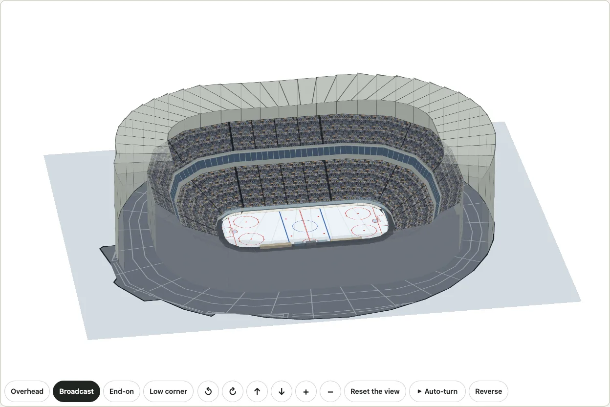

## The thirty-two venues

Made by `pnpm venues` from `scripts/venues.data.json` and the files of `data-sources/venues/2026-10-20/`; do not edit by hand. Each fact says whether a source says it (`documented`) or it is ours (`plausible`), and what was read, in the file the table is made from.

<!-- venues-table -->
| Key | Arena | Division | City | Wikidata | Seats for hockey | Tiers | Roof | The rink | Outline |
| --- | --- | --- | --- | --- | --- | --- | --- | --- | --- |
| `honda-center` | Honda Center | Pacific | Anaheim, United States | Q774138 | 17,174 (Wikipedia; Wikidata's capacity 17,174) | 2, plausible | fixed, plausible | along 90° (inferred) | way 120623151, 14,067 m² |
| `scotiabank-saddledome` | Scotiabank Saddledome | Pacific | Calgary, Canada | Q1140083 | 19,289 (Wikipedia; Wikidata's capacity 16,605) | 2, documented | saddle, documented | not known | way 4397328, 15,792 m² |
| `rogers-place` | Rogers Place | Pacific | Edmonton, Canada | Q5339036 | 18,641 (Wikidata; Wikidata's capacity 18,641) | 2, plausible | fixed, plausible | along 93° (inferred) | way 448626254, 22,634 m² |
| `crypto-com-arena` | Crypto.com Arena | Pacific | Los Angeles, United States | Q186080 | 18,145 (Wikipedia; Wikidata's capacity 19,060) | 2, documented | fixed, plausible | not known | way 428021739, 23,467 m² |
| `sap-center` | SAP Center | Pacific | San Jose, United States | Q261863 | 17,435 (Wikipedia; Wikidata's capacity 19,190) | 2, plausible | fixed, plausible | not known | way 24169210, 18,294 m² |
| `climate-pledge-arena` | Climate Pledge Arena | Pacific | Seattle, United States | Q977529 | 17,151 (Wikipedia; Wikidata's capacity 18,000) | 2, documented | fixed, documented | along 0° (inferred) | way 25123756, 18,041 m² |
| `rogers-arena` | Rogers Arena | Pacific | Vancouver, Canada | Q517318 | 18,871 (Wikipedia; Wikidata's capacity 18,422) | 2, plausible | fixed, plausible | along 102° (inferred) | way 24705911, 13,837 m² |
| `t-mobile-arena` | T-Mobile Arena | Pacific | Las Vegas, United States | Q3338973 | 17,500 (Wikipedia; Wikidata's capacity 20,000) | 2, plausible | fixed, plausible | along 90° (inferred) | way 364489406, 29,859 m² |
| `united-center` | United Center | Central | Chicago, United States | Q639975 | 19,717 (Wikipedia; Wikidata's capacity 23,500) | 2, documented | fixed, plausible | along 90° (inferred) | way 205221993, 18,684 m² |
| `ball-arena` | Ball Arena | Central | Denver, United States | Q795470 | 17,809 (Wikipedia; Wikidata's capacity 19,155) | 2, plausible | fixed, plausible | not known | way 25312645, 19,762 m² |
| `american-airlines-center` | American Airlines Center | Central | Dallas, United States | Q463345 | 18,532 (Wikipedia; Wikidata's capacity 19,200) | 2, plausible | barrel, documented | along 144° (inferred) | way 25312698, 17,632 m² |
| `grand-casino-arena` | Grand Casino Arena | Central | Saint Paul, United States | Q1421388 | 17,954 (Wikidata; Wikidata's capacity 17,954) | 3, documented | fixed, plausible | along 120° (inferred) | relation 20658401, 19,188 m² |
| `bridgestone-arena` | Bridgestone Arena | Central | Nashville, United States | Q302869 | 17,510 (Wikidata; Wikidata's capacity 17,510) | 2, plausible | fixed, plausible | along 156° (inferred) | way 130905914, 24,099 m² |
| `enterprise-center` | Enterprise Center | Central | St. Louis, United States | Q1067700 | 18,096 (Wikipedia; Wikidata's capacity 18,400) | 2, documented | fixed, plausible | along 105° (inferred) | way 42369176, 16,931 m² |
| `delta-center` | Delta Center | Central | Salt Lake City, United States | Q82294 | 16,020 (Wikipedia; Wikidata's capacity 19,911) | 2, plausible | fixed, plausible | along 45° (inferred) | way 23335190, 18,183 m² |
| `canada-life-centre` | Canada Life Centre | Central | Winnipeg, Canada | Q656928 | 15,225 (Wikipedia; Wikidata's capacity 15,004) | 2, documented | fixed, plausible | along 162° (inferred) | way 14869890, 12,765 m² |
| `td-garden` | TD Garden | Atlantic | Boston, United States | Q432105 | 17,850 (Wikipedia; Wikidata's capacity 18,624) | 2, plausible | fixed, plausible | along 55.2° (mapped) | way 25123637, 12,751 m² |
| `keybank-center` | KeyBank Center | Atlantic | Buffalo, United States | Q1110789 | 19,070 (Wikipedia; Wikidata's capacity 19,070) | 3, documented | fixed, plausible | along 144° (inferred) | way 626433722, 20,083 m² |
| `little-caesars-arena` | Little Caesars Arena | Atlantic | Detroit, United States | Q18154984 | 19,515 (Wikipedia; Wikidata's capacity none) | 2, plausible | fixed, plausible | along 147° (inferred) | way 526548805, 25,798 m² |
| `amerant-bank-arena` | Amerant Bank Arena | Atlantic | Sunrise, United States | Q795526 | 19,250 (Wikipedia; Wikidata's capacity 20,737) | 2, plausible | fixed, plausible | not known | way 43903801, 22,287 m² |
| `bell-centre` | Bell Centre | Atlantic | Montreal, Canada | Q522282 | 20,962 (Wikipedia; Wikidata's capacity 21,273) | 3, documented | fixed, plausible | along 132° (inferred) | way 19911284, 14,929 m² |
| `canadian-tire-centre` | Canadian Tire Centre | Atlantic | Ottawa, Canada | Q1327290 | 17,010 (Wikipedia; Wikidata's capacity 19,153) | 3, documented | fixed, plausible | not known | way 449048777, 19,131 m² |
| `benchmark-international-arena` | Benchmark International Arena | Atlantic | Tampa, United States | Q940199 | 19,092 (Wikipedia; Wikidata's capacity 19,204) | 2, plausible | fixed, plausible | not known | relation 12296444, 18,050 m² |
| `scotiabank-arena` | Scotiabank Arena | Atlantic | Toronto, Canada | Q406972 | 18,819 (Wikipedia; Wikidata's capacity 19,800) | 2, plausible | fixed, plausible | not known | way 19882585, 16,007 m² |
| `lenovo-center` | Lenovo Center | Metropolitan | Raleigh, United States | Q39177 | 18,547 (Wikipedia; Wikidata's capacity 19,722) | 2, documented | fixed, plausible | not known | way 47732090, 21,960 m² |
| `nationwide-arena` | Nationwide Arena | Metropolitan | Columbus, United States | Q166503 | 18,500 (Wikipedia; Wikidata's capacity 18,144) | 2, plausible | fixed, plausible | along 93° (inferred) | way 30266537, 26,258 m² |
| `prudential-center` | Prudential Center | Metropolitan | Newark, United States | Q849027 | 16,514 (Wikipedia; Wikidata's capacity 17,625) | 2, documented | fixed, plausible | along 21° (inferred) | way 1421198650, 25,650 m² |
| `ubs-arena` | UBS Arena | Metropolitan | Elmont, United States | Q48742753 | 17,255 (Wikipedia; Wikidata's capacity none) | 2, plausible | fixed, plausible | along 18° (inferred) | way 328876880, 22,886 m² |
| `madison-square-garden` | Madison Square Garden | Metropolitan | New York, United States | Q186125 | 18,006 (Wikipedia; Wikidata's capacity 18,006) | 2, documented | fixed, plausible | not known | way 138141251, 15,025 m² |
| `xfinity-mobile-arena` | Xfinity Mobile Arena | Metropolitan | Philadelphia, United States | Q818735 | 19,173 (Wikipedia; Wikidata's capacity 20,328) | 2, plausible | fixed, plausible | along 15.6° (mapped) | way 25312366, 21,134 m² |
| `ppg-paints-arena` | PPG Paints Arena | Metropolitan | Pittsburgh, United States | Q595460 | 18,187 (Wikipedia; Wikidata's capacity 18,387) | 2, plausible | fixed, plausible | along 18.7° (mapped) | way 130358195, 20,150 m² |
| `capital-one-arena` | Capital One Arena | Metropolitan | Washington, United States | Q223240 | 18,573 (Wikipedia; Wikidata's capacity 20,674) | 2, plausible | fixed, plausible | not known | way 48041466, 18,700 m² |
<!-- /venues-table -->

## How each rink's direction is known

A rink's direction is one of three things (`VenueOrientation.basis`): **mapped**, the ice OpenStreetMap maps inside the building (TD Garden, Xfinity Mobile Arena, PPG Paints Arena); **inferred**, the long axis of the building's main hall, which a rink usually follows but which no source says; or **not known**, a building with no direction, drawn east-west with north at the top. Only a source that shows the rink makes it mapped.

On 2026-10-30 (SPX-645) each of the thirty-two was looked at again for anything better, from open sources only, and nothing was taken from a team's or a ticket seller's seat map:

- **OpenStreetMap**, every sports, indoor, building-part, stadium, pitch and rink feature within 260 metres of the arena (`pnpm venues:rink`, the answers in `data-sources/venues/2026-10-30/`; a building part with no sport, indoor tag or rink-like name is left out of each file and the count, and the file says how many). An ice, or a basketball court (which lies as the rink does, on the one floor), inside the building. Only the three already mapped have one: TD Garden's parquet floor lies along its ice, and no other arena has a court or a rink mapped inside. `pnpm venues` fails if a later sweep finds an ice the first read did not hold.
- **English Wikipedia**, each article read in full for a sentence that gives the compass direction of the rink or the floor. One speaks of a direction: the Bridgestone Arena's theatre layout puts its stage "at the north end of the arena floor". That says the floor lies roughly north-south, which the building's inferred 156 degrees agrees with; it gives no bearing, so the arena stays inferred.
- **Wikimedia Commons**, each arena's category and sub-categories (as many files as the table says), looked through by title and description for a stated direction of the ice, of the floor, or of a camera looking along it, and for an aerial photograph of an open roof. None states one. Photographs are looked at as evidence and never copied or redistributed; a photograph with a licence the package could not credit is not used at all.

The result: **no arena changed its basis.** Twenty-nine stay inferred or not known, and each says so in the table above and on the demo's venues page. Where a source later shows a rink (a mapped ice, a photograph of the ice taken from a place and a direction the photograph states, or an article's bearing), the arena's record in `scripts/venues.data.json` takes that source and its basis becomes mapped.

<!-- rink-table -->
| Key | How the rink lies in the drawing | OpenStreetMap, read 2026-10-30 | English Wikipedia | Wikimedia Commons | Changed by this reading |
| --- | --- | --- | --- | --- | --- |
| `honda-center` | inferred: from the building's long axis, 90° | 1 feature; no ice, no court | no direction given | 362 files of "Honda Center" | no |
| `scotiabank-saddledome` | not known: drawn east-west, north at the top | 6 features; no ice, no court | no direction given | 123 files of "Scotiabank Saddledome"; eight photographs looked at, three taken from known places fix the roof's line at 60 degrees (see below); none shows the ice | the roof's line is recorded (60 degrees); the rink is still not known |
| `rogers-place` | inferred: from the building's long axis, 93° | 17 features; no ice, no court | no direction given | 192 files of "Rogers Place" | no |
| `crypto-com-arena` | not known: drawn east-west, north at the top | 18 features; no ice, no court | no direction given | 163 files of "Crypto.com Arena" | no |
| `sap-center` | not known: drawn east-west, north at the top | 3 features; no ice, no court | no direction given | 57 files of "SAP Center" | no |
| `climate-pledge-arena` | inferred: from the building's long axis, 0° | 9 features; no ice, no court | no direction given | 148 files of "Climate Pledge Arena" | no |
| `rogers-arena` | inferred: from the building's long axis, 102° | 12 features; no ice, no court | no direction given | 40 files of "Rogers Arena" | no |
| `t-mobile-arena` | inferred: from the building's long axis, 90° | 2 features; no ice, no court | no direction given | 420 files of "T-Mobile Arena" | no |
| `united-center` | inferred: from the building's long axis, 90° | 6 features; no ice, no court | no direction given | 119 files of "United Center" | no |
| `ball-arena` | not known: drawn east-west, north at the top | 2 features; no ice, no court | no direction given | 173 files of "Ball Arena" | no |
| `american-airlines-center` | inferred: from the building's long axis, 144° | 1 feature; no ice, no court | no direction given | 593 files of "American Airlines Center" | no |
| `grand-casino-arena` | inferred: from the building's long axis, 120° | 63 features; no ice, no court | no direction given | 26 files of "Xcel Energy Center" | no |
| `bridgestone-arena` | inferred: from the building's long axis, 156° | 4 features; no ice, no court | the theatre layout puts the stage "at the north end of the arena floor": the floor lies roughly north-south; the building's 156 degrees agrees within 24, and the sentence gives no bearing | 603 files of "Bridgestone Arena" | no: stays inferred (a point of the compass is not a heading) |
| `enterprise-center` | inferred: from the building's long axis, 105° | 5 features; no ice, no court | no direction given | 481 files of "Enterprise Center" | no |
| `delta-center` | inferred: from the building's long axis, 45° | 4 features; no ice, no court | no direction given | 77 files of "Delta Center" | no |
| `canada-life-centre` | inferred: from the building's long axis, 162° | 42 features; no ice, no court | no direction given | 17 files of "Canada Life Centre" | no |
| `td-garden` | mapped: the ice, way/837727439, along 55.2° | 146 features; ice way/837727439, court way/837727438 along 54.3° | no direction given | 200 files of "TD Garden"; the parquet floor mapped inside lies along the ice's direction | no: mapped before |
| `keybank-center` | inferred: from the building's long axis, 144° | 6 features; no ice, no court | no direction given | 56 files of "KeyBank Center" | no |
| `little-caesars-arena` | inferred: from the building's long axis, 147° | 2 features; no ice, no court | no direction given | 279 files of "Little Caesars Arena" | no |
| `amerant-bank-arena` | not known: drawn east-west, north at the top | 1 feature; no ice, no court | no direction given | 38 files of "Amerant Bank Arena" | no |
| `bell-centre` | inferred: from the building's long axis, 132° | 11 features; no ice, no court | no direction given | 212 files of "Bell Centre" | no |
| `canadian-tire-centre` | not known: drawn east-west, north at the top | 1 feature; no ice, no court | no direction given | 98 files of "Canadian Tire Centre" | no |
| `benchmark-international-arena` | not known: drawn east-west, north at the top | 6 features; no ice, no court | no direction given | 366 files of "Benchmark International Arena" | no |
| `scotiabank-arena` | not known: drawn east-west, north at the top | 123 features; no ice, no court | no direction given | 196 files of "Scotiabank Arena" | no |
| `lenovo-center` | not known: drawn east-west, north at the top | 2 features; no ice, no court | no direction given | 445 files of "Lenovo Center" | no |
| `nationwide-arena` | inferred: from the building's long axis, 93° | 1 feature; no ice, no court | no direction given | 105 files of "Nationwide Arena" | no |
| `prudential-center` | inferred: from the building's long axis, 21° | 3 features; no ice, no court | no direction given | 56 files of "Prudential Center" | no |
| `ubs-arena` | inferred: from the building's long axis, 18° | 12 features; no ice, no court | no direction given | 60 files of "UBS Arena" | no |
| `madison-square-garden` | not known: drawn east-west, north at the top | 63 features; no ice, no court | no direction given | 354 files of "Madison Square Garden" | no |
| `xfinity-mobile-arena` | mapped: the ice, relation/20144167, along 15.6° | 7 features; ice relation/20144167, court way/1471736142 along 15.8° | no direction given | 547 files of "Xfinity Mobile Arena" | no: mapped before |
| `ppg-paints-arena` | mapped: the ice, way/1557965070, along 18.7° | 5 features; ice way/1557965070, no court | no direction given | 629 files of "PPG Paints Arena" | no: mapped before |
| `capital-one-arena` | not known: drawn east-west, north at the top | 182 features; no ice, no court | no direction given | 160 files of "Capital One Arena" | no |
<!-- /rink-table -->

## The Scotiabank Saddledome


The Saddledome is drawn as what it is: a round building under one roof that is a reverse hyperbolic paraboloid (the article's words), high at two opposite points of its rim and low at the two between them (`src/venue.saddle.ts`).

- **The roof** is a net of quads on that surface, `SADDLE_CELLS` to a side (8, 10 or 16 at `low`, `auto` and `high` detail), the round plan mapped on a square grid so that every cell is a fair quad and the seams run along the roof as the joints of a precast roof do. Each corner of a quad is on the surface `z = z0 + k (a² − b²)` (`saddleHeight`), `a` the way along the line of the two high points and `b` across it, as a fraction of the plan's radius. A thick beam, `EAVE.depth` (5 feet) deep, runs round its edge and hangs over the wall's top by `EAVE.overhang` (7 feet). It is a roof: cut away from above and, quad by quad, from the eye's side, whole from the street, with the walls on or off.
- **The walls** lean out from their foot to the beam (`EAVE.lean`, 14 percent of the height), in `4 × cells` facets with a pier at every second one, the fine lines of cladding and a few small windows; at each of the two high points stands a round stair tower and a square one against the wall (`TOWERS`). They give way to the eye's side as every wall does.
- **Which way it lies, how high it stands, how round it is** are the data's (`roof.saddle` and `bowl` in `scripts/venues.data.json`, with what each was read from). The line of the two high points runs 60 degrees from north (east-northeast to west-southwest). That is read from three photographs taken from known places (Commons: "Scotiabank Saddledome, southeast view 20240819 1", taken from the southeast, where the roof sags between its high ends left and right; "Scotiabank Saddledome from Calgary Tower, Calgary, Alberta, 2025-07-14", from the northwest; "Scotiabank Saddledome, southwest view 20240819 1", from the west along the line, where the roof is an arch over its near high end; each CC BY-SA 4.0, looked at as evidence and not copied) and from the building's outline, which has one bulge, the west entrance's annex, 215 to 270 degrees from the building's middle. The low rim stands 78 feet over the ice, the high points 138: ours, measured on those photographs, good to about a sixth. The plan is round: the bowl's outer edge is a circle widened only as the rink's ends need (the interior photographs on Commons show the tiers curving all the way round), and the tiers' rises are lower than the usual (20 and 30 feet) because the roof is low over the sides.
- **How the rink lies in it is not known.** No open source says: OpenStreetMap does not map the ice, no article gives a bearing, and no photograph of the ice shows which way it faces the line of the high points. The rink is drawn east-west with north at the top and no arrow, as for any building with no direction, and the roof lies where the photographs put it (60 degrees from north). How the two lie against each other in the picture is therefore not a fact, and the page says so beside the drawing.
- **What is left out:** the concourse deck and its columns at the foot of the wall, the corrugations and the real count of the piers, the coffers of the roof's underside, the signs and every mark painted on the building (no logos). The colours of the two towers are the package's own red and yellow tokens.

## LED boards

`boards` lights a venue up: the ribbon boards along the fascia between the seating levels, and a scoreboard hung over the middle of the playing surface. It is off by default, and a drawing without it is exactly what it was. The content is generic and ours: panels of colour in bands, blocks, chevrons or waves, and a plain score in seven-segment digits (drawn as paths, so that no font is needed). No logo, no sponsor, no line of text from a real board, and no real team's colours unless you pass them.

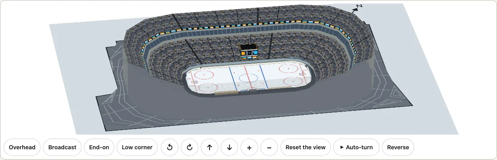

```ts
import { drawKyogijo } from "@johnmorrisdotca/kyogijo-stadiums";
import { buildTurn } from "@johnmorrisdotca/kyogijo-stadiums/turn";

const arena = { sport: "nhl", arena: "td-garden", crowd: { real: true } } as const;
const model = buildTurn(arena, { venue: { boards: { colors: ["#c8102e", "#ffffff"], pattern: "chevrons", score: [3, 2] } } });
console.log(model.planes.some((p) => p.kind === "ribbon"), model.planes.some((p) => p.kind === "hung-board"));
// true true
const plan = drawKyogijo({ ...arena, crowd: { real: true, boards: true } });
console.log(plan.includes("ky-cr-ribbon"), plan.includes("ky-cr-board"));
// true true
```

| Option | What it does |
| --- | --- |
| `boards` | `true` for both boards in the package's own colours, `false` for none, or an object: |
| `ribbon` | The ribbon boards. On by default. In 3D each is a strip of the suite level's wall under the next tier, 3.8 feet tall, a plane of its own (the walk below it is the walk less that strip); a venue with one level has its ribbon on the front of that level. In the plan it is a lit line along the front of each tier that has a walk below it. |
| `scoreboard` | The scoreboard over the surface: four faces with the score on each, a ring of display under them, a cap and a strut, hung 28 to 70 feet over the surface (a fifth of its longer side) and sized by it (an arena's is about 28 by 19 feet). A ballpark has none; a tournament hall has the layout's own scoreboards, so only ribbons. In 3D a score drawing's own scoreboard replaces it. |
| `colors` | One to three CSS colours (a hex, `rgb()`, `hsl()` or a name; anything else is ignored). The crowd's `home` and `away` where left out and the crowd has them, else amber, blue and white. |
| `pattern` | `bands` (the usual), `blocks`, `chevrons` or `waves`. |
| `score` | Home, then away, whole numbers 0 to 99. 0 and 0 by default. |

Where to say it: `crowd: { boards }` draws the plan and, in the 3D view, is read by the venue; `venue: { boards }` of the 3D view says the same and wins (`false` turns the crowd's off), and `turn.update(options, { venue: { boards } })` changes it while the view turns, without stopping it or sending it back. The same options work for the stadiums and Korakuen Hall, in a district (each venue has its own) and, as `stadium: { boards }`, round a tournament hall.

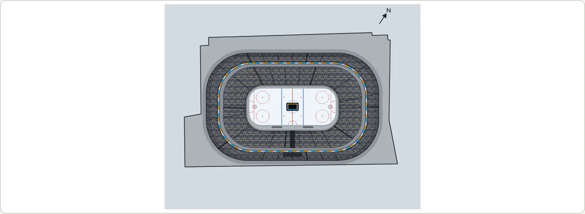

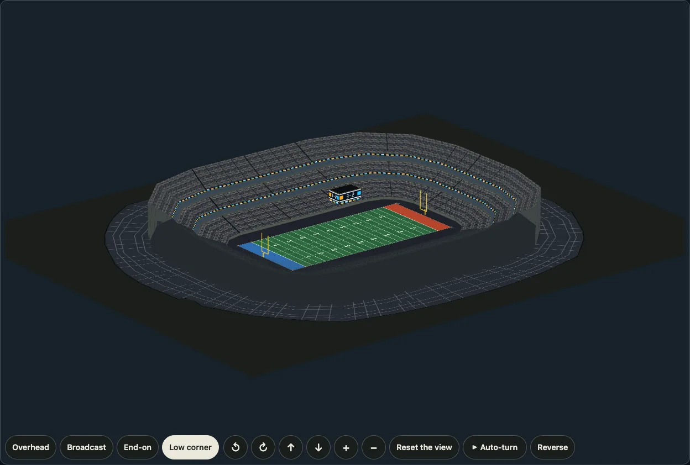

Every lit shape carries the class `u-led` in 3D (`ky-cr-led` in the plan), over the dark housing `u-led-bed`, so that a lighting layer can make the boards glow. The 3D view reads the venue's planes as kinds `ribbon` and `hung-board` (the uprights `ribbon-boards` and `hung-board`, said in words for a screen reader). The demo's [venues](https://johnmorrisdotca.github.io/kyogijo-stadiums/venues.html), [stadiums](https://johnmorrisdotca.github.io/kyogijo-stadiums/stadiums.html), [tournament layouts](https://johnmorrisdotca.github.io/kyogijo-stadiums/halls.html) and [district](https://johnmorrisdotca.github.io/kyogijo-stadiums/district.html) pages have an LED boards switch, kept in the address as `boards=1`.

## Night lighting

`lighting: "night"` lights a venue as at night (and [lights down](#lights-down) is a show's, with [more presets](#the-lighting-presets)): the house goes down, the playing surface stays lit, small lights show along the aisles and stairs, the [LED boards](#led-boards) glow, the exits are green and the windows, the coping and the lanes of the concourse are softly lit. It is off by default, and a drawing without it is exactly what it was. It is the first lighting of an option that later ones (a show's colours and washes) are added to: `lighting` is a preset name (`"night"`, `true` and `{ preset: "night" }` are the same, `"lightsDown"` the second, `false` none), or `{ preset, aisles, wash }`.

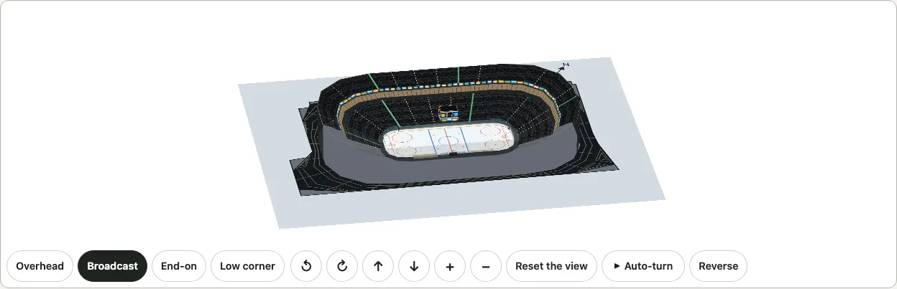

```ts
import { drawKyogijo } from "@johnmorrisdotca/kyogijo-stadiums";
import { buildTurn } from "@johnmorrisdotca/kyogijo-stadiums/turn";

const arena = { sport: "nhl", arena: "td-garden", crowd: { real: true } } as const;
const model = buildTurn(arena, { venue: { boards: true, lighting: "night" } });
console.log(model.lighting, model.planes.some((p) => p.id === "night-pool"));
// night true
const plan = drawKyogijo({ ...arena, crowd: { real: true, lighting: "night" } });
console.log(plan.includes('class="ky-crowd ky-night"'), plan.includes('class="ky-cr-pool"'));
// true true
```

What it is made of, so that it is cheap and nothing is worked out as the view turns: in 3D a veil over each plane of seats (`u-veil`), one flat plane on the floor round the surface (`night-pool`, a radial gradient that is clear over the middle, so that the markings stay as drawn), the aisle lines drawn as dotted lights (`ky-cr-aisle`) and every fourth, the vomitory, as a green exit light (`ky-cr-vom`), a halo under each lit board panel (`u-led-glow`), and the colours, which are custom properties of the view's root (`data-lighting="night"`: `--ky-night-aisle`, `--ky-night-exit` and `--ky-night-rim`, with the venue's own `--ky-cr-bed` and the rest set dark). The night rule sets the venue's colours itself, with more weight than the themes' rules, so the house is dark in the light theme and in the dark one, and the lights are at least seven to one against the seats in both. In the plan it is a veil over the stands (`ky-cr-veil`), the same lights and a pool of light round the surface; the boards are outside the dimmed group.

| Where | How |
| --- | --- |
| The plan | `crowd: { lighting: "night" }`. |
| The 3D view | `venue: { lighting: "night" }`, or the crowd's (the venue's wins, and `false` turns it off). `turn.update(options, { venue: { lighting } })` changes it while the view turns, without stopping it or sending it back. The root carries `data-lighting="night"`; `TurnModel.lighting` says it. |
| A district | `venue: { lighting }` of the 3D view, one pool of light to each venue. |
| A tournament hall | `stadium: { lighting }`, or `venue: { lighting }` in 3D. |
| The usual stands | The same: any `crowd` has it, not only a real building. |

The demo's venues page has a Lighting choice beside the LED boards button (see [the presets](#the-lighting-presets)), and the stadiums, tournament layouts and district pages the same as a choice in their controls; it is kept in the address as `lighting=night`.

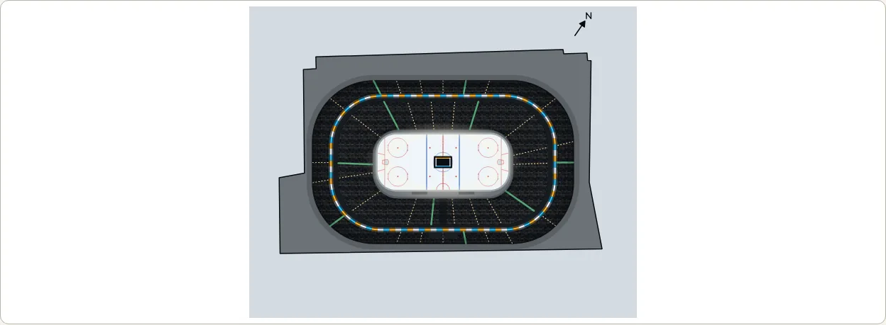

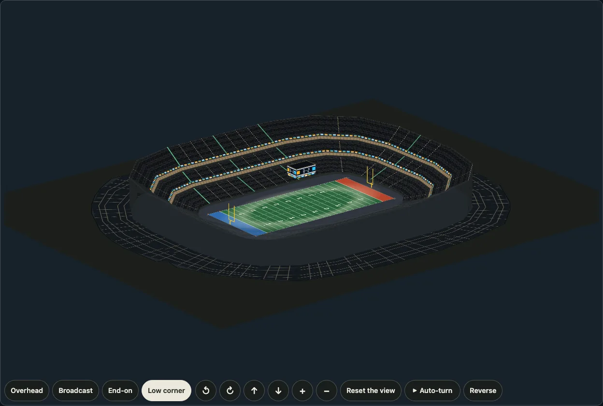

### Lights down

`lighting: "lightsDown"` is a show's house: nearly black, each stair aisle lit from above as a beam with a soft falloff on the steps either side (it lies in the plane of the seats, so it follows the tier's rake), thin lit rails beside it, the front of every step edged with light, and the boards still glowing. `wash` puts a colour of light on the playing surface, over the markings, which stay visible through it (it never takes more than half of the colour away from them); it works with `"night"` too, where the pool of light round the surface takes the colour as well. `aisles` is the colour of the beams. Both take a CSS colour or one of the named colours `LIGHT_COLORS` holds: `white` (the beams' default), `amber`, `purple`, `magenta`, `blue` and `cyan`; anything else is ignored.


```ts
import { buildTurn } from "@johnmorrisdotca/kyogijo-stadiums/turn";

const arena = { sport: "nhl", arena: "td-garden", crowd: { real: true } } as const;
const lit = buildTurn(arena, { venue: { lighting: { preset: "lightsDown", aisles: "blue", wash: "magenta" } } });
console.log(lit.lighting, lit.planes.some((p) => p.id === "light-wash"), lit.planes.some((p) => p.svg.includes("u-beam")));
// lightsDown true true
```

| Part | In 3D | In the plan |
| --- | --- | --- |
| The house | A heavier veil over the seats (`u-veil-down`), the venue's colours set darker still. | `ky-cr-veil-down` over the stands, the crowd group `ky-crowd ky-night ky-down`. |
| An aisle's beam | Three strokes of the aisle's line, wide and faint, narrower, and a bright core (`u-beam`), and two thin rails beside it; a vomitory has a broader beam. | The same strokes (`ky-cr-beam`). |
| A step's edge | A thin lit line along the front of each piece of a tier (`u-edge`). | A lit line along the front of each tier (`ky-cr-edge`). |
| The wash | One flat plane over the surface's box (`light-wash`), brighter over the middle (`WASH`), with the surface's rounded corners for a rink. | A rectangle over the surface (`ky-cr-wash`) in the same gradient. |

The demo's lighting choice has Lights down among its presets, and a choice of the colour of light on the surface beside it (purple, magenta, blue or white, over the preset's own; under Lights down the beams take a colour that goes with it); the address keeps them as `lighting=lightsDown` and `wash=purple`. An old address's `night=1` and `lights=1` still open the night and the lights down.

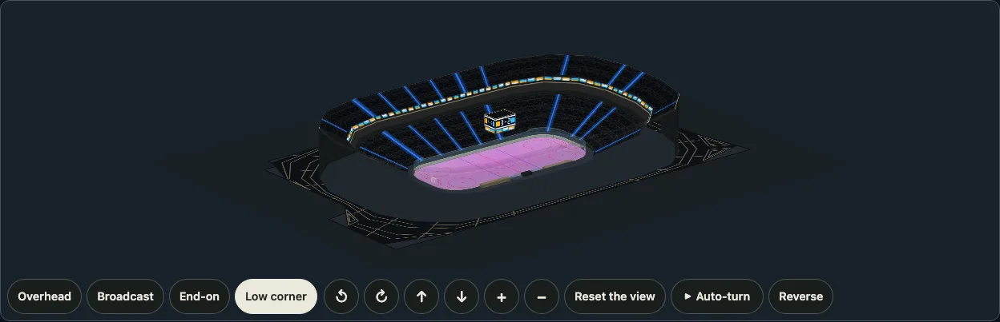

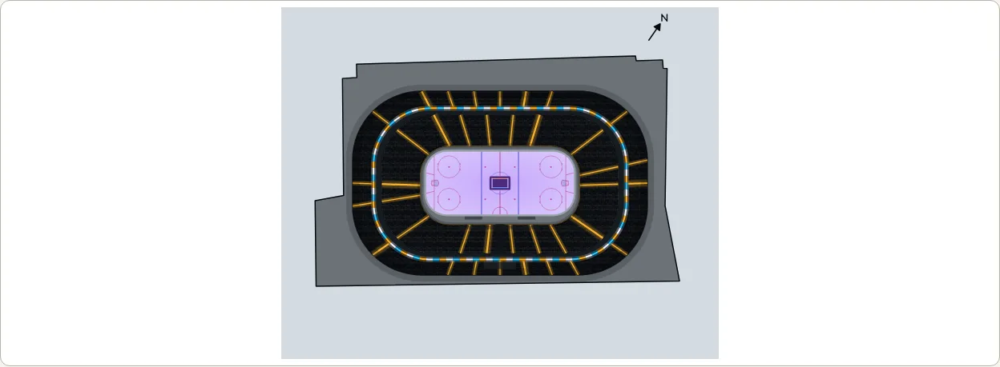

### The lighting presets

A preset is a name on the same `lighting` option, and a table of constants (`LIGHT_PRESETS`, with `LIGHTING_PRESETS` for the names and `LIGHT_COLORS` for the colours; and `resolveLighting`, all exported from the main entry and from `/turn`) says what each is made of: how dark the house is (`house`: `half`, `dim` or `dark`), how the aisles are lit (`aisles`: `none`, small `dots` or `beams`), whether a pool of light lies round the surface (`pool`), and the colours of the wash and the beams.

| Preset | The house | The aisles | The surface |
| --- | --- | --- | --- |
| `night` | dim | small lights, green exits | a pool of light round it |
| `game` | half lit (a light veil) | none | a pool of white light round it |
| `lightsDown` | dark | a white beam down each | as it is |
| `intro` | dark | a beam in the visitors' colour (the second colour) | a wash in the home team's colour |
| `concert` | dark | warm amber beams | a purple wash |

The `intro`'s colours are the teams' where the package has them: the crowd's `home` and `away`, else the colours of a score's two teams (`home.color`, `away.color`), else blue for the surface and amber for the beams. They can be passed: `lighting: { preset: "intro", colors: ["#c8102e", "#ffffff"] }` stands for the home team's colour and the visitors' (a colour that is not a colour is ignored), and `wash` and `aisles` win over everything, for any preset. The order is `wash`/`aisles`, then `colors`, then the teams, then the preset's own. `resolveLighting(option, team)` gives the answer, `{ preset, house, aisles, pool, beam, wash }`. (A `celebration`, colours chasing round the bowl, is to come.)

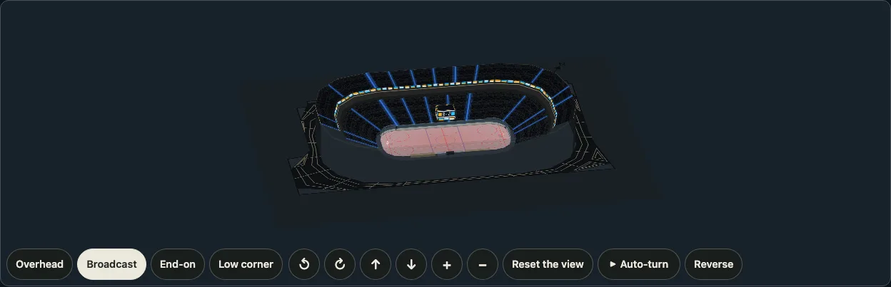

```ts
import { LIGHT_PRESETS, resolveLighting } from "@johnmorrisdotca/kyogijo-stadiums";

console.log(Object.keys(LIGHT_PRESETS).join(" "));
// night game lightsDown intro concert
const intro = resolveLighting({ preset: "intro", colors: ["#c8102e", "#ffffff"] });
console.log(intro?.wash, intro?.beam, intro?.house);
// #c8102e #ffffff dark
```

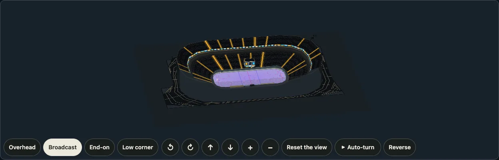

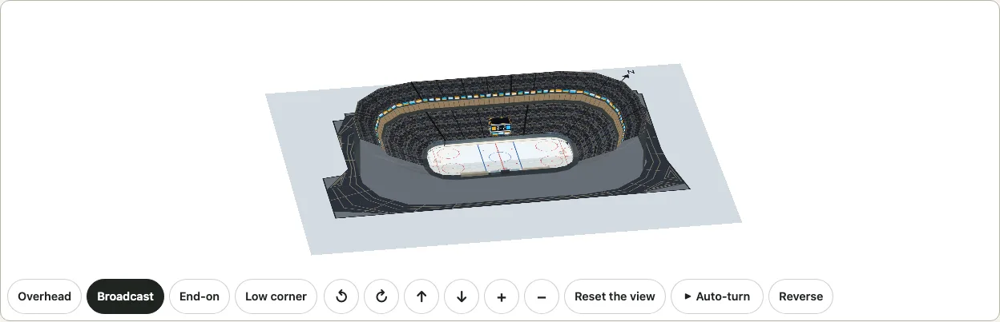

## How the rink's orientation is found

OpenStreetMap maps the ice inside three of these thirty-two buildings (TD Garden, the Xfinity Mobile Arena and PPG Paints Arena: `osm.ice` holds its outline), so their rinks lie as the ice does; for the other twenty-nine the rink's orientation is an inference from the building, and says so (`basis`):

- `mapped`: from the ice where OpenStreetMap maps it: a closed way (or a relation of one) tagged as an ice rink or a pitch of ice hockey, the size of a rink (1,000 to 2,600 square metres) with its middle inside the building, whose long side (at least 1.5 times its short side) gives the heading, and whose middle is the rink's. The Xfinity Mobile Arena's is a relation of one way named "Philadelphia Flyers Ice Rink" in OpenStreetMap.
- `building`: from the long axis of the building's main hall, which a rink usually follows. The main hall is the largest rectangle that fits inside the outline, over every direction three degrees apart; it does not see a wing, a plaza or a ramp that a rectangle cannot fill. It is said when the building has a direction (the largest rectangle in its best direction is at least 1.25 times the largest in its worst) and the hall is at least 1.1 times as long as it is wide.
- `none`: a round or squarish building has no direction, and nothing is said. Eleven buildings are drawn east-west with north at the top: the Scotiabank Saddledome, the Crypto.com Arena, the SAP Center, the Ball Arena, the Amerant Bank Arena, the Canadian Tire Centre, the Benchmark International Arena, the Scotiabank Arena, the Lenovo Center, Madison Square Garden and the Capital One Arena.

The middle of the rink is the middle of the main hall (or of the ice, where it is mapped). The stored axis is the result of `coreOf` on the stored outline, and a test recomputes it.

## Sources and licences

- **OpenStreetMap, ODbL 1.0, (c) OpenStreetMap contributors.** The outline, the height of the building where OpenStreetMap maps one, and the axis worked out from the outline are a derived database. They live only in `src/venues.osm.data.ts` and in `data-sources/venues/`, are never copied into a CC0 or CC BY-SA file of the package and no such file is copied into them, and are offered under the ODbL with the credit `VENUE_ATTRIBUTION` (`(c) OpenStreetMap contributors, ODbL 1.0, openstreetmap.org/copyright`). A drawing made from them is a produced work: it carries the credit and the description says so.
- **Wikidata, CC0.** The capacity (P1083, with the sport it applies to, P641) and the coordinates of each arena's item. Wikidata's figure for ice hockey is used where its item has one (Rogers Place, the Grand Casino Arena, the Bridgestone Arena; where it has two for different years, the later one: the Grand Casino Arena's 17,954 from 2012, not the 18,064 of 2000); elsewhere its one capacity is for another event or another year (the Saddledome's 16,605 are its 1983 seats) and is kept beside the figure used (`null` where the item gives none: the Little Caesars Arena's and the UBS Arena's).
- **English Wikipedia, CC BY-SA 4.0.** The seats for ice hockey where Wikidata has none for it, the number of seating levels and the kind of roof where an article says them, each with the article and the revision; the facts are numbers and words of ours, not the text. The articles are credited in [NOTICE.md](../NOTICE.md#the-venues-sources).
- **Raw answers** are kept as they were returned in `data-sources/venues/2026-10-20/` (`pnpm venues:fetch <date> <division>` fetches them: one request at a time, ten seconds apart, with a User-Agent that names the project; the files are `wikidata-<division>.json`, `wikipedia-<division>.json` and `osm-<arena>.json`). `pnpm venues` makes the two data files and the tables of this page and of NOTICE.md from them.

Neither Wikidata nor OpenStreetMap says how many seating levels an arena has or what shape its roof is, and no open dataset of arenas drawn as bowls was found (searches on 2026-10-20): OpenStreetMap has outlines, Wikidata capacities, and the seating charts that exist are the teams' and the ticket sellers', which are not used. So a number of tiers is `documented` only where an article says it and `plausible` (two bowls, a lower and an upper, as an arena of 17,000 seats usually has) where none does, and the table says which.

## Limits

- The orientation is mapped for three of the thirty-two, inferred for eighteen and not known for eleven.
- The outline is OpenStreetMap's: where it takes in a plaza or a wing of the building (Rogers Place's, the Crypto.com Arena's), so does the drawing, and the 3D walls and roof stand on the hall only.
- The tiers are fitted to the outline and the seats; real bowls have sections, overhangs and sightline corners that are not drawn, and their suite level is a plain wall of windows. The 3D heights are ours.
- The seats are the hockey configuration's, from the sources named; they change with a renovation (the Rogers Arena's 18,871 are its seats since 2018).

See also the [world venue checklist](./research/venue-checklist.md), which ranks the districts and single venues worth drawing next.
